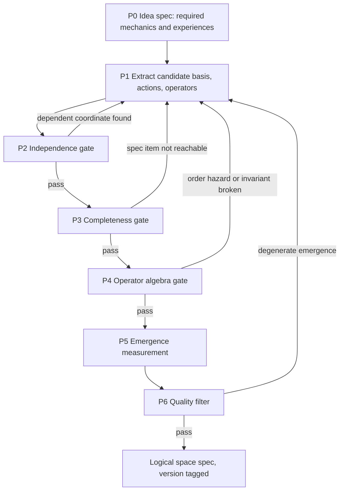
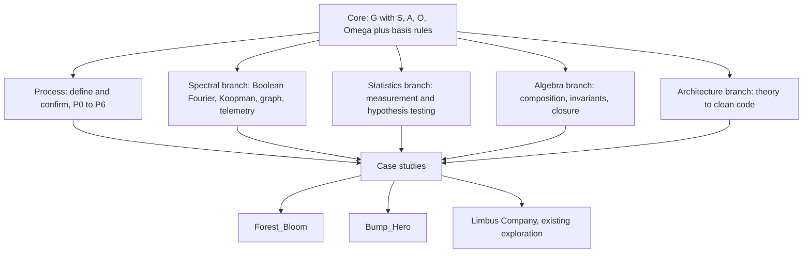

# Logical Space Base Theory — Discussion Record

> **Status:** Living discussion document. **Not an approved design.** Agreed points are marked; everything else is a proposal or an open question.
> **Compact core:** [Logical-Space-Base-Theory.md](../../../docs/theory/Logical-Space-Base-Theory.md), version v0.2. This record keeps the reasoning; the core file holds the current statement.
> **Started:** 2026-10-24. **Companion explainer:** [Logical-Space-Mathematical-Foundations.md](../../../docs/theory/Logical-Space-Mathematical-Foundations.md).
> **Builds on:** [decomposition playbook](../../playbooks/playbook-decompose-game-to-logical-space.md), model $\mathcal{G} = \langle \mathcal{S}, \mathcal{A}, \hat{\mathbb{O}}, \Omega \rangle$, and the [basis/operator separation rule](../../../.claude/rules/no-case-study-bias-and-basis-orthogonality.md).

---

## 1. Owner's Intent

In the owner's terms:

- Discover and build a **base theory of logical space** for games, inspired by the Fourier transform.
- From a set of **basis** elements, build a logical space that:
  1. makes the code **clean from the beginning**;
  2. is a **complete** base theory for the game;
  3. produces **emergent gameplay from the operators between basis elements**.
- Expand the base theory with further **branches**, for example **statistics**.
- Apply the theory to real games: **Forest_Bloom** and **Bump_Hero**.
- Owner confirmed Breath of the Wild's "chemistry engine" is roughly the intended picture: few properties, rules between them, many unscripted outcomes.

---

## 2. Agreed Points

| Ref | Point | Status |
|---|---|---|
| AG-1 | Keep Fourier's basis, span and independence ideas. **Drop linearity for operators**, because linear rules cannot produce emergence. Emergence lives in interaction terms. | **Agreed** 2026-10-24 |
| AG-2 | "Complete for all games" is not reachable. Completeness is defined **relative to one game idea's spec**. | **Agreed** 2026-10-24 |
| AG-3 | Basis independence needs a defined test. | **Agreed need**; process drafted in section 4, to research |
| AG-4 | Emergence needs a defined measurement. | **Agreed need**; process drafted in section 4, to research |
| AG-5 | **Resolution rule RF-5:** basis = coarsest level that generates every P0 mechanic plus target emergence, is perceivable and predictable by the player, and fits cost. Finer detail collapses into config parameters. | **Agreed** 2026-10-24 |
| AG-6 | **Basis ladder.** Grow a space from the smallest basis, one element or operator per rung, until the target interestingness appears. Mode A climbs with a **detector**, which recognizes the target in logs. Mode B derives the basis from a **spec**, which names the producing interaction terms. Rung history upgrades detector to spec. Owner practice: climb now; define interesting first whenever possible. Core section 4.1, principle L12. | **Agreed** 2026-10-24 |

---

## 3. Critical Point Raised: Three Different "Bases"

The word "basis" currently covers three different things. The theory must pick one as primary or define how they relate. This is a category check required by the separation rule.

| Candidate | Example, generic | Lives in | Is it state? |
|---|---|---|---|
| **State basis** | HP, position, moisture, burning flag | Coordinates of $\mathcal{S}$ | Yes |
| **Property vocabulary** | Flammable, conductive, heavy: BotW-style tags on content | Static config, or state if tags can change at runtime | Depends |
| **Action basis** | Move, place, attack, wait | Generators of $\mathcal{A}$ | No |

Operators are **never** basis elements. In BotW terms, "fire ignites flammable things" is an operator; "flammable" is a property; "is burning" is state.

**My guess, for the owner to correct:** the BotW-like emergence the owner wants comes from a small **property vocabulary** plus operators that read properties and write state. The state basis then follows mechanically from the playbook's save-game test.

### 3.1 Owner's Definition (2026-10-24)

In the owner's words: a basis element is **something base that cannot be divided further within the game's scope**. What causes emergence is **how elements interact with each other: the operators**. Fourier analogy given: basis = sine waves; operator = addition.

### 3.2 Refinements Proposed by the Assistant (not yet agreed)

| Ref | Refinement | Reason |
|---|---|---|
| RF-1 | In Fourier, the basis is indexed by **frequency only**; amplitude and phase form the **coefficient** $c_n = A e^{i\varphi}$. Game analog: basis element = element **type** (static config); coefficient = **instance parameters** (state). | Keeps type and instance separate, matching the state/config split |
| RF-2 | **Addition alone produces no emergence**: a sum of sines contains only its input frequencies. **Multiplication** does: $\sin a \sin b = \tfrac12[\cos(a-b) - \cos(a+b)]$ creates frequencies no input had. Emergence image: **an operator whose output has components outside its inputs.** | Makes AG-1 precise inside the owner's own analogy |
| RF-3 | "Indivisible" is relative to the operator set. Basis $B$ = **minimal generating set** under $\hat{\mathbb{O}}$: every game element is a composition of $B$ (generating), and no $b \in B$ is a composition of the others (minimal). | Gives P2 a precise target that works for nonlinear operators |
| RF-4 | With nonlinear operators, minimal generating sets **may not be unique and may differ in size**. "Dimension" of a game may be undefined; report the chosen basis, not a number. | Consistent with the no-sacred-numbers rule |

### 3.3 Depth of Decomposition (2026-10-24)

**Owner's principle:** the goal is not to simulate the real world. Fire and water can be divided further (owner's example: temperature, state of matter, H2O), but decomposition must stop where the basis is **simple enough to produce the emergence wanted**. No digging down to "string theory."

**Worked example, assistant's analysis:**

| Candidate | Verdict | Reason |
|---|---|---|
| Fire, water as basis | Too coarse | Steam, ice, extinguishing must each be hand-written |
| Substance type | **Basis**, static config | Carries effective parameters: boiling point, ignition point, conductivity |
| Temperature | **Basis**, state per instance | Cannot be computed from other coordinates |
| State of matter | **Derived**, fails T2.1 | Operator `phase(substance, T)` |
| Fire | **Derived** | Flammable substance above ignition point; combustion operator emits heat |
| Steam | **Derived** | Water instance above boiling point |

Operators: heat transfer, phase derivation, combustion. Emergent without enumeration: steam, ice, water extinguishing fire by absorbing heat, burning wood, melting metal.

| Ref | Proposal, not yet agreed | Analogy |
|---|---|---|
| RF-5 | **Resolution rule.** The basis is the coarsest level that (1) generates every P0 mechanic plus the target emergence, (2) the player can perceive and predict, (3) fits compute and code cost. Everything finer collapses into config parameters. | Physics: effective theory, lower scales become parameters. Fourier: bandlimit, keep only the frequencies needed |

### 3.4 Reference Game: Baba Is You (owner's reference, 2026-10-24)

Facts, from sources: began at Nordic Game Jam 2017, theme "Not There"; released 13 March 2019. First image was ice beside lava protected by "ICE IS NOT MELT." The designer, Arvi Teikari, chose that **objects have no default properties**: all behavior comes from rules. Rule words are pushable blocks, so moving them changes the rules. Combinations are not hardcoded; there are too many words for that. The hardest programming problem was **which rule wins when two conflict**, for example WALL IS STOP versus WALL IS DEFEAT. Sources: [Wikipedia](https://en.wikipedia.org/wiki/Baba_Is_You), [MCV/DEVELOP interview](https://mcvuk.com/when-we-made-baba-is-you/), [Gamereactor](https://www.gamereactor.eu/baba-is-you-lets-you-change-the-rules-of-the-game).

Mapping to $\mathcal{G}$, assistant's analysis. Property behavior for SINK and DEFEAT is from prior knowledge of the game, not from the sources above.

| Element | Baba Is You | Category |
|---|---|---|
| Nouns: BABA, WALL, ROCK, FLAG, LAVA, ICE | Entity types | Basis, static |
| Properties: YOU, WIN, STOP, PUSH, DEFEAT, HOT, MELT, SINK | Property vocabulary | Basis, static |
| Connectives: IS, AND, NOT, HAS | Grammar | Part of the fixed parser operator |
| Positions of all objects, including word blocks | Grid | State $\mathcal{S}$ |
| Active rule set | Parsed from word positions each turn | **Derived from state**, fails T2.1 |
| Parser and property interpreter | Fixed engine code | Operator, never changes |
| HOT with MELT on one tile destroys MELT; YOU with DEFEAT destroys YOU; SINK destroys both | Pairwise co-location rules | Operators, degree-2 interactions |
| YOU on WIN | Win condition | $\Omega$ |

Lessons for the base theory:

| Ref | Lesson |
|---|---|
| BB-1 | **No default properties** is the purest form of the owner's thesis: every behavior is basis plus operator. |
| BB-2 | **Rules as state.** The player edits which rules are active. This does not break the space/operator separation: the operator is a fixed interpreter; the active rule set is derived state it reads. Operators have two levels: fixed interpreter, variable rule data. |
| BB-3 | HOT with MELT is the same shape as burning with wet in the explainer: a degree-2 interaction term. |
| BB-4 | Rule conflict was the hardest engineering problem. This is gate P4: priority and order must be defined explicitly. |
| BB-5 | Assistant's interpretation: each level **restricts** the available words and layout so the emergent space forces one insight. Emergence supplies possibilities; level design curates them into progression. |

### 3.5 Parameter Sensitivity (owner's observation, 2026-10-24)

**Owner:** changing one small parameter can make the emergence very interesting or very boring. This happened in Forest_Bloom.

**Assistant's reading:** this is a **regime change**. Long-run behavior switches qualitatively at some parameter value: in dynamics, a bifurcation; in physics, a phase transition. Proposed tool: a **regime map**. Sweep parameters, classify each run's long-run behavior, and draw the regions. See explainer idea H.

| Ref | Proposal, not yet agreed |
|---|---|
| RS-1 | Every design parameter that affects emergence gets a regime map before tuning by hand. |
| RS-2 | Defaults sit inside the interesting region, with margin from its boundaries, unless the boundary is a deliberate player-facing lever. |
| RS-3 | "Interesting" and "boring" need operational definitions per game, agreed with the owner before measuring. |

### 3.6 What Makes Emergence Interesting (owner, 2026-10-24)

**Owner:** the "wow" moment is **when play changes**. Example: WALL IS YOU, and now you move the wall.

**Assistant's formalization, not yet agreed:**

| Ref | Proposal |
|---|---|
| IE-1 | **Interesting emergence changes the player's effective action space**, not only state values. After WALL IS YOU, the input operator acts on different entities; walls stop being obstacles; the reachable set changes. "More damage, same decisions" is boring emergence. |
| IE-2 | Mechanism: an operator **rebinds a role** to a different basis element. YOU moves from BABA to WALL. Same basis, new binding, new verbs. BotW parallel: burning grass makes an updraft, and the paraglider gains a new way to rise. |
| IE-3 | Candidate measure **M5 affordance shift**: compare before and after an emergent event: which entities respond to input, which moves are possible, the reachable state set, and the strong agent's strategy. Large shift means play changed. |
| IE-4 | Caution: not every play change is good. BABA IS WIN next to BABA ends the level instantly. P6 still filters trivializing shifts. |

### 3.7 Catalog of Interestingness Types (2026-10-24)

**Owner:** each game has its own interesting point. Forest_Bloom's is **adjusting parameters until ecological balance appears**. Gathering the interesting kinds into one catalog is a good idea.

**Consequence for the theory:** there is no single universal definition of "interesting." The core keeps a **catalog of interestingness types**, each with an operational test. Each game's P0 spec declares which types it targets.

| Type | Meaning | Example | Test | Status |
|---|---|---|---|---|
| I1 Affordance shift | Combination changes what the player can do | Baba Is You: WALL IS YOU | M5 | From owner, section 3.6 |
| I2 Dynamic balance | Parameters produce a sustained, diverse, non-collapsing system | Forest_Bloom ecological balance | Regime map: rich coexistence region; M4 | From owner |
| I3 Solution diversity | Many distinct ways to reach one goal | BotW chemistry puzzles | M2, M3 | Assistant's candidate |
| I4 Story emergence | Rule interactions produce memorable unscripted events | Dwarf Fortress, RimWorld | M2 plus human report | Assistant's candidate |
| I5 Strategic depth | No dominant strategy; skill keeps paying off | Chess, card games | P6 dominance test; skill-luck measure | Assistant's candidate |
| I6 Chain reaction | One action triggers a cascade of interactions | Bump_Hero: one shot ricochets through allies and chains their skills | M6 cascade profile | From owner, confirmed 2026-10-24 |

**M6 cascade profile, assistant's proposal.** Sample many actions, for example shot angle and force. Record cascade length: triggered interactions per action. Read:

- **Branching ratio** $m$ = mean number of new triggers each trigger causes. Galton–Watson branching process: $m < 1$ gives short cascades; $m$ near 1 gives a heavy tail of long ones; $m > 1$ explodes. Restitution, spacing and trigger radius tune $m$, so this connects to regime maps.
- **Skill expression:** long chains should be reachable by aiming, not by luck. Compare the chain length of the best found shot against random shots, and check how much chain length depends on the chosen shot.
- Caution: a heavy tail is a target to measure, not evidence of self-organized criticality.

Note on I2: in Forest_Bloom the interesting point lives in **parameter space**, the designer or observer tuning, rather than in player actions. The catalog must allow both.

Catalog is open: add a type only with an example game and a test.

---

## 4. Draft Process: Define and Confirm a Logical Space

**Proposal for discussion.** Each step has a gate. A gate produces evidence, not a claim.

### P0 — Idea Spec

Write the game idea as a numbered list of **required mechanics and experiences**: "player can extinguish fire with water," "economy must not snowball." This list is the completeness target from AG-2. Also declare which **interestingness types** from the section 3.7 catalog the game targets, with thresholds for their tests.

### P1 — Extract Candidates

Run playbook steps 1 to 5: raw mechanics inventory, state $\mathcal{S}$, actions $\mathcal{A}$, operators $\hat{\mathbb{O}}$, boundary $\Omega$. Separate state from static config.

### P2 — Independence Gate

Goal: every basis coordinate is a genuine degree of freedom.

| Test | Question | Method | Fails when |
|---|---|---|---|
| T2.1 Derivation | Can coordinate $x_k$ be computed from the others? | Inspect operators: is $x_k$ ever written except as a function of other coordinates? | A formula $x_k = g(\text{others})$ holds everywhere → derived value, remove from basis, compute on read |
| T2.2 Save-game minimality | If $x_k$ is dropped from the save, can the state be restored? | Drop it, reload, compare next ticks | Restored game behaves identically → redundant |
| T2.3 Reachable-set dependence | Is $x_k$ determined by the others in practice? | Sample reachable states by simulation; for discrete data, estimate conditional entropy $H(x_k \mid \text{rest})$; for continuous data, check functional dependence | $H \approx 0$ → dependent on the reachable set; review whether this is a design intent or a hidden coupling |
| T2.4 Category check | Is $x_k$ actually an operator or a parameter? | Separation rule | It is a formula, resolver or table |

Output: a basis table with one verdict per coordinate and the evidence.

Note: T2.3 can flag coordinates that are independent in principle but locked together by current rules. That is useful information, not automatically an error.

### P3 — Completeness Gate

Goal: the space spans the idea spec.

- Build a **coverage matrix**: rows are P0 items; columns are basis coordinates and operators.
- For each row, give a **witness**: an action sequence from a start state that produces the required mechanic, shown by construction or by recorded simulation.
- Row without a witness → gap: add a coordinate or an operator.
- Column used by no row → candidate for deletion (YAGNI), unless it supports another column.

### P4 — Operator Algebra Gate

See explainer section 8.

- Read/write table for every operator.
- Commutator tests on sampled states for every pair that shares a written coordinate, or where one reads what the other writes.
- Declared invariants checked as property tests.
- Closure: valid state in, valid state out; bounds and finiteness.

### P5 — Emergence Measurement

Candidate measures, to validate (AG-4):

| Measure | Definition | Source |
|---|---|---|
| M1 Interaction share | Fraction of outcome variance from interaction terms: Boolean Fourier weight on degree 2 and above, or $1 - \sum_i S_i$ | Explainer sections 3 and 4 |
| M2 Novel outcomes | Distinct outcome classes reached in simulation that are not listed in P0 | Simulation logs |
| M3 Strategy diversity | Entropy of the strategy distribution among strong agents | Explainer section 9 |
| M4 Dynamic modes | Cycles and growth modes from DMD on key observables | Explainer section 5 |
| M5 Affordance shift | Change in the effective action space after an emergent event: entities that respond to input, possible moves, reachable set, strong-agent strategy | Section 3.6, owner's "play changes" criterion |

**Validation plan for the measures themselves:** apply them to reference systems where emergence is uncontroversial (a chemistry-style rule set) and to deliberately additive systems. A good measure separates them. Until that is done, M1 to M4 are hypotheses.

### P6 — Quality Filter

Emergence is necessary, not sufficient. Reject or redesign on:

- dominant strategy: win rate beyond all others, outside confidence intervals;
- softlock or unreachable win;
- runaway growth, or a DMD eigenvalue modulus above 1, where the spec requires balance;
- invariant violation;
- fake choice: options whose outcome difference is negligible.

Human playtest remains a separate evidence layer after P6.

---

## 5. Branches of the Base Theory

Proposed structure. The core stays small; branches attach downstream, following the pattern of the [Big Five sandbox](../../../docs/explorations/big-five-logical-projection/README.md).

---

## 6. Case-Study Plan

- **Forest_Bloom deep discussion is deferred** until the theory adoption in that project is done (owner, 2026-10-24). Its parameter-sensitivity example, section 3.5, waits for that session.
- Neither Forest_Bloom nor Bump_Hero source has been inspected in this discussion. Read actual source and local instructions first.
- **Anti-bias:** derive each game's basis independently with the same process. Then compare. What recurs across games is a candidate for the core theory; what does not stays in the case study.
- Forest_Bloom fits the dynamics tools: grid, ticks, ecosystem; ideas C and D.
- Bump_Hero: first-pass decomposition from source at [docs/explorations/bump-hero-logical-space/README.md](../../../docs/explorations/bump-hero-logical-space/README.md). Turn-based physics flick roguelike; tests open problem 6 through its continuous shot vector.

---

## 7. Open Questions for Discussion

1. Which "basis" is primary: state, property vocabulary, or both with a defined relation? (Section 3.)
2. What is Bump_Hero: genre, core loop, current state?
3. Which case study goes first through P0 to P6?
4. ~~Should the core theory get its own canonical file?~~ Done: `docs/theory/Logical-Space-Base-Theory.md`, v0.2. Still open: moving the Big Five sandbox pin from v0.1.
5. How much tooling is acceptable: a headless simulation harness per game is needed for P2.3, P3 witnesses, P5 and P6.
6. Which emergence measure, M1 to M4, matters most to the owner's sense of "emergent gameplay"?
7. **Detector for I2 dynamic balance** (next, per AG-6): what log signal says "balance happened"?
8. Theory gaps from the Forest_Bloom review, not yet discussed: **T2** config versus action in sandboxes, where tuning parameters is the player's action; **T3** no observation map Y in the model, so L4 perceivability is untestable; **T4** minimality needs a usefulness test, such as ablation.

---

## 8. Change Log

| Date | Change |
|---|---|
| 2026-10-24 | Created. Recorded intent, AG-1 to AG-4, three-basis critical point, draft P0 to P6 process, branch map, open questions. |
| 2026-10-24 | Added owner's basis definition, section 3.1, and assistant refinements RF-1 to RF-4, section 3.2. |
| 2026-10-24 | Added depth-of-decomposition principle, substance and temperature example, RF-5 resolution rule, section 3.3. |
| 2026-10-24 | RF-5 agreed as AG-5. Added Baba Is You analysis, section 3.4, and parameter sensitivity, section 3.5. |
| 2026-10-24 | Forest_Bloom deferred until adoption. Added owner's "play changes" criterion and IE-1 to IE-4, section 3.6; candidate measure M5. |
| 2026-10-24 | Interesting is game-specific; added interestingness catalog I1 to I5, section 3.7; P0 declares target types. |
| 2026-10-24 | Bump_Hero first-pass decomposition; owner confirmed its interesting moment; added I6 chain reaction and M6 cascade profile. |
| 2026-10-24 | Compacted into core file v0.2; playbook updated to v2. Testing deferred until Bump_Hero adoption completes. |
| 2026-10-24 | Forest_Bloom review against v0.2 (read-only): strong P4 engineering; no action space, I2 not reached, internal state invisible, likely over-resolved. Owner parked Forest_Bloom during its migration; theory gaps T1 to T4 raised; T1 agreed as AG-6, core v0.2.1. |
