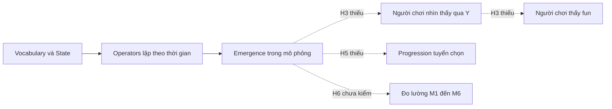
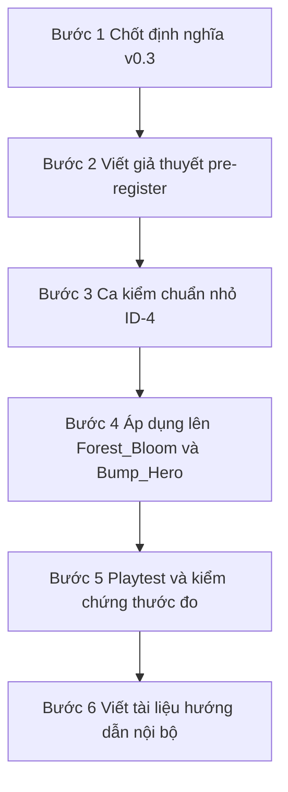

# Logical Space Theory — Phản Biện, Ý Tưởng và Lộ Trình Thành Nghiên Cứu

> **Trạng thái:** Tài liệu thảo luận sống. **Không phải thiết kế đã duyệt.** Mỗi mục ghi rõ: *Đã vá* (đã sửa vào core v0.3-draft), *Đề xuất*, *Mở*, hoặc *Đã thống nhất*.
> **Bắt đầu:** 2026-11-03. **Core:** [Logical-Space-Base-Theory.md](../../../docs/theory/Logical-Space-Base-Theory.md) v0.3-draft. **Hồ sơ trước:** [2026-10-24 discussion record](2026-10-24-logical-space-base-theory.md).
> **Ngôn ngữ:** Thảo luận bằng tiếng Việt (chủ dự án yêu cầu 2026-11-03). Tài liệu tiếng Anh (core, playbook, explainer) giữ tiếng Anh (Q1, đã trả lời).

---

## 1. Mục Đích (lời chủ dự án)

Biến Logical Space Base Theory thành **một nghiên cứu thật**: rõ ràng, chặt chẽ logic, áp dụng được thực tế.

| Người đọc | Cần gì |
|---|---|
| Chủ dự án, khi làm game tiếp theo | Quy trình dùng được ngay, ra quyết định cụ thể |
| Designer khác | Khái niệm dễ hiểu, ví dụ, so sánh với công cụ quen thuộc |
| Reviewer bài báo | Định nghĩa chặt, so sánh với nghiên cứu trước, giả thuyết có thể bác bỏ, bằng chứng |

**Hiện trạng (chủ dự án, 2026-11-03):** chủ yếu là ý tưởng trên giấy. Chỉ Forest_Bloom áp dụng: phía mô phỏng trở nên khá thú vị, nhưng cần nhiều tuning và luật để thật sự "fun". Fun mong muốn: cân bằng tự nhiên + phản ứng dây chuyền giữa các loài cây; người chơi **gieo hạt và chỉnh gene**, rồi xem rừng phản ứng.

---

## 2. Các Lỗ Hổng (Phản biện 2026-11-03)

Chuỗi cũ dừng ở "Emergence trong mô phỏng". Mọi thứ sau đó là chỗ hổng.

### H1. "Tương tác = emergence" là sai — nghiêm trọng nhất

| | Nội dung |
|---|---|
| Vấn đề | L6 cũ: emergence = operator có số hạng tích. Nhưng HOT×MELT là tích mà designer **viết tay**, không có gì bất ngờ |
| Lý lẽ | Emergence đến từ **lặp operator theo thời gian và không gian**: lửa lan, đun nước, hơi chặn đường. Một số hạng tương tác là điều kiện cần, chưa đủ |
| Định nghĩa tốt hơn | Bedau, *weak emergence*: kết quả vĩ mô suy ra được từ vi mô **nhưng chỉ bằng cách chạy mô phỏng** |
| Hệ quả | M1 (tỉ lệ phương sai từ tương tác) đo sai thứ; còn phụ thuộc phân phối đầu vào và cách chọn tọa độ |
| Trạng thái | **Đã thống nhất AG-7** (2026-11-03): L6 mới thu hẹp AG-1. M1 thêm cảnh báo |
| Mở | Đo "chỉ tìm được bằng mô phỏng" thế nào? Ý tưởng: so dự đoán của designer (viết trước, L14) với kết quả chạy; phần lệch = emergence |

### H2. "Basis" chưa được định nghĩa chặt

| | Nội dung |
|---|---|
| Vấn đề | L2 cũ: mọi phần tử là "tổ hợp" của basis — nhưng "tổ hợp" chưa định nghĩa. Operator biến state thành state, không ghép phần tử thành phần tử |
| Ba nghĩa lẫn lộn | State basis; vocabulary thuộc tính (BotW: flammable); action basis. Câu hỏi mở số 1 từ 2026-10-24 |
| Fourier gãy | Basis Fourier **biểu diễn** một tín hiệu. Basis game **sinh ra** nhiều nội dung và lịch sử chơi — giống ngữ pháp hoặc cellular automaton hơn không gian vector |
| Trạng thái | **Đã vá**: thêm $\mathcal{V}$ vào mô hình; L2 định nghĩa lại bằng P3 witness + ablation (T4); ghi rõ giới hạn analogy Fourier |
| Mở | ~~Basis tối thiểu có duy nhất không?~~ **Đã thống nhất AG-10** (2026-11-03): không chứng minh; dùng quy tắc chọn trong L3: (1) người chơi thấy và hiểu, (2) ít toán tử hơn, (3) dùng lại code; ghi lý do |

### H3. Không có người chơi trong mô hình

| | Nội dung |
|---|---|
| Vấn đề | Không có bản đồ quan sát $Y$ (T3), không có mental model, không có vòng học của người chơi |
| Bằng chứng | Forest_Bloom: trạng thái nội A, V, C, W, D, Ex điều khiển mọi thứ; màn hình chỉ thấy DRY/WET, màu loài, 3 giai đoạn |
| Nghiên cứu trước | Wright và Hopkins: "sản phẩm thật là mental model trong đầu người chơi". Cook skill atom: action → simulation → feedback → model |
| Trạng thái | **Đã vá**: mô hình thêm $Y$ và vòng mental model; L13; cổng P7; thuật ngữ meta-action (T2) |
| Mở | ~~P7 đo "fun" bằng gì?~~ **Đã thống nhất AG-11** (2026-11-03): (1) chơi tiếp không — số phút tự chơi thêm; (2) kể lại — đo legibility; (3) IMI chỉ khi so phiên bản |

### H4. Lý thuyết không thể sai (không bác bỏ được)

| | Nội dung |
|---|---|
| Vấn đề | Interestingness do từng game tự định nghĩa, detector cũng vậy → kết quả nào cũng giải thích được sau khi xảy ra |
| Trạng thái | **Đã vá**: L14 pre-register; định vị lại lý thuyết là **phương pháp thiết kế có giả thuyết kiểm chứng được**, không phải "lý thuyết của mọi game" |
| Mở | Danh sách giả thuyết chính thức — xem mục 4 |

### H5. Chỉ có emergence, không có progression

| | Nội dung |
|---|---|
| Vấn đề | Juul: emergence vs progression. Cook: loops vs arcs. Lý thuyết không có chỗ cho màn chơi, unlock, mục tiêu — trong khi bài học Baba BB-5 nói level mới là thứ tuyển chọn emergence |
| Trạng thái | **Đã vá**: thuật ngữ progression structure; L15; P0 yêu cầu phác progression |
| Mở | Forest_Bloom là sandbox: progression của nó là gì? Mở khóa gene? Thử thách khí hậu? |

### H6. Thước đo chưa được kiểm chứng

| | Nội dung |
|---|---|
| Vấn đề | M1 đến M6 chưa từng đối chiếu với cảm nhận người chơi |
| Mẫu có sẵn | Browne, Ludi: 57 thước đo tự động từ self-play, đối chiếu xếp hạng người chơi, giữ 16 cái dự đoán được chất lượng |
| Trạng thái | **Đã vá**: thêm đoạn "Validating the measures" vào core mục 6 |
| Mở | Cần bao nhiêu game/biến thể và bao nhiêu người chơi? Nguồn người chơi ở đâu? |

### 2.1 Áp dụng v0.3 lên Forest_Bloom (đang thảo luận)

| Khía cạnh | Ý định gốc (chủ dự án) | Engine hiện tại (kiểm toán 2026-10-24) | Nhận xét (trợ lý) |
|---|---|---|---|
| Thể loại | Hyper casual puzzle | Sandbox hệ sinh thái mô phỏng sâu | Lệch thể loại |
| Mục tiêu thú vị | I6 chain reaction, kiểu Candy Crush | I2 cân bằng động | Mục tiêu chính đã trượt từ I6 sang I2 |
| Người chơi đọc được | Hyper casual cần hiểu trong vài giây | Trạng thái ẩn A, V, C, W, D, Ex quyết định mọi thứ | Vi phạm L13 nặng nhất ở thể loại này |
| Số tham số | Ít, luật đơn giản | Hơn 100 tham số ghép nối | Quá mịn (cạm bẫy 5) |
| Progression | Level có điều kiện khác nhau, hoặc endless | Không có | Thiếu L15 |

**Làm rõ của chủ dự án (2026-11-03):**
- Cân bằng **sinh ra trong quá trình phát triển** và là **bắt buộc**: thiếu nó, 1–2 loài chiếm toàn bản đồ, rất nhàm. "Nhiều loại cây để làm gì khi nó không visualize được và không thể tồn tại?"
- **Cân bằng không phải mục tiêu; nó là điều kiện để các loài cây có ý nghĩa.**
- Mục tiêu hiện tại **không còn là hyper casual chain reaction đơn giản**; vẫn học hỏi những gì dùng được từ nó.

→ Hệ quả lý thuyết: xem ý tưởng ID-6 (mục 3). Câu hỏi mở: mục tiêu hiện tại của Forest_Bloom là gì (Q4b).

### 2.2 Định Hướng Forest_Bloom (trợ lý đề xuất, chờ chủ dự án)

Chủ dự án chưa biết game sẽ đi về đâu vì xây từ dưới lên. Những gì đã biết: người chơi **gieo hạt, chỉnh gene**; thú vị là **phản ứng dây chuyền giữa các loài**; **cân bằng là điều kiện sống còn** (ID-6).

| Hướng | Game tham chiếu | Vòng chơi | Hợp với engine hiện có | Rủi ro |
|---|---|---|---|---|
| **A. Puzzle phục hồi theo level** | Terra Nil, Cloud Gardens | Mỗi level là một vùng đất hỏng; số hạt giới hạn; mục tiêu: N loài cùng sống, phủ X% | Cao: độ ẩm, lây lan, cạnh tranh dùng lại được | Phải thiết kế level; luật phải đọc được |
| B. Đặt ô endless | Dorfromantik, Islanders | Rút hạt ngẫu nhiên, đặt lên lưới; điểm theo láng giềng; chơi tới khi hết chỗ | Thấp: bỏ phần lớn mô phỏng | Mất chiều sâu sinh thái |
| C. Sandbox thiết kế gene | The Sapling, SimLife | Thiết kế loài, thả vào, xem hệ chạy; kịch bản thử thách | Rất cao: gần engine hiện tại nhất | Chính là chỗ "thú vị nhưng chưa fun" hiện nay |

**Đề xuất: A làm khung, mượn gene của C làm progression.**

- **Chain reaction = diễn thế sinh thái (ecological succession).** Cây tiên phong cải tạo đất → loài ưa bóng mọc được → rừng già. Đây là phản ứng dây chuyền **theo thời gian**, có thật trong tự nhiên, và là I6 + AG-7 đúng nghĩa: luật cục bộ đơn giản lặp lại tạo làn sóng không ai viết tay.
- **Khoảnh khắc wow:** gieo đúng một hạt ở đúng chỗ, xem làn sóng diễn thế lan khắp bản đồ.
- **Cân bằng:** điều kiện thắng hoặc điều kiện sống còn của level (ID-6), không phải thứ người chơi tune hàng giờ.
- **Gene:** meta-action **giữa các level**. Lai hoặc chỉnh gene để mở loài mới giải được biome khó hơn. Progression (L15) = biome mới với điều kiện khác (khô, lạnh, mặn).
- **Đọc được (L13):** mỗi biến ẩn quyết định kết quả phải có hình ảnh (màu đất, bóng râm). Bài học Cloud Gardens: được khen về mood, bị chê vì luật không rõ. Dev Cloud Gardens cũng phải **trao cho người chơi quyền điều khiển sự phát triển** mới làm được puzzle.
- **Engine cũ là kho linh kiện:** chỉ lấy toán tử nào level cần (thang basis, AG-6).

**Phản hồi của chủ dự án (2026-11-03):** "Có tiềm năng hơn rồi." A và C liên hệ chặt chẽ, **C bao trùm A** → phát triển **song song** trong Forest_Bloom. Thích game tham chiếu **Terra Nil**.

**FB-1 (đã thống nhất hướng):** Forest_Bloom = một không gian luật chung (C, sandbox gene) + chế độ level phục hồi (A, kiểu Terra Nil) là **các lát cắt được tuyển chọn** của không gian đó. Đúng L15: C cung cấp nổi sinh, A tuyển chọn thành progression. Tiền lệ: Cloud Gardens và The Sapling đều có campaign/kịch bản + sandbox trên cùng engine.

**Rào chắn (trợ lý đề xuất):** làm song song dễ tái diễn trôi dạt từ dưới lên. Giữ: (1) một vocabulary $\mathcal{V}$ chung cho cả hai chế độ; (2) mỗi level A đóng vai **detector cụ thể** cho C — level không giải được thì luật của C còn thiếu hoặc thừa; (3) luật mới chỉ thêm khi một level cần nó (thang basis).

### 2.4 Điều Kiện Sống Còn của Forest_Bloom: Ẩn Bên Dưới, Hiện Ra Đơn Giản (Q6, đang thảo luận)

**Chủ dự án (2026-11-03):** nhàm "ngay từ khi một loài đã chiếm gần như toàn bộ số lượng cây + trên 12 cây". Các điều kiện số liệu khó thể hiện trong gameplay → **giữ toàn bộ criteria nhưng ngầm bên dưới; người chơi chỉ thấy 1, cùng lắm 2 tham số + visual.**

**Tầng ẩn (designer, phép kiểm P6, ghi trước theo L14):**

| Điều kiện | Giá trị nháp |
|---|---|
| Độc chiếm | Một loài ≥ khoảng 90% số cây **và** tổng số cây > 12 → vi phạm (quần thể nhỏ ≤ 12 cây được miễn) |
| Đa dạng | Còn ≥ k loài sống — k chưa chốt |
| Bền | Đúng suốt W tick cuối — W chưa chốt |
| Ổn định qua seed | Đạt ở ≥ q% seed — **chỉ dùng khi thiết kế level, không hiện cho người chơi** |

**Tầng hiện (người chơi, qua $Y$), trợ lý đề xuất:**

| Tín hiệu | Là gì | Visual |
|---|---|---|
| 1. **Đa dạng sống** | Số loài hiệu dụng (Hill number bậc 1 = $e^{H}$, $H$ là entropy Shannon của tỉ lệ loài). 1 = độc canh; bằng số loài khi các loài đều nhau. Gộp "đa dạng" và "không độc chiếm" vào **một con số** | Độ rực màu của cả khu rừng: độc canh → bản đồ nhạt dần, xám; đa dạng → khảm nhiều màu. Có thể thêm một dải lá nhỏ ở góc màn hình |
| 2. **Xu hướng** | Đa dạng sống đang tăng hay giảm trong W tick gần nhất. Thay cho "Bền" | Mũi tên hoặc nhịp đập; khi một loài sắp độc chiếm, vùng của nó **lan màu rõ** và viền nhấp nháy cảnh báo |

**Vì sao hợp lý:** đây chính là thiết kế $Y$ (L13): nén nhiều biến ẩn thành ít tín hiệu nhìn thấy. Hill number là chỉ số đa dạng chuẩn trong sinh thái học (Jost 2006, *Entropy and diversity*, Oikos), đọc được theo nghĩa đời thường: "rừng này tương đương có mấy loài". Terra Nil cũng hiện tiến độ phục hồi bằng một thanh đơn giản và sự thay đổi màu bản đồ.

**Chủ dự án duyệt (2026-11-03):** hình ảnh "rừng nhạt dần khi độc canh, rực màu khi đa dạng" đúng cảm giác mong muốn. Nguyên tắc nén $Y$ **đã thống nhất AG-9 → core L17**: điều kiện sống còn hay mục tiêu cần người chơi cảm nhận → $Y$ nén thành 1–2 tín hiệu có hướng + visual; ngưỡng chi tiết ở tầng ẩn. Còn mở: giá trị k, W, q.

### 2.3 Khoảnh Khắc Mục Tiêu của Forest_Bloom (bản nháp P0, chờ chủ dự án duyệt)

**Lời chủ dự án:** thích nhất ở Terra Nil là *"chuỗi phục hồi lan ra khi đặt công trình đúng chỗ"*.

| Thành phần P0 | Nội dung (nháp) |
|---|---|
| Mục tiêu thú vị | **I6 chain reaction** — gieo hạt đúng chỗ → làn sóng phục hồi/diễn thế lan ra |
| Biểu hiện kỹ năng | "Đúng chỗ" phải quan trọng: chuỗi từ vị trí tốt nhất dài hơn hẳn vị trí ngẫu nhiên (M6: best vs random) |
| Điều kiện sống còn (ID-6) | Nhiều loài cùng tồn tại; không loài nào chiếm toàn bản đồ |
| Vòng người chơi | Nhìn bản đồ → chọn hạt và vị trí → xem làn sóng lan → hiểu vì sao lan/dừng → gieo tiếp |
| Đọc được (L13) | Nguyên nhân lan (đất, ẩm, bóng) và hệ quả (loài mới mọc) phải thấy được |
| Progression (L15) | Level A: biome và điều kiện khác nhau; gene (meta-action) giữa level; sandbox C mở toàn bộ |

**Trạng thái:** **Chủ dự án duyệt bản nháp P0** (2026-11-03): "đúng hết rồi".

**Điểm khác Terra Nil (trợ lý nhận xét):** chuỗi của Terra Nil phần lớn là **luật bán kính viết tay** (đặt công trình → vùng xung quanh đổi). Theo AG-7, đó gần với nội dung hơn là nổi sinh. Forest_Bloom có thể vượt lên: làn sóng lan bằng **luật cục bộ lặp lại** giữa các loài (diễn thế), nên mỗi lần gieo có thể cho kết quả khác và không ai viết tay trước.

Nguồn: [Terra Nil, Science Friday](https://www.sciencefriday.com/segments/video-game-environment/), [Terra Nil review](https://gameluster.com/review-terra-nil-rebuilding-the-planet-from-the-ground-up/), [Cloud Gardens, Game Developer](https://www.gamedeveloper.com/game-platforms/getting-tangled-up-in-the-beautiful-landscapes-of-cloud-gardens), [Cloud Gardens review](https://godisageek.com/reviews/cloud-gardens-review/), [Dorfromantik](https://en.wikipedia.org/wiki/Dorfromantik), [The Sapling](https://store.steampowered.com/app/997380/The_Sapling).

Candy Crush là ví dụ đẹp cho AG-7: luật cục bộ đơn giản (khớp 3 + rơi xuống) **lặp lại** → cascade không ai viết tay. Level chỉ đổi bàn cờ, mục tiêu, số nước — đúng L15.

---

## 3. Ý Tưởng Phát Triển (Đề xuất, chưa thống nhất)

| ID | Ý tưởng | Lý do |
|---|---|---|
| ID-1 | **Emergence = khoảng cách dự đoán.** Trước khi chạy, designer ghi dự đoán kết quả; emergence = những gì xảy ra mà không có trong dự đoán | Biến weak emergence thành thứ đo được, khớp L14 |
| ID-2 | **Regime map là sân chơi của sandbox.** Với Forest_Bloom, chỉnh gene = di chuyển trên regime map. Fun = người chơi thấy mình đẩy hệ qua ranh giới cân bằng/sụp đổ | Nối T2, L10 và fun của chủ dự án |
| ID-3 | **Bảng perceivability bắt buộc**: mỗi sự kiện mục tiêu → nguyên nhân nhìn thấy ở đâu, hệ quả nhìn thấy ở đâu | Làm L13 kiểm tra được trên giấy, trước playtest |
| ID-4 | **Game đồ chơi tham chiếu** (một sandbox nhỏ cỡ cellular automaton) làm bài kiểm chuẩn cho toàn bộ quy trình P0 đến P7 | Reviewer cần một ca trọn vẹn, nhỏ, tái lập được |
| ID-6 | **[Đã thống nhất AG-8, 2026-11-03 → core L16]** **Tách "mục tiêu thú vị" khỏi "điều kiện sống còn" (viability condition).** Có những tính chất không phải cái người chơi tận hưởng, mà là điều kiện để cái thú vị **có thể tồn tại**: cân bằng loài để nhiều loài có ý nghĩa (Forest_Bloom); bàn cờ luôn còn nước đi (Candy Crush). Điều kiện sống còn đi vào P0 như **ràng buộc bắt buộc** và P6 kiểm tra như bất biến; mục tiêu thú vị đi vào P5 và P7. I2 có thể chuyển thành điều kiện sống còn trong Forest_Bloom, và chỉ là mục tiêu ở game mà chính sự cân bằng là trải nghiệm | Từ lời chủ dự án 2026-11-03: "cân bằng không phải mục tiêu, nó là điều kiện để các loại cây có ý nghĩa" |
| ID-7 | **Tìm level A bằng máy, designer tuyển chọn.** Chủ dự án lo (2026-11-03): nổi sinh làm Forest_Bloom hay hơn Terra Nil nhưng khó hơn, vì phải chạy rất nhiều mô phỏng C để tìm bộ level A phù hợp. Đề xuất: pipeline **quality-diversity (MAP-Elites)**: sinh level ứng viên (bản đồ, hạt cho phép, mục tiêu) → mô phỏng gieo ngẫu nhiên và gieo tốt nhất → giữ level qua điều kiện sống còn (ID-6) và có khoảng cách kỹ năng M6 lớn → xếp vào lưới đa dạng theo đặc trưng (độ khó biome, độ dài chuỗi, số loài cần) → designer chọn và chỉnh tay. Mô phỏng rẻ nhờ C giữ nhỏ (thang basis); Forest_Bloom đã có headless sim, ablation, `SimClosure`. Biến chi phí mô phỏng thành công cụ thiết kế. **Chủ dự án chọn dạng Hybrid** (2026-11-03): máy tìm, designer chọn, sửa, khóa ô, máy tiếp tục từ bản sửa — mô hình gần nhất: Interactive Constrained MAP-Elites (Alvarez và cs. 2019). Tài liệu: [docs/research/quality-diversity-level-generation/](../../../docs/research/quality-diversity-level-generation/README.md), tổng hợp tiếng Anh [QD-Level-Generation-Synthesis.md](../../../docs/research/quality-diversity-level-generation/QD-Level-Generation-Synthesis.md) | [Gravina và cs., PCG through QD](https://mail.antoniosliapis.com/articles/pcgqd.php); [Khalifa, Constrained MAP-Elites](https://um.edu.mt/library/oar/handle/123456789/82006); [Fontaine và cs., Mario](https://arxiv.org/abs/2007.05674v2); Isaksen, biến thể Flappy Bird |
| ID-5 | Tách core thành hai tầng: **Ontology** (V, S, A, O, Ω, Y — chặt, hình thức) và **Phương pháp** (ladder, gate, đo lường — thực dụng) | Reviewer đánh giá từng tầng riêng; designer chỉ cần tầng 2 |

---

## 4. Lộ Trình Thành Nghiên Cứu (Đề xuất)

**Tiến độ (2026-11-03):**

| Bước | Trạng thái |
|---|---|
| 1 Chốt định nghĩa v0.3 | **Xong**, trừ H6 chờ dữ liệu. AG-7 đến AG-11 |
| 2–3 Giả thuyết + ca mẫu | **Hoãn.** Trợ lý đề xuất ca mẫu = lát cắt nhỏ nhất của Forest_Bloom (3 loài, một level kiểu Terra Nil, prototype headless mới, engine cũ là kho linh kiện). Chủ dự án: migration Forest_Bloom chưa xong → **hoãn tới khi migration xong** |
| 4–6 | Chờ bước 3 |

### 4.1 Đích Đến: Tài Liệu Nội Bộ (Q5, 2026-11-03)

Đích đến là **tài liệu nội bộ chất lượng cao** cho chủ dự án và các designer khác, không phải bài báo.

| Giữ | Giảm | Thêm |
|---|---|---|
| Giả thuyết có thể sai (L14) — để chính mình không tự lừa | Thống kê playtest quy mô lớn, công cụ đo chuẩn hóa | Hướng dẫn bắt đầu nhanh cho designer mới |
| So sánh với Sellers, MDA, Machinations — để designer biết vị trí | Trích dẫn học thuật đầy đủ | Ca mẫu trọn vẹn P0 đến P7 (ID-4) |
| Định nghĩa chặt, phép thử chạy được | Chứng minh hình thức | Bảng thuật ngữ; lỗi thường gặp (ontology traps) |
| Playtest nhỏ, ghi chép trung thực | | Mẫu điền sẵn (template) cho P0, bảng basis, bảng perceivability |

**Giả thuyết ứng viên** (mỗi cái có thể sai):

| ID | Giả thuyết | Cách bác bỏ |
|---|---|---|
| HY-1 | Basis ladder đạt mục tiêu với ít tham số hơn cách xây từ dưới lên không có detector | So số tham số và số vòng lặp trên cùng mục tiêu; nếu không ít hơn → sai |
| HY-2 | Thước đo emergence (M2 hoặc ID-1) tương quan dương với đánh giá "bất ngờ thú vị" của người chơi | Tương quan ≈ 0 → thước đo vô dụng |
| HY-3 | Sự kiện emergent qua được bảng perceivability được người chơi nhớ/kể lại nhiều hơn sự kiện không qua | Không khác biệt → L13 không quan trọng như giả định |
| HY-4 | Tách state/config/derived theo save-test làm giảm lỗi đồng bộ và thời gian thêm nội dung | Đo trên lịch sử commit/bug; không khác → lợi ích "clean code" chỉ là tuyên bố |

**Câu đóng góp (Đã thống nhất 2026-11-03):**
> *A method for designing systemic games, from idea to code architecture: a testable ontology, a basis-growing procedure with a stopping rule, and gates that carry emergence in simulation through to player experience.*
>
> (Tiếng Việt: Một phương pháp thiết kế game hệ thống, đi từ ý tưởng đến kiến trúc code. Phương pháp có ontology kiểm thử được, quy trình phát triển basis có điều kiện dừng, và cổng kiểm tra từ emergence trong mô phỏng đến trải nghiệm người chơi.)

**Đã có người làm — không nhận là mới:** ít phần tử + luật → nhiều kết quả (Juul, BotW, Sellers parts); emergence từ vòng phản hồi (Dormans, Sellers loops); mô phỏng để cân bằng trước (Machinations, agent playtest); thước đo tự động (Browne, chỉ board game); không lưu giá trị suy ra (chuẩn hóa dữ liệu trong kỹ thuật phần mềm).

**Phần mới — đóng góp có thể bảo vệ:**

| # | Đóng góp | Khác nghiên cứu trước ở đâu |
|---|---|---|
| C1 | Ontology có phép thử: state, config, derived, operator, Y + save-test, derivation test, category check | Sellers chỉ mô tả "nouns, verbs", không có phép thử |
| C2 | Basis ladder có điều kiện dừng: một thay đổi mỗi nấc, detector, detector nâng thành spec | Prototype lặp lại thì ai cũng làm; chưa ai biến thành quy trình có điều kiện dừng |
| C3 | Nối thẳng thiết kế sang kiến trúc code | Machinations và Sellers dừng ở thiết kế |
| C4 | Regime map làm sân chơi cho người chơi (ID-2) | Quét tham số bên AI chỉ để designer tune |
| C5 | Catalog interestingness có phép thử cho game hệ thống | Ludi chỉ có cho board game. Hiện còn yếu: chưa có detector nào |

**Rủi ro định vị:** gọi là "lý thuyết" và nhấn mạnh Fourier → reviewer so với Sellers/MDA, kết luận "không mới". Gọi là **phương pháp**, chứng minh bằng ca áp dụng thật (HY-1) → đứng vững hơn.

---

## 5. Nghiên Cứu Liên Quan

| Công trình | Nội dung chính | Liên hệ | Link |
|---|---|---|---|
| Sellers, *Advanced Game Design* (2017) | Parts (nouns, verbs), Loops, Wholes | Gần nhất: parts ≈ basis, loops ≈ operators | [InformIT](https://www.informit.com/store/advanced-game-design-a-systems-approach-9780134667607) |
| Dormans, *Engineering Emergence* (2012) | Machinations: dòng tài nguyên, vòng phản hồi, mô phỏng trước khi build | Emergence từ cấu trúc; Mission/Space cho progression | [Thesis](https://eprints.illc.uva.nl/id/eprint/2118/), [AIIDE 2011](https://ojs.aaai.org/index.php/AIIDE/article/view/12477), [DiGRA](https://dl.digra.org/index.php/dl/article/view/593) |
| Juul (2002) | Games of emergence vs progression | H5, L15 | [Bài gốc](https://jesperjuul.net/text/openandtheclosed.html) |
| Hunicke, LeBlanc, Zubek, MDA (2004) | Mechanics → Dynamics → Aesthetics | Từ vựng chuẩn reviewer mong đợi; bị phê bình là không phổ quát | [PDF](https://users.cs.northwestern.edu/%7Ehunicke/MDA.pdf), [DDE](https://gamedeveloper.com/design/from-mda-to-dde) |
| BotW, GDC 2017 | Chemistry engine = "máy tính trạng thái dựa trên luật"; "Action Game = Collision + Movement + State" | Phiên bản thực tế của luận đề | [GamesBeat](https://gamesbeat.com/the-legend-of-zelda-breath-of-the-wild-makes-chemistry-just-as-important-as-physics/) |
| Cook (2007, 2012) | Skill atoms; loops và arcs | Vòng người chơi cho P0, P7 | [Chemistry](https://lostgarden.com/2007/07/19/the-chemistry-of-game-design/), [Loops and Arcs](https://lostgarden.com/2012/04/30/loops-and-arcs) |
| Koster, Grammar of Gameplay | Atom game lồng nhau, gợi ý ký pháp BNF | Ngữ pháp thay cho Fourier (H2) | [PDF](https://www.raphkoster.com/gaming/atof/grammarofgameplay.pdf) |
| Smith, Nelson, Mateas, Ludocore (2010) | Luật game dạng logic hình thức, answer set programming | P4 dạng hình thức hơn | [PDF](https://www.kmjn.org/publications/Ludocore_CIG10.pdf) |
| Browne, Ludi (2010) | 57 thước đo tự động, kiểm chứng với người chơi | Phương pháp cho H6 | [Maastricht](https://cris.maastrichtuniversity.nl/en/publications/evolutionary-game-design) |
| Bedau (1997) | Weak emergence: chỉ suy ra được bằng mô phỏng | Định nghĩa mới của L6 | [Tóm tắt](https://arxiv.org/pdf/1803.09443), [Phản biện](https://core-cms.cambridgecore.org/core/services/aop-cambridge-core/content/view/89063B3CC696E6CF03ECD99888BE7124/S0031824822000058a.pdf/setting-the-demons-loose-computational-irreducibility-does-not-guarantee-unpredictability-or-emergence.pdf) |
| Mitchell, Hraber, Crutchfield (1993) | Bác chỉ số "edge of chaos" của Langton | Cảnh báo cho regime map và M6 | [arXiv](https://arxiv.org/pdf/adap-org/9311003) |
| Wright, Hopkins | Possibility space; mental model là sản phẩm thật | H3 | [Hopkins](https://donhopkins.medium.com/designing-user-interfaces-to-simulation-games-bd7a9d81e62d) |
| Liu, Togelius và cs. (2017) | Agent tự động playtest, tìm trong không gian tham số | Công cụ cho regime map, HY-1 | [arXiv](https://arxiv.org/abs/1703.06275) |
| Denisova và cs. (2016) | So sánh PENS, GEQ, IEQ | Chọn công cụ đo cho P7 | [PDF](https://www-users.york.ac.uk/~pc530/pubs/Denisova_CHIPLAY16.pdf) |
| SimLife, Equilinox, Niche | Game hệ sinh thái: chỉnh gene, tác động gián tiếp | Ca so sánh cho Forest_Bloom | [SimLife](https://en.wikipedia.org/wiki/SimLife) |

### 5.1 So Sánh Với Fourier, Sellers, MDA (Đã thống nhất 2026-11-03)

Sellers và MDA **không giống Fourier**. Chúng chia sẻ cùng **luận đề chung**: *ít phần cơ bản + luật kết hợp → nhiều kết quả không ai viết tay.* Phần Fourier thật sự mang lại là **đo ngược** và **kiểm tra cơ sở**.

| Ý tưởng | Fourier | Logical Space | Sellers PLW | MDA |
|---|---|---|---|---|
| Ít phần cơ bản | Vài sóng sin | Basis ($\mathcal{V}$, $\mathcal{S}$) | Parts | Mechanics |
| Luật kết hợp | Phép cộng | Operators | Loops | Ngầm hiểu |
| Kết quả phong phú | Mọi tín hiệu | Emergence | Wholes | Dynamics |
| **Đo ngược: tách kết quả về thành phần** | **Có**: biến đổi Fourier | **Có**: P2, M1, ladder | Không | Không |
| **Kiểm tra độc lập và tối thiểu** | **Có**: trực giao | **Có**: save-test, ablation | Không | Không |
| Cảm xúc người chơi | — | Y, P7 (v0.3) | Wholes | Aesthetics |

Ba hàng đầu: ý chung, nhiều người đã có. Hai hàng in đậm: phần riêng, nguồn gốc từ tinh thần Fourier.

**Cách viết trong bài báo:** không viết "lấy cảm hứng Fourier nên mới". Viết: *"Sellers và MDA mô tả hệ thống; phương pháp này đo và kiểm tra nó."* Fourier là nguồn gốc của tinh thần đo và kiểm tra đó.

**Tóm tắt hai khung:**
- **MDA:** Mechanics (luật) → Dynamics (hành vi khi chạy) → Aesthetics (cảm xúc). Designer chạm Mechanics, người chơi cảm Aesthetics. Là từ vựng, không có quy trình hay phép thử.
- **Sellers PLW:** Parts (danh từ, động từ) → Loops (vòng phản hồi) → Wholes (trải nghiệm). Gameplay đến từ vòng phản hồi. Mô tả và dạy tư duy hệ thống, không có phép thử "phần này có cần không".

**Chưa tìm:** Sellers bản đầy đủ; bài gốc Isaksen về biến thể Flappy Bird; talk GDC của Randy Smith về readability; postmortem các game hệ sinh thái.

---

## 6. Câu Hỏi Mở

| ID | Câu hỏi |
|---|---|
| Q1 | ~~Core theory có dịch sang tiếng Việt không?~~ **Đã trả lời 2026-11-03:** tài liệu tiếng Anh giữ tiếng Anh; thảo luận và file này bằng tiếng Việt |
| Q2 | ~~Chấp nhận L6 mới?~~ **Đã trả lời:** đồng ý, "L6 mới hợp lý hơn" → AG-7 |
| Q3 | ~~Lý thuyết đem lại gì mà Sellers/Machinations không có?~~ **Đã trả lời:** câu đóng góp C1–C5, mục 4 |
| Q4 | Forest_Bloom: progression là gì? **Trả lời một phần (chủ dự án, 2026-11-03):** ý định gốc là **game hyper casual**, lấy aesthetic từ game puzzle (người chơi vui): core gameplay đơn giản + chain reaction tạo hấp dẫn, như Candy Crush. Progression: lặp chu trình với **level mới có điều kiện khác** để đa dạng, hoặc **endless**. Còn mở: "cân bằng tự nhiên" đứng ở đâu trong khung này — xem mục 2.1 |
| Q4b | ~~Mục tiêu hiện tại của Forest_Bloom?~~ **Đã có hướng FB-1** (mục 2.2): sandbox gene C bao trùm level phục hồi A kiểu Terra Nil. Q4c đã trả lời: khoảnh khắc thích nhất ở Terra Nil là **"chuỗi phục hồi lan ra khi đặt công trình đúng chỗ"** → mục 2.3 |
| Q5 | ~~Nhắm nơi công bố nào?~~ **Đã trả lời:** tài liệu nội bộ chất lượng cao cho chủ dự án và designer khác. Hệ quả: mục 4.1 |
| Q6 | Câu hỏi mở từ hồ sơ cũ còn hiệu lực: detector cho I2; T2 đến T4 (nay đã có đề xuất vá) |

---

## 7. Nhật Ký Thay Đổi

| Ngày | Thay đổi |
|---|---|
| 2026-11-03 | Viết tài liệu nội bộ (mục 4.1): `docs/theory/Logical-Space-Designer-Guide.md` — quickstart, thuật ngữ, mẫu điền sẵn, lỗi tốn kém |
| 2026-11-03 | Bước 1 lộ trình xong; ca mẫu (lát cắt Forest_Bloom) hoãn tới khi migration Forest_Bloom xong |
| 2026-11-03 | AG-11: bộ đo P7 (chơi tiếp, kể lại, IMI) vào core và playbook Bước 12 |
| 2026-11-03 | AG-10: H2 giải bằng quy tắc chọn basis (core L3, playbook Bước 7) |
| 2026-11-03 | Q6: ngưỡng độc chiếm (~90% và > 12 cây); mục 2.4 tầng ẩn / tầng hiện; AG-9 nén qua Y → core L17, playbook Bước 12 |
| 2026-11-03 | AG-8: ID-6 duyệt → core L16, thuật ngữ viability condition, P0 và P6, ghi chú I2; playbook Bước 0 và Bước 11 |
| 2026-11-03 | P0 Forest_Bloom duyệt (mục 2.3); ID-7 tìm level bằng QD, chủ dự án chọn Hybrid; lưu 6 bài báo và bản tổng hợp tiếng Anh vào `docs/research/quality-diversity-level-generation/` |
| 2026-11-03 | Forest_Bloom: ý định gốc hyper casual (Q4); cân bằng là điều kiện sống còn → ID-6; định hướng A/B/C, mục 2.2; FB-1: C bao trùm A, phát triển song song, tham chiếu Terra Nil |
| 2026-11-03 | Playbook đồng bộ lên v3.0: 13 bước, Bước 12 cổng người chơi P7, 9 cạm bẫy; CLAUDE.md và AGENTS.md cập nhật |
| 2026-11-03 | Q5: đích đến là tài liệu nội bộ; thêm mục 4.1; bước 6 đổi thành tài liệu hướng dẫn |
| 2026-11-03 | Câu đóng góp C1–C5 (Q3); mục 5.1 so sánh Fourier, Sellers, MDA |
| 2026-11-03 | AG-7: chủ dự án đồng ý L6 mới (emergence = kết quả của luật lặp nhiều bước, không ai liệt kê trước). Q1, Q2 đã trả lời |
| 2026-11-03 | Tạo file. Ghi mục đích, H1 đến H6, ý tưởng ID-1 đến ID-5, lộ trình nghiên cứu, giả thuyết HY-1 đến HY-4, nghiên cứu liên quan, câu hỏi mở. Core vá lên v0.3-draft |
