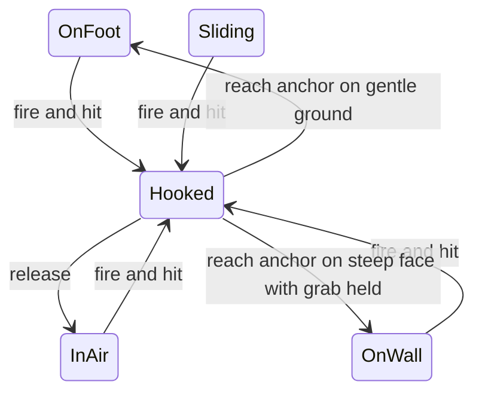

# Endless Walker Prototype: Feel Pass and Grappling Hook Test

Design document, 2026-11-12. Status: **approved by owner 2026-11-12 (EW-29)**.
Builds on the approved prototype ([design](2026-11-12-endless-walker-prototype.md), [plan](../implement/2026-11-12-endless-walker-prototype.md)). Code: `docs/explorations/endless-walker/prototype/`.

Items marked **[Owner]** were said by the owner in playtest. Items marked **[Claude]** are Claude's calls and can be overruled.

## 1. Why

First playtest, 2026-11-12. The owner said:

| Area | Owner said |
|---|---|
| Walking | No weight, no camera feeling, no VFX when moving |
| Sliding | Too slow. Camera, VFX and sound not OK |
| Hook | Wants a grappling hook like Attack on Titan: drags you fast, momentum makes you fly toward anything. Not in the GDD, only a test |
| Tuning | Every new number must be adjustable on a settings panel |

Earlier fixes the same day: reversed mouse and left/right input, flat-looking scenery (side sun, slope colours, boulders, route poles).

## 2. Goals, non-goals, anti-goals

| Kind | Items |
|---|---|
| Goals | Walking, sliding and hooking each have camera, screen-space and world VFX, and sound feedback. Hook test playable. All new numbers on the panel |
| Non-goals | Hook in the GDD or decision record. Hook upgrades, stamina cost for the hook, hook targets other than terrain. Changing the 62 approved settings or their tests. Weather, night, other biomes |
| Anti-goals | Effects that hide the terrain or make the player sick (strong blur or shake at low speed). A hook that breaks the existing walk, climb and slide rules when it is switched off |

## 3. Feedback per state [Claude, owner asked for camera, screen VFX and camera effects on all three]

Feedback reads state only (existing rule, enforced by `tests/purity.test.js`).

| State | Camera | Screen effects | World VFX | Sound |
|---|---|---|---|---|
| Walk (OnFoot) | Head bob per step: height and period grow with load. Sideways sway. Camera lower and closer uphill. Slow breathing sway when stamina under 25 percent | Vignette grows as stamina falls. Desaturation when stamina is empty | Snow puff per footstep. Footprint marks behind the walker, last 200 kept | Crunch per step, lower and louder with load. Breath louder as stamina falls |
| Climb (OnWall) | Closer to the face, small sway per climb move | Same vignette as walk | Small snow or rock dust per hand move | Grip scrape per move, breath |
| Slide (Sliding) | Low and close. FOV from fovFoot up to fovSlideMax with speed (existing). Shake from 12 m/s, growing with speed. Roll into carves | Radial blur and speed lines at the screen edge from 14 m/s. Snow flecks streaking past the lens | Spray plume behind, bigger when carving or braking. Groove trail left in the snow | Wind roar rising in pitch and level with speed. Scrape changing with grip. Hiss on carves |
| Hook (Hooked, and InAir after a hook) | Zoom punch on attach. FOV kick plus 10 degrees while pulled. Camera turns toward velocity | Chromatic flash at the edges on fire. Speed lines during pull and flight | Rope line with tension wobble. Burst of snow or rock at the anchor | Whoosh on fire, thunk on attach, reel whine while pulled, wind in flight |
| Fall (Fallen), hard landing | Shake (existing) plus short dip | Short white flash | Snow burst | Thud |

Slide speed: the approved numbers give about 15 m/s relaxed and 24 m/s tucked. **[Claude]** Most of the "too slow" is missing near-field speed cues; this pass adds them first. Raising real speed changes approved test values, so it waits for the owner after replay.

## 4. Grappling hook test [Owner intent, Claude details]

| Item | Value | By |
|---|---|---|
| Switch | G toggles the hook on or off. Off by default. When off, nothing in the existing rules changes | Claude |
| Fire | Hold right mouse button, gamepad right bumper. Ray from the camera along aim | Claude |
| Range | Hits terrain within 60 m. Miss gives no hook | Claude |
| Pull | While held, acceleration toward the anchor of 40 m/s per second, plus gravity, top speed 35 m/s | Claude |
| Release | Let go: mode InAir with full velocity kept. Existing landing rules decide the result (soft, slope slide, hard fall) | Owner (momentum, fly) |
| Chain | Can fire again in the air | Claude |
| Cost | None. Load and stamina do not touch the hook | Claude |
| Arrive | Within 1.5 m of the anchor: OnWall if grab held on a steep face, else OnFoot | Claude |

The hook is a rule (`src/rules/hook.js`), pure like the others, tested in Node. Balance and stamina rules ignore the Hooked mode.

## 5. Settings panel [Owner]

- New file `src/feel-config.js` with `FEEL_SPEC` (same shape as `CONFIG_SPEC`) and `feel` (live values). Its own test `tests/feel-config.test.js`. The existing `tests/config.test.js` (62 keys) stays unchanged.
- The tuning panel (Tab) shows the old groups plus new groups: Walk feel, Slide feel, Hook, Screen FX, Sound, Scenery. Copy values and Reset cover both.
- Scenery constants added earlier today (sun, fill light, fog, colours) move into `FEEL_SPEC` so they are tunable.
- One master toggle per effect family (camera effects, screen effects, VFX, sound) so the owner can A/B each.

## 6. Constraints

- Three.js `0.160.0` only. Post-processing from the same version: `examples/jsm/postprocessing/EffectComposer.js`, `RenderPass.js`, `ShaderPass.js`, `OutputPass.js` (all probed HTTP 200). No new libraries, no installs, no build step.
- Rules stay pure; feedback reads state only; `load` only in `stamina.js` (existing tests).
- Must stay at a playable frame rate on a desktop browser. Footprints and particles are pooled.

## 7. Left to the builder

All starting values for the new numbers. Shader details of vignette, blur, speed lines and chromatic flash. Exact sound synthesis.

## 8. Pass test

Owner replays and says walking has weight, sliding feels fast, and the hook is fun. Then the owner decides: keep the hook as a GDD idea or drop it, and whether real slide speed must rise.
