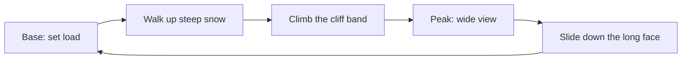
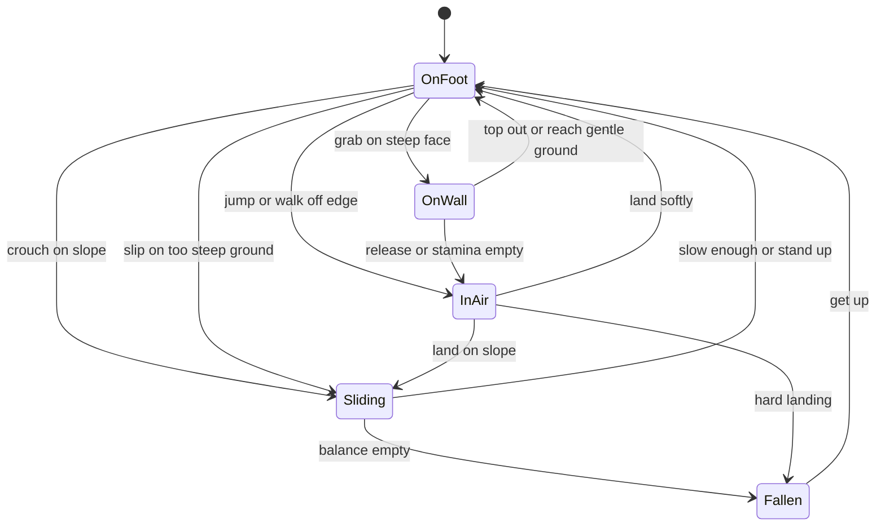
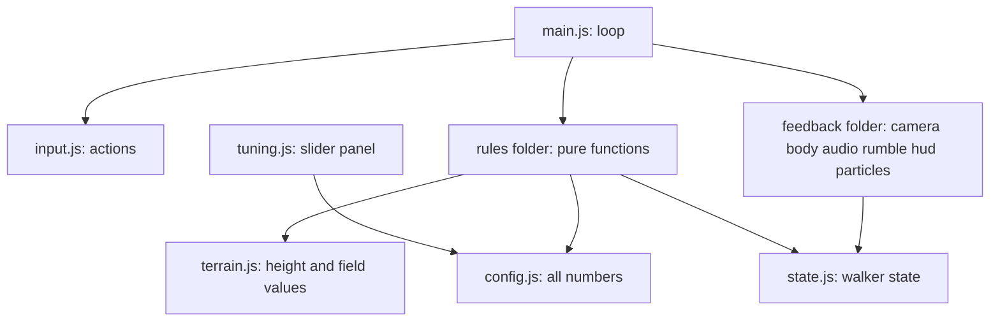

# Endless Walker Prototype: One Snow Mountain

Design document, 2026-11-12. Status: **approved by owner (EW-28)**. Next step is the implementation plan.

Sections 1 to 11 are the approved design. Section 12 is a builder handoff added by Claude after approval so that a plan writer with no memory of the conversation can work from this file alone. Its numbers are starting values, not owner decisions.

Sources: [GDD](../../../docs/explorations/endless-walker/GDD.md), [decision record](2026-11-12-endless-walker.md) (EW-1 to EW-27).

Items marked **[Owner]** were decided by the owner. Items marked **[Claude]** are Claude's calls and can be overruled.

---

## 1. Intent

Find out whether three movements feel good before anything else is designed: **walking uphill under load, climbing, and sliding down from the peak**.

The whole game idea rests on the body being fun to move. If these three do not feel good on one mountain, more world will not fix it. If they do, the open questions (why speed matters, charting, growth) get answered on top of something proven.

## 2. Pass test

**[Owner, EW-27]** The owner plays it and says walking, climbing and sliding each feel good.

**[Claude]** What to look for in each:

| Movement | Reference | Feels right when |
|---|---|---|
| Walk uphill under load | Death Stranding, overloaded on a slope (EW-19) | More load clearly makes the hill a fight for stamina. The body looks and sounds heavy. Going diagonal is a real choice |
| Climb | Peak (EW-26) | Any steep face can be grabbed. Stamina decides how far you get. More load means a shorter reach before you must rest |
| Slide | Death Stranding snow-peak slide (EW-21, EW-22) | Steering answers at once. The run is long and unbroken. The view is wide. A relaxed slide is safe; a pushed slide is a skill test (EW-23) |

## 3. Goals, non-goals, anti-goals

| Kind | Items |
|---|---|
| Goals | One snow mountain (EW-24). Climb up under load, reach the peak, slide down. Live tuning of every feel number while playing |
| Non-goals | Procedural generation, other biomes, vehicles, weather, night, temperature, wind, water, rope and rappel, gear, growth, charting, a reason for speed, saving, phone support |
| Anti-goals | A slide that punishes relaxed play. Weight shown only as a bar and not in the body. A cluttered screen |

## 4. The play loop

Way up tests stamina. Way down tests balance.

## 5. How it gets made

| Choice | Decision | By |
|---|---|---|
| Platform | HTML page in a desktop browser | Owner, EW-25 |
| 3D library | Three.js | Claude |
| View | Third person, camera behind the walker | Claude |
| Input | Keyboard and mouse, plus gamepad with rumble when one is plugged in | Claude |
| Physics | Own simple movement code on a height map. No physics engine | Claude |
| Walker body | Simple figure built from boxes, moved by code. No animation files | Claude |
| Sound | Made in code with the browser's audio system. No sound files | Claude |
| Tuning | On-screen panel with a slider for every feel number | Claude |
| Code layout | Several small files, run through a one-line local web server | Claude |
| Location | `docs/explorations/endless-walker/prototype/` | Claude |

Known limit: an HTML prototype proves rules, camera, sound and response. It does not prove animation quality. That question waits for a real engine.

## 6. The mountain

**[Claude]** One hand-shaped height map. No overhangs.

| Zone | Shape | Purpose |
|---|---|---|
| Base | Flat snow | Set load, learn controls |
| Approach | 15 to 35 degrees, uneven | Loaded uphill walk, zig-zag choice |
| Cliff band | 60 to 80 degrees, 20 to 30 m tall, on the approach side only, below the summit | Climb |
| Summit | Small flat top | View and launch |
| Slide face | Opposite side, 20 to 35 degrees, open, 600 m or longer, runs unbroken from the summit with no cliff, gentle bumps and a few rock islands | Slide of 40 seconds or more |
| Far landmark | Tall distant peak straight ahead of the slide face | Scenery, gives the slide a target |

Scenery: sky gradient, low sun, distance haze, far ranges, snow spray. Simple shapes, no textures needed.

Terrain field values the rules read at the walker's position:

| Value | Meaning |
|---|---|
| Slope along heading | Uphill or downhill in the direction of travel |
| Slope across heading | Sideways tilt |
| Grip | Lower on the slide face, higher on rock |
| Softness | Deeper snow on the approach slows walking |

## 7. Logical space of the prototype

Subset of GDD section 9.3 (EW-17).

| Kind | Content |
|---|---|
| State | Position, velocity, stamina, balance, contact mode |
| Actions | Move with pace, grab, jump, crouch |
| Terrain field | Section 6 table |
| Config | Load, and every number on the tuning panel |
| Rules | Locomotion, stamina, balance, slide and gravity, mode change |
| Feedback | Camera, body pose, sound, rumble, stamina bar. Reads state, never changes it |

Code keeps these apart: rules are plain functions of state, actions, field and config, so they can be tested without the 3D scene.

### Contact modes

### Rules

| Rule | Behaviour | By |
|---|---|---|
| Locomotion | Speed builds and fades over time, never instant. Turns widen with speed. Uphill slows, deep snow slows. Load does not change speed | EW-20 plus Claude |
| Too steep to walk | Above a walk limit the walker cannot stand: grab or slide. The limit is a tuning value set between the steepest approach slope and the cliff band, so the approach is walkable and the cliff is not | Claude |
| Stamina | Drained by sprinting, by walking uphill, by climbing. Returns when standing or walking on gentle ground. Load takes up part of the bar, like Peak | EW-20, EW-26 |
| Stamina empty on foot | Slow trudge only, no sprint | Claude |
| Stamina empty on wall | Grip lost, walker drops and slides | EW-26 |
| Climb | Hold grab on a steep face. Move in any direction on it. Jump on wall gives a short lunge for extra stamina | EW-26 plus Claude |
| Slide speed | Built from slope and grip. Height turns into speed | EW-15 |
| Slide steer | Move left and right to carve. Wider turns at speed | Claude |
| Slide brake | Pull back to slow and steady | Claude |
| Slide push | Hold sprint to tuck and go faster | Claude |
| Balance | Below a safe speed it does not drop at all. Above it, drops with extra speed, sideways tilt, hard turns and bumps. Recovers when the player eases off | EW-23 |
| Fall | Soft tumble, speed lost, walker gets up after a moment. No damage, no restart | Claude |

Load never enters the balance rule or the slide (EW-20).

## 8. Controls

**[Claude]**

| Action | Keyboard and mouse | Gamepad |
|---|---|---|
| Move | W A S D | Left stick, tilt sets pace |
| Sprint, or tuck while sliding | Shift | Right trigger |
| Look | Mouse | Right stick |
| Jump, or lunge on wall | Space | A |
| Grab | Hold left mouse button | Hold left trigger |
| Crouch, starts slide on a slope | C | B |
| Load down, load up | Z and X | D-pad left and right |
| Back to base | R | Back button |
| Jump to peak, for slide testing | T | Start button |

## 9. Feedback

The player must feel load and speed without reading numbers.

| Signal | Shows | How |
|---|---|---|
| Stamina bar | Stamina, and load as a blocked part of the bar | The only fixed thing on screen |
| Body pose | Slope, load, speed, balance | Leans forward uphill and more under load. Shorter, slower steps when tired. Leans into carves. Wobbles as balance drops |
| Camera | Speed and mode | Follows with a small delay. Widens with speed. Drops low and close on the slide. Keeps the horizon in frame. Small shake on hard landing |
| Sound | Surface, effort, speed | Footstep per step, heavier under load. Breath louder as stamina falls. Wind and snow scrape rise with slide speed |
| Rumble | Steps and danger | Pulse per footstep. Stronger buzz as balance drops |
| Snow spray | Speed and carving | Particles behind the walker on the slide |

Balance has no bar **[Claude]**: wobble, sound and rumble carry it. If playtest shows the player cannot read it, a bar is added.

## 10. Left to the builder

- All tuning values. Start from sensible guesses, expose every one on the panel.
- Exact height-map formula, as long as section 6 zones exist.
- Look of the figure and scenery, kept simple.
- File split inside the prototype folder, as long as rules stay separate from drawing.

## 11. After the prototype

If the pass test holds, the next design round takes up the deferred questions: cost of slowness, charting, growth currency, gear source, balance-loss detail, action count, and the move to a real engine.

---

## 12. Builder handoff [Claude, starting values]

Everything here may be tuned. Every number must appear on the tuning panel. What may **not** change without the owner: sections 1 to 9.

### 12.1 Conventions

| Item | Value |
|---|---|
| Units | Metres, seconds, degrees in config, radians inside math |
| Axes | Y up. Summit at x 0, z 0. Approach side is negative z. Slide face is positive z |
| Simulation step | Fixed 1/60 s, separate from drawing |
| Walker size | 1.8 m tall, 0.35 m radius |
| Start position | x 0, z -680, facing positive z |

### 12.2 Files

| Path under `docs/explorations/endless-walker/prototype/` | Holds | May import Three.js |
|---|---|---|
| `index.html` | Page, import map | |
| `src/main.js` | Fixed-step loop, wiring | Yes |
| `src/config.js` | Every tuning number, one object | No |
| `src/state.js` | Walker state and its starting values | No |
| `src/input.js` | Keyboard, mouse, gamepad into one actions object | No |
| `src/terrain.js` | Height formula, slope, grip, softness at a point | No |
| `src/rules/locomotion.js`, `stamina.js`, `balance.js`, `slide.js`, `climb.js`, `mode.js` | One rule each: state, actions, field, config, time step in; new state out | No |
| `src/feedback/camera.js`, `body.js`, `audio.js`, `rumble.js`, `hud.js`, `particles.js`, `scene.js` | Read state only | Yes |
| `src/tuning.js` | Slider panel bound to config | No |
| `tests/*.test.js` | Rule and terrain tests | No |

Libraries, pinned, loaded by import map from a CDN: `three@0.160.0`, `lil-gui@0.19.2`. No build step. Run with any static server, for example `python -m http.server 8080` or `npx serve`, from the prototype folder. Tests run with `node --test`; the plan writer must first check that Node is installed and fall back to a browser test page if not.

### 12.3 Mountain formula

Let r be horizontal distance from the summit and a the angle from the positive z axis. Height is a blend of two profiles: `h = w * slide(r) + (1 - w) * approach(r) + bumps`, where `w = smoothstep(-0.3, 0.3, cos(a))`.

Slide profile:

| r from | r to | Height from | Height to | Angle |
|---|---|---|---|---|
| 0 | 12 | 320 | 320 | Flat summit |
| 12 | 612 | 320 | 0 | About 28 degrees |
| 612 | beyond | 0 | 0 | Flat run-out |

Approach profile:

| r from | r to | Height from | Height to | Angle | Zone |
|---|---|---|---|---|---|
| 0 | 12 | 320 | 320 | Flat | Summit |
| 12 | 75 | 320 | 288 | About 27 degrees | Upper slope |
| 75 | 81 | 288 | 274 | About 67 degrees | Upper cliff pitch |
| 81 | 84 | 274 | 273.5 | Nearly flat | Rest ledge |
| 84 | 90 | 273.5 | 260 | About 66 degrees | Lower cliff pitch |
| 90 | 600 | 260 | 0 | About 27 degrees | Approach |
| 600 | beyond | 0 | 0 | Flat | Base |

Join the segments with short smooth blends so there are no sharp creases. Bumps: smooth noise of 1.5 m height and 40 m spacing on the approach, 0.6 m and 25 m on the slide face, none on the cliff. Slide face varies between 20 and 35 degrees through wider gentle waves. Three to five rock islands on the slide face, each 5 to 10 m wide, placed off the centre line.

Field values: grip 0.12 on the slide face, 0.35 on the approach snow, 0.8 on cliff and rock. Softness 0.6 on the approach, 0.2 on the slide face, 0 on cliff and rock. Far landmark: a peak 900 m tall at z 4000.

### 12.4 Starting numbers

**Locomotion**

| Number | Value |
|---|---|
| Walk speed at full tilt | 3.0 m/s |
| Sprint speed | 5.5 m/s |
| Speed gain | 6 m/s per second |
| Speed loss when stick released | 8 m/s per second |
| Turn rate | 360 degrees per second at walk, 140 at sprint |
| Uphill speed factor | 1 minus 0.9 times sine of slope along heading, never below 0.35 |
| Deep snow speed factor | 1 minus 0.3 times softness |
| Walk limit | 45 degrees |
| Gravity | 15 m/s per second |
| Jump start speed | 5.5 m/s upward |
| Hard landing | Downward speed above 9 m/s |

**Stamina**

| Number | Value |
|---|---|
| Bar size | 100 |
| Load range | 0 to 60, blocks that much of the bar |
| Sprint drain | 6 per second |
| Uphill walk drain | 2.5 times sine of slope along heading, per second |
| Climb drain | 3 per second moving, 1 per second hanging |
| Wall lunge | 2 m jump along the wall, costs 8 |
| Regain | 12 per second standing, 6 per second walking on ground under 10 degrees |
| Regain delay | 0.8 seconds after the last drain |
| Empty on foot | Speed capped at 1.2 m/s |

Checks these numbers are meant to give: each cliff pitch costs about 36 stamina, so a walker with load 60 only just makes one pitch and must rest on the ledge. Unloaded, the approach needs about four rests; at load 60, about nine.

**Climb**

| Number | Value |
|---|---|
| Grab allowed | Surface steeper than 50 degrees, within 0.6 m |
| Climb speed | 1.2 m/s in any direction on the face |
| Top out | Automatic when the surface ahead drops under the walk limit |

**Slide**

| Number | Value |
|---|---|
| Start | Crouch on slope steeper than 8 degrees |
| Speed gain | 9.81 times (sine of slope minus grip times cosine of slope) |
| Air drag | 0.015 times speed squared relaxed, 0.007 tucked |
| Brake | Adds 0.45 to grip |
| Steer rate | 700 divided by speed, in degrees per second, kept between 30 and 90 |
| End | Speed under 2 m/s on slope under 10 degrees, or crouch released under 4 m/s |

Meant to give: about 15 m/s relaxed and about 24 m/s tucked on the 28 degree face.

**Balance**

| Number | Value |
|---|---|
| Bar size | 100, hidden |
| Safe speed | 18 m/s. At or below it balance never drops |
| Drop above safe speed | 4 per second for each m/s over, plus 25 times sine of slope across heading, plus 15 at full steer |
| Bump hit | 5 to 10 at once, only above safe speed |
| Recovery | 20 per second at or below safe speed, or while braking |
| Fall | 1.5 second tumble, speed cut to 30 percent, 1 second to stand, balance back to 100 |

**Camera**

| Number | On foot | Sliding |
|---|---|---|
| Distance behind | 5.5 m | 4 m |
| Height above walker | 1.8 m | 1.0 m |
| Field of view | 60 degrees | Up to 80 at 24 m/s |
| Follow delay | 0.15 seconds | 0.15 seconds |

### 12.5 Tests the plan must include

| Test | Expect |
|---|---|
| Height at summit, base, ledge | 320, 0, about 274 |
| Slope on approach and slide face | Under walk limit |
| Slope on both cliff pitches | Over grab limit |
| Slide face along centre line from summit to run-out | No point steeper than walk limit, no cliff |
| Uphill walk at load 0 and load 60 | Same speed, usable stamina 100 and 40 |
| Balance at 18 m/s for 60 seconds, no steer | Stays 100 |
| Balance at 24 m/s straight | Reaches zero in a few seconds |
| Relaxed slide on 28 degrees | Settles near 15 m/s |
| Tucked slide on 28 degrees | Settles near 24 m/s |
| Climb with stamina empty | Mode becomes in air |
| One cliff pitch at load 60 | Stamina left is small but above zero |
| Every rule | Load appears only in the stamina rule |

Automatic tests cover rules and terrain. Feel is judged only by the owner playing (section 2).

### 12.6 Notes for the plan writer

- Save the plan to `.cursor/plans/implement/2026-11-12-endless-walker-prototype.md`. Follow `.claude/rules/plan-files.md`, `plan-diagrams.md` and `mermaid-diagrams.md`.
- Build order that shows results early: terrain and camera, walking, stamina and load, climbing, sliding and balance, feedback, tuning panel, owner playtest.
- Do not use the subagent-driven-development skill (`.claude/rules/skip-subagent-driven-development.md`). Do not commit unless the owner asks.
- Do not add anything from the non-goals list in section 3.
- Other case studies in this repository (Anima, Forest_Bloom, psychology models) must not leak in (`.claude/rules/no-case-study-bias-and-basis-orthogonality.md`).
