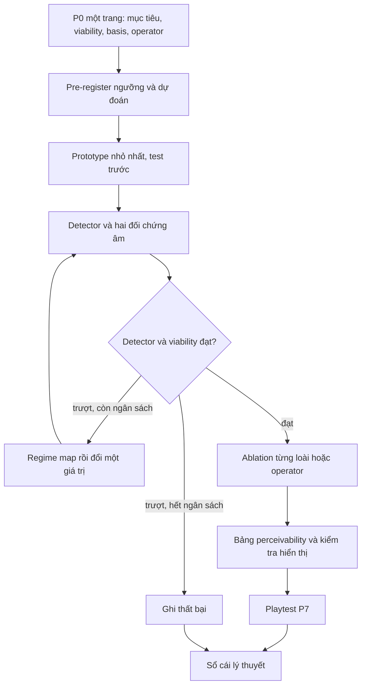

# Đề Xuất Cắt Gọn Lý Thuyết Logical Space lên v0.4

> **Trạng thái:** Đề xuất, **chờ chủ dự án duyệt**. Chưa sửa core, playbook hay Designer Guide. Khi duyệt sẽ ghi thành AG tiếp theo.
> **Nguồn bằng chứng:** ca mẫu lát cắt Forest_Bloom ([plan](../implement/2026-11-12-forest-bloom-slice-reference-case.md), [thư mục ca mẫu](../../../docs/explorations/forest-bloom-slice/), [sổ cái lý thuyết](../../../docs/explorations/forest-bloom-slice/theory-ledger.md)), nhánh `study/forest-bloom-slice`.
> **Giới hạn lớn nhất:** cổng người chơi P7 **chưa chạy** (chủ dự án hoãn ngày 2026-11-13). Mọi kết luận về "fun" đều chưa có dữ liệu. Đề xuất này chỉ dựa trên phần mô phỏng và kiểm tra hiển thị.

## 1. Tóm Tắt Kết Quả so với Pre-registration

| Mục | Ngưỡng đăng ký trước | Kết quả | Dự đoán trước | Trúng dự đoán |
|---|---|---|---|---|
| D1 skill gap | ít nhất 3.0 | 4.25 ở nấc 3 (nấc 0: 1.59) | Trượt ở nấc 0 | Có |
| D2 best share | ít nhất 0.25 | 0.28 | Đạt | Có |
| D3 near-best share | nhiều nhất 0.15 | 0.129 (nấc 0: 0.19) | Trượt ở nấc 0 | Có |
| D4 depth | ít nhất 6 | 11 | Đạt | Có |
| V1 không độc chiếm | dưới 90% khi trên 12 cây | Đạt ở nấc 3, cây bụi 85% | Trượt ở nấc 0 | Có |
| V2 ít nhất 2 loài | k = 2 | Đạt ở nấc 3 | Đạt ở nấc 0 | **Trượt**: nấc 0 bản đồ đầy cây tiên phong trước khi gieo được cây bụi |
| N1 đối chứng đồng đều | detector phải trượt | Trượt ở mọi nấc | Trượt | Có |
| N2 đối chứng không lặp | detector phải trượt | Trượt ở mọi nấc | Trượt | Có |
| PT1 chơi tiếp | ít nhất 60% | **Chưa chạy** | Trượt | — |
| PT2 kể đúng nguyên nhân | ít nhất 60% | **Chưa chạy** | Đạt | — |
| HY-1 proxy | đạt với tối đa 30 giá trị config | Đạt với 28, nếu ô lưới tính là dữ liệu level | Trượt | **Trượt** |
| HY-3 | sự kiện trong bảng perceivability được kể lại | Chưa chạy | Không đoán | — |
| HY-2, HY-4 | | Không kiểm được trên một lát cắt | | — |

**Thang basis:** đạt ở nấc 3, dùng 4 trong 5 nấc ngân sách. Ba thay đổi, mỗi nấc một giá trị: `enrichCap` cây tiên phong 3 → 0, `minSoil` cây tán 4 → 3, `lifespan` cây bụi 10 → 7. Chi tiết: [rung-log](../../../docs/explorations/forest-bloom-slice/rung-log.md).

**Đạt nhưng yếu, phải nói thẳng:**

| Điểm yếu | Ý nghĩa |
|---|---|
| Vùng sống còn hẹp: `lifespan` cây bụi chỉ 6 hoặc 7 | Kết quả nằm giữa hai ranh giới lật (L10). Chỉnh nhỏ là mất |
| Cây bụi chiếm 85%, ngưỡng 90% | Qua V1 với 5 điểm; nhìn vẫn gần một màu |
| **Không còn cây tán nào sống** ở cuối ván | Loài thứ ba không làm việc ở trạng thái cuối. Chuỗi diễn thế tiên phong → bụi → tán không xảy ra; làn sóng I6 là làn sóng cây bụi |
| Sự kiện "bóng râm giết cây" không nhìn thấy được | Chủ dự án kiểm tra: 4 trên 5 dòng perceivability thấy được; bóng râm thì không, vì không còn cây tán. L13 trượt cho một sự kiện mục tiêu |

**Nghĩa cho phương pháp, không chỉ cho lát cắt:** detector đo đúng thứ đã đăng ký (I6 cộng viability), và nó đạt, nhưng nó **không bắt được** việc một loài trong P0 không còn tồn tại. V2 với k = 2 cho 3 loài quá lỏng. Bài học: điều kiện sống còn phải nói rõ **loài nào cần sống**, không chỉ "bao nhiêu loài". Đây là lỗi của bảng P0 và pre-registration, không phải của code.

## 2. Đếm Phán Quyết trong Sổ Cái

37 mục: L1 đến L17, M1 đến M6, P0 đến P7, I1 đến I6. Phán quyết áp theo luật máy móc của plan.

| Phán quyết | Số mục | Các mục |
|---|---|---|
| Giữ | 13 | L6, L10, L11, L12, L13, L14, L16, M6, P0, P4, P6, P7, I6 |
| Giữ, chưa kiểm | 9 | L15, L17, M3, M5, I1, I2, I3, I4, I5 |
| Gộp | 6 | L5 vào L1, L8 vào P0, L9 vào L16, M2 vào L14, P1 vào P0, P5 vào M6 |
| Ứng viên cắt | 9 | L1, L2, L3, L4, L7, M1, M4, P2, P3 |

Lưu ý về L1 và L5: theo luật máy móc chúng là ứng viên cắt, vì không có quyết định nào đổi. Nhưng người viết plan đã biết luật, nên giá trị phòng ngừa của chúng không thể hiện trong một ca. Đề xuất: giữ thành **một** luật ontology, kiểm trên ca do người khác xây (HY-4).

M1 và M4 được kiểm trung thực theo yêu cầu plan: trong Task 6 và 7, mọi quyết định đến từ regime map và các check của detector. Sobol, Boolean Fourier hay Koopman/DMD không cải thiện quyết định nào. Đề xuất cắt khỏi core, giữ trong tài liệu toán như phụ lục tham khảo.

## 3. Core v0.4 Đề Xuất: Trước và Sau

| v0.3 | v0.4 đề xuất | Lý do |
|---|---|---|
| L1 Operators are not basis; L5 Derived values are not basis | **Một luật ontology**: state chỉ giữ thứ thay đổi theo thời gian; operator, config và giá trị suy ra nằm ngoài state | Gộp; giá trị phòng ngừa, chưa chứng minh |
| L2 minimal under ablation | Giữ **chỉ khi** thêm bước ablation rẻ: bỏ từng loài hoặc operator, chạy lại detector | Không được dùng; 0 cây tán cho thấy nó sẽ có ích |
| L3 No sacred numbers; L4 Resolution rule; L7 Completeness relative | Chuyển sang Designer Guide làm lời khuyên, bỏ khỏi danh sách nguyên tắc | Không đổi quyết định nào |
| L6 Iteration makes emergence | Giữ, kèm phép thử: đối chứng "không lặp" (N2) và độ sâu D4 | Làm việc thật |
| L8 Interesting is game-specific | Gộp vào P0 | Chỉ làm việc qua P0 |
| L9 Emergence not sufficient | Gộp vào L16 | Chỉ làm việc qua V1 |
| L10, L11, L12, L14, L16 | Giữ | Làm việc thật, có bằng chứng |
| L13 | Giữ | Bắt được lỗi: bóng râm không thấy được |
| L15, L17 | Giữ, chưa kiểm | Cần nhiều level và playtest |
| M1 Interaction share, M4 Dynamic modes | Cắt khỏi core, giữ làm phụ lục toán | Không quyết định nào cần |
| M2 Novel outcomes | Gộp vào L14 dạng "khoảng cách dự đoán" (ID-1) | Lần trượt V2 chính là thứ này |
| M3, M5 | Giữ, chưa kiểm | Không áp dụng được cho lát cắt |
| M6 Cascade profile | Giữ | Thước đo duy nhất đã làm việc |
| P0, P1 | Gộp thành **một trang P0**: mục tiêu, viability, bảng basis, bảng operator | P1 chỉ là phần viết của P0 |
| P2, P3 | Cắt khỏi cổng bắt buộc | Không chạy, không thấy mất gì |
| P4 | Giữ, thêm một dòng: cách cộng nhiều đóng góp vào cùng ô | Bảng đọc/ghi thiếu đúng chỗ này |
| P5 | Gộp vào M6 | P5 chỉ là chạy M6 |
| P6 | Giữ, **sửa**: viability phải nêu loài hoặc thành phần nào phải sống | V2 k = 2 để lọt 0 cây tán |
| P7 | Giữ; phần perceivability đã làm việc, phần playtest chưa chạy | |
| I1 đến I6 | Giữ catalog; chỉ I6 có detector | |

Kết quả: từ 17 nguyên tắc, 6 thước đo, 8 cổng còn khoảng **10 nguyên tắc, 3 thước đo (M3, M5, M6), 4 cổng**.

## 4. Quy Trình Ngắn Hơn Đề Xuất

## 5. Chi Phí Thực Trả theo Cổng

Ước lượng thô, thời gian làm việc của trợ lý trong phiên 2026-11-12 đến 2026-11-13, không phải đo chính xác.

| Bước | Giờ ước lượng | Có đáng không |
|---|---|---|
| P0, basis, operator, pre-registration | 0.5 | Có: ngăn chỉnh ngưỡng sau khi thấy kết quả |
| Code mô phỏng và test (Task 3 đến 5) | 1 | Có |
| Detector, đối chứng, nấc 0 | 0.5 | Có: N1 cho thấy nấc 0 không khác bãi đồng đều |
| Thang 3 nấc và regime map | 0.5 | Có: regime map quyết định mọi nấc |
| View, perceivability | 0.5 | Có: tìm ra bóng râm không thấy được |
| Review toàn nhánh và sửa | 0.3 | Có: bắt lỗi revision sai trong file kết quả |
| P1 đến P3 riêng lẻ, M1, M4 | 0 | Không chạy; không thấy thiếu |

## 6. Ý Tưởng Để Dành (không vào core lúc này)

| Ý tưởng | Nguồn |
|---|---|
| Bảng đọc/ghi P4 nêu cách cộng đóng góp đồng thời vào một ô | Ruling Task 4 |
| Ablation từng loài hoặc operator như phép thử L2 rẻ | 0 cây tán |
| Regime map báo độ bền: khoảng cách từ điểm đạt tới ranh giới lật gần nhất | Vùng 6 đến 7 ở nấc 3 |
| File kết quả phải ghi đúng revision, đánh dấu dirty nếu code chưa commit | Review cuối |

## 7. Việc Tiếp Theo Đề Xuất

| Thứ tự | Việc | Ai |
|---|---|---|
| 1 | Duyệt, sửa hoặc từ chối đề xuất này; nếu duyệt, ghi AG tiếp theo rồi mới sửa core, playbook, Designer Guide | Chủ dự án |
| 2 | Chạy playtest P7 (đã hoãn); kết quả có thể đổi phán quyết của L13, L17, P7 | Chủ dự án |
| 3 | Nấc tiếp theo nếu muốn cây tán sống: một thay đổi, sau khi sửa P6 để đòi cây tán sống | Trợ lý, sau khi duyệt |
| 4 | Merge nhánh `study/forest-bloom-slice` | Chủ dự án quyết định |
