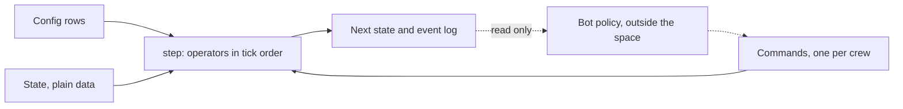
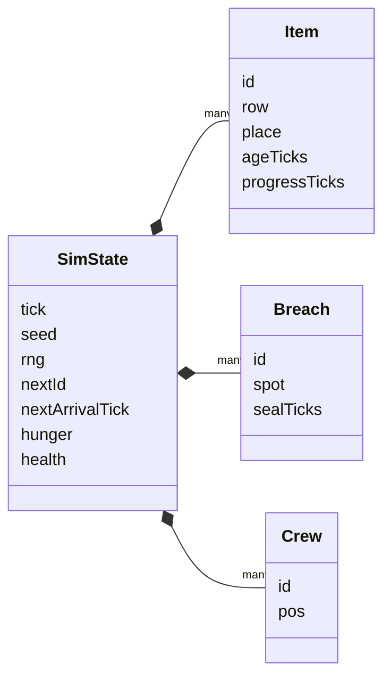
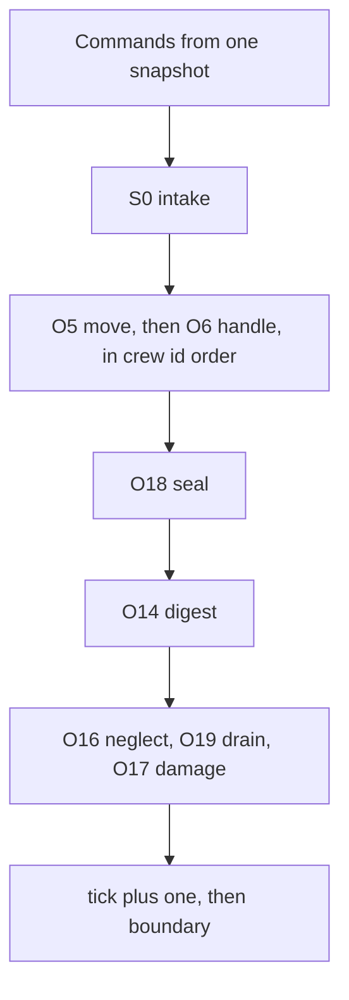

# Sandworm Co-op: Rung 0 and Rung 1 Design Spec

**Date:** 2026-11-26
**Status:** Draft for owner review. Nothing built, nothing run.
**Source:** [`logical-space.md`](../../../docs/explorations/sandworm-coop-survival/logical-space.md) (main), research README sections 3, 6, 10.
**Plan:** [implement/2026-11-26-sandworm-rung01.md](../implement/2026-11-26-sandworm-rung01.md)
**Marks:** **SW-n** owner decision. **S** source design. **P** proposal, not agreed. **Q-n** open question. **A-n** assumption this spec makes.

## 1. Intent

Turn the smallest part of the logical space into code that runs, so the intake queue can be measured.

| Goal | Not a goal |
|---|---|
| Rung 0: numbers sheet that finds a workable and a failing setting | Graphics, Driver, shake, trip |
| Rung 1: headless seeded sim of intake, carry, acid, hunger, neglect, breach, seal | Pieces, hammer (SW-1, SW-3 wait for rung 2) |
| Pre-registered thresholds approved before any sweep | Allergen, heart, tools, currency |
| Code shaped like the model | Proving emergence, fun or loop coupling |

**Limit.** Rung 1 has one role. It cannot test I7. L12 needs a detector for the target interestingness before climbing, and none exists for I7. The rung 1 thresholds are **queue and viability checks** (L16), not an interestingness detector.

## 2. Assumptions To Confirm

The owner did not answer these. The assistant's recommendation is used. Confirming them is the first owner gate.

| ID | Assumption | If changed, affects |
|---|---|---|
| A-1 | Builder is Claude in a later session. The plan also carries the Gemini safety header, so Gemini can run it | Handoff only |
| A-2 | TypeScript on Node 24, `node:test`, no dependencies, folder `prototypes/sandworm-coop/` | All files |
| A-3 | "Branch for me" means an owner branch in the work tree | Tree only |
| A-4 | A full acid pit refuses food; the dropped item goes to the floor at the acid spot. **Replaces** the first-in-first-out queue proposal; no `acid_order` | State, O6, O14 |
| A-5 | An item that expires becomes a breach and is removed | O16 |
| A-6 | Sealing is bare-handed, needs empty hands; one hand slot; seal progress is saved on the breach | State, O18, O6 |
| A-7 | Interior map is two spots, `mouth` and `acid`, with a walk time. **P:** more spots are added only when a rung needs them | State, O5 |

## 3. Gaps Found In Section 9, And Fixes

| # | Gap | Fix used here |
|---|---|---|
| G1 | Nothing can put food in the acid (entry is only through O7 or throw) | O6 `drop` at the acid spot |
| G2 | O14 needs `size` and capacity $C$ | Both added; config must have $C \ge$ largest size |
| G3 | Instance id and next id are missing | `id`, `nextId`, shared by items and breaches. Queue state is not needed (A-4) |
| G4 | Seed, random cursor, tick count missing | `rng` (cursor), `seed`, `tick` saved |
| G5 | Scripted intake has no ID or read/write list | Operator **S0**; it needs saved `nextArrivalTick` |
| G6 | No one issues crew commands | Two bot policies, outside the space (section 8) |
| G7 | O16 needs `neglect_limit`; Q-16 open | Config. **P:** only floor food ages; pickup pauses age |
| G8 | Unlimited safe waiting in acid | Removed by A-4 |
| G9 | Item fate after breach | A-5 |
| G10 | Breach damage, size, growth undefined | Constant `breachDamagePerTick`; no size, no growth |
| G11 | O18 reads `seal_rate` with no tool; repair progress placed on crew | A-6: `sealWorkTicks`; progress on the breach |
| G12 | O19 reads heart, evolution, shock | Constant drain, no regen |
| G13 | O5 has no speed rule or map | A-7; carry percent comes from `mass` through config |
| G14 | O14 reads `digestible`, writes currency | Both omitted: the one food row always digests and pays no currency |
| G15 | Two crew grab one item (Q-25) | **P:** commands resolve in crew id order |
| G16 | Fractional time can finish one tick late | All quantities are integers |
| G17 | Rung 0 absent from section 9; README section 10 says "acid slots" | Section 6; capacity $C$ |
| G18 | V1 cannot test the death spiral without worm speed | Low-hunger recovery only; spiral stays open |
| G19 | Section 9 lists a crew slot **and** items have place `held` | Slot is derived from item places (L5, IV3) |
| G20 | Rung 1 vocabulary lists `mass`, but one food row makes it a constant | Kept, because O5 must read a property, not a name |

`logical-space.md` is not edited by this work. Updating its section 9 is a follow-up.

## 4. Approaches

| Approach | Trade-off | Verdict |
|---|---|---|
| **A. Plain data state, one function per operator, fixed tick list** | Direct mirror of the model; saves and compares trivially | **Chosen** (assistant call, requested by the brief) |
| B. Entity component library | Pays off with many entity kinds; adds a dependency and hides tick order | Not now |
| C. Spreadsheet or notebook only | Fast for rung 0; cannot express crew position or contention | Rung 0 logic is kept as code instead, so both rungs share config |

## 5. Model

### 5.1 Vocabulary and config

| Name | Type | Read by | Placeholder |
|---|---|---|---|
| `food.mass` | integer | O5 | 1 |
| `food.size` | integer | O6, O14 capacity | 1 |
| `food.digestTicks` | integer | O14 | 60 |
| `food.yieldHunger` | integer | O14 | 8000 |
| `acidCapacity` | integer | O6 | 2 |
| `neglectLimitTicks` | integer | O16 | 300 |
| `sealWorkTicks` | integer | O18 | 30 |
| `drainPerTick` | integer | O19 | 100 |
| `breachDamagePerTick` | integer | O17 | 50 |
| `walkTicks` | integer | O5 | 40 |
| `carry.heavyMassFrom` | integer | O5 | 2 |
| `carry.heavyPercent` | integer | O5 | 45 (**S** for heavy carry) |
| `carry.lightPercent` | integer | O5 | 70 |
| `crewCount` | integer | all crew rules | 3 |
| `hungerStart`, `hungerMax`, `healthMax` | integer | state | 70000, 100000, 100000 |
| `intake.firstArrivalTick`, `meanGapTicks`, `jitterTicks` | integer | S0 | 0, 60, 20 |
| `timeLimitTicks` | integer | boundary | 6000 |

**Every value above is a PLACEHOLDER**, chosen so the rung 0 arithmetic has a workable window. Only `heavyPercent` comes from the source design. Ten ticks are one second. Hunger and health use a scale where 100000 is full.

### 5.2 State

| Value | Shape |
|---|---|
| `Item.place` | `floor(spot)`, `held(crew)` or `acid`. A gone item is removed from the list |
| `Crew.pos` | `at(spot)` or `walking(to, left)`; `left` in distance units; one walk is `walkTicks × 100` |

**Derived, never saved:** held item of a crew member, used acid capacity, carry speed, the other end of a walk, outcome, load.

### 5.3 Commands

`wait`, `move(to)`, `pick(itemId)`, `drop`, `seal(breachId)`. One per crew per tick, read from one snapshot taken before the tick. A command that is not allowed changes nothing and logs `rejected`.

### 5.4 Operators

| ID | Rule | Reads | Writes |
|---|---|---|---|
| S0 | If `tick ≥ nextArrivalTick`: add one food on the mouth floor, age 0; set the next arrival to `tick + gap`. `gap` is uniform integer in mean ± jitter, one random draw each arrival | intake config, rng, tick | items, nextId, nextArrivalTick, rng |
| O5 | `move(to)`: advance 100 units per tick empty, or carry percent while holding. Reversing mid-walk keeps the position. `wait` mid-walk stays put | command, held item mass | crew pos |
| O6 | `pick`: at a spot, empty hands, item on that floor. `drop`: at a spot, holding. At `acid`, if used capacity + size ≤ $C$ the item enters with progress 0; otherwise it goes to the acid floor. Age is kept, never reset | command, places, size, $C$ | item place |
| O18 | `seal`: at the breach spot, empty hands, adds 1 to `sealTicks`; at `sealWorkTicks` the breach is removed. Several crew add up | command, breach | breaches |
| O14 | Each acid item adds 1 progress; at `digestTicks` hunger rises by the yield, clamped, and the item is removed | acid items | progress, hunger, items |
| O16 | Each floor item adds 1 age; at `neglectLimitTicks` it is removed and a breach appears at its spot | floor items | age, items, breaches, nextId |
| O19 | `hunger = max(0, hunger − drainPerTick)` | drain | hunger |
| O17 | `health = max(0, health − breachDamagePerTick × breach count)` | breaches | health |
| Ω | After the tick counter rises: health 0 → `lost_health`; else hunger 0 → `lost_hunger`; else tick at limit → `survived`; else `running` | health, hunger, tick | none |

Hunger 0 as a loss is a rung proxy for the source's slow-then-die state (Q-2).

### 5.5 Tick order (P, subset of section 6.5)

An item that arrives or enters the acid gets its first age or progress in that same tick.

### 5.6 Invariants

| ID | Holds after every tick |
|---|---|
| IV2 | Hunger and health inside 0 and their maximum |
| IV3 | Every item has exactly one valid place; a `held` place names a real crew |
| IV4 | A crew member holds at most one item (rung 1 form) |
| IV6, IV8 | A paid item is removed, so it cannot pay again or be read again |
| IV10 | Ids are unique and below `nextId` |
| IV12 | Used acid capacity is at most $C$ |
| R1-A | Every stored number is an integer |
| R1-B | A held or acid item does not age |

IV1, IV5, IV7, IV9, IV11 have nothing to check in rung 1.

## 6. Rung 0: Numbers Sheet

Arithmetic on the same config. Rates are per tick.

| Rate | Formula |
|---|---|
| demand | `drainPerTick / yieldHunger` |
| supply | `1 / meanGapTicks` |
| pit | `floor(C / size) / digestTicks` |
| haul | `crewCount / haulCycleTicks` |
| haulCycleTicks | `walkTicks + 1 + ceil(walkTicks × 100 / carryPercent) + 1` |

| Verdict, first match | Condition |
|---|---|
| `incapable` | min(pit, haul) < demand |
| `starve` | supply < demand |
| `overload` | supply > min(pit, haul) |
| `ok` | otherwise |

**Rung 0 pass:** on the sweep grid, at least one point is `ok` and at least one is not, and the printed sheet labels every input as placeholder or source. It ignores sealing time, hunger lost at the cap and random gaps, so `ok` is a necessary-condition estimate, not a prediction of the sim.

## 7. Rung 1: Pre-registered Measures And Thresholds

> **PROPOSED. The owner must approve these before any sweep.** The sweep refuses to run until `thresholds.json` records the approval. After approval no number changes to make a result pass. A needed change is a new, dated version with the old result kept.

**Run:** 6000 ticks (10 simulated minutes). Warm-up 600 ticks. Seeds 1 to 20. Policy `sealFirst` is the one judged; `foodFirst` is reported as a control with no threshold.

| Measure | Definition |
|---|---|
| load, per tick | floor items + open breaches |
| p95Load | nearest-rank 95th percentile of load after warm-up |
| growth | mean load of the last third minus mean of the first third, after warm-up |
| idleShare | idle crew-ticks ÷ crew-ticks, after warm-up. Idle means standing at the mouth with no job (R1-D1). Walking back to the mouth is `work`. Waiting with food at a full pit is `blocked`, not idle |

A run that ends before the end of warm-up is measured from tick 0.

| Run class, first match | Condition |
|---|---|
| `runaway` | `lost_health`, or growth > 2, or p95Load > 4 × crew |
| `idle` | idleShare > 0.60 |
| `bounded` | `survived`, p95Load ≤ 2 × crew, growth ≤ 1, and 0.15 ≤ idleShare ≤ 0.60 |
| `strained` | anything else |

A grid point takes a class when at least 16 of 20 seeds agree; otherwise it is `mixed`.

**Primary grid (162 points):** meanGapTicks 20, 30, 40, 50, 60, 70, 80, 100, 120; walkTicks 20, 40, 60; acidCapacity 1, 2, 3; crewCount 3, 4. Jitter = `floor(meanGap / 3)`. **One-at-a-time checks**, reported without thresholds: drainPerTick 75, 100, 125; neglectLimitTicks 200, 300, 450, along the meanGap axis at walk 40, capacity 2, crew 3.

| ID | Prediction | Passes when |
|---|---|---|
| R1-P1 | A bounded, moderately busy region exists | At least 3 `bounded` points connected by single grid steps |
| R1-P2 | Outside it the system is idle or runaway | At least 70% of non-bounded points are `idle` or `runaway` (`strained` and `mixed` count against). Not evaluable if P1 fails |
| R1-P3 | The border to runaway is sharp (L10) | Fine line: meanGap 20 to 80 step 2, capacity 2, crew 3. Let `a` be the largest gap with runaway share ≥ 80%, and `b` the smallest gap above `a` with share ≤ 20%. Needs `b / a ≤ 1.25` on at least 2 of the 3 walk distances. A missing `a` or `b` fails that line |
| R1-V1 | Low hunger is recoverable (partial V1) | Placeholder config, hungerStart 20000: at least 16 of 20 seeds reach hunger ≥ 50000 and do not lose |

A failed prediction is a result. It is recorded, not tuned away.

**R1-D1 (owner, 2026-11-26, before any simulation run):** the walk back to the mouth counts as work. It is part of the rung 0 haul cycle, so counting it as idle would let the walk count, more than the queue, decide the class. No threshold number changed. The rule is stateless, so a return after sealing, or a turn back after a job disappears, also counts as work.

## 8. Bot Policies (Outside The Space)

They read the full state, which is better information than a player has. Results describe these bots only.

For each crew member in id order, with items and breaches claimed by earlier ids skipped:

| Step | Rule |
|---|---|
| Holding | At acid with room: `drop`. At acid, no room: `wait`, status `blocked`. Otherwise `move(acid)` |
| `sealFirst` | Lowest-id unclaimed breach; else oldest unclaimed floor item (tie: lowest id) |
| `foodFirst` | Same two jobs, food before breaches |
| Reach job | Not at its spot: `move`. At it: `seal` or `pick` |
| No job, not at the mouth | `move(mouth)`, status `work` (return walk, R1-D1) |
| No job, at the mouth | `wait`, status `idle` |

Known weakness to keep visible: holding pauses age, so a blocked bot is temporary safe storage, at most one item per crew member.

## 9. Proposals And Open Questions Relied On

| Ref | Content | Used by |
|---|---|---|
| Q-16 (P) | Only floor food ages; pickup pauses | O16 |
| Q-24 (P) | Capacity counts size | O6 |
| Q-25 (P) | Crew id order | O6 |
| Q-27 (P) | Nothing leaves the acid by hand | O6 |
| Q-2 (open) | Hunger 0 and health 0 end the run | Ω |
| 6.5 (P) | Tick order | step |
| Content rule (P) | $C \ge$ largest size | config check |
| SW-2 | One pit with a maximum capacity | O6, O14 |

SW-1 and SW-3 are not used until rung 2.

## 10. Follow-ups (Out Of Scope)

| Rung | Adds |
|---|---|
| 2 | Pieces and break (SW-1, SW-3 shares), currency, rear exit |
| 3 | Shake and trip, with a flat-delay control |
| 4 | Driver choosing intake: first rung that can test I7 criterion 1 |
| 5 to 7 | Heart and gates, hazards one at a time, human players (P7) |
| Docs | Update `logical-space.md` section 9 with G1 to G20 outcomes; add the case to core section 10 |

## 11. Left To The Builder

Private helpers, event log field names beyond the listed kinds, text layout of reports.
