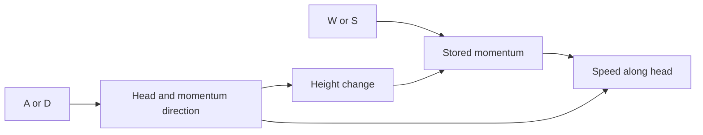

# Sandworm Driver demo: head steering (approved)

Owner request: "use steering to turn worm head and its momentum direction". Owner picked approach A on 2026-11-27.

## Approaches

| Option | Trade-off |
|---|---|
| **A. Steering wheel (picked)** | Steering is separate from push and brake, so the momentum rule stays clear and there is a brake. `A`/`D` are relative to the head. |
| B. Point to direction | Easier to aim, but the against-travel momentum rule would almost disappear. |

## Controls

| Key | Effect |
|---|---|
| `A` / `D` | Rotate head counterclockwise / clockwise. The momentum direction rotates with it. No cost. |
| `W` | Push forward. Builds momentum underground. |
| `S` | Brake. The only key against travel, so it drains momentum. Never reverses. Lets go of a rock being ground. |
| none | Keep heading and momentum. |

## Builder calls (not decided by the owner)

- In the air, `A`/`D` rotate head and velocity at a separate, slower rate. `W`/`S` push or pull along travel.
- Gravity rules, collision losses, bottom levelling and the free rolling level stay as before.

