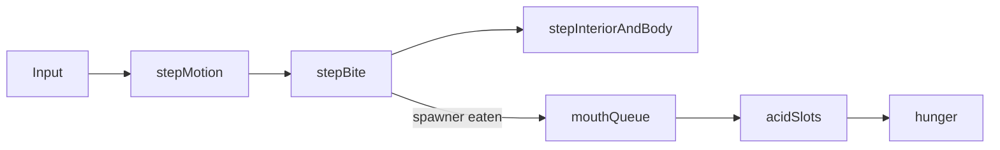
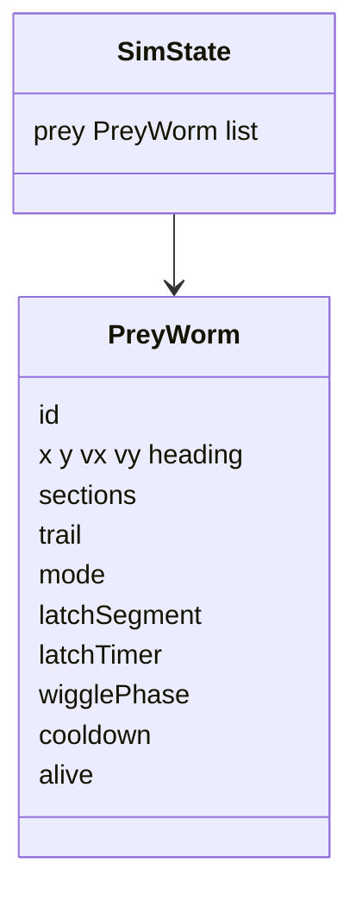
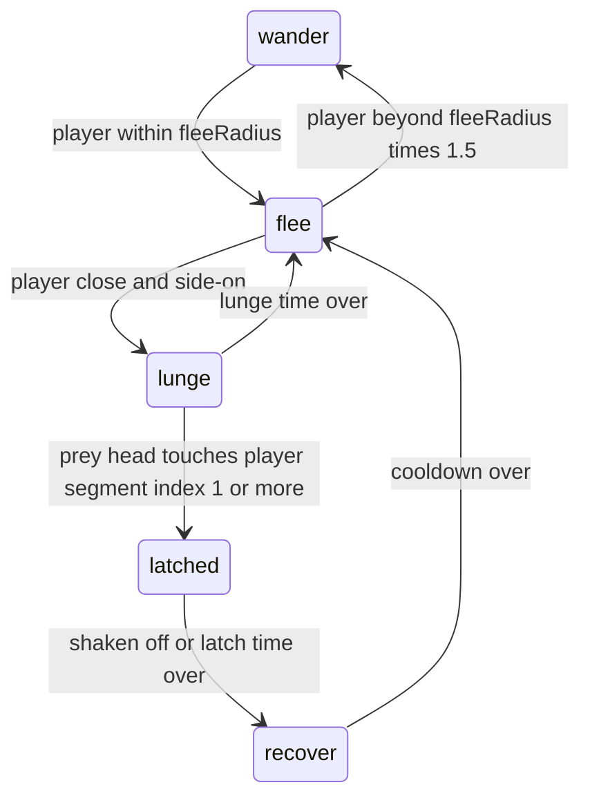
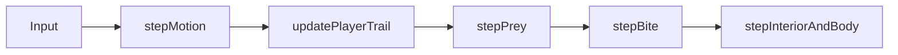

# Sandworm Driver demo: Prey Worm (chase, head bite, body cut, latch)

Date: 2026-11-28. Status: draft, awaiting owner approval.
Target: `prototypes/sandworm-driver-demo/` (TypeScript, Vite, Three.js, vitest).

## 1. Intent

Owner wants a smaller enemy sandworm that is **prey**. The fun is **a chase where the driver works to land a clean bite** (owner, 2026-11-28).

- Clean bite = **head bite: eat it whole** (owner pick).
- Bite on its body: it is cut, we eat **1 section**, rest lives (owner).
- It slams into **our body**: it sticks, wiggles to escape, and the wiggle **pushes our turning and momentum through physics** (owner).

## 2. Goals, non-goals, anti-goals

| Kind | Item |
|---|---|
| Goal | Prey flees; landing a head bite takes steering and momentum skill |
| Goal | Body bite is an easy fallback worth 1 section; chase continues |
| Goal | Bad approach can get prey latched on our body, which disturbs heading and momentum |
| Non-goal | Spring or verlet bodies (approach B), body dent visuals (approach C, later add-on) |
| Non-goal | Interior minimap, CCTV (parked by owner) |
| Non-goal | Prey that hunts or damages health directly |
| Anti-goal | Latch so common it becomes the main loop. It must read as the price of a sloppy approach |
| Anti-goal | Prey that cannot be caught by a skilled driver, or caught by just holding W |

## 3. Approaches considered

| Option | Idea | Trade-off | Pick |
|---|---|---|---|
| A. Path-history bodies | Each worm records its head path; segments sit at fixed arc distances back along it | Rigid follow-the-leader body, no bending. Cheap, deterministic, testable | **Picked by owner** |
| B. Spring chain (verlet) | Segments are masses linked by springs | Truest physics, but tuning and jitter risk, hard to test | Rejected |
| C. Hybrid | A plus local spring offset at the latch point | Visual polish only; can be added on top of A later | Deferred |

## 4. Current state (what the code does today)

- `WormState` is one head point. Body exists only in the renderer.
- Food is static `Spawner`s, eaten or not.
- World is a 2D side view: `x` forward, `y` height (`<= 0` underground, floor `maxDepth -28`).

## 5. Design

### 5.1 Body model (shared by our worm and prey)

- `PathTrail`: ring buffer of head samples `{x, y}` appended when the head has moved at least `trailSampleSpacing` since the last sample. Stores cumulative arc length.
- Segment `i` position = point on trail at arc distance `i * segmentSpacing` behind the head (linear interpolation between samples).
- Our worm: `playerSegments` count, `playerSegmentRadius`. Prey: `preySegments`, `preySegmentRadius`, smaller than ours.
- Our segments are new sim state used for collision only. Renderer may switch to them; not required.

### 5.2 Prey state

`mode`: `wander` | `flee` | `lunge` | `latched` | `recover`.

### 5.3 Prey behavior

- Movement uses the same 2D world rules as ours (stays between `maxDepth` and surface; no flying).
- **Prey turns faster, player is faster on straights**: `preyTurnRate > turnRate`, `preySpeed` between our cruise and top speed. Catching it comes from angle and momentum, not raw turning.
- Flee steers away from the player head, with jitter so paths vary.
- **Lunge trigger (sloppy approach)**: player head within `lungeRadius` and the angle between player heading and the line to prey is above `lungeAngle` (we are side-on, not nose-on). Lunge targets our nearest body segment. Nose-on approach never triggers a lunge, so a clean chase is always possible.

### 5.4 Bite resolution (in `stepBite`)

Contact test is our head circle (`headRadius`) against prey segment circles. Prey segment 0 is its head.

| Contact | Condition | Result |
|---|---|---|
| Head bite | Our head touches prey segment 0 | Prey removed. `mouthQueue += sections`. Impact `break` |
| Body bite | Our head touches prey segment `k >= 1` | Remove 1 section (prey `sections -= 1`, tail shortens). `mouthQueue += 1`. Prey forced to `flee`, gets short speed burst. If `sections` hits 1, it is only a head |
| Latched prey | Our head touches latched prey | Counts as head or body bite by segment as above; frees the latch |

Head bite wins if both segment 0 and another are touched in one step.
Sections eaten go through existing `mouthQueue` then acid pit (cap `acidCapacity`, SW-2), so a whole catch digests over time.

### 5.5 Latch physics (in `stepMotion`)

While a prey is `latched` at our segment index `j`:

- Lever factor `L = j / playerSegments` (0 near head, 1 at tail).
- Wiggle force `f = latchWiggleForce * sin(wigglePhase)`, `wigglePhase += latchWiggleFreq * 2π * dt`.
- Heading push: `heading += f * L * latchTurnGain * dt`, capped per step like other turns. Tail latch steers us more.
- Momentum drag: `momentum -= latchMomentumDrain * (1 - L * 0.5) * dt`. Near-head latch drags more, tail latch steers more.
- Small shake impulse each wiggle peak, so the cockpit shakes and crew may get stunned (existing interior rules).
- Prey rides along: its head pinned to our segment `j`, its trail follows.

**Escape** (any one):
- `latchTimer` runs out (`latchDuration`). Prey lets go into `recover`.
- Hard brake: `S` held with momentum dropping past `shakeOffBrake`. Prey thrown off.
- Prey (or our segment `j`) hits a rock while latched. Prey is stunned and thrown off.
- We bite it (5.4).

### 5.6 Tick order

`stepMotion` applies latch forces from previous step state.

### 5.7 Spawning, render, UI

- Spawn: `preyCount` prey placed ahead along the run (fixed seed list like rocks). New file `src/sim/prey.ts` holds prey step.
- Render: prey drawn as chain of spheres or capsules from its segments, smaller and paler than ours. Latched prey visibly attached.
- Sonar minimap: prey head as moving blip, body as short line.
- HUD: `LATCHED, shake it off` pill while latched.
- Tuning popup (`F3`): new `prey` folder with all section 6 values.

## 6. New config (starting values, tune in play)

| Key | Start | Note |
|---|---|---|
| `trailSampleSpacing` | 0.5 | m |
| `segmentSpacing` | 2.2 | m |
| `playerSegments` | 8 | |
| `playerSegmentRadius` | 1.8 | |
| `preySegments` | 5 | = sections |
| `preySegmentRadius` | 1.0 | |
| `preySpeed` | 20 | between our cruise and top |
| `preyTurnRate` | 3.6 | faster than `turnRate 2.6` |
| `fleeRadius` | 30 | |
| `lungeRadius` | 8 | |
| `lungeAngle` | 1.0 | rad, side-on threshold |
| `latchDuration` | 4 | s |
| `latchWiggleForce` | 1.0 | |
| `latchWiggleFreq` | 2.5 | Hz |
| `latchTurnGain` | 1.2 | |
| `latchMomentumDrain` | 18 | per s |
| `shakeOffBrake` | 25 | momentum drop |
| `preyCount` | 4 | |
| `preyYieldPerSection` | 15 | hunger per section |

## 7. Tests (vitest)

- Trail: segment `i` lies at arc distance `i * segmentSpacing` along a known path.
- Head bite removes prey and adds `preySegments` to `mouthQueue`.
- Body bite removes exactly 1 section and adds 1.
- Nose-on approach never triggers lunge; side-on within radius does.
- Latch at tail turns heading more than latch near head; near head drains more momentum.
- Each escape path frees the latch.

## 8. Calls made by Claude (owner may override)

1. Lunge only on side-on approach, so a clean nose-on chase is always possible.
2. Latch effect split: tail steers, near head drags momentum.
3. Escape by timer, hard brake, or rock slam.
4. Whole catch enters acid pit as N items (SW-2 cap paces digestion).
5. Prey cannot hurt health directly; harm comes only through steering, momentum, shake.
6. All numbers in section 6 are starting guesses.

## 9. Left to builder

Exact flee jitter, spawn positions, render style details, HUD wording.
