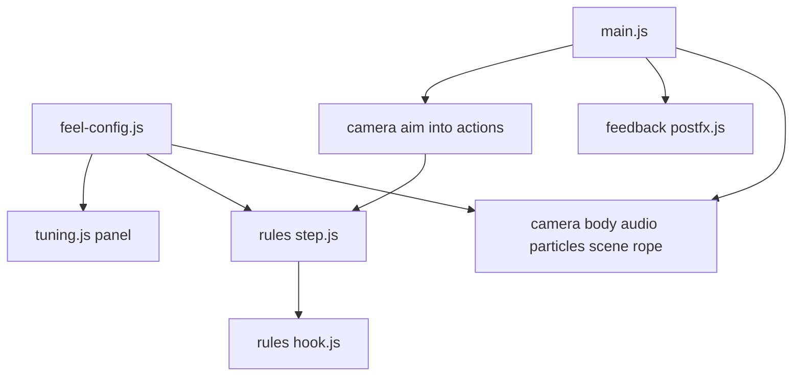

# Endless Walker Feel Pass and Grappling Hook Test Implementation Plan

> **For agentic workers (Gemini):** Use `.agents/skills/executing-plans/SKILL.md`. Do NOT use subagent-driven-development. Steps use checkbox (`- [ ]`) syntax.
>
> **Hard execution rules**
> 1. Implement tasks in order. Do not start Task N+1 until Task N's verification step passes.
> 2. Never skip an "Expected: FAIL" step. Run it and see it fail first.
> 3. **Never change an expected value in a test to make it pass.** This includes all 38 existing tests. If a test fails, STOP and report the test name, actual and expected value.
> 4. If a file or text anchor this plan names is not found, STOP and report.
> 5. Tick a box only when you observed the result yourself. Otherwise write `PENDING: <reason>`.
> 6. Do not commit, push, reset, checkout, clean, stash or delete. Do not run `git add`. The owner commits.
> 7. Touch only files under `docs/explorations/endless-walker/prototype/`, plus ticking boxes in this plan.
> 8. Do not edit `src/config.js` or `tests/config.test.js`.

**Goal:** Give walking, climbing, sliding and a new grappling hook test real weight and speed feel through camera, screen effects, world VFX and sound, all tunable live.

**Architecture:** New tuning values live in `src/feel-config.js` (separate from the 62 approved settings). The hook is a pure rule `src/rules/hook.js`, called from `stepWalker` only when a `feel` object is passed and the hook is on, so existing tests and behaviour are unchanged. Screen effects are one post-processing shader pass. All feedback modules gain a last parameter `feel` and still only read state.

**Tech Stack:** Three.js `0.160.0` (plus its `examples/jsm/postprocessing/` add-ons), lil-gui `0.19.2`, Web Audio, Node `node --test`.

**Spec:** `.cursor/plans/design/2026-11-12-endless-walker-feel-pass-and-hook-spike.md` (approved 2026-11-12). Read it fully before Task 1.

## Global Constraints

- Root `docs/explorations/endless-walker/prototype/`. All paths relative to it.
- Run tests from root: `node --test`. Run game: `python -m http.server 8765 --bind 127.0.0.1`, open `http://127.0.0.1:8765/` (port 8080 is taken by another app on this machine).
- Post-processing imports exactly: `three/addons/postprocessing/EffectComposer.js`, `RenderPass.js`, `ShaderPass.js`, `OutputPass.js` (the import map already maps `three/addons/`; all four probed HTTP 200).
- Only `src/main.js` and `src/feedback/*.js` import `three`. Only `src/tuning.js` imports `lil-gui`. `src/feel-config.js` and `src/rules/*.js` import nothing from the CDN.
- `load` stays only in `src/rules/stamina.js`. Feedback never assigns to `state` (existing purity test).
- Hook off by default. With the hook off, `stepWalker` must give exactly the same result as before.
- No new libraries, no installs, no build step, no sound or texture files.

## Review Focus

1. Hook off but fire held must change nothing. Test in Task 2 (`hook off is identical`).
2. Firing straight down at your own feet must not give NaN or a stuck Hooked state. Test in Task 2 (`hook at own feet arrives`).
3. Being pulled along or into the ground must never put the walker below the surface. Test in Task 2 (`pull never goes under ground`).
4. Right-click must not open the browser menu, and pointer lock must survive firing. Runtime check in Task 7.
5. Post-processing plus 600 footprints must still be playable. Runtime FPS check in Task 7 (owner).

---

## File map



| File | Task |
|---|---|
| Create `src/feel-config.js`, `tests/feel-config.test.js`. Modify `src/tuning.js`, `src/feedback/scene.js`, `src/main.js` | 1 |
| Create `src/rules/hook.js`, `tests/hook.test.js`, `src/feedback/rope.js`. Modify `src/rules/step.js`, `src/state.js`, `src/input.js`, `src/main.js`, `index.html` (help text) | 2 |
| Modify `src/feedback/camera.js` | 3 |
| Create `src/feedback/postfx.js`. Modify `src/main.js` | 4 |
| Modify `src/feedback/particles.js`, create `src/feedback/footprints.js` | 5 |
| Modify `src/feedback/audio.js` | 6 |
| Runtime checklist | 7 |

---

### Task 0: Baseline

- [x] **Step 1:** From root run `node --test`. Expected: `pass 38`, `fail 0`. Otherwise STOP.
- [x] **Step 2:** Read the spec and all files this plan modifies.

---

### Task 1: Feel config, panel, tunable scenery

**Interfaces (Produces):**
- `src/feel-config.js`: `export const FEEL_SPEC` (key -> `{ value, min, max, step, group }`, same shape as `CONFIG_SPEC`); `export const feel` (key -> number, live, mutated by the panel).
- `src/tuning.js`: `createTuning(config, CONFIG_SPEC, feel, FEEL_SPEC) -> gui`. One folder per group of both specs. "Reset values" and "Copy values" cover both (copied JSON has two keys: `config` and `feel`).
- `src/feedback/scene.js`: `createScene(renderer) -> { scene, sun, hemi, update(feel) }`. `update` sets `sun.intensity = feel.sunIntensity`, `hemi.intensity = feel.fillIntensity`, `scene.fog.near = feel.fogNear`, `scene.fog.far = feel.fogFar`. Called once per frame from `main.js`.

**FEEL_SPEC** (38 keys):

| Group | Key | Value | Min | Max | Step |
|---|---|---|---|---|---|
| Walk feel | bobHeight | 0.05 | 0 | 0.3 | |
| Walk feel | bobLoadGain | 1.0 | 0 | 3 | |
| Walk feel | swayRollDeg | 0.6 | 0 | 5 | |
| Walk feel | uphillCamDrop | 0.5 | 0 | 2 | |
| Walk feel | tiredSway | 0.03 | 0 | 0.2 | |
| Slide feel | slideShakeFrom | 12 | 0 | 40 | |
| Slide feel | slideShakeAmp | 0.06 | 0 | 0.4 | |
| Slide feel | carveRollDeg | 6 | 0 | 25 | |
| Screen FX | vignetteMax | 0.55 | 0 | 1 | |
| Screen FX | desatEmpty | 0.5 | 0 | 1 | |
| Screen FX | speedFxFrom | 14 | 0 | 40 | |
| Screen FX | speedFxMax | 0.8 | 0 | 1 | |
| Screen FX | blurStrength | 0.6 | 0 | 2 | |
| Screen FX | flashTime | 0.15 | 0 | 1 | |
| VFX | footprintCount | 200 | 0 | 600 | 10 |
| VFX | puffSize | 0.4 | 0 | 2 | |
| VFX | sprayRate | 1.0 | 0 | 4 | |
| VFX | lensFlecks | 1.0 | 0 | 3 | |
| Hook | hookEnabled | 0 | 0 | 1 | 1 |
| Hook | hookRange | 60 | 10 | 150 | |
| Hook | hookPull | 40 | 5 | 120 | |
| Hook | hookMaxSpeed | 35 | 5 | 80 | |
| Hook | hookArrive | 1.5 | 0.5 | 5 | |
| Hook | hookFovKick | 10 | 0 | 30 | |
| Hook | hookPunch | 0.3 | 0 | 1 | |
| Sound | masterVolume | 0.8 | 0 | 1 | |
| Sound | stepVolume | 0.7 | 0 | 1 | |
| Sound | breathVolume | 0.5 | 0 | 1 | |
| Sound | windVolume | 0.7 | 0 | 1 | |
| Sound | hookVolume | 0.7 | 0 | 1 | |
| Scenery | sunIntensity | 2.2 | 0 | 5 | |
| Scenery | fillIntensity | 0.45 | 0 | 2 | |
| Scenery | fogNear | 700 | 0 | 3000 | |
| Scenery | fogFar | 3800 | 500 | 6000 | |
| Toggles | camFxOn | 1 | 0 | 1 | 1 |
| Toggles | screenFxOn | 1 | 0 | 1 | 1 |
| Toggles | vfxOn | 1 | 0 | 1 | 1 |
| Toggles | soundOn | 1 | 0 | 1 | 1 |

- [x] **Step 1: Write `tests/feel-config.test.js`**

```js
import { test } from 'node:test';
import assert from 'node:assert/strict';
import { FEEL_SPEC, feel } from '../src/feel-config.js';

const GROUPS = ['Walk feel', 'Slide feel', 'Screen FX', 'VFX', 'Hook', 'Sound', 'Scenery', 'Toggles'];

test('feel spec: 38 keys, valid ranges, live values match', () => {
  assert.equal(Object.keys(FEEL_SPEC).length, 38);
  for (const [k, s] of Object.entries(FEEL_SPEC)) {
    assert.ok(s.min <= s.value && s.value <= s.max, k);
    assert.ok(GROUPS.includes(s.group), k);
    assert.equal(feel[k], s.value, k);
  }
});

test('hook is off by default; scenery matches today values', () => {
  assert.equal(feel.hookEnabled, 0);
  assert.equal(feel.sunIntensity, 2.2);
  assert.equal(feel.fogNear, 700);
});
```

Expected-value reasoning: 38 = rows of the table above. Scenery values are the ones hard-coded in `scene.js` today (sun 2.2, fill 0.45, fog 700 to 3800).

- [x] **Step 2:** Run `node --test tests/feel-config.test.js`. Expected: FAIL (module missing).
- [x] **Step 3:** Implement `src/feel-config.js`; extend `createTuning`; add `hemi` and `update(feel)` to `createScene`; in `main.js` import `feel, FEEL_SPEC`, call `createTuning(config, CONFIG_SPEC, feel, FEEL_SPEC)` and `sceneApi.update(feel)` each frame.
- [x] **Step 4:** Run `node --test`. Expected: `pass 40`, `fail 0`.

---

### Task 2: Hook rule, input, rope line

**Interfaces:**
- Consumes: `terrain.heightAt`, `terrain.slopeDegAt`; `feel` from Task 1.
- Produces:
  - `src/rules/hook.js`:
    - `export function raycastTerrain(origin, dir, maxDist, terrain) -> {x,y,z} | null`. March 0.5 m steps along unit `dir` from `origin`; at the first sample below `heightAt`, bisect 8 times between the last two samples; return that point. `null` if no hit within `maxDist`.
    - `export function hook(state, actions, feel, dt, terrain, config) -> state | null`. Returns `null` when the hook is not involved this step (hook off and not Hooked, or no fire and not Hooked). Otherwise returns the new state.
  - `WalkerState` gains `hookAnchor: null | {x,y,z}` (set in `createState` and `peakState`).
  - `Actions` gains `hookFire` (held: right mouse button or gamepad button 5), `hookToggle` (edge: KeyG), `aim: {ox,oy,oz,dx,dy,dz}` (camera position and unit forward, filled by `main.js` after `input.read`; input sets it to null).
  - `stepWalker(state, actions, config, dt, terrain, feel)`: new optional 6th param. First line after the field: `const h = feel ? hook(state, actions, feel, dt, terrain, config) : null;` If `h` is not null, skip mode transitions and movement, then run stamina and balance on `h` as now.
  - `src/feedback/rope.js`: `createRope(scene) -> { update(state, feel, dt) }`. Line from walker chest to `state.hookAnchor` while mode is `Hooked`, slight sideways wobble that settles over 0.3 s after attach. Hidden otherwise.
- `main.js`: on `actions.hookToggle`, set `feel.hookEnabled = 1 - feel.hookEnabled`. Fill `actions.aim` from `cameraRig.camera` (`getWorldDirection`). Pass `feel` to `stepWalker`.
- `input.js`: `contextmenu` event `preventDefault` on the canvas; right button (`e.button === 2`) sets `hookFire`; left stays grab.

Hook behaviour (spec section 4):
- Hook off (`feel.hookEnabled` is 0) and mode `Hooked` → mode `InAir`, keep `vel`, `hookAnchor = null`.
- Not Hooked, `hookFire` held, hook on, `actions.aim` not null → `raycastTerrain(aim origin, aim dir, feel.hookRange)`. Hit → mode `Hooked`, `hookAnchor` = hit, `modeTime = 0`, `vel` = current velocity (OnFoot and Sliding: `(sin h, 0, cos h) * speed`; InAir and Hooked: `vel`; OnWall: 0). Miss → `null`.
- Hooked and `hookFire` held: `v += unit(anchor - pos) * hookPull * dt`, `v.y -= config.gravity * dt`, clamp `|v| <= hookMaxSpeed`, `pos += v * dt`. If `pos.y < heightAt`: `pos.y = heightAt` and `v.y = max(v.y, 0)`. `speed` = horizontal `|v|`, `heading = atan2(v.x, v.z)` when horizontal speed > 0.5.
- Hooked and distance to anchor `< hookArrive` → `actions.grab && slopeDegAt(anchor) > config.grabMinDeg` ? `OnWall` : `OnFoot`; `vel` 0 for OnWall; `hookAnchor = null`.
- Hooked and `hookFire` released → `InAir`, `vel` kept, `hookAnchor = null`.

- [x] **Step 1: Write `tests/hook.test.js`**

```js
import { test } from 'node:test';
import assert from 'node:assert/strict';
import * as terrain from '../src/terrain.js';
import { config } from '../src/config.js';
import { FEEL_SPEC } from '../src/feel-config.js';
import { createState } from '../src/state.js';
import { stepWalker } from '../src/rules/step.js';
import { hook, raycastTerrain } from '../src/rules/hook.js';
const dt = 1 / 60;
const defaults = () => Object.fromEntries(Object.entries(FEEL_SPEC).map(([k, s]) => [k, s.value]));
const feelOn = () => ({ ...defaults(), hookEnabled: 1 });
const feelOff = () => ({ ...defaults(), hookEnabled: 0 });
const act = (o = {}) => ({ raw: { x: 0, y: 0 }, move: { x: 0, z: 0, mag: 0 }, sprint: false, jump: false, grab: false, crouch: false, loadDelta: 0, reset: false, toPeak: false, lookDX: 0, lookDY: 0, hookFire: false, hookToggle: false, aim: null, ...o });
const at = (z, o = {}) => ({ ...createState(config), pos: { x: 0, y: terrain.heightAt(0, z), z }, ...o });
const dist = (a, b) => Math.hypot(a.x - b.x, a.y - b.y, a.z - b.z);

test('raycast down hits the approach surface', () => {
  const p = raycastTerrain({ x: 0, y: 160, z: -310 }, { x: 0, y: -1, z: 0 }, 60, terrain);
  assert.ok(p && Math.abs(p.y - terrain.heightAt(0, -310)) < 0.1, JSON.stringify(p));
});

test('raycast up misses', () => assert.equal(raycastTerrain({ x: 0, y: 160, z: -310 }, { x: 0, y: 1, z: 0 }, 60, terrain), null));

test('hook off is identical to no hook', () => {
  const s = at(-300), a = act({ hookFire: true, aim: { ox: 0, oy: 160, oz: -310, dx: 0, dy: -1, dz: 0 }, move: { x: 0, z: 1, mag: 1 } });
  assert.deepEqual(stepWalker(s, a, config, dt, terrain, feelOff()), stepWalker(s, a, config, dt, terrain));
});

test('fire and hit from OnFoot enters Hooked', () => {
  const L = Math.hypot(0.2, 0.98);
  const a = act({ hookFire: true, aim: { ox: 0, oy: terrain.heightAt(0, -300) + 1.5, oz: -300, dx: 0, dy: 0.2 / L, dz: 0.98 / L } });
  const s = hook(at(-300), a, feelOn(), dt, terrain, config);
  assert.equal(s.mode, 'Hooked'); assert.ok(s.hookAnchor.z > -296 && s.hookAnchor.z < -292, `anchor z ${s.hookAnchor.z}`);
});

test('pull closes distance fast and caps speed', () => {
  const anchor = { x: 0, y: terrain.heightAt(0, -270) + 1, z: -270 };
  let s = at(-300, { mode: 'Hooked', hookAnchor: anchor });
  s = { ...s, pos: { ...s.pos, y: s.pos.y + 0.1 } };
  const d0 = dist(s.pos, anchor);
  const a = act({ hookFire: true });
  for (let i = 0; i < 60 && s.mode === 'Hooked'; i++) s = hook(s, a, feelOn(), dt, terrain, config);
  assert.ok(d0 - dist(s.pos, anchor) > 10, `closed ${d0 - dist(s.pos, anchor)}`);
  let t = at(-300, { mode: 'Hooked', hookAnchor: { x: 0, y: 900, z: -300 } }), vmax = 0;
  for (let i = 0; i < 300; i++) { t = hook(t, a, feelOn(), dt, terrain, config); vmax = Math.max(vmax, Math.hypot(t.vel.x, t.vel.y, t.vel.z)); }
  assert.ok(vmax <= 35 + 1e-9, `vmax ${vmax}`);
});

test('pull never goes under ground', () => {
  let s = at(-300, { mode: 'Hooked', hookAnchor: { x: 0, y: terrain.heightAt(0, -200), z: -200 } });
  const a = act({ hookFire: true });
  for (let i = 0; i < 600 && s.mode === 'Hooked'; i++) {
    s = hook(s, a, feelOn(), dt, terrain, config);
    assert.ok(s.pos.y >= terrain.heightAt(s.pos.x, s.pos.z) - 1e-6, `under at step ${i}`);
  }
});

test('release keeps velocity and flies', () => {
  const s = hook(at(-300, { mode: 'Hooked', hookAnchor: { x: 0, y: 200, z: -250 }, vel: { x: 0, y: 5, z: 20 } }), act(), feelOn(), dt, terrain, config);
  assert.equal(s.mode, 'InAir'); assert.deepEqual(s.vel, { x: 0, y: 5, z: 20 }); assert.equal(s.hookAnchor, null);
});

test('hook at own feet arrives, no NaN', () => {
  const y = terrain.heightAt(0, -680);
  let s = hook(at(-680), act({ hookFire: true, aim: { ox: 0, oy: y + 1.5, oz: -680, dx: 0, dy: -1, dz: 0 } }), feelOn(), dt, terrain, config);
  for (let i = 0; i < 5 && s && s.mode === 'Hooked'; i++) s = hook(s, act({ hookFire: true }), feelOn(), dt, terrain, config);
  assert.equal(s.mode, 'OnFoot'); assert.ok(Number.isFinite(s.pos.x + s.pos.y + s.pos.z));
});

test('switching hook off while Hooked drops to InAir', () => {
  const s = hook(at(-300, { mode: 'Hooked', hookAnchor: { x: 0, y: 200, z: -250 } }), act({ hookFire: true }), feelOff(), dt, terrain, config);
  assert.equal(s.mode, 'InAir');
});
```

Expected-value reasoning: approach surface at z −310 is 148.8 m (Claude computed with the current `terrain.js`), so a ray from y 160 straight down hits within 12 m, inside range 60; bisection to 0.5/2⁸ m gives < 0.1 error. Aim (0, 0.2, 0.98) normalised from 1.5 m above z −300 rises at 11.5° into a 27° slope; Claude marched the current terrain at 0.05 m: hit at 6.15 m, z −293.97, so bounds −296 to −292. Pull: Claude simulated the exact formula (pull 40, gravity 15, cap 35, ground clamp) on 2026-11-12: distance 33.7 m → 13.9 m in 1 s (closed 19.8 > 10); speed cap reached exactly 35.000 with a far anchor. Own-feet aim: hit is about 1.5 m below the eye, then within `hookArrive` 1.5 m after at most a few steps.

- [x] **Step 2:** Run `node --test tests/hook.test.js`. Expected: FAIL (module missing).
- [x] **Step 3:** Implement `hook.js`; add `hookAnchor: null` to both state builders; wire `step.js`, `input.js`, `main.js`; create `rope.js`; add "Right mouse: hook (G toggles)" to the help overlay in `index.html`.
- [x] **Step 4:** Run `node --test`. Expected: `pass 49`, `fail 0` (38 old + 2 feel + 9 hook). The 38 old tests must pass unchanged.

---

### Task 3: Camera feel

**Interfaces:** `cameraRig.update(state, config, dt, lookDX, lookDY, feel)`. All effects scaled to 0 when `feel.camFxOn` is 0.

Behaviour (spec section 3, camera column):
- **OnFoot:** head bob on target height `bobHeight * (1 + bobLoadGain * load / 60) * sin(2π * steps)`; roll `swayRollDeg * sin(π * steps)`; when `slopeAlong` uphill, camera height lower by `uphillCamDrop * sin(slopeAlong)` and distance 15% closer; stamina below 25% of `staminaMax - load` adds slow sway `tiredSway * sin(1.3 t)`. The camera reads `state.load` here only to scale bob. That is feedback, not a rule, so the `load` purity rule (rules folder only) still holds.
- **OnWall:** distance × 0.7.
- **Sliding:** shake amplitude `slideShakeAmp * clamp((speed - slideShakeFrom) / 10, 0, 1)` (smooth noise, not white random), roll toward heading change rate up to `carveRollDeg`.
- **Hooked:** on entering, zoom punch: FOV dips by `hookPunch * 10` degrees over 0.1 s then returns; while Hooked, FOV `fovFoot + hookFovKick`; yaw eases toward velocity direction at 3 rad/s. InAir right after Hooked keeps the kick, fading over 0.5 s.
- **Fallen from a hard landing:** existing shake plus a 0.2 m dip.

- [x] **Step 1:** Implement; pass `feel` from `main.js`.
- [x] **Step 2:** Run `node --test`. Expected: `pass 49`, `fail 0` (purity test still passes).

---

### Task 4: Screen effects

**Interfaces:** `src/feedback/postfx.js`: `createPostFx(renderer, scene, camera) -> { render(state, config, feel, dt), setSize(w, h) }`. Composer = RenderPass + one ShaderPass + OutputPass. `main.js` replaces `renderer.render(...)` with `postFx.render(...)`, and calls `setSize` on resize. When `feel.screenFxOn` is 0, the shader pass is disabled.

Shader uniforms and their sources:

| Uniform | Value |
|---|---|
| vignette | `vignetteMax * (1 - stamina / usable)` on foot and wall; 0.25 × that while sliding |
| desat | `desatEmpty` when stamina is 0, eased over 0.5 s |
| speedFx | `speedFxMax * clamp((speed - speedFxFrom) / 12, 0, 1)` while Sliding, Hooked or InAir (speed = 3D velocity length in air) |
| blur | radial blur from screen centre, strength `blurStrength * speedFx`, 8 taps |
| lines | speed lines at the edges (hash of angle and time), opacity = speedFx |
| flash | white/chromatic edge flash `1 → 0` over `flashTime` on: entering Hooked, landing hard |

- [x] **Step 1:** Implement; wire in `main.js`.
- [x] **Step 2:** Run `node --test`. Expected: `pass 49`, `fail 0`.

---

### Task 5: World VFX

**Interfaces:** `src/feedback/footprints.js`: `createFootprints(scene) -> { update(state, feel, dt) }`. Pool of 600 flat dark-blue instanced quads (0.25 × 0.12 m, opacity 0.35). One print per integer change of `state.steps` while OnFoot, alternating left and right 0.15 m; while Sliding one long groove quad every 0.5 m. Only the newest `feel.footprintCount` are visible. `particles.update(state, config, dt, feel)` adds: snow puff per footstep (size `puffSize`), spray rate × `sprayRate`, bigger burst while braking or steering hard, anchor burst on entering Hooked, small dust per climb move, lens flecks: 60 near-camera points streaking past at slide/air speed above 10 m/s, count × `lensFlecks`. Everything hidden when `feel.vfxOn` is 0.

- [x] **Step 1:** Implement; wire in `main.js`.
- [x] **Step 2:** Run `node --test`. Expected: `pass 49`, `fail 0`.

---

### Task 6: Sound

**Interfaces:** `audio.update(state, config, dt, feel)`. All gains × `masterVolume`, and 0 when `soundOn` is 0.

| Sound | Rule |
|---|---|
| Footstep crunch | Per integer change of `steps`: noise burst through low-pass, cutoff `1800 - 900 * load/60` Hz, gain `stepVolume * (0.6 + 0.4 * load/60)`, plus a short 70 Hz thump |
| Breath | Existing loop, gain `breathVolume * (1 - stamina/usable)`, rate up when tired |
| Wind roar | Noise band-pass, centre `300 + 40 * speed` Hz, gain `windVolume * clamp(speed / 25, 0, 1)` in Sliding, Hooked, InAir |
| Scrape and carve | Sliding: band-pass noise gain by speed; extra high hiss by steer amount |
| Hook | Thunk (short low sine drop 180 to 60 Hz) on entering Hooked; reel whine (saw 400 to 900 Hz by speed) while Hooked; gains × `hookVolume` |
| Fall | Thud on entering Fallen |

- [x] **Step 1:** Implement.
- [x] **Step 2:** Run `node --test`. Expected: `pass 49`, `fail 0`.

---

### Task 7: Runtime checklist (owner)

Gemini ticks only what it observed; otherwise PENDING.

- [x] `node --test` final count: pass 49 fail 0
- [ ] Page loads with no console errors (PENDING: requires interactive browser test by owner)
- [ ] Walk: bob, footprints, crunch, vignette when tired (PENDING: requires interactive playtest by owner)
- [ ] Slide: shake, speed lines, blur, lens flecks, wind roar (PENDING: requires interactive playtest by owner)
- [ ] Hook: G on, right-click fires, no browser menu, pointer lock kept, pull, release flight, landing (PENDING: requires interactive playtest by owner)
- [ ] Each toggle in the panel turns its effect family off (PENDING: requires interactive playtest by owner)
- [ ] FPS stays playable with 600 footprints and screen FX on (owner) (PENDING: requires interactive playtest by owner)
- [ ] **Owner pass test:** walking has weight, sliding feels fast, the hook is fun (PENDING: requires owner playtest)
- [x] `git status --short` shows changes only under the prototype folder and this plan

Report: test counts, box states, STOP events, deviations with reason.
