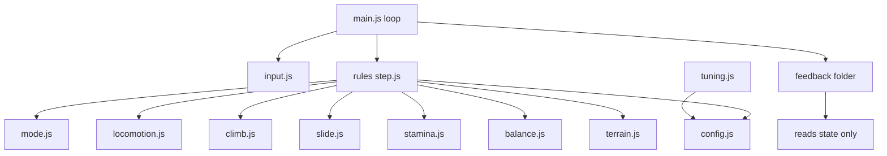
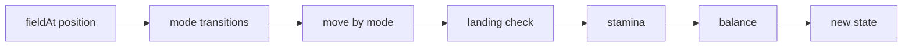

# Endless Walker Prototype (One Snow Mountain) Implementation Plan

> **For agentic workers (Gemini):** Use `.agents/skills/executing-plans/SKILL.md` (or superpowers:executing-plans). Do NOT use subagent-driven-development. Steps use checkbox (`- [ ]`) syntax.
>
> **Hard execution rules**
> 1. Implement tasks in order. Do not start Task N+1 until Task N's verification step passes.
> 2. Never skip an "Expected: FAIL" step. Run it and see it fail first.
> 3. **Never change an expected value in a test to make it pass.** If a test fails after a correct-looking implementation, STOP and report the test name, actual value and expected value.
> 4. If a file or text anchor this plan names is not found, STOP and report.
> 5. Tick a box only when you observed the result yourself. Otherwise write `PENDING: <reason>` next to it.
> 6. Do not commit, push, reset, checkout, clean or delete anything. The owner commits.
> 7. Touch only files under `docs/explorations/endless-walker/prototype/`, plus ticking boxes in this plan.
> 8. Do not add anything from the Non-goals list (Global Constraints).

**Goal:** Browser prototype of one snow mountain where the owner can walk uphill under load, climb a cliff band, and slide down a long face, with every feel number live-tunable.

**Architecture:** Plain ES modules, no build step, served statically. Rules are pure functions `(state, actions, field, config, dt, terrain) -> newState` in `src/rules/`, testable with `node --test`. Three.js feedback modules in `src/feedback/` only read state. One fixed 1/60 s simulation step, decoupled from drawing.

**Tech Stack:** Three.js `0.160.0` and lil-gui `0.19.2` via import map from `cdn.jsdelivr.net`; Web Audio; Gamepad API; Node `v24.12.0` built-in test runner (verified installed 2026-11-12, npm 11.17.0).

**Spec:** `.cursor/plans/design/2026-11-12-endless-walker-prototype.md` (approved EW-28; section 12 = starting values). Read sections 2, 6, 7, 8, 9 and 12 before Task 1.

## Global Constraints

- Root: `docs/explorations/endless-walker/prototype/`. All paths below are relative to it.
- Units metres, seconds. Degrees in config, radians in math. Y up. Summit at x 0, z 0. Approach side negative z, slide face positive z. Heading 0 means facing +z; direction vector `(sin h, cos h)` in (x, z).
- Fixed simulation step 1/60 s. Max 5 steps per animation frame.
- Walker 1.8 m tall, 0.35 m radius. Start x 0, z -680, heading 0.
- Import map URLs exactly: `https://cdn.jsdelivr.net/npm/three@0.160.0/build/three.module.js`, `https://cdn.jsdelivr.net/npm/three@0.160.0/examples/jsm/`, `https://cdn.jsdelivr.net/npm/lil-gui@0.19.2/dist/lil-gui.esm.js` (all three probed HTTP 200).
- Only `src/main.js` and `src/feedback/*.js` may import `three`. Only `src/tuning.js` may import `lil-gui`. `src/config.js`, `state.js`, `input.js`, `terrain.js`, `rules/*.js` import nothing from the CDN, so Node can load them.
- `package.json` in root contains `{"type":"module","private":true,"scripts":{"test":"node --test"}}` and no dependencies.
- Load (EW-20) affects stamina only. The word `load` may appear in `src/rules/stamina.js` only, among rule files.
- Feedback never writes state.
- Non-goals (do not build): procedural generation, other biomes, vehicles, weather, night, temperature, wind, water, rope and rappel, gear, growth, charting, a reason for speed, saving, phone support. No other case-study concepts (Anima, Forest_Bloom, psychology models).
- No textures, model files or sound files. Body is boxes. Sound made in Web Audio.
- Run tests: from root, `node --test`. Run game: from root, `python -m http.server 8080`, open `http://localhost:8080/`.

## Changes vs spec section 12 (Claude, for owner review)

| Item | Spec 12 | Plan | Why |
|---|---|---|---|
| Tucked air drag | 0.007 | **0.0062** | With 0.007 tucked speed settles at 22.6 m/s, not the spec's "about 24". 0.0062 gives 23.99. Feel target kept, number changed |
| Height blends | "short smooth blends" | Box filter of half-width 1 m over the piecewise-linear profile | Exact, testable. Keeps the 3 m ledge flat |
| Slide face 20 to 35 degree variation | "wider gentle waves" | Wave `4.0 * sin(2π(r-12)/150)` tapered at both ends | Verified: centre line 20.0 to 37.5 degrees incl. bumps |
| Bump hits | 5 to 10 at once | One hit per 25 m travelled above safe speed: `5 + 5 * bumpNorm` | Deterministic, testable |
| Rock islands | 3 to 5, 5 to 10 m | 4 domes radius 4 m, height 2 m at (-60,200), (70,320), (-90,430), (40,520) | Off centre line |

Known fact, not changed: a walkable route (max 35 degrees) goes round the cliff at about 60 to 75 degrees from +z. Climbing is not forced. Owner decides after playtest.

## Review Focus

1. Long frame (tab hidden then shown) must not teleport or tunnel the walker: accumulator clamps to 5 steps. Test in Task 2 (`stepsForFrame`).
2. Walking straight into the cliff without grab must stop the walker, not let it walk up a 66 degree face. Test in Task 3.
3. Changing load while stamina is above the new usable max must clamp stamina. Test in Task 4.
4. Releasing grab on the wall, or stamina hitting 0, drops into InAir, and a hard landing gives Fallen, not a stuck state. Tests in Tasks 5 and 6.
5. A relaxed slide (no tuck, no steer) on the real slide face centre line must never lose balance. Test in Task 6 runs it on real terrain.

---

## File map



| File | Task |
|---|---|
| `index.html`, `package.json`, `src/config.js`, `src/state.js`, `src/terrain.js`, `tests/terrain.test.js`, `tests/config.test.js` | 1 |
| `src/main.js`, `src/loop.js`, `src/input.js`, `src/feedback/scene.js`, `src/feedback/camera.js`, `tests/input.test.js`, `tests/loop.test.js` | 2 |
| `src/rules/step.js`, `src/rules/mode.js`, `src/rules/locomotion.js`, `tests/locomotion.test.js` | 3 |
| `src/rules/stamina.js`, `src/feedback/hud.js`, `tests/stamina.test.js`, `tests/purity.test.js` | 4 |
| `src/rules/climb.js`, `tests/climb.test.js` | 5 |
| `src/rules/slide.js`, `src/rules/balance.js`, `tests/slide.test.js`, `tests/balance.test.js` | 6 |
| `src/feedback/body.js`, `audio.js`, `rumble.js`, `particles.js` | 7 |
| `src/tuning.js` | 8 |

Step order inside one simulation step:



Move by mode: OnFoot uses locomotion, OnWall uses climb, Sliding and Fallen use slide, InAir uses ballistic motion in `step.js`.

---

### Task 0: Inspect checkout and baseline

- [x] **Step 1:** Run `git status --short` from repo root. Expected: `docs/explorations/endless-walker/prototype/` does not exist yet. If it exists, STOP and report its contents.
- [x] **Step 2:** Run `node --version`. Expected: `v24.x` or newer. Run `python --version`. Expected: 3.x.
- [x] **Step 3:** Read spec sections 2, 6, 7, 8, 9, 12 and this whole plan.

---

### Task 1: Scaffold, config, state, terrain

**Files:** Create `index.html`, `package.json`, `src/config.js`, `src/state.js`, `src/terrain.js`, `tests/terrain.test.js`, `tests/config.test.js`.

**Interfaces (Produces):**
- `src/config.js`: `export const CONFIG_SPEC` = object, key -> `{ value, min, max, step, group }`; `export const config` = plain object key -> number, built from `CONFIG_SPEC` values. Tuning panel mutates `config` in place.
- `src/state.js`: `export function createState(config) -> WalkerState`; `export function peakState(config) -> WalkerState` (x 0, z 2, on surface, heading 0, OnFoot, stamina full).
- `WalkerState` = `{ pos:{x,y,z}, vel:{x,y,z}, heading, speed, stamina, balance, load, mode, modeTime, sinceDrain, fallTimer, bumpDist, lungeTimer, lungeDir:{x,z}, lungeStarted, steps }`. `mode` is one of `'OnFoot' | 'OnWall' | 'Sliding' | 'InAir' | 'Fallen'`. `steps` = footstep counter (float, feedback reads its integer part). Start values: `pos` (0, heightAt, -680), `vel` 0, `heading` 0, `speed` 0, `stamina` 100, `balance` 100, `load` 0, `mode 'OnFoot'`, others 0 / false.
- `src/terrain.js`: `heightAt(x,z) -> number`; `gradientAt(x,z) -> {gx,gz}`; `slopeDegAt(x,z) -> number`; `zoneAt(x,z) -> 'base'|'approach'|'cliff'|'summit'|'slide'|'runout'|'rock'`; `fieldAt(x,z,heading) -> Field`; constants `ROCKS` (array of `{x,z,radius,height}`), `LANDMARK = {x:0, z:4000, height:900}`.
- `Field` = `{ height, slopeDeg, slopeAlongDeg, slopeAcrossDeg, grip, softness, zone, bumpNorm, aheadSlopeDeg, uphill:{x,z} }`. `slopeAlongDeg` positive = uphill along heading. `slopeAcrossDeg` = signed sideways tilt. `aheadSlopeDeg` = `slopeDegAt` 0.6 m ahead along heading. `uphill` = unit horizontal vector up the gradient (0,0 on flat). `bumpNorm` = local bump noise mapped to 0..1.

**CONFIG_SPEC keys** (value, min, max, step, group). Every number below is a starting value from spec 12.4:

| Key | Value | Min | Max | Group |
|---|---|---|---|---|
| walkSpeed | 3.0 | 0.5 | 8 | Locomotion |
| sprintSpeed | 5.5 | 1 | 12 | Locomotion |
| speedGain | 6 | 0.5 | 30 | Locomotion |
| speedLoss | 8 | 0.5 | 30 | Locomotion |
| turnRateWalk | 360 | 30 | 1080 | Locomotion |
| turnRateSprint | 140 | 30 | 1080 | Locomotion |
| uphillCoef | 0.9 | 0 | 2 | Locomotion |
| uphillMin | 0.35 | 0.05 | 1 | Locomotion |
| snowCoef | 0.3 | 0 | 1 | Locomotion |
| walkLimitDeg | 45 | 30 | 60 | Locomotion |
| gravity | 15 | 5 | 30 | Locomotion |
| jumpSpeed | 5.5 | 1 | 12 | Locomotion |
| hardLanding | 9 | 3 | 30 | Locomotion |
| staminaMax | 100 | 50 | 200 | Stamina |
| loadMax | 60 | 0 | 90 | Stamina |
| loadStepSize | 10 | 1 | 30 | Stamina |
| sprintDrain | 6 | 0 | 30 | Stamina |
| uphillDrainCoef | 2.5 | 0 | 10 | Stamina |
| climbDrainMove | 3 | 0 | 10 | Stamina |
| climbDrainHang | 1 | 0 | 10 | Stamina |
| lungeDistance | 2 | 0.5 | 5 | Climb |
| lungeCost | 8 | 0 | 30 | Stamina |
| regainStand | 12 | 0 | 40 | Stamina |
| regainWalk | 6 | 0 | 40 | Stamina |
| regainWalkMaxDeg | 10 | 0 | 30 | Stamina |
| regainDelay | 0.8 | 0 | 3 | Stamina |
| emptySpeedCap | 1.2 | 0.2 | 3 | Stamina |
| grabMinDeg | 50 | 40 | 80 | Climb |
| grabReach | 0.6 | 0.2 | 2 | Climb |
| climbSpeed | 1.2 | 0.2 | 4 | Climb |
| lungeTime | 0.25 | 0.05 | 1 | Climb |
| slideStartDeg | 8 | 0 | 30 | Slide |
| dragRelaxed | 0.015 | 0.001 | 0.05 | Slide |
| dragTucked | 0.0062 | 0.001 | 0.05 | Slide |
| brakeGrip | 0.45 | 0 | 1 | Slide |
| steerK | 700 | 100 | 2000 | Slide |
| steerMin | 30 | 5 | 180 | Slide |
| steerMax | 90 | 5 | 360 | Slide |
| slideEndSpeed | 2 | 0 | 6 | Slide |
| slideEndDeg | 10 | 0 | 30 | Slide |
| slideReleaseSpeed | 4 | 0 | 10 | Slide |
| balanceMax | 100 | 50 | 200 | Balance |
| safeSpeed | 18 | 5 | 40 | Balance |
| balDropPerMs | 4 | 0 | 20 | Balance |
| balDropTilt | 25 | 0 | 100 | Balance |
| balDropSteer | 15 | 0 | 100 | Balance |
| bumpSpacing | 25 | 5 | 100 | Balance |
| bumpHitMin | 5 | 0 | 30 | Balance |
| bumpHitExtra | 5 | 0 | 30 | Balance |
| balRecover | 20 | 0 | 100 | Balance |
| fallTumble | 1.5 | 0.2 | 5 | Balance |
| fallKeep | 0.3 | 0 | 1 | Balance |
| fallStand | 1.0 | 0.2 | 5 | Balance |
| fallFriction | 4 | 0 | 20 | Balance |
| camDistFoot | 5.5 | 2 | 15 | Camera |
| camDistSlide | 4 | 2 | 15 | Camera |
| camHeightFoot | 1.8 | 0 | 6 | Camera |
| camHeightSlide | 1.0 | 0 | 6 | Camera |
| fovFoot | 60 | 30 | 100 | Camera |
| fovSlideMax | 80 | 30 | 110 | Camera |
| fovSlideSpeed | 24 | 5 | 50 | Camera |
| camDelay | 0.15 | 0 | 1 | Camera |

Groups: Locomotion, Stamina, Climb, Slide, Balance, Camera.

- [x] **Step 1: Write `package.json`** exactly as in Global Constraints.

- [x] **Step 2: Write failing tests `tests/terrain.test.js`**

```js
import { test } from 'node:test';
import assert from 'node:assert/strict';
import { heightAt, slopeDegAt, fieldAt, zoneAt } from '../src/terrain.js';

const near = (a, b, tol) => assert.ok(Math.abs(a - b) <= tol, `${a} not within ${tol} of ${b}`);

test('heights: summit, base, ledge', () => {
  near(heightAt(0, 0), 320, 0.01);
  near(heightAt(0, -680), 0, 0.01);
  near(heightAt(0, -82.5), 273.75, 0.3);
});

test('approach centre line is walkable (under 45)', () => {
  for (const [a, b] of [[-14, -70], [-100, -596]])
    for (let z = a; z >= b; z -= 0.5) assert.ok(slopeDegAt(0, z) < 45, `z ${z}: ${slopeDegAt(0, z)}`);
});

test('both cliff pitches steeper than grab limit 50', () => {
  assert.ok(slopeDegAt(0, -78) > 50);
  assert.ok(slopeDegAt(0, -87) > 50);
});

test('slide face centre line: walkable everywhere, 20 to 38 degrees on the face', () => {
  for (let z = 0; z <= 640; z += 0.5) assert.ok(slopeDegAt(0, z) < 45, `z ${z}`);
  for (let z = 40; z <= 580; z += 0.5) {
    const s = slopeDegAt(0, z);
    assert.ok(s > 19.5 && s < 38, `z ${z}: ${s}`);
  }
});

test('field values by zone', () => {
  assert.equal(zoneAt(0, 300), 'slide');
  assert.equal(zoneAt(0, -300), 'approach');
  assert.equal(zoneAt(0, -78), 'cliff');
  assert.equal(zoneAt(-60, 200), 'rock');
  const s = fieldAt(0, 300, 0), a = fieldAt(0, -300, 0), c = fieldAt(0, -78, Math.PI);
  assert.equal(s.grip, 0.12); assert.equal(s.softness, 0.2);
  assert.equal(a.grip, 0.35); assert.equal(a.softness, 0.6);
  assert.equal(c.grip, 0.8);  assert.equal(c.softness, 0);
});

test('slopeAlong sign: facing +z on approach is uphill, on slide face is downhill', () => {
  assert.ok(fieldAt(0, -300, 0).slopeAlongDeg > 20);
  assert.ok(fieldAt(0, 300, 0).slopeAlongDeg < -20);
  assert.ok(Math.abs(fieldAt(0, -300, Math.PI / 2).slopeAlongDeg) < 8);
});
```

Expected-value reasoning: summit r<12 is flat 320 with all noise masked (masks start at r 14). Base r 680 > 600, profile 0 and bump mask is 0 beyond 600. Ledge centre r 82.5 lies inside 81 to 84 (274 to 273.5, linear = 273.75); the 1 m box filter does not reach it and bumps are masked on 66 to 98. Approach base slope atan(260/510) = 27.0°; worst case with 1.5 m / 40 m bumps measured 31.8°. Cliffs atan(14/6) = 66.8°, atan(13.5/6) = 66.0°. Slide face atan(320/600) = 28.1° ± wave; measured centre line 19.95° to 37.52° (Claude ran this exact formula on 2026-11-12). At heading π/2 on approach, travel is across the fall line, so slope along is near 0.

- [x] **Step 3:** Run `node --test tests/terrain.test.js`. Expected: FAIL, cannot find module `../src/terrain.js`.

- [x] **Step 4: Implement `src/terrain.js`.** The formula is fixed; use this code for the height function (it is the verified version):

```js
const ss = (a, b, x) => { const t = Math.min(1, Math.max(0, (x - a) / (b - a))); return t * t * (3 - 2 * t); };
const SLIDE = [[0, 320], [12, 320], [612, 0]];
const APPR = [[0, 320], [12, 320], [75, 288], [81, 274], [84, 273.5], [90, 260], [600, 0]];
function lin(t, r) {
  if (r <= t[0][0]) return t[0][1];
  for (let i = 1; i < t.length; i++) if (r <= t[i][0]) {
    const [a, ha] = t[i - 1], [b, hb] = t[i]; return ha + (hb - ha) * (r - a) / (b - a);
  }
  return t[t.length - 1][1];
}
function profile(t, r, b) { let s = 0; for (let k = -4; k <= 4; k++) s += lin(t, Math.max(0, r + b * k / 4)); return s / 9; }
function hash(i, j, s) { const h = Math.sin(i * 127.1 + j * 311.7 + s * 74.7) * 43758.5453; return (h - Math.floor(h)) * 2 - 1; }
function vnoise(x, z, sp, s) {
  const fx = x / sp, fz = z / sp, i = Math.floor(fx), j = Math.floor(fz), u = fx - i, v = fz - j;
  const su = u * u * (3 - 2 * u), sv = v * v * (3 - 2 * v);
  const a = hash(i, j, s), b = hash(i + 1, j, s), c = hash(i, j + 1, s), d = hash(i + 1, j + 1, s);
  return a + (b - a) * su + (c - a) * sv + (a - b - c + d) * su * sv;
}
function baseHeight(x, z) {
  const r = Math.hypot(x, z);
  const w = r < 1e-6 ? 1 : ss(-0.3, 0.3, z / r);
  const wave = 4 * Math.sin(2 * Math.PI * (r - 12) / 150) * ss(12, 40, r) * (1 - ss(560, 612, r));
  const slide = profile(SLIDE, r, 1) + wave + 0.6 * vnoise(x, z, 25, 2) * ss(14, 30, r) * (1 - ss(580, 612, r));
  const cliffMask = 1 - ss(66, 70, r) * (1 - ss(94, 98, r));
  const appr = profile(APPR, r, 1) + 1.5 * vnoise(x, z, 40, 1) * ss(14, 30, r) * (1 - ss(560, 600, r)) * cliffMask;
  return w * slide + (1 - w) * appr;
}
```

Then: `heightAt = baseHeight + sum of rock domes` where each rock adds `height * ss(radius, 0, d)` (`d` = distance to rock centre, i.e. `height * (1 - ss(0, radius, d))`). Rocks: `[{x:-60,z:200},{x:70,z:320},{x:-90,z:430},{x:40,z:520}]`, radius 4, height 2. `gradientAt`: central difference, eps 0.05. `slopeDegAt = atan(hypot(gx,gz))` in degrees. `zoneAt` order: inside any rock radius → `'rock'`; r < 12 → `'summit'`; `slopeDegAt > 50` → `'cliff'`; z ≥ 0 side (w ≥ 0.5) → r ≤ 612 `'slide'` else `'runout'`; else r ≤ 600 `'approach'` else `'base'`. Grip/softness by zone: slide 0.12/0.2, approach 0.35/0.6, cliff and rock 0.8/0, summit 0.35/0.2, base and runout 0.35/0.6. `bumpNorm = (vnoise(x,z,25,2)+1)/2`. `slopeAlongDeg = atan(gx*sin h + gz*cos h)` in degrees; `slopeAcrossDeg = atan(gx*cos h - gz*sin h)`.

- [x] **Step 5:** Run `node --test tests/terrain.test.js`. Expected: all 6 PASS.

- [x] **Step 6: Write `tests/config.test.js`:**

```js
import { test } from 'node:test';
import assert from 'node:assert/strict';
import { CONFIG_SPEC, config } from '../src/config.js';
import { createState } from '../src/state.js';

test('every config key has a valid slider range and matches config', () => {
  assert.equal(Object.keys(CONFIG_SPEC).length, 62);
  for (const [k, s] of Object.entries(CONFIG_SPEC)) {
    assert.ok(s.min <= s.value && s.value <= s.max, k);
    assert.ok(['Locomotion','Stamina','Climb','Slide','Balance','Camera'].includes(s.group), k);
    assert.equal(config[k], s.value, k);
  }
  assert.equal(config.dragTucked, 0.0062);
});

test('start state', () => {
  const s = createState(config);
  assert.deepEqual([s.pos.x, s.pos.z, s.heading, s.mode, s.stamina, s.balance, s.load], [0, -680, 0, 'OnFoot', 100, 100, 0]);
});
```

Expected-value reasoning: 62 = rows in the CONFIG_SPEC table above.

- [x] **Step 7:** Run `node --test tests/config.test.js`. Expected: FAIL (module missing). Implement `src/config.js` and `src/state.js` per Interfaces. Run again. Expected: PASS.

- [x] **Step 8: Write `index.html`:** full-viewport canvas container `#app`, a `#hud` div, an `#help` overlay (control list from spec section 8, hidden by H key), import map with `three`, `three/addons/` and `lil-gui` mapped to the Global Constraints URLs, `<script type="module" src="src/main.js">`. Body background `#cfd8e3`, margin 0, overflow hidden.

- [x] **Step 9:** Run `node --test`. Expected: `pass 8`, `fail 0`.

---

### Task 2: Scene, camera, input, fixed-step loop

**Files:** Create `src/input.js`, `src/main.js`, `src/feedback/scene.js`, `src/feedback/camera.js`, `tests/input.test.js`, `tests/loop.test.js`.

**Interfaces:**
- Consumes: `heightAt`, `ROCKS`, `LANDMARK`, `zoneAt` (Task 1), `config`, `createState`, `peakState`.
- Produces:
  - `src/input.js`: `export function createInput(domElement) -> { read(cameraYaw) -> Actions }`; `export function toWorldMove(rawX, rawY, yaw) -> {x, z, mag}`; `export function applyDeadzone(v, dz=0.15) -> number`.
  - `Actions` = `{ raw:{x,y}, move:{x,z,mag}, sprint, jump, grab, crouch, loadDelta, reset, toPeak, lookDX, lookDY }`. `raw.y` +1 = forward (W / stick up). `jump`, `reset`, `toPeak` are true only on the press frame (edge). `loadDelta` is -1, 0 or +1 on press frame. `grab`, `crouch`, `sprint` are held. Gamepad: left stick move (magnitude = tilt, so pace), right stick look, RT sprint (>0.5), A jump, LT grab (>0.5), B crouch, d-pad left/right load, Back reset, Start peak. Mouse look uses pointer lock on canvas click. Left mouse held = grab.
  - `src/loop.js`: `export function stepsForFrame(acc, frameDt, step=1/60, maxSteps=5) -> {steps, acc}`. When more than `maxSteps` are due, run `maxSteps` and set `acc` to its remainder modulo `step` (drop the backlog).
  - `src/feedback/scene.js`: `export function createScene(renderer) -> { scene, sun }`.
  - `src/feedback/camera.js`: `export function createCameraRig(aspect) -> { camera, update(state, config, dt, lookDX, lookDY), yaw }`.

- [x] **Step 1: Write tests**

```js
// tests/input.test.js
import { test } from 'node:test';
import assert from 'node:assert/strict';
import { toWorldMove, applyDeadzone } from '../src/input.js';
const near = (a, b) => assert.ok(Math.abs(a - b) < 1e-9, `${a} vs ${b}`);
test('forward at yaw 0 is +z', () => { const m = toWorldMove(0, 1, 0); near(m.x, 0); near(m.z, 1); near(m.mag, 1); });
test('forward at yaw pi/2 is +x', () => { const m = toWorldMove(0, 1, Math.PI / 2); near(m.x, 1); near(m.z, 0); });
test('diagonal keyboard clamps magnitude to 1', () => near(toWorldMove(1, 1, 0).mag, 1));
test('deadzone', () => { assert.equal(applyDeadzone(0.1), 0); near(applyDeadzone(1), 1); near(applyDeadzone(-1), -1); });
```

```js
// tests/loop.test.js
import { test } from 'node:test';
import assert from 'node:assert/strict';
import { stepsForFrame } from '../src/loop.js';
test('normal frame', () => assert.equal(stepsForFrame(0, 1 / 60).steps, 1));
test('long frame is clamped to 5 steps and drops the rest', () => {
  const r = stepsForFrame(0, 3.0); assert.equal(r.steps, 5); assert.ok(r.acc < 1 / 60);
});
```

Expected-value reasoning: right-strafe convention `x = rawX*cos(yaw) + rawY*sin(yaw)`, `z = -rawX*sin(yaw) + rawY*cos(yaw)`, matching heading 0 = +z. Deadzone rescales `(|v|-dz)/(1-dz)` with sign.

**Note:** `stepsForFrame` lives in `src/loop.js` because `main.js` imports `three` from the CDN and Node cannot load it. `loop.js` and `rules/step.js` are the only files added to the spec 12.2 list.

- [x] **Step 2:** Run `node --test tests/input.test.js tests/loop.test.js`. Expected: FAIL (modules missing).
- [x] **Step 3:** Implement `src/input.js`, `src/loop.js`.
- [x] **Step 4:** Run same command. Expected: PASS 6.
- [x] **Step 5: Implement `scene.js`:** terrain mesh `PlaneGeometry` spanning x −800..800, z −800..1100 at 3 m spacing, heights from `heightAt`, vertex colours by `zoneAt` (snow `#f4f7fb`, approach snow `#e6ecf3`, cliff and rock `#5b5f66`), `MeshLambertMaterial({vertexColors:true})`, `flatShading` off. Sky: large back-side sphere with vertical gradient shader (horizon `#f6d8b8`, zenith `#6d93c7`). Sun: `DirectionalLight` low in the sky toward +z (position (−300, 180, −400) relative to walker, follows walker so shadows are not needed). `HemisphereLight`. `Fog` colour `#dfe6ee`, near 300, far 3500. Far ranges: ring of 30 grey-blue cones radius 2500 to 3500. Landmark: cone at `LANDMARK` 900 m tall, base radius 700, snow top colour. Rock islands visible as grey vertex colours.
- [x] **Step 6: Implement `camera.js`:** yaw/pitch from look input (mouse 0.0025 rad per px, stick 2.5 rad/s). Auto-recenter yaw toward walker heading at 1.5 rad/s after 1 s without look input while speed > 1. Position target = walker + back `camDistFoot` along yaw + up `camHeightFoot`; when mode is `Sliding` use the Slide values and FOV `fovFoot + (fovSlideMax - fovFoot) * min(1, speed / fovSlideSpeed)`. Smooth with `1 - exp(-dt / camDelay)`. Keep camera at least 0.5 m above `heightAt` at its position. Shake 0.25 s, 0.15 m amplitude when mode just became `Fallen` from `InAir`.
- [x] **Step 7: Implement `main.js`:** WebGLRenderer, scene, camera rig, input, state; animation loop uses `stepsForFrame`; each step calls `stepWalker` (Task 3; until Task 3 exists, a stub that returns state unchanged); `R` → `createState`, `T` → `peakState`; resize handling.
- [ ] **Step 8 (runtime):** PENDING: requires interactive browser observation by owner. Start server, open page. Observe: mountain, cliff band, sky, landmark, camera behind the start point, mouse look works, no console errors. Tick only if observed.

---

### Task 3: Walking, jumping, landing (OnFoot, InAir)

**Files:** Create `src/rules/step.js`, `src/rules/mode.js`, `src/rules/locomotion.js`, `tests/locomotion.test.js`. Modify `src/main.js` (replace stub with `stepWalker`).

**Interfaces:**
- Produces:
  - `src/rules/locomotion.js`: `export function locomotion(state, actions, field, config, dt, terrain) -> state`; `export function uphillFactor(slopeAlongDeg, config) -> number`; `export function targetSpeed(state, actions, field, config) -> number`.
  - `src/rules/mode.js`: `export function modeTransitions(state, actions, field, config) -> state`; `export function land(state, field, config) -> state`.
  - `src/rules/step.js`: `export function stepWalker(state, actions, config, dt, terrain) -> state`. `terrain` = `{ heightAt, fieldAt, gradientAt, slopeDegAt }`. Calls rules in the order of the step diagram. Rules for modes not built yet return state unchanged until their task.
- All rules return a new object (`{...state, pos:{...}}`); never mutate input.

Behaviour (spec 7 and 12.4):
- `uphillFactor = max(uphillMin, 1 - uphillCoef * sin(max(0, slopeAlong)))`. Downhill gives 1.
- `targetSpeed = mag * (sprint && stamina > 0 ? sprintSpeed : walkSpeed) * uphillFactor * (1 - snowCoef * softness)`, then `min(·, emptySpeedCap)` if `stamina <= 0`.
- Speed moves toward target by `speedGain*dt` (up) or `speedLoss*dt` (down).
- Heading turns toward `move` direction at rate interpolated from `turnRateWalk` (speed ≤ walkSpeed) to `turnRateSprint` (speed ≥ sprintSpeed). No turn when `mag` is 0.
- Next position along heading. If `slopeDegAt(next) > walkLimitDeg` and next is higher: do not move, speed 0 (wall stop). If `slopeDegAt(next) > walkLimitDeg` and next is lower: mode `InAir`, `vel` = horizontal velocity, vy 0. Otherwise `y = heightAt(next)`.
- `steps += speed * dt / (0.7 + 0.25 * speed / sprintSpeed)` (stride length grows with speed).
- `modeTransitions` OnFoot: `jump` → InAir with `vel = dir*speed + (0, jumpSpeed, 0)`; `field.slopeDeg > walkLimitDeg` → Sliding (slip). Grab and crouch transitions are added in Tasks 5 and 6.
- InAir motion (in `step.js`): `vel.y -= gravity*dt`; `pos += vel*dt`. When `pos.y <= heightAt`: call `land`. `land`: if `-vel.y > hardLanding` → Fallen (`fallTimer = fallTumble + fallStand`, `speed *= fallKeep`); else if `slopeDeg > walkLimitDeg` → Sliding with `speed` = horizontal speed; else OnFoot with `speed` = horizontal speed. Snap `y` to ground. Set `modeTime = 0` on every mode change.

- [x] **Step 1: Write `tests/locomotion.test.js`**

```js
import { test } from 'node:test';
import assert from 'node:assert/strict';
import * as terrain from '../src/terrain.js';
import { config } from '../src/config.js';
import { createState } from '../src/state.js';
import { stepWalker } from '../src/rules/step.js';
import { uphillFactor, targetSpeed } from '../src/rules/locomotion.js';
const dt = 1 / 60;
const act = (o = {}) => ({ raw: { x: 0, y: 0 }, move: { x: 0, z: 0, mag: 0 }, sprint: false, jump: false, grab: false, crouch: false, loadDelta: 0, reset: false, toPeak: false, lookDX: 0, lookDY: 0, ...o });
const fwd = (o = {}) => act({ raw: { x: 0, y: 1 }, move: { x: 0, z: 1, mag: 1 }, ...o });
const run = (s, a, sec) => { for (let i = 0; i < Math.round(sec / dt); i++) s = stepWalker(s, a, config, dt, terrain); return s; };

test('uphill factor at 27 degrees and floor', () => {
  assert.ok(Math.abs(uphillFactor(27, config) - (1 - 0.9 * Math.sin(27 * Math.PI / 180))) < 1e-9);
  assert.equal(uphillFactor(89, config), 0.35);
  assert.equal(uphillFactor(-20, config), 1);
});

test('speed builds over time, not instantly, on flat base', () => {
  const s = run(createState(config), fwd(), 0.25);
  assert.ok(s.speed > 1.3 && s.speed < 1.7, `${s.speed}`);
  assert.ok(Math.abs(run(s, fwd(), 2).speed - 3.0 * (1 - 0.3 * 0.6)) < 0.01);
});

test('load does not change walking speed', () => {
  const f = terrain.fieldAt(0, -300, 0);
  const a = { ...createState(config), load: 0 }, b = { ...createState(config), load: 60 };
  assert.equal(targetSpeed(a, fwd(), f, config), targetSpeed(b, fwd(), f, config));
});

test('walking into the cliff without grab stops below it', () => {
  let s = { ...createState(config), pos: { x: 0, y: terrain.heightAt(0, -93), z: -93 } };
  s = run(s, fwd(), 10);
  assert.equal(s.mode, 'OnFoot');
  assert.ok(s.pos.z < -88.5, `${s.pos.z}`);
});

test('jump then land on flat', () => {
  let s = run(createState(config), act({ jump: true }), dt);
  assert.equal(s.mode, 'InAir');
  s = run(s, act(), 1.0);
  assert.equal(s.mode, 'OnFoot');
});

test('hard landing gives Fallen', () => {
  let s = { ...createState(config), mode: 'InAir', vel: { x: 0, y: -12, z: 0 }, pos: { x: 0, y: 1, z: -680 } };
  s = run(s, act(), 0.2);
  assert.equal(s.mode, 'Fallen');
});
```

Expected-value reasoning: speed gain 6 m/s² for 0.25 s = 1.5 m/s (target 2.46 not yet reached). Base softness 0.6 → target 3.0 × 0.82 = 2.46. Lower cliff pitch begins at r 90 (fillet 89 to 91), so a wall-stopped walker stays at z < −88.5. Jump 5.5 m/s up with gravity 15: airtime 0.73 s < 1.0 s; landing speed 5.5 < 9 → OnFoot. Falling from 12 m/s > 9 → Fallen.

- [x] **Step 2:** Run `node --test tests/locomotion.test.js`. Expected: FAIL (modules missing).
- [x] **Step 3:** Implement `locomotion.js`, `mode.js`, `step.js`. Wire `stepWalker` into `main.js`.
- [x] **Step 4:** Run `node --test`. Expected: all PASS (Tasks 1 to 3).
- [ ] **Step 5 (runtime):** PENDING: requires interactive browser observation by owner. Walk from base to cliff foot; zig-zag works; walker stops at the cliff; jump works. Temporary body: one box until Task 7.

---

### Task 4: Stamina, load, HUD

**Files:** Create `src/rules/stamina.js`, `src/feedback/hud.js`, `tests/stamina.test.js`, `tests/purity.test.js`. Modify `src/rules/step.js` (call stamina after move).

**Interfaces:**
- Produces: `export function usableMax(load, config) -> number` (`staminaMax - load`); `export function stamina(state, actions, field, config, dt) -> state`. `src/feedback/hud.js`: `export function createHud(el) -> { update(state, config) }`.

Behaviour (spec 12.4 Stamina):
- `loadDelta` changes `load` by `loadStepSize`, clamped to `[0, loadMax]`. Then clamp stamina to `usableMax`.
- Drain per second, summed: OnFoot and `sprint` and `speed > walkSpeed` → `sprintDrain`; OnFoot and `speed > 0.1` and `slopeAlongDeg > 0` → `uphillDrainCoef * sin(slopeAlong)`; OnWall → `climbDrainMove` if `actions.raw` magnitude > 0.1 else `climbDrainHang`. If `state.lungeStarted` → subtract `lungeCost` once and set `lungeStarted = false`.
- If any drain this step: `sinceDrain = 0`, else `sinceDrain += dt`.
- Regain only when `sinceDrain >= regainDelay` and mode OnFoot: `speed < 0.1` → `regainStand`; else `field.slopeDeg < regainWalkMaxDeg` → `regainWalk`. No regain in other modes.
- Clamp `[0, usableMax(load)]`.
- HUD: one bar fixed at bottom centre, 320 × 10 px. Full width = `staminaMax`. Fill = stamina (white). Right part of width `load` drawn hatched grey (blocked). Nothing else on screen.

- [x] **Step 1: Write tests**

```js
// tests/stamina.test.js
import { test } from 'node:test';
import assert from 'node:assert/strict';
import { config } from '../src/config.js';
import { createState } from '../src/state.js';
import { stamina, usableMax } from '../src/rules/stamina.js';
import { fieldAt } from '../src/terrain.js';
const dt = 1 / 60;
const act = (o = {}) => ({ raw: { x: 0, y: 0 }, move: { x: 0, z: 0, mag: 0 }, sprint: false, jump: false, grab: false, crouch: false, loadDelta: 0, ...o });
const loop = (s, a, f, sec) => { for (let i = 0; i < Math.round(sec / dt); i++) s = stamina(s, a, f, config, dt); return s; };

test('usable stamina at load 0 and 60', () => { assert.equal(usableMax(0, config), 100); assert.equal(usableMax(60, config), 40); });

test('raising load clamps stamina', () => {
  let s = { ...createState(config), load: 50, stamina: 50 };
  s = stamina(s, act({ loadDelta: 1 }), fieldAt(0, -680, 0), config, dt);
  assert.equal(s.load, 60); assert.equal(s.stamina, 40);
});

test('sprint drains 6 per second', () => {
  const s = loop({ ...createState(config), speed: 5.5 }, act({ sprint: true }), fieldAt(0, -680, 0), 1);
  assert.ok(Math.abs(s.stamina - 94) < 0.05, `${s.stamina}`);
});

test('regain waits 0.8 s then 12 per second standing', () => {
  const s = loop({ ...createState(config), stamina: 50 }, act(), fieldAt(0, -680, 0), 1.8);
  assert.ok(Math.abs(s.stamina - 62) < 0.3, `${s.stamina}`);
});

test('climbing drains 3 moving, 1 hanging', () => {
  const f = fieldAt(0, -87, Math.PI);
  const m = loop({ ...createState(config), mode: 'OnWall' }, act({ raw: { x: 0, y: 1 } }), f, 2);
  const h = loop({ ...createState(config), mode: 'OnWall' }, act(), f, 2);
  assert.ok(Math.abs(m.stamina - 94) < 0.05); assert.ok(Math.abs(h.stamina - 98) < 0.05);
});
```

```js
// tests/purity.test.js
import { test } from 'node:test';
import assert from 'node:assert/strict';
import { readdirSync, readFileSync } from 'node:fs';
const dir = (d) => readdirSync(new URL(`../src/${d}/`, import.meta.url)).filter(f => f.endsWith('.js'));
const src = (d, f) => readFileSync(new URL(`../src/${d}/${f}`, import.meta.url), 'utf8');

test('load appears only in the stamina rule', () => {
  for (const f of dir('rules')) if (f !== 'stamina.js') assert.ok(!/\bload\b/.test(src('rules', f)), f);
});
test('rules import nothing from three or the CDN', () => {
  for (const f of dir('rules')) assert.ok(!/from ['"](three|lil-gui|http)/.test(src('rules', f)), f);
});
test('feedback never assigns to state', () => {
  for (const f of dir('feedback')) assert.ok(!/\bstate\.[\w.]+\s*([-+*/]?=)(?!=)/.test(src('feedback', f)), f);
});
```

Expected-value reasoning: base standing has no slope drain. Regain after 0.8 s delay: 1.0 s × 12 = 12 → 62. Wall drain 3 × 2 = 6; 1 × 2 = 2. `\bload\b` does not match `loadMax` or `loadDelta` (no word boundary inside), so `step.js` must pass `actions` through without naming `state.load`.

- [x] **Step 2:** Run `node --test tests/stamina.test.js tests/purity.test.js`. Expected: stamina tests FAIL (module missing).
- [x] **Step 3:** Implement `stamina.js`, `hud.js`; call stamina in `step.js`; HUD in `main.js`.
- [x] **Step 4:** Run `node --test`. Expected: all PASS.
- [ ] **Step 5 (runtime):** PENDING: requires interactive browser observation by owner. With Z/X, blocked part of the bar grows and shrinks. Uphill walk at load 60 needs clearly more rests than at load 0.

---

### Task 5: Climbing (OnWall)

**Files:** Create `src/rules/climb.js`, `tests/climb.test.js`. Modify `src/rules/mode.js`, `src/rules/step.js`.

**Interfaces:**
- Produces: `export function climb(state, actions, field, config, dt, terrain) -> state`.

Behaviour (spec 7, 12.4 Climb):
- Enter (in `modeTransitions`, OnFoot or InAir): `grab` held and (`field.aheadSlopeDeg > grabMinDeg` or `field.slopeDeg > grabMinDeg`) → OnWall, speed 0, vel 0.
- On wall, input is wall-relative: `raw.y` up/down the face, `raw.x` sideways. Up direction = `field.uphill`; side = `(uphill.z, -uphill.x)`. Move `climbSpeed * dt` along the surface: horizontal step = `climbSpeed * dt * cos(slope)` for the up component, `climbSpeed * dt` for side; then `y = heightAt`. Heading faces `uphill`.
- Lunge: `jump` on wall with stamina ≥ `lungeCost` → `lungeTimer = lungeTime`, `lungeDir` = input direction (default up), `lungeStarted = true`; while `lungeTimer > 0` move at `lungeDistance / lungeTime` along surface instead of `climbSpeed`.
- Leave (in `modeTransitions` OnWall): `!grab` → InAir, `vel` = 1 m/s away from the face; `stamina <= 0` → InAir, vel 0. Top out: moving up and `slopeDegAt(pos + uphill*grabReach) < walkLimitDeg` → OnFoot, pos moved `grabReach` up the face onto the ground. Also `field.slopeDeg < walkLimitDeg` under the walker → OnFoot.

- [x] **Step 1: Write `tests/climb.test.js`**

```js
import { test } from 'node:test';
import assert from 'node:assert/strict';
import * as terrain from '../src/terrain.js';
import { config } from '../src/config.js';
import { createState } from '../src/state.js';
import { stepWalker } from '../src/rules/step.js';
const dt = 1 / 60;
const act = (o = {}) => ({ raw: { x: 0, y: 0 }, move: { x: 0, z: 0, mag: 0 }, sprint: false, jump: false, grab: false, crouch: false, loadDelta: 0, reset: false, toPeak: false, lookDX: 0, lookDY: 0, ...o });
const at = (z, o = {}) => ({ ...createState(config), pos: { x: 0, y: terrain.heightAt(0, z), z }, ...o });

test('grab at cliff foot enters OnWall', () => {
  const s = stepWalker(at(-90.5), act({ grab: true }), config, dt, terrain);
  assert.equal(s.mode, 'OnWall');
});

test('climb with stamina empty drops to InAir', () => {
  const s = stepWalker(at(-87, { mode: 'OnWall', stamina: 0 }), act({ grab: true, raw: { x: 0, y: 1 } }), config, dt, terrain);
  assert.equal(s.mode, 'InAir');
});

test('release grab drops to InAir', () => {
  const s = stepWalker(at(-87, { mode: 'OnWall' }), act({ grab: false }), config, dt, terrain);
  assert.equal(s.mode, 'InAir');
});

test('lower pitch at load 60: reaches the ledge with a little stamina left', () => {
  let s = at(-90.5, { load: 60, stamina: 40 });
  const a = act({ grab: true, raw: { x: 0, y: 1 } });
  let t = 0;
  while (t < 30 && !(s.mode === 'OnFoot' && t > 0.5)) { s = stepWalker(s, a, config, dt, terrain); t += dt; }
  assert.equal(s.mode, 'OnFoot', `mode ${s.mode} at t ${t}`);
  assert.ok(s.pos.z > -84.5 && s.pos.z < -80.5, `z ${s.pos.z}`);
  assert.ok(s.stamina > 0 && s.stamina < 10, `stamina ${s.stamina}`);
});
```

Expected-value reasoning: lower pitch face length hypot(13.5, 6) = 14.8 m at 1.2 m/s = 12.3 s, drain 3/s → 36.9; 40 − 36.9 ≈ 3.1. Fillets shorten the steep part slightly, so allow 0 to 10. Top-out puts the walker on the ledge (r 81 to 84, z −84.5 to −80.5 with fillet margin). Stamina regain cannot occur during climb (OnWall), and at top-out the regain delay has not passed.

- [x] **Step 2:** Run `node --test tests/climb.test.js`. Expected: FAIL.
- [x] **Step 3:** Implement `climb.js`; add grab/leave/top-out transitions in `mode.js`; route OnWall in `step.js`.
- [x] **Step 4:** Run `node --test`. Expected: all PASS.
- [ ] **Step 5 (runtime):** PENDING: requires interactive browser observation by owner. Hold left mouse at cliff, climb both pitches, rest on ledge, top out on the upper slope.

---

### Task 6: Sliding, balance, falling

**Files:** Create `src/rules/slide.js`, `src/rules/balance.js`, `tests/slide.test.js`, `tests/balance.test.js`. Modify `src/rules/mode.js`, `src/rules/step.js`.

**Interfaces:**
- Produces: `export function slideAccel(speed, slopeAlongDeg, grip, tucked, braking, config) -> number`; `export function slide(state, actions, field, config, dt, terrain) -> state`; `export function balance(state, actions, field, config, dt) -> state`.

Behaviour (spec 7, 12.4 Slide and Balance):
- Enter: OnFoot and `crouch` and `field.slopeDeg > slideStartDeg` → Sliding, `speed = max(speed, 1)`. Slip already from Task 3.
- `slideAccel = 9.81 * (sin(down) - g * cos(down)) - k * speed²`, where `down = -slopeAlongDeg` in radians, `g = grip + (braking ? brakeGrip : 0)`, `k = tucked ? dragTucked : dragRelaxed`. `tucked = actions.sprint`. `braking = actions.raw.y < -0.3`. Speed never below 0.
- Steer: `heading += raw.x * clamp(steerK / max(speed, 0.1), steerMin, steerMax)` degrees per second.
- Horizontal step along heading = `speed * cos(slopeAlong) * dt` (speed is along the surface), then `y = heightAt`.
- End (in `modeTransitions` Sliding): `speed < slideEndSpeed && field.slopeDeg < slideEndDeg` → OnFoot; `!crouch && speed < slideReleaseSpeed && field.slopeDeg <= walkLimitDeg` → OnFoot; `balance <= 0` → Fallen with `speed *= fallKeep`, `fallTimer = fallTumble + fallStand`.
- Fallen: moves with slide physics but no input, then extra `-fallFriction` m/s²; `fallTimer -= dt`; at 0 → OnFoot, `balance = balanceMax`.
- Balance, mode Sliding only: if `speed <= safeSpeed` or braking → `+balRecover`/s. Else drop/s = `balDropPerMs*(speed - safeSpeed) + balDropTilt*|sin(slopeAcross)| + balDropSteer*|raw.x|`; and `bumpDist += speed*dt`; each time `bumpDist >= bumpSpacing`: `bumpDist -= bumpSpacing`, drop `bumpHitMin + bumpHitExtra * field.bumpNorm` at once. Other modes: recover `balRecover`/s. Clamp `[0, balanceMax]`.

- [x] **Step 1: Write tests**

```js
// tests/slide.test.js
import { test } from 'node:test';
import assert from 'node:assert/strict';
import { config } from '../src/config.js';
import { slideAccel } from '../src/rules/slide.js';
const settle = (tucked) => { let v = 1; for (let i = 0; i < 60 * 120; i++) v = Math.max(0, v + slideAccel(v, -28, 0.12, tucked, false, config) / 60); return v; };
test('relaxed slide on 28 degrees settles near 15 m/s', () => assert.ok(Math.abs(settle(false) - 15.42) < 0.1, `${settle(false)}`));
test('tucked slide on 28 degrees settles near 24 m/s', () => assert.ok(Math.abs(settle(true) - 23.99) < 0.1, `${settle(true)}`));
test('brake on 28 degrees slows the walker', () => assert.ok(slideAccel(15, -28, 0.12, false, true, config) < -3));
```

```js
// tests/balance.test.js
import { test } from 'node:test';
import assert from 'node:assert/strict';
import * as terrain from '../src/terrain.js';
import { config } from '../src/config.js';
import { createState } from '../src/state.js';
import { balance } from '../src/rules/balance.js';
import { stepWalker } from '../src/rules/step.js';
const dt = 1 / 60;
const act = (o = {}) => ({ raw: { x: 0, y: 0 }, move: { x: 0, z: 0, mag: 0 }, sprint: false, jump: false, grab: false, crouch: false, loadDelta: 0, reset: false, toPeak: false, lookDX: 0, lookDY: 0, ...o });
const flat = { ...terrain.fieldAt(0, 300, 0), slopeAcrossDeg: 0, bumpNorm: 0 };

test('18 m/s for 60 s straight: balance stays 100', () => {
  let s = { ...createState(config), mode: 'Sliding', speed: 18 };
  for (let i = 0; i < 3600; i++) s = balance(s, act(), flat, config, dt);
  assert.equal(s.balance, 100);
});

test('24 m/s straight: balance reaches zero in 2 to 5 s', () => {
  let s = { ...createState(config), mode: 'Sliding', speed: 24 }, t = 0;
  while (s.balance > 0 && t < 10) { s = balance(s, act(), flat, config, dt); t += dt; }
  assert.ok(t > 2 && t < 5, `t ${t}`);
});

test('relaxed slide down the real slide face never falls', () => {
  let s = { ...createState(config), pos: { x: 0, y: terrain.heightAt(0, 14), z: 14 }, mode: 'Sliding', speed: 1 };
  const a = act({ crouch: true });
  let minBal = 100;
  for (let i = 0; i < 60 * 90 && s.pos.z < 600; i++) { s = stepWalker(s, a, config, dt, terrain); minBal = Math.min(minBal, s.balance); }
  assert.notEqual(s.mode, 'Fallen'); assert.equal(minBal, 100);
  assert.ok(s.pos.z > 590, `slide stopped at z ${s.pos.z}`);
});
```

Expected-value reasoning: terminal speed solves `9.81(sin 28° − 0.12 cos 28°) = k v²`: 3.567 / 0.015 → 15.42; 3.567 / 0.0062 → 23.99. Brake: grip 0.57 → 9.81(0.469 − 0.503) − 0.015·225 = −3.71. At 18 m/s = safe speed, no drop, already at max. At 24 m/s: 24/s base drop plus one bump hit (5) per 25 m = per 1.04 s → zero at about 3.6 s. Real face: Claude simulated this exact terrain and slide formula along x 0 on 2026-11-12: max speed 17.08 m/s (under safe 18, so balance never drops), z 14 to 600 in 46.7 s (meets spec 6 "40 s or more", inside the 90 s limit).

- [x] **Step 2:** Run `node --test tests/slide.test.js tests/balance.test.js`. Expected: FAIL.
- [x] **Step 3:** Implement `slide.js`, `balance.js`; transitions in `mode.js`; route Sliding and Fallen in `step.js`; call balance after stamina.
- [x] **Step 4:** Run `node --test`. Expected: all PASS. If `relaxed slide down the real slide face` fails, STOP and report `minBal`, final `z` and max speed — do not tune values.
- [ ] **Step 5 (runtime):** PENDING: requires interactive browser observation by owner. Press T, crouch, slide whole face. Relaxed: safe. Shift: faster, wobble risk, can fall and stand up.

---

### Task 7: Body, sound, rumble, snow spray

**Files:** Create `src/feedback/body.js`, `audio.js`, `rumble.js`, `particles.js`. Modify `src/main.js`.

**Interfaces:** each exports `create*(...)` returning `{ update(state, config, dt) }`. `createBody(scene)`, `createAudio()` (starts on first user click, browsers block audio before that), `createRumble()`, `createParticles(scene)`. Read state only (purity test enforces).

| Module | Must show (spec 9) |
|---|---|
| body | Box figure: torso, head, backpack sized by `load` (0 to 60 → 0.2 to 0.6 m deep), two legs, two arms. Forward lean = `slopeAlong` uphill × (0.4 + load / 100). Leg swing from `steps`; tired (stamina < 25% usable) → shorter, slower swing. OnWall: arms up, body flat to face. Sliding: crouched, lean into steer by `raw`-free proxy = heading change rate. Wobble amplitude rises as `balance` drops below 70. Fallen: rolled on side |
| audio | Footstep: short filtered noise burst on each integer change of `steps`, lower and louder with load. Breath: noise through band-pass with 0.5 Hz amplitude LFO, gain rises as stamina falls. Wind and snow scrape: noise band-pass, gain and filter frequency rise with slide speed |
| rumble | `gamepad.vibrationActuator.playEffect('dual-rumble', …)` if present: 60 ms pulse per footstep, continuous strength `1 - balance/100` while sliding. Silently skip when no gamepad or no actuator |
| particles | `Points`, 400 pooled, spawned behind walker while Sliding at rate ∝ speed, more when steering, fade over 0.8 s |

- [x] **Step 1:** Implement the four modules and wire into `main.js`.
- [x] **Step 2:** Run `node --test`. Expected: all PASS, including `feedback never assigns to state`.
- [ ] **Step 3 (runtime):** PENDING: requires interactive browser observation by owner. Observe each row of the table above in the browser. Tick each only if seen or heard; gamepad rumble PENDING if no gamepad is available.

---

### Task 8: Tuning panel

**Files:** Create `src/tuning.js`. Modify `src/main.js`.

**Interfaces:** `export function createTuning(config, CONFIG_SPEC) -> gui`. One lil-gui folder per group, one slider per key (min, max, step from spec; step = `(max-min)/200` if not given), bound to the live `config` object. Buttons: "Reset values" (restore `CONFIG_SPEC` values) and "Copy values" (copy JSON of changed keys to clipboard so owner can paste tunings back). Panel toggles with Tab key, starts closed. No saving to storage (saving is a non-goal).

- [x] **Step 1:** Implement and wire.
- [x] **Step 2:** Run `node --test`. Expected: all PASS.
- [ ] **Step 3 (runtime):** PENDING: requires interactive browser observation by owner. Change `walkSpeed` and `dragTucked` while playing; effect is immediate. Copy values produces JSON.

---

### Task 9: Runtime checklist and owner playtest

Tests cannot tick these. Gemini ticks only what it observed itself; everything else is PENDING for the owner.

- [x] `node --test` final count recorded here: pass 38 fail 0
- [ ] PENDING: Page loads with no console errors in Chrome (owner check)
- [ ] PENDING: Full loop: base → walk up → climb both pitches → summit → slide to run-out → R back to base (owner playtest)
- [ ] PENDING: Slide from summit lasts 40 s or more relaxed (spec 6) (owner playtest)
- [ ] PENDING: Controls in spec section 8 all work on keyboard and mouse (owner check)
- [ ] PENDING: Gamepad controls and rumble (PENDING if no pad)
- [ ] PENDING: Screen shows only the stamina bar (help overlay hidden, panel closed) (owner check)
- [x] `git status --short` shows changes only under `docs/explorations/endless-walker/prototype/` and this plan
- [ ] **Owner pass test (EW-27):** walking, climbing, sliding each feel good — owner only

Report to owner: test counts, each box state, any STOP events, any deviation from this plan with reason.
