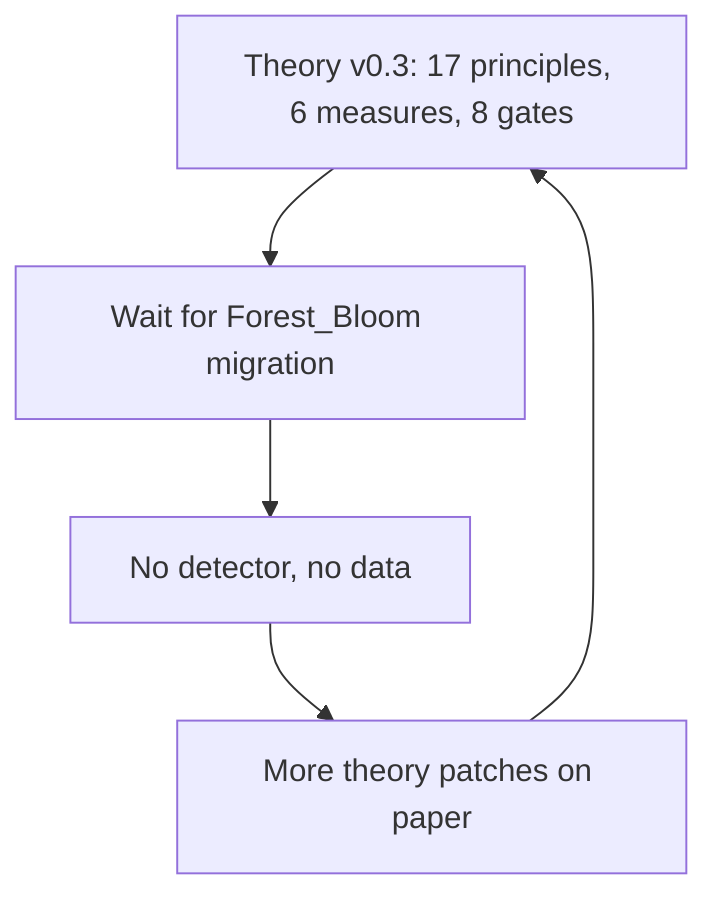
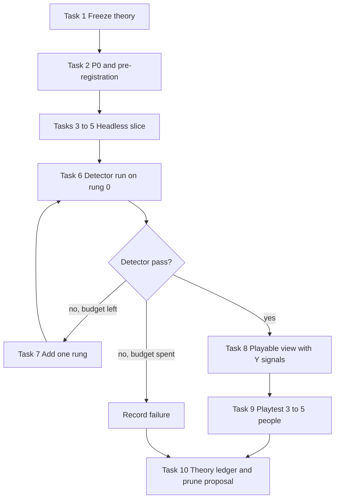
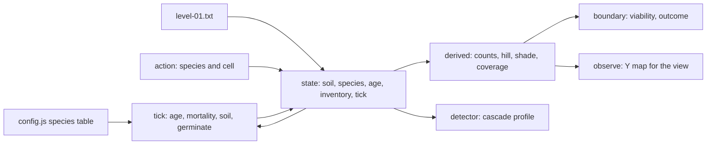

# Forest_Bloom Slice Reference Case Implementation Plan

> **For agentic workers:** REQUIRED SUB-SKILL: Use superpowers:executing-plans to implement this plan task-by-task, inline. Do not use superpowers:subagent-driven-development (project rule `skip-subagent-driven-development.md`). Steps use checkbox (`- [ ]`) syntax for tracking.

**Goal:** Produce the first real evidence for the Logical Space method: freeze the theory, build the smallest Forest_Bloom slice (3 species, 1 level, headless), run one pre-registered I6 detector, playtest it with 3 to 5 people, then propose cutting every principle and measure that did no work.

**Architecture:** A new zero-dependency JavaScript prototype inside this repo. One set of ES modules holds config, state, pure operators and the detector; Node runs them headless for tests and measurement, and a single browser page imports the same modules for the playtest. The old Forest_Bloom engine is not touched and not required.

**Tech Stack:** Node 24 (`node --test`, ES modules, no npm packages), plain HTML canvas, `python -m http.server` for local serving.

**Spec:** [critique and study record](../design/2026-11-03-logical-space-critique-and-study.md) sections 2.2 to 2.4 and 4 (P0 approved, FB-1, Y signals, roadmap steps 2 to 5); [core theory v0.3-draft](../../../docs/theory/Logical-Space-Base-Theory.md).

## Decision this plan needs from the owner

On 2026-11-03 the owner deferred the reference case "until the Forest_Bloom migration finishes". This plan reverses that: the slice is a **new** prototype in this repo, so the migration does not block it. Approving this plan approves that reversal. Task 1 records it.

## Global Constraints

- Theory is frozen at `2026-11-03-logical-space-v0.3-draft`. No new L, AG, M, I or P item until Task 9. Ideas that come up go into `theory-ledger.md` under "Parked", not into the core.
- L14: `pre-registration.md` is committed **before** the first detector run. After that commit, thresholds change only by a dated amendment line that states the reason; old values stay visible.
- L12: one change per rung. Ladder budget: **5 rungs total** (rung 0 to rung 4). Budget spent without a pass is a valid result and is reported as such.
- Ontology: operators are pure functions `(state, level, config) -> state`. No derived value is stored in state. The view reads state and never writes it.
- Simulation is deterministic: no random numbers inside operators. Only `randomAgent` uses a seeded RNG.
- Zero npm dependencies.
- Rung 0 config values below are untested starting guesses. Do not tune them before the first detector run.
- Language: code, README and plan in English. Lines added to the critique record are in Vietnamese.
- Commits: on branch `study/forest-bloom-slice`, only after the owner says to commit. Commit steps below show the message to use.

## Flow

Current, as of 2026-11-03:



Target:



Data flow of the slice:



## File Structure

| Path | Responsibility |
|---|---|
| `prototypes/forest-bloom-slice/package.json` | `"type": "module"`, script `test` = `node --test` |
| `prototypes/forest-bloom-slice/src/config.js` | Vocabulary and static config: species table, soil limits |
| `prototypes/forest-bloom-slice/src/level.js` | Parse level text into a level object |
| `prototypes/forest-bloom-slice/src/state.js` | Create and clone state |
| `prototypes/forest-bloom-slice/src/operators.js` | The four phase operators and `tick` |
| `prototypes/forest-bloom-slice/src/actions.js` | Legal actions, apply action |
| `prototypes/forest-bloom-slice/src/derived.js` | Counts, Hill number, shade, coverage |
| `prototypes/forest-bloom-slice/src/boundary.js` | Viability and level outcome |
| `prototypes/forest-bloom-slice/src/cascade.js` | Counterfactual cascade of one action |
| `prototypes/forest-bloom-slice/src/agents.js` | Seeded RNG, random agent, greedy agent, playthrough |
| `prototypes/forest-bloom-slice/src/detector.js` | Cascade profile and pre-registered verdict |
| `prototypes/forest-bloom-slice/src/observe.js` | Y map: state to what the player sees |
| `prototypes/forest-bloom-slice/levels/level-01.txt` | The one level |
| `prototypes/forest-bloom-slice/tools/run-detector.js` | CLI: writes `results/rung-N.json` |
| `prototypes/forest-bloom-slice/tools/regime-map.js` | CLI: sweeps two config values, writes CSV |
| `prototypes/forest-bloom-slice/web/index.html`, `web/main.js` | Playable canvas view |
| `prototypes/forest-bloom-slice/test/*.test.js` | One test file per source module |
| `docs/explorations/forest-bloom-slice/README.md` | P0, basis table, operator table, perceivability table |
| `docs/explorations/forest-bloom-slice/pre-registration.md` | Thresholds and expected outcomes, written before any run |
| `docs/explorations/forest-bloom-slice/rung-log.md` | One row per rung: change, result, lesson |
| `docs/explorations/forest-bloom-slice/playtest-protocol.md`, `playtest-results.md` | P7 kit and raw results |
| `docs/explorations/forest-bloom-slice/theory-ledger.md` | Per theory item: did it do work |
| `.cursor/plans/design/2026-11-12-logical-space-v0.4-prune-proposal.md` | Task 10 output for owner approval |

All commands below run from `D:\Projects\Research\prototypes\forest-bloom-slice` unless stated.

## Review Focus

1. Malformed level file: ragged rows, unknown character, missing header. Expected: `parseLevel` throws an error naming the line. Test in Task 3.
2. Illegal action: rock cell, occupied cell, soil below `minSoil`, empty inventory. Expected: `applyAction` throws, state unchanged. Test in Task 5.
3. No legal action, or every cascade is zero. Expected: detector returns `pass: false` with `skillGap: 0`, never `NaN` or `Infinity`. Test in Task 6.
4. Empty forest. Expected: `hillNumber` returns 0 and viability reports `diverse: false` without dividing by zero. Test in Task 5.
5. Page opened as `file://`, where browsers block module imports. Expected: the page shows a visible message telling the user to run the serve command. Check in Task 8.

---

### Task 1: Freeze the theory and record the decision

**Files:**
- Modify: `docs/theory/Logical-Space-Base-Theory.md:5` (status line)
- Modify: `.cursor/plans/design/2026-11-03-logical-space-critique-and-study.md` (progress table in section 4, change log in section 7)
- Modify: `.cursor/playbooks/playbook-decompose-game-to-logical-space.md` (one note under the version line)
- Create: `memory/2026-11-12-theory-freeze-and-reference-case-session.md`
- Modify: `CLAUDE.md` (project-internal memory list, one line)

- [ ] **Step 1:** Create branch `study/forest-bloom-slice` from `main`.
- [ ] **Step 2:** Append to the core status line: `**Frozen 2026-11-12:** no new principle, measure, gate or catalog type until the Forest_Bloom slice reference case reports. See [plan](../../.cursor/plans/implement/2026-11-12-forest-bloom-slice-reference-case.md).`
- [ ] **Step 3:** In the critique record, set roadmap rows 2–3 to "Đang làm (2026-11-12)" with the reason: prototype mới nằm trong repo Research nên không phụ thuộc migration; add one change-log row dated 2026-11-12. Add the same one-line freeze note to the playbook.
- [ ] **Step 4:** Write the project memory file: decision, reason, link to this plan. Add its line to `CLAUDE.md`.
- [ ] **Step 5:** Commit: `docs: freeze theory at v0.3 and start reference case`

### Task 2: P0 and pre-registration

**Files:**
- Create: `docs/explorations/forest-bloom-slice/README.md`
- Create: `docs/explorations/forest-bloom-slice/pre-registration.md`
- Create: `docs/explorations/forest-bloom-slice/rung-log.md`
- Create: `docs/explorations/forest-bloom-slice/theory-ledger.md`

- [ ] **Step 1: Write `README.md`.** Sections: P0 (copy the approved P0 from critique record 2.3: target I6, skill via M6 best versus random, viability, player loop); basis table and operator table using the values below; the data-flow diagram from this plan.

Basis table for rung 0:

| Entry | Class | Notes |
|---|---|---|
| Species type: pioneer 1, shrub 2, canopy 3 | Vocabulary, config | Parameters in the species table |
| Rock mask, initial soil, seed inventory, ticks per turn | Level config | Progression structure, L15 |
| `soil` per cell, integer 0 to 5 | State | |
| `species` per cell, 0 for empty | State | |
| `age` per cell | State | |
| `inventory` per species, `tick` | State | |
| Shade, counts, coverage, Hill number, trend | Derived | Never stored |

Species table for rung 0:

| Field | pioneer | shrub | canopy | Meaning |
|---|---|---|---|---|
| `minSoil` | 1 | 3 | 4 | Soil needed to germinate and to stay alive |
| `soilSelf` | 0 | 0 | -1 | Soil change on own cell per tick |
| `soilNear` | 1 | 1 | 0 | Soil change on each 4-neighbour per tick |
| `enrichCap` | 3 | 5 | 5 | A positive `soilNear` never lifts a cell above this |
| `matureAge` | 1 | 2 | 3 | Age from which the plant seeds neighbours |
| `lifespan` | 6 | 10 | 16 | Dies when age exceeds this |
| `shadeLimit` | 1 | 3 | 5 | Dies when canopy 4-neighbours reach this count |
| `rank` | 1 | 2 | 3 | Higher rank wins a contested empty cell |

Operator table, one tick, each phase reads the result of the phase before it and writes synchronously:

| Order | Operator | Reads | Writes |
|---|---|---|---|
| 1 | `agePhase` | species | age plus 1 for every plant |
| 2 | `mortalityPhase` | age, soil, species, config | removes a plant when age exceeds `lifespan`, or soil is below `minSoil`, or canopy neighbours reach `shadeLimit` |
| 3 | `soilPhase` | surviving plants, config | soil, clamped 0 to 5; positive `soilNear` respects `enrichCap` |
| 4 | `germinatePhase` | snapshot after phase 3 | each empty non-rock cell takes the highest-rank species among mature 4-neighbours whose `minSoil` the cell meets; new plant age 0 |

- [ ] **Step 2: Write `pre-registration.md`** with exactly these values.

Detector for I6, computed on the start state of level 01 over every legal first action, horizon 12 ticks:

| ID | Condition | Threshold |
|---|---|---|
| D1 | Skill gap: best cascade size divided by mean cascade size | at least 3.0 |
| D2 | Best cascade size as a share of non-rock cells | at least 0.25 |
| D3 | Share of legal actions whose size is at least 0.8 of the best | at most 0.15 |
| D4 | Depth of the best cascade: ticks in which it still grew. Separates an iterated wave from a hand-written radius rule, AG-7 | at least 6 |

Viability, checked on the greedy playthrough of level 01 over the last 8 ticks (W = 8):

| ID | Condition |
|---|---|
| V1 | No species holds 90% or more of trees while total trees exceed 12 |
| V2 | At least 2 species alive (k = 2 for a 3-species slice) |

q is not used: the slice is deterministic with one level.

Detector validity, L11. The detector must **fail** on both negative controls or it is not a detector:

| Control | Definition |
|---|---|
| N1 uniform field | 12 by 12, no rock, all soil 1, same inventory |
| N2 no iteration | Level 01 with every species' `matureAge` set to 999 |

Player gate P7, 5 players (minimum 3):

| ID | Condition |
|---|---|
| PT1 | At least 60% of players keep playing 5 minutes or more after being told they may stop |
| PT2 | At least 60% of players name a correct cause in the retell: soil getting richer, shade, or the species order |

Hypotheses: HY-1 proxy, the slice passes with at most 30 config values in total; HY-3, events listed in the perceivability table are the ones players retell. HY-2 and HY-4 are not testable on one slice and are marked "not tested".

Also record one predicted outcome per item above (pass or fail) before running, per idea ID-1.

- [ ] **Step 3: Write `rung-log.md`** with header `| Rung | One change | D1 | D2 | D3 | D4 | V1 | V2 | N1 fails | N2 fails | Verdict | What was missing |` and no rows.
- [ ] **Step 4: Write `theory-ledger.md`** with one row per item L1 to L17, M1 to M6, P0 to P7, I1 to I6 and header `| Item | Used in task | Changed a decision or caught an error | Evidence link | Verdict |`. Add an empty "Parked ideas" section. Fill rows as tasks use items; an item counts as "did work" only with an evidence link.
- [ ] **Step 5:** Commit: `docs: pre-register forest bloom slice P0 and detector`

### Task 3: Scaffold, config, level, state

**Files:**
- Create: `package.json`, `src/config.js`, `src/level.js`, `src/state.js`, `levels/level-01.txt`
- Test: `test/level.test.js`

**Interfaces:**
- Produces:
  - `config.js`: `export const EMPTY = 0, PIONEER = 1, SHRUB = 2, CANOPY = 3, SOIL_MAX = 5`; `export const CONFIG = { species: { 1: {...}, 2: {...}, 3: {...} } }` with the species table fields; `export function withOverrides(config, overrides)` returning a deep copy where `overrides` is `{ [speciesId]: { field: value } }`.
  - `level.js`: `parseLevel(text) -> { width, height, rock: Uint8Array, initialSoil: Int8Array, inventory: {1,2,3}, ticksPerTurn }`. Index of cell x, y is `y * width + x`.
  - `state.js`: `createState(level) -> { soil: Int8Array, species: Uint8Array, age: Int16Array, inventory: {1,2,3}, tick: 0 }`; `cloneState(state)`.

`levels/level-01.txt`, exact content. `#` is rock, a digit is initial soil:

```
ticksPerTurn=8
inventory=3,2,1
---
000000#00000
011100#00130
010000#00030
0100####0000
010000000000
000001100000
######100###
000000100000
003000100010
003300000010
000000#00110
000000#00000
```

- [ ] **Step 1: Write the failing tests**

```js
import test from 'node:test';
import assert from 'node:assert/strict';
import { readFileSync } from 'node:fs';
import { parseLevel } from '../src/level.js';
import { createState, cloneState } from '../src/state.js';

const L = (grid, inv = '3,2,1') => parseLevel(`ticksPerTurn=8\ninventory=${inv}\n---\n${grid}`);

test('parses level 01', () => {
  const level = parseLevel(readFileSync(new URL('../levels/level-01.txt', import.meta.url), 'utf8'));
  assert.equal(level.width, 12);
  assert.equal(level.height, 12);
  assert.equal(level.ticksPerTurn, 8);
  assert.deepEqual(level.inventory, { 1: 3, 2: 2, 3: 1 });
  assert.equal(level.rock[6], 1);            // x 6, y 0
  assert.equal(level.initialSoil[1 * 12 + 9], 1);
  assert.equal(level.initialSoil[1 * 12 + 10], 3);
});

test('rejects ragged rows, naming the line', () => {
  assert.throws(() => L('111\n11'), /line 5/);
});

test('rejects unknown characters', () => {
  assert.throws(() => L('1x1'), /line 4/);
});

test('rejects a missing header', () => {
  assert.throws(() => parseLevel('111'), /ticksPerTurn/);
});

test('state copies level data and clone is independent', () => {
  const level = L('123');
  const s = createState(level);
  assert.deepEqual([...s.soil], [1, 2, 3]);
  assert.deepEqual(s.inventory, { 1: 3, 2: 2, 3: 1 });
  const c = cloneState(s);
  c.soil[0] = 5; c.inventory[1] = 0;
  assert.equal(s.soil[0], 1);
  assert.equal(s.inventory[1], 3);
});
```

- [ ] **Step 2:** Run `node --test`. Expected: FAIL, modules not found.
- [ ] **Step 3:** Implement the three modules and `package.json`. Accept both `\n` and `\r\n` line endings. Line numbers in errors are 1-based over the whole file.
- [ ] **Step 4:** Run `node --test`. Expected: 5 pass.
- [ ] **Step 5:** Commit: `feat: forest bloom slice config, level parser and state`

### Task 4: Operators and tick

**Files:**
- Create: `src/operators.js`
- Test: `test/operators.test.js`

**Interfaces:**
- Consumes: `CONFIG`, `parseLevel`, `createState`, `cloneState`.
- Produces: `agePhase`, `mortalityPhase`, `soilPhase`, `germinatePhase`, each `(state, level, config) -> state` returning a new state; `tick(state, level, config) -> state` applying them in that order and adding 1 to `state.tick`; `run(state, level, config, ticks) -> state`.

- [ ] **Step 1: Write the failing tests.** Helper `put(state, i, species, age = 0)` sets `species[i]` and `age[i]` directly.

```js
test('pioneer spreads one cell per tick and enriches soil', () => {
  const level = L('111'); let s = createState(level); put(s, 0, PIONEER);
  s = tick(s, level, CONFIG);
  assert.deepEqual([...s.species], [1, 1, 0]);
  s = tick(s, level, CONFIG);
  assert.deepEqual([...s.species], [1, 1, 1]);
  assert.deepEqual([...s.soil], [2, 3, 2]);
});

test('pioneer dies after its lifespan', () => {
  const level = L('1'); let s = createState(level); put(s, 0, PIONEER);
  assert.equal(run(s, level, CONFIG, 6).species[0], PIONEER);
  assert.equal(run(s, level, CONFIG, 7).species[0], EMPTY);
});

test('lone canopy starves its own soil', () => {
  const level = L('4'); let s = createState(level); put(s, 0, CANOPY);
  const s1 = tick(s, level, CONFIG);
  assert.equal(s1.species[0], CANOPY); assert.equal(s1.soil[0], 3);
  assert.equal(tick(s1, level, CONFIG).species[0], EMPTY);
});

test('canopy shade kills a neighbouring pioneer', () => {
  const level = L('444'); let s = createState(level); put(s, 0, PIONEER); put(s, 1, CANOPY);
  assert.deepEqual([...tick(s, level, CONFIG).species], [0, 3, 0]);
});

test('higher rank wins a contested cell', () => {
  const level = L('333'); let s = createState(level); put(s, 0, PIONEER, 5); put(s, 2, SHRUB, 5);
  assert.equal(tick(s, level, CONFIG).species[1], SHRUB);
});

test('pioneer enrichment stops at its cap', () => {
  const level = L('11'); let s = createState(level); put(s, 0, PIONEER);
  assert.ok(run(s, level, CONFIG, 5).soil[1] <= 3);
});

test('nothing grows on rock and soil stays within 0 to 5', () => {
  const level = L('5#5'); let s = createState(level); put(s, 0, SHRUB, 5);
  s = run(s, level, CONFIG, 8);
  assert.equal(s.species[1], EMPTY);
  assert.ok([...s.soil].every(v => v >= 0 && v <= 5));
});

test('tick does not mutate its input and is deterministic', () => {
  const level = L('111'); const s = createState(level); put(s, 0, PIONEER);
  const before = JSON.stringify([...s.species, ...s.soil, ...s.age]);
  const a = run(s, level, CONFIG, 10), b = run(s, level, CONFIG, 10);
  assert.equal(JSON.stringify([...s.species, ...s.soil, ...s.age]), before);
  assert.deepEqual([...a.species], [...b.species]);
});
```

- [ ] **Step 2:** Run `node --test test/operators.test.js`. Expected: FAIL.
- [ ] **Step 3:** Implement `src/operators.js` from the operator table in Task 2. Neighbours are the 4 orthogonal cells inside the grid. A dead plant's cell resets `age` to 0. A cell emptied in phase 2 may be refilled in phase 4 of the same tick.
- [ ] **Step 4:** Run `node --test`. Expected: all pass.
- [ ] **Step 5:** Fill ledger rows that this task exercised (L1, L5, P4 at least). Commit: `feat: forest bloom slice operators and tick`

### Task 5: Actions, derived values, boundary

**Files:**
- Create: `src/actions.js`, `src/derived.js`, `src/boundary.js`
- Test: `test/actions.test.js`, `test/derived.test.js`, `test/boundary.test.js`

**Interfaces:**
- Produces:
  - `legalActions(state, level, config) -> Array<{ species, cell }>`: inventory above 0, cell not rock, cell empty, soil at least `minSoil`.
  - `applyAction(state, level, config, action) -> state`: new state with the plant at age 0 and inventory minus 1; throws `Error('illegal action: <reason>')` otherwise.
  - `speciesCounts(state) -> { 1, 2, 3, total }`; `hillNumber(state) -> number`, the exponential of Shannon entropy over species shares, 0 when no trees; `shadeAt(state, level, cell) -> number`; `coverage(state, level) -> number`, trees divided by non-rock cells.
  - `viability(state) -> { monoculture: boolean, diverse: boolean, ok: boolean }` per V1 and V2 with thresholds 0.9, 12 and 2 exported as `VIABILITY`.

- [ ] **Step 1: Write the failing tests**

```js
test('legal actions respect soil, rock, occupancy and inventory', () => {
  const level = L('1#4', '1,0,1'); const s = createState(level);
  assert.deepEqual(legalActions(s, level, CONFIG),
    [{ species: 1, cell: 0 }, { species: 1, cell: 2 }, { species: 3, cell: 2 }]);
});

test('applyAction plants, spends a seed, leaves input untouched', () => {
  const level = L('1'); const s = createState(level);
  const n = applyAction(s, level, CONFIG, { species: 1, cell: 0 });
  assert.equal(n.species[0], 1); assert.equal(n.inventory[1], 2);
  assert.equal(s.species[0], 0); assert.equal(s.inventory[1], 3);
});

for (const [name, grid, inv, action] of [
  ['rock', '#', '3,2,1', { species: 1, cell: 0 }],
  ['soil too low', '1', '3,2,1', { species: 3, cell: 0 }],
  ['no seeds', '1', '0,2,1', { species: 1, cell: 0 }],
]) test(`applyAction rejects ${name}`, () => {
  const level = L(grid, inv);
  assert.throws(() => applyAction(createState(level), level, CONFIG, action), /illegal action/);
});

test('applyAction rejects an occupied cell', () => {
  const level = L('1'); const s = applyAction(createState(level), level, CONFIG, { species: 1, cell: 0 });
  assert.throws(() => applyAction(s, level, CONFIG, { species: 1, cell: 0 }), /illegal action/);
});

test('hill number: empty 0, monoculture 1, three equal species 3', () => {
  const level = L('555555'); const s = createState(level);
  assert.equal(hillNumber(s), 0);
  put(s, 0, 1); put(s, 1, 1);
  assert.ok(Math.abs(hillNumber(s) - 1) < 1e-9);
  put(s, 2, 2); put(s, 3, 2); put(s, 4, 3); put(s, 5, 3);
  assert.ok(Math.abs(hillNumber(s) - 3) < 1e-9);
});

test('viability: small monoculture is exempt, large one is not', () => {
  const level = L('1'.repeat(14)); const s = createState(level);
  for (let i = 0; i < 12; i++) put(s, i, 1);
  assert.equal(viability(s).monoculture, false);
  put(s, 12, 1);
  assert.equal(viability(s).monoculture, true);
  assert.equal(viability(s).ok, false);
});

test('viability on an empty forest does not divide by zero', () => {
  const v = viability(createState(L('111')));
  assert.deepEqual(v, { monoculture: false, diverse: false, ok: false });
});
```

- [ ] **Step 2:** Run `node --test`. Expected: new tests FAIL.
- [ ] **Step 3:** Implement the three modules. `legalActions` orders by species id, then cell index.
- [ ] **Step 4:** Run `node --test`. Expected: all pass.
- [ ] **Step 5:** Commit: `feat: forest bloom slice actions, derived values and viability`

### Task 6: Cascade, agents, detector, rung 0 run

**Files:**
- Create: `src/cascade.js`, `src/agents.js`, `src/detector.js`, `tools/run-detector.js`
- Test: `test/cascade.test.js`, `test/detector.test.js`
- Modify: `docs/explorations/forest-bloom-slice/rung-log.md`, `theory-ledger.md`

**Interfaces:**
- Produces:
  - `cascade(state, level, config, action, horizon = 12) -> { size, depth }`. Run two copies for `horizon` ticks: one with the action, one without. Count cells whose `species` differs between the two, once right after the action (this first count is the starting peak, normally 1) and once after each tick. `size` is the peak count. `depth` is the number of ticks in which the count rose above its previous peak.
  - `mulberry32(seed) -> () => number`; `randomAgent(rng)` and `greedyAgent()` both `(state, level, config) -> action | null`; greedy picks the legal action with the largest cascade size, first one on ties.
  - `playthrough(level, config, agent) -> { final, history }`: repeat pick action, apply, run `ticksPerTurn` ticks, until the agent returns null; `history` holds the state after every tick.
  - `THRESHOLDS = { skillGap: 3.0, bestShare: 0.25, nearBestShare: 0.15, depth: 6 }`.
  - `cascadeProfile(level, config) -> { actions, best, mean, skillGap, bestShare, nearBestShare, depth, checks: { D1, D2, D3, D4 }, pass }`. With no legal action, or mean 0: `skillGap` 0 and `pass` false.
  - `uniformLevel()` and `noIterationConfig(config)` for controls N1 and N2.

- [ ] **Step 1: Write the failing tests**

```js
test('cascade of one pioneer in a corridor', () => {
  const level = L('111111'); const s = createState(level);
  assert.deepEqual(cascade(s, level, CONFIG, { species: 1, cell: 0 }, 12), { size: 6, depth: 5 });
});

test('cascade is 1 when nothing can spread', () => {
  const level = L('1#1'); const s = createState(level);
  assert.deepEqual(cascade(s, level, CONFIG, { species: 1, cell: 0 }, 12), { size: 1, depth: 0 });
});

test('profile never returns NaN or Infinity', () => {
  const p = cascadeProfile(L('###'), CONFIG);
  assert.equal(p.actions, 0); assert.equal(p.skillGap, 0); assert.equal(p.pass, false);
});

test('detector rejects control N1, the uniform field', () => {
  assert.equal(cascadeProfile(uniformLevel(), CONFIG).pass, false);
});

test('detector rejects control N2, no iteration', () => {
  const level = parseLevel(readFileSync(new URL('../levels/level-01.txt', import.meta.url), 'utf8'));
  const p = cascadeProfile(level, noIterationConfig(CONFIG));
  assert.equal(p.best, 1); assert.equal(p.pass, false);
});

test('greedy playthrough plays one seed for one turn of 8 ticks', () => {
  const level = L('111111', '1,0,0');
  const { final, history } = playthrough(level, CONFIG, greedyAgent());
  assert.equal(final.inventory[1], 0);
  assert.equal(history.length, 8);
});

test('playthrough ends when no legal action is left, seeds unspent', () => {
  const level = L('11', '2,0,0');
  const { final, history } = playthrough(level, CONFIG, greedyAgent());
  assert.equal(final.inventory[1], 1);   // both cells are occupied after turn 1: each death is reseeded by the neighbour
  assert.equal(history.length, 8);
});
```

- [ ] **Step 2:** Run `node --test`. Expected: new tests FAIL.
- [ ] **Step 3:** Implement the three modules.
- [ ] **Step 4:** Run `node --test`. Expected: all pass. If N1 or N2 **passes** the detector, stop: the detector is invalid. Do not change thresholds; record the fact in `rung-log.md` and raise it with the owner.
- [ ] **Step 5:** Implement `tools/run-detector.js`: arguments `--rung <n>` and optional `--override <speciesId>.<field>=<value>` (repeatable). It prints and writes `results/rung-<n>.json` holding the profile, the greedy playthrough viability over the last 8 ticks, a random-agent playthrough with seed 1 for comparison, the control results, the config used, and the git revision.
- [ ] **Step 6:** Confirm `pre-registration.md` is committed. Run `node tools/run-detector.js --rung 0`. Add the rung 0 row to `rung-log.md` with real numbers. Compare with the predictions written in Task 2 and note every miss.
- [ ] **Step 7:** Fill ledger rows (L11, L12, L14, L16, M6, P5, P6). Commit: `feat: I6 detector and rung 0 result`

### Task 7: Ladder and regime map

Skip to Task 8 when rung 0 passes D1 to D4, V1 and V2.

**Files:**
- Create: `tools/regime-map.js`
- Modify: `src/config.js` or `src/operators.js` (one change per rung), tests for the change, `rung-log.md`, `README.md` tables

**Interfaces:**
- Produces: `node tools/regime-map.js --x <speciesId>.<field>=<from>..<to> --y <speciesId>.<field>=<from>..<to>` writing `results/regime-<x>-<y>.csv` with columns `x, y, skillGap, bestShare, nearBestShare, depth, viable, pass`.

- [ ] **Step 1:** Implement `tools/regime-map.js` on top of `cascadeProfile` and `withOverrides`. Verify with `node tools/regime-map.js --x 1.lifespan=2..10 --y 1.enrichCap=1..5`: the CSV has 45 data rows.
- [ ] **Step 2:** Read which check failed at the last rung and write "what was missing" in `rung-log.md` **before** choosing the next change. Decide by the failed check:

| Failed | Meaning | Candidate single change |
|---|---|---|
| D3 or D1, position does not matter | Spread is too uniform | A level-config terrain value that blocks enrichment, or a lower pioneer `enrichCap` |
| D2 or D4, wave is short | Chain dies early | Raise one `lifespan`, or lower one `matureAge` |
| V1, one species takes over | Missing counter-pressure | One mortality rule or one `shadeLimit` value |
| V2, species die out | Chain is too harsh | One `minSoil` value |

- [ ] **Step 3:** Before changing a value, run the regime map over that value and one neighbour value. Pick a point away from a flip boundary, L10. Save the CSV.
- [ ] **Step 4:** Make the one change test-first: write or adjust the test, see it fail, implement, see it pass.
- [ ] **Step 5:** Run `node tools/run-detector.js --rung <n>`. Add the row. Update the README tables. Commit: `feat: rung <n> <the one change>`
- [ ] **Step 6:** Repeat Steps 2 to 5 until a pass or until rung 4 is recorded. On budget spent, write a "Result: detector not reached in 5 rungs" section in `rung-log.md` with the best rung and the suspected reason, then go to Task 10. Do not build the view for a slice that failed.

### Task 8: Observation map and playable view

**Files:**
- Create: `src/observe.js`, `web/index.html`, `web/main.js`
- Test: `test/observe.test.js`
- Modify: `docs/explorations/forest-bloom-slice/README.md` (perceivability table)

**Interfaces:**
- Consumes: `hillNumber`, `shadeAt`, `viability`, `legalActions`, `applyAction`, `tick`, `speciesCounts`.
- Produces: `observe(state, level, history) -> { cells: Array<{ rock, soil, species, shaded }>, hill, richness, trend, warning }`. `richness` is `hill / 3` clamped to 0..1. `shaded` is true when `shadeAt` is above 0. `history` is the list of states after each tick, current state last. `trend` is `'up' | 'down' | 'flat'` from Hill of the last entry minus Hill of the entry 8 positions before it, dead band 0.05; `'flat'` when history has fewer than 9 entries. `warning` is the species id holding 75% or more of trees while trees exceed 12, else 0.

- [ ] **Step 1: Write the perceivability table** in the README before any view code, L13:

| Target event | Cause the player sees | Effect the player sees |
|---|---|---|
| Wave spreads | Ground gets darker and richer ahead of the wave: soil 0 pale sand to soil 5 dark brown | New plants appear cell by cell, one tick at a time |
| Wave stops | Rock; pale soil that the species cannot use | Front line stops |
| Succession | Rich soil ring behind pioneers | Shrub then canopy colours replace pioneer colour |
| Shade kill | Dark overlay on cells next to canopy | Pioneer fades out |
| Monoculture risk | Whole map loses colour saturation; trend arrow points down; border of the dominant species pulses | Player plants a different species |

- [ ] **Step 2: Write the failing tests**

```js
test('richness and trend follow the hill number', () => {
  const level = L('555555'); const s = createState(level);
  put(s, 0, 1); put(s, 1, 1);
  const mono = cloneState(s);
  put(s, 2, 2); put(s, 3, 2); put(s, 4, 3); put(s, 5, 3);
  const history = [...Array(8).fill(mono), s];
  const o = observe(s, level, history);
  assert.ok(Math.abs(o.richness - 1) < 1e-9);
  assert.equal(o.trend, 'up');
  assert.equal(observe(mono, level, [mono]).trend, 'flat');
});

test('warning names the dominant species only above 12 trees', () => {
  const level = L('1'.repeat(16)); const s = createState(level);
  for (let i = 0; i < 12; i++) put(s, i, 1);
  assert.equal(observe(s, level, [s]).warning, 0);
  put(s, 12, 1);
  assert.equal(observe(s, level, [s]).warning, 1);
});

test('observe marks rock and shaded cells', () => {
  const level = L('4#4'); const s = createState(level); put(s, 0, CANOPY);
  const o = observe(s, level, [s]);
  assert.equal(o.cells[1].rock, true);
  assert.equal(o.cells[0].shaded, false);
});
```

- [ ] **Step 3:** Run `node --test`. Expected: new tests FAIL. Implement `src/observe.js`. Run again. Expected: all pass.
- [ ] **Step 4: Implement the view.** `index.html` holds a canvas, three seed buttons with remaining counts, a trend arrow, a restart button, and a `<noscript>`-style fallback block that stays visible until `main.js` loads and says: `Run "python -m http.server 8000" in prototypes/forest-bloom-slice, then open http://localhost:8000/web/`. `main.js` fetches `../levels/level-01.txt`, draws only from `observe`, and on a click at a legal cell applies the action then animates `ticksPerTurn` ticks at 250 ms each. Cells legal for the selected seed are outlined. Canvas saturation scales with `richness`. No numbers on screen except seed counts, L17. After the last seed and its ticks, show one line: forest thriving when `viability(...).ok` and coverage is at least 0.6, otherwise forest fading; then offer restart.
- [ ] **Step 5: Manual check.** Serve, open the page, and confirm each row of the perceivability table is visible in play. Open `web/index.html` directly as a file and confirm the serve message is visible. Record both checks in the README.
- [ ] **Step 6:** Fill ledger rows (L13, L17, P7 prep). Commit: `feat: playable view with compressed Y signals`

### Task 9: Playtest, P7

The owner runs this task. The executor prepares the files and stops.

**Files:**
- Create: `docs/explorations/forest-bloom-slice/playtest-protocol.md`, `playtest-results.md`

- [ ] **Step 1: Write the protocol.** One player at a time, 3 to 5 players who have not seen the project. Script: (1) say only "plant seeds to bring this land back to life"; no rule explanation; (2) the player plays two full levels, about 5 minutes; (3) say "that is all I need; you can stop now or keep playing, either is fine", start a timer, leave the player alone, stop the timer when they stop or at 15 minutes; (4) ask "what was the most memorable moment, and why did it happen?" and write the answer word for word; (5) ask "what did the fading colour mean?". No IMI: there is no second version to compare.
- [ ] **Step 2: Write the results template:** `| Player | Voluntary minutes | Memorable moment, verbatim | Cause given | Cause correct | Read the fading colour correctly | Notes |`, then a summary block for PT1, PT2 and HY-3.
- [ ] **Step 3:** Commit: `docs: P7 playtest protocol`. **Stop and hand over to the owner.**
- [ ] **Step 4, owner:** Run the sessions and fill the table with raw data, including bad results.
- [ ] **Step 5:** Compute PT1 and PT2 against the pre-registered thresholds. State pass or fail plainly. With 3 to 5 players this is a signal, not statistics; say so in the summary. Fill ledger rows (P7, L13, L17, AG-11 kit items one by one). Commit: `docs: P7 playtest results`

### Task 10: Theory ledger and prune proposal

**Files:**
- Modify: `docs/explorations/forest-bloom-slice/theory-ledger.md`
- Create: `.cursor/plans/design/2026-11-12-logical-space-v0.4-prune-proposal.md`
- Create: `memory/` session file for this work; modify `CLAUDE.md` memory list

- [ ] **Step 1:** Complete every ledger row. Verdict rules, applied mechanically:

| Verdict | Rule |
|---|---|
| Keep | Changed a decision or caught an error in this case, with an evidence link |
| Keep, untested | Could not apply to this slice by its nature: L15 with one level, I1 to I5, M3, M5 |
| Merge | Did work only together with another item; name the item |
| Cut candidate | Applicable to this slice, and nothing would have gone differently without it |

M1 and M4 get an honest check: was there any decision in Tasks 6 and 7 that Sobol shares or dynamic modes would have improved? If not, they are cut candidates.

- [ ] **Step 2:** Write the proposal in Vietnamese, as a design record: summary table of results against the pre-registration (detector, controls, viability, PT1, PT2, each hypothesis); the ledger verdict counts; the proposed v0.4 core as a before and after list of items; process cost actually paid per gate in rough hours; parked ideas. Include one Mermaid diagram of the proposed shorter process. Where the slice failed (budget spent, or P7 failed), the proposal says what that means for the method, not only for the slice.
- [ ] **Step 3:** Do **not** edit the core, playbook or Designer Guide. Those change only after the owner approves the proposal, recorded as the next AG.
- [ ] **Step 4:** Write the session memory file and add its line to `CLAUDE.md`. Commit: `docs: theory ledger and v0.4 prune proposal`

---

## What this plan leaves out on purpose

| Left out | Reason |
|---|---|
| Gene editing, meta-actions, sandbox mode C | One level, one target first. FB-1 guard 3: add rules only when a level needs them |
| QD level search, ID-7 | Needs a working detector and agent first; this plan produces both |
| Second level, progression | L15 stays untested here and is marked so in the ledger |
| Bump_Hero second case | After the prune decision |
| Reuse of the old Forest_Bloom engine | Parts bin only; nothing at rung 0 needs it |
| Cleanup of the psychology and Anima material | Separate decision; not needed for evidence |
