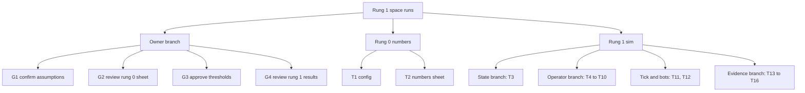
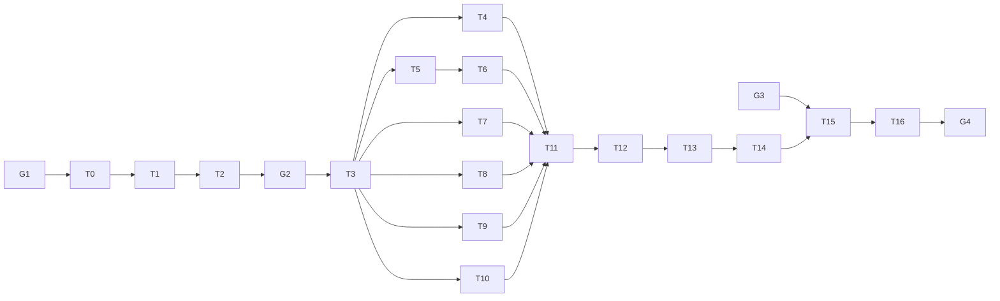

# Sandworm Rung 0 and Rung 1 Implementation Plan

> **For agentic workers:** REQUIRED SUB-SKILL: use superpowers:executing-plans. Do **not** use subagent-driven-development (project rule). Steps use checkbox (`- [ ]`) syntax.

**Goal:** A numbers sheet (rung 0) and a headless, seeded, deterministic sim of the intake queue (rung 1) with pre-registered checks.

**Architecture:** Config is data, state is plain data, each operator is one function over a draft state, `step` runs them in a fixed list. Bots and metrics sit outside the space and only read state.

**Tech Stack:** TypeScript run directly by Node 24, `node:test`, `node:assert/strict`, no dependencies.

**Spec:** [design/2026-11-26-sandworm-rung01.md](../design/2026-11-26-sandworm-rung01.md). Read it first.

## Executor Rules

1. Tasks in order. Respect the owner gates.
2. Never skip an "expect FAIL" step.
3. **Never change an expected value or a threshold to make a test or prediction pass.** If a number looks wrong, STOP and report.
4. If a file or anchor is not as described, STOP and report.
5. Tick a box only after you observed its result. Otherwise write PENDING with the reason.
6. No commit unless the owner asks. No push, reset, checkout, clean, delete of existing files, package install or elevation.
7. Never edit `D:\Projects\MotionCanvas`, `logical-space.md` or the demo.

## Global Constraints

- All files under `prototypes/sandworm-coop/`. Commands run from that folder.
- Only erasable TypeScript: no `enum`, no `namespace`, no parameter properties. Relative imports end in `.ts`; type-only imports use `import type`.
- Node runs the code **without type checking**. A passing test is not a type check.
- Every stored quantity is an integer. Ten ticks are one second. `WALK_SPEED = 100`.
- No `Math.random`, `Date.now` or object key order dependence inside `src/` except `sweep.ts` writing its report date from a command argument.
- Operators read config properties, never `row` names.
- Derived values are never stored in `SimState`.
- Every default value is labelled `PLACEHOLDER` or `SOURCE` in `config.ts`.
- No SW-1 or SW-3 feature, no allergen, currency, heart or Driver.

## Review Focus

| Failure mode | Expected behavior | Test in |
|---|---|---|
| Two crew drop into one free pit space on one tick | Lower id enters, other goes to acid floor | Task 6 |
| Save and load mid-run | Same continuation, including random arrivals | Task 11 |
| Illegal or stale command, such as picking an item that is gone | State unchanged, `rejected` event, no throw | Task 6, Task 11 fuzz |
| Config where an item can never fit the pit | Refused at load with a named error | Task 1 |
| Sweep started before approval | Refuses, writes nothing | Task 13 |

## Work Tree





G3 may happen any time after G1, but always before T15.

---

## Owner Branch

These are yours. The builder must not tick them.

- [ ] **G1: Confirm assumptions A-1 to A-7** (spec section 2). Changing A-4 to A-7 means the spec and tasks are revised before T1.
- [ ] **G2: Review the rung 0 sheet** (T2 output). Check at least one `ok` and one failing point, and that the `ok` window is believable. May change placeholders; record old and new values.
- [ ] **G3: Approve or edit thresholds** (spec section 7). Then **you** fill `approvedBy` and `approvedOn` in `thresholds.json`. Done before any sweep.
- [ ] **G4: Review rung 1 results.** Read the report. Decide: climb to rung 2, change a rule, or stop.

---

## Build Branch

### Task 0: Baseline

**Goal:** Know the starting state. **Files:** none. **Depends:** G1. **Relies on:** A-1, A-2.

- [x] Run `git status --short` and record the output. Existing uncommitted demo and doc changes are not yours; leave them.
- [x] Run `node --version`. Expected: `v24.` prefix. Otherwise STOP.
- [x] Confirm `prototypes/sandworm-coop/` does not exist. If it does, STOP.

### Task 1: Scaffold, types, config

**Goal:** Config as validated data.
**Files:** Create `package.json` (`{"name":"sandworm-coop","private":true,"type":"module","scripts":{"test":"node --test"}}`), `src/types.ts`, `src/config.ts`, `test/fixtures.ts`, `test/config.test.ts`.
**Covers:** content rule. **Depends:** T0. **Relies on:** A-2, content rule (P), Q-24 (P).

**Interfaces, produces:**

```ts
// types.ts
export type Spot = 'mouth' | 'acid';
export type FoodRow = {id: string; mass: number; size: number; digestTicks: number; yieldHunger: number};
export type Config = {
  crewCount: number; walkTicks: number; acidCapacity: number; neglectLimitTicks: number; sealWorkTicks: number;
  drainPerTick: number; breachDamagePerTick: number; hungerStart: number; hungerMax: number; healthMax: number;
  timeLimitTicks: number;
  food: FoodRow;
  carry: {heavyMassFrom: number; heavyPercent: number; lightPercent: number};
  intake: {firstArrivalTick: number; meanGapTicks: number; jitterTicks: number};
};
export type Place = {kind: 'floor'; spot: Spot} | {kind: 'held'; crew: number} | {kind: 'acid'};
export type Item = {id: number; row: string; place: Place; ageTicks: number; progressTicks: number};
export type Breach = {id: number; spot: Spot; sealTicks: number};
export type CrewPos = {kind: 'at'; spot: Spot} | {kind: 'walking'; to: Spot; left: number};
export type Crew = {id: number; pos: CrewPos};
export type SimState = {
  tick: number; seed: number; rng: number; nextId: number; nextArrivalTick: number;
  hunger: number; health: number; items: Item[]; breaches: Breach[]; crew: Crew[];
};
export type Command = {kind: 'wait'} | {kind: 'move'; to: Spot} | {kind: 'pick'; itemId: number}
  | {kind: 'drop'} | {kind: 'seal'; breachId: number};
export type SimEvent = {
  tick: number; kind: 'arrived' | 'picked' | 'dropped' | 'acidFull' | 'digested' | 'breached' | 'sealed' | 'rejected';
  id?: number; crew?: number;
};
export type Outcome = 'running' | 'survived' | 'lost_health' | 'lost_hunger';

// config.ts
export const WALK_SPEED = 100;
export const PLACEHOLDER_CONFIG: Config;           // spec section 5.1 values
export function validateConfig(c: Config): string[]; // empty means valid
```

`mouth` and `acid` live only in `Spot`. `fixtures.ts` exports `tiny(over?: Partial<Config>): Config`:

```ts
{crewCount:1, walkTicks:2, acidCapacity:1, neglectLimitTicks:5, sealWorkTicks:2, drainPerTick:10,
 breachDamagePerTick:7, hungerStart:500, hungerMax:2000, healthMax:1000, timeLimitTicks:1000,
 food:{id:'meat', mass:1, size:1, digestTicks:3, yieldHunger:1000},
 carry:{heavyMassFrom:2, heavyPercent:25, lightPercent:50},
 intake:{firstArrivalTick:0, meanGapTicks:100, jitterTicks:0}}
```

- [x] **Step 1: Failing tests**

```ts
assert.deepEqual(validateConfig(PLACEHOLDER_CONFIG), []);
assert.deepEqual(validateConfig(tiny()), []);
assert.match(validateConfig(tiny({food:{...tiny().food, size:2}})).join(), /acidCapacity/);
assert.match(validateConfig(tiny({walkTicks:0})).join(), /walkTicks/);
assert.match(validateConfig(tiny({drainPerTick:1.5})).join(), /drainPerTick/);
assert.match(validateConfig(tiny({intake:{firstArrivalTick:0, meanGapTicks:5, jitterTicks:5}})).join(), /jitterTicks/);
```

Reasoning: size 2 with capacity 1 can never enter, which the content rule forbids. Jitter equal to the mean would allow a gap of 0.

- [x] **Step 2:** `node --test` → FAIL (module not found).
- [x] **Step 3:** Implement. All numbers integers; all positive except `firstArrivalTick` and `jitterTicks` (≥ 0); `jitterTicks < meanGapTicks`; `hungerStart ≤ hungerMax`; carry percents 1 to 100.
- [x] **Step 4:** `node --test` → PASS. Report the pass and fail counts.

### Task 2: Rung 0 numbers sheet

**Goal:** Say whether any crew pace can sustain hunger.
**Files:** Create `src/numbers.ts`, `test/numbers.test.ts`, `results/rung0.md` (generated).
**Covers:** spec section 6. **Depends:** T1. **Relies on:** all placeholders.

**Interfaces:**

```ts
export type Verdict = 'incapable' | 'starve' | 'overload' | 'ok';
export type Sheet = {demand: number; supply: number; pit: number; haul: number; haulCycleTicks: number; verdict: Verdict};
export function sheet(c: Config): Sheet;
export function primaryGrid(base: Config): Config[];   // 162 points, spec section 7
export function renderSheet(base: Config): string;     // markdown
```

Running `node src/numbers.ts` writes `results/rung0.md`.

- [x] **Step 1: Failing tests.** `P = PLACEHOLDER_CONFIG`, `gap(n)` copies P with that mean gap.

```ts
assert.equal(sheet(P).haulCycleTicks, 100);
assert.equal(sheet(P).verdict, 'ok');
assert.equal(sheet(gap(30)).verdict, 'overload');
assert.equal(sheet(gap(80)).verdict, 'ok');
assert.equal(sheet(gap(120)).verdict, 'starve');
assert.equal(sheet({...P, crewCount:1}).verdict, 'incapable');
assert.equal(primaryGrid(P).length, 162);
const v = new Set(primaryGrid(P).map(c => sheet(c).verdict));
assert.ok(v.has('ok') && v.size > 1);   // rung 0 pass condition
assert.match(renderSheet(P), /PLACEHOLDER/);
assert.match(renderSheet(P), /SOURCE/);
```

Reasoning: walk 40, carry 70%: 40 + 1 + ceil(4000/70)=58 + 1 = 100. Haul = 3/100, pit = 2/60 = 1/30, demand = 100/8000 = 1/80. Capacity is min = 0.03. Gap 60 (0.0167) sits between. Gap 30 (0.0333) is above 0.03. Gap 80 equals demand, which is `ok`. Gap 120 is below demand. One crew hauls 0.01 < 0.0125.

- [x] **Step 2:** FAIL. **Step 3:** Implement. The report lists inputs with labels, the verdict per grid point, counts per verdict, the pass line, and the three limits from spec section 6.
- [x] **Step 4:** `node --test` → PASS, then `node src/numbers.ts` → file written.
- [x] **Step 5:** STOP for **G2**.

### Task 3: State, derived values, random, invariants

**Goal:** The save file and its checks.
**Files:** Create `src/rng.ts`, `src/state.ts`, `src/invariants.ts`, `test/state.test.ts`.
**Covers:** IV2, IV3, IV4, IV6, IV8, IV10, IV12, R1-A. **Depends:** G2. **Relies on:** A-4, A-6, A-7.

**Interfaces:**

```ts
export function nextRandom(rng: number): {value: number; rng: number};  // mulberry32, value is uint32
export function initialState(c: Config, seed: number): SimState;
export function heldItem(s: SimState, crew: number): Item | undefined;
export function acidUsed(s: SimState, c: Config): number;
export function carryPercent(c: Config, mass: number): number;          // mass >= heavyMassFrom ? heavy : light
export function checkInvariants(s: SimState, c: Config): string[];      // each string starts with the invariant id
```

`initialState`: tick 0, `rng = seed >>> 0`, nextId 1, nextArrivalTick `firstArrivalTick`, hunger `hungerStart`, health `healthMax`, no items or breaches, all crew `at mouth`, ids 0 upward.

- [x] **Step 1: Failing tests**

```ts
assert.deepEqual(initialState(tiny({crewCount:2}), 5).crew, [
  {id:0, pos:{kind:'at', spot:'mouth'}}, {id:1, pos:{kind:'at', spot:'mouth'}}]);
assert.equal(initialState(tiny(), 5).health, 1000);
assert.equal(carryPercent(tiny(), 1), 50);
assert.equal(carryPercent(tiny(), 2), 25);
// same input gives same output; seeds 1 and 2 give different first values
// checkInvariants(initialState(...)) is []
// each hand-broken state returns its id: hunger -1 → IV2; two items held by crew 0 → IV4;
// two acid items with capacity 1 → IV12; duplicate id or id >= nextId → IV10;
// held by crew 9 → IV3; hunger 0.5 → R1-A
```

- [x] **Step 2:** FAIL. **Step 3:** Implement. IV6 and IV8 hold by removal; no check function beyond IV10. **Step 4:** PASS.

## Operator Branch

Every operator takes `(s: SimState, c: Config, events: SimEvent[])`, mutates `s`, and returns nothing. Command operators also take `commands: readonly Command[]`, indexed by crew id. All depend on T3.

### Task 4: S0 intake

**Files:** `src/ops/intake.ts`, `test/intake.test.ts`. **Covers:** S0, IV10. **Depends:** T3. **Relies on:** A-7.
**Interface:** `intake(s, c, events): void`

- [x] **Step 1: Failing tests**

```ts
const s = initialState(tiny(), 1);
intake(s, tiny(), ev);
assert.deepEqual(s.items, [{id:1, row:'meat', place:{kind:'floor', spot:'mouth'}, ageTicks:0, progressTicks:0}]);
assert.equal(s.nextId, 2);
assert.equal(s.nextArrivalTick, 100);
assert.notEqual(s.rng, 1);             // one draw even with jitter 0
s.tick = 1; intake(s, tiny(), ev);
assert.equal(s.items.length, 1);
// mean 60, jitter 20, 1000 arrivals: every gap is an integer in 40..80, both ends within 40..45 and 75..80 occur
```

- [x] **Step 2:** FAIL. **Step 3:** `gap = mean - jitter + (value % (2*jitter + 1))`. **Step 4:** PASS.

### Task 5: O5 crew motion

**Files:** `src/ops/crewMotion.ts`, `test/crewMotion.test.ts`. **Covers:** O5. **Depends:** T3. **Relies on:** A-7, G13.
**Interface:** `crewMotion(s, c, events, commands): void`; ignores non-`move` commands.

- [x] **Step 1: Failing tests** (walk length 200 units)

| Case | Expect |
|---|---|
| Empty, at mouth, `move acid` once | `walking to acid, left 100` |
| Twice | `at acid` |
| Holding mass 1 (50%) | `at acid` after exactly 4 calls, not 3 |
| Holding mass 2 (25%) | `at acid` after exactly 8 calls |
| One call, then `wait` | unchanged, `left 100` |
| Empty, one call, then `move mouth` | `at mouth` |
| Holding mass 1, one call (left 150), then `move mouth` | `at mouth` after that one call |
| `move mouth` while at mouth | unchanged |

Reasoning: reversing turns `left` into `200 - left` and then advances in the same tick. With left 150 the way back is 50, which one 50-unit step covers.

- [x] **Step 2:** FAIL. **Step 3:** Implement. **Step 4:** PASS.

### Task 6: O6 handle

**Files:** `src/ops/handle.ts`, `test/handle.test.ts`. **Covers:** O6, IV3, IV4, IV12. **Depends:** T3. **Relies on:** A-4, A-6, Q-25, Q-27, Q-24, SW-2.
**Interface:** `handle(s, c, events, commands): void`; resolves `pick` and `drop` in crew id order.

- [x] **Step 1: Failing tests**

| Case | Expect |
|---|---|
| Pick floor item at own spot, item age 3 | `held crew 0`, age 3, event `picked` |
| Pick while walking; pick item at other spot; pick missing id; pick held or acid item; pick while holding | no change, event `rejected` |
| Two crew pick the same item | crew 0 holds it; crew 1 `rejected` |
| Drop at mouth | `floor mouth`, age kept |
| Drop at acid, pit empty | `acid`, progress 0, event `dropped` |
| Drop at acid, C 1, one item inside | `floor acid`, age kept, event `acidFull` |
| Two crew drop on one tick, one space | crew 0 item `acid`, crew 1 item `floor acid` |
| C 3, size 2, two drops | one in acid, one on floor |
| Drop with empty hands or while walking | `rejected` |

- [x] **Step 2:** FAIL. **Step 3:** Implement; check capacity again for each drop. **Step 4:** PASS.

### Task 7: O18 seal

**Files:** `src/ops/seal.ts`, `test/seal.test.ts`. **Covers:** O18. **Depends:** T3. **Relies on:** A-6.
**Interface:** `seal(s, c, events, commands): void`

- [x] **Step 1: Failing tests** (`sealWorkTicks` 2)

| Case | Expect |
|---|---|
| Crew at spot, empty, one call | `sealTicks 1`, breach stays |
| Second call | breach removed, event `sealed` |
| Seal once, 10 calls of `wait`, seal once | removed (progress kept) |
| Two crew, one call | removed |
| Third crew seals the removed breach same call | `rejected` |
| Holding; other spot; walking; missing id | no change, `rejected` |

- [x] **Step 2:** FAIL. **Step 3:** Implement. **Step 4:** PASS.

### Task 8: O14 digest

**Files:** `src/ops/digest.ts`, `test/digest.test.ts`. **Covers:** O14, IV2, IV6, IV8, IV12. **Depends:** T3. **Relies on:** SW-2, G14.
**Interface:** `digest(s, c, events): void`

- [x] **Step 1: Failing tests** (`digestTicks` 3, yield 1000, hunger 500)

| Case | Expect |
|---|---|
| Two calls | item present, progress 2, hunger 500 |
| Third call | item gone, hunger 1500, event `digested` |
| Fourth call | hunger still 1500 |
| Hunger 1900 at payment | 2000 |
| Capacity 2, two items, three calls | both gone together, hunger 2000 after clamp |
| Floor and held items, three calls | progress 0, present |

- [x] **Step 2:** FAIL. **Step 3:** Implement. **Step 4:** PASS.

### Task 9: O16 neglect

**Files:** `src/ops/neglect.ts`, `test/neglect.test.ts`. **Covers:** O16, R1-B, IV10. **Depends:** T3. **Relies on:** A-5, Q-16.
**Interface:** `neglect(s, c, events): void`

- [x] **Step 1: Failing tests** (limit 5)

| Case | Expect |
|---|---|
| Floor item, 4 calls | age 4, no breach |
| 5th call | item gone; one breach, same spot, `sealTicks 0`, id equals old `nextId`; event `breached` |
| Held item and acid item, 10 calls | age unchanged, no breach |
| Age 3, held for 10 calls, back on floor, 1 call then 1 call | no breach, then breach |

Reasoning: pickup pauses at 3. Two more floor ticks reach 5.

- [x] **Step 2:** FAIL. **Step 3:** Implement; process in item id order so breach ids are stable. **Step 4:** PASS.

### Task 10: O19 drain and O17 damage

**Files:** `src/ops/metabolism.ts`, `src/ops/hazard.ts`, `test/body.test.ts`. **Covers:** O19, O17, IV2. **Depends:** T3. **Relies on:** G10, G12.
**Interfaces:** `metabolism(s, c, events): void`, `hazardTick(s, c, events): void`

- [x] **Step 1: Failing tests:** hunger 500 → 490; 5 → 0. Health 1000 with 2 breaches → 986; with none → 1000; health 5 with 1 → 0.
- [x] **Step 2:** FAIL. **Step 3:** Implement. **Step 4:** PASS.

## Tick And Bots Branch

### Task 11: Boundary, tick order, determinism

**Goal:** One `step` that is the whole space.
**Files:** `src/boundary.ts`, `src/tick.ts`, `test/tick.test.ts`, `test/determinism.test.ts`.
**Covers:** Ω, all invariants, R1-B. **Depends:** T4 to T10. **Relies on:** 6.5 order (P), Q-2.

**Interfaces:**

```ts
export function outcome(s: SimState, c: Config): Outcome;
export function step(s: SimState, c: Config, commands: readonly Command[]): {state: SimState; events: SimEvent[]};
```

`step` clones with `structuredClone`, never mutates its input, runs `intake, crewMotion, handle, seal, digest, neglect, metabolism, hazardTick`, then adds 1 to `tick`. Calling it when `outcome` is not `running` throws.

- [x] **Step 1: Failing tests.** Start from `initialState(tiny(), 1)`, editing fields to set up each case, with `nextArrivalTick: 999` unless arrival is wanted.

| Case | Expect after one step |
|---|---|
| Health 0 and hunger 0 | `outcome` is `lost_health` |
| Only hunger 0 | `lost_hunger` |
| Tick 1000, both above 0 | `survived` |
| Breach with `sealTicks 1`, crew seals (O18 before O17) | health 1000 |
| Hunger 5, acid item progress 2 (O14 before O19) | hunger 995, `running` |
| Floor item age 4 at crew spot, crew picks (O6 before O16) | no breach |
| Same item, crew waits (O16 before O17) | one breach, health 993 |
| Input state after `step` | deep equal to a copy made before |

Arrival ageing: from the initial state with arrival on, after 4 `wait` steps no breach; after the 5th, one breach and health 993.

- [x] **Step 2:** FAIL. **Step 3:** Implement. **Step 4:** PASS.
- [x] **Step 5: Determinism and fuzz tests**

| Test | Expect |
|---|---|
| Two 500-step runs, placeholder config, seed 7, same scripted command list | deep equal states and events |
| Same run, `JSON.stringify` and parse at step 250, continue | deep equal final state |
| 20 seeds, up to 2000 steps of random commands (test-local generator, ids may be invalid) | no throw; `checkInvariants` empty after every step |
| Same fuzz | every item aged only while it stayed on the floor (compare before and after each step) |

The random generator for fuzz commands must be separate from `state.rng`.

### Task 12: Bot policies

**Files:** `src/bots.ts`, `test/bots.test.ts`. **Covers:** spec section 8. **Depends:** T11. **Relies on:** G6.
**Interfaces:**

```ts
export type Status = 'work' | 'idle' | 'blocked';
export type Decision = {commands: Command[]; status: Status[]};
export type Policy = (s: SimState, c: Config) => Decision;
export const sealFirst: Policy;
export const foodFirst: Policy;
```

- [x] **Step 1: Failing tests**

| State | Expect |
|---|---|
| Holding, at mouth | `move acid`, `work` |
| Holding, at acid, room | `drop`, `work` |
| Holding, at acid, full | `wait`, `blocked` |
| One breach and one floor item at mouth, `sealFirst` | `seal` that breach |
| Same, `foodFirst` | `pick` that item |
| Two crew, two floor items ages 1 and 4 | crew 0 picks age 4, crew 1 picks the other |
| Two crew, one item, nothing else | crew 0 works; crew 1 `idle` |
| No jobs, at acid | `move mouth`, `work` (R1-D1) |
| No jobs, walking | `move mouth`, `work` (R1-D1) |
| No jobs, at mouth | `wait`, `idle` |
| Any call | state unchanged |

- [x] **Step 2:** FAIL. **Step 3:** Implement. **Step 4:** PASS.

## Evidence Branch

### Task 13: Metrics, classes, approval lock

**Files:** `src/metrics.ts`, `src/thresholds.ts`, `thresholds.json`, `test/metrics.test.ts`.
**Covers:** spec section 7. **Depends:** T12. **Relies on:** proposed thresholds.

**Interfaces:**

```ts
export type RunClass = 'runaway' | 'idle' | 'bounded' | 'strained';
export type RunMetrics = {outcome: Outcome; ticks: number; idleShare: number; p95Load: number; growth: number;
  digested: number; breached: number; maxHunger: number};
export type Thresholds = {version: 1; approvedBy: string | null; approvedOn: string | null;
  warmupTicks: 600; seeds: 20; agree: 16; runawayGrowth: 2; runawayLoadPerCrew: 4; idleAbove: 0.6; idleBelowBounded: 0.15;
  boundedLoadPerCrew: 2; boundedGrowth: 1; p1Connected: 3; p2Share: 0.7; p3High: 0.8; p3Low: 0.2; p3Ratio: 1.25; p3Lines: 2;
  v1Start: 20000; v1Reach: 50000};
export function p95(load: number[]): number;       // sorted[ceil(0.95 n) - 1]
export function growth(load: number[]): number;    // mean last third minus mean first third; third = floor(n/3); 0 if n < 3
export function runOne(c: Config, seed: number, policy: Policy, t: Thresholds): RunMetrics;
export function classify(m: RunMetrics, crew: number, t: Thresholds): RunClass;
export function pointClass(runs: RunClass[], t: Thresholds): RunClass | 'mixed';
export function assertApproved(t: Thresholds): void;  // throws Error('thresholds not approved')
```

The literal types above are the proposed values. If G3 edits one, change it here and in the spec **before** any sweep. `thresholds.json` is written with both approval fields `null`. **The builder never fills them.**

- [x] **Step 1: Failing tests**

```ts
assert.equal(p95([...Array(20).keys()]), 18);
assert.equal(growth([0,0,0, 1,1,1, 3,3,3]), 3);
// classify, crew 3, base = survived, idle .30, p95 6, growth 1 → bounded
// outcome lost_health → runaway; growth 3 → runaway; p95 13 → runaway
// idle .70 → idle; idle .15 → bounded; idle .60 → bounded; idle .10 → strained
// p95 7 → strained; growth 1.5 → strained; lost_hunger with idle .30 → strained
// pointClass: 16 bounded + 4 idle → bounded; 15 + 5 → mixed
// assertApproved throws when either field is null; passes when both are strings
// runOne(P, 3, sealFirst, t) called twice → deep equal
```

- [x] **Step 2:** FAIL. **Step 3:** Implement. Load is sampled after each step. **Step 4:** PASS.

### Task 14: P3 witnesses

**Goal:** Prove each rung 1 mechanic is reachable by a command sequence.
**Files:** `test/witness.test.ts`. **Covers:** S0, O5, O6, O14, O16, O17, O18, O19. **Depends:** T11 (ordered after T13). **Relies on:** tick order.

**Interfaces:** consumes `initialState`, `step`, `outcome`; produces nothing.

Both start at `initialState(tiny(), 1)`.

- [x] **Witness 1, feed:** `wait`; `pick 1`; `move acid` four times; `drop`; `wait`; `wait`. After 9 steps: no items, no breaches, hunger **1410**, health 1000, tick 9.
  Reasoning: carry 50% needs 4 moves for 200 units. The drop tick gives progress 1, so payment is on step 9. Hunger is 500 − 8×10 = 420, then +1000 = 1420, then −10 = 1410.
- [x] **Witness 2, breach and repair:** `wait` five times → 1 breach (id 2), health **993**. `seal 2` → health **986**. `seal 2` → no breach, health 986. Hunger **430**.
  Reasoning: arrival ages on step 1 and expires on step 5. The first seal tick leaves the breach to damage once more; the second removes it before damage.
- [x] Run `node --test` → all PASS. Report counts.

If a witness fails, the rules or tick order are wrong. Do not edit the numbers.

### Task 15: Sweep and report

**Files:** `src/sweep.ts`, `test/sweep.test.ts`; generated `results/rung1-<date>.md` and `.json`.
**Covers:** R1-P1, R1-P2, R1-P3, R1-V1. **Depends:** T14 **and G3**. **Relies on:** approved thresholds.

**Interfaces:**

```ts
export type PointResult = {params: {meanGap: number; walk: number; capacity: number; crew: number};
  cls: RunClass | 'mixed'; shares: Record<RunClass, number>};
export function evalP1(points: PointResult[], t: Thresholds): boolean;
export function evalP2(points: PointResult[], t: Thresholds): boolean | null;            // null if P1 fails
export function evalP3Line(line: {meanGap: number; runawayShare: number}[], t: Thresholds): boolean;
export function evalV1(runs: RunMetrics[], t: Thresholds): boolean;                     // runs from hungerStart v1Start
export function main(argv: string[]): void;                                              // argv: date string
```

Grid neighbours differ by one position on exactly one axis of the spec's value lists.

- [ ] **Step 1: Failing tests** with hand-made points

| Case | Expect |
|---|---|
| 3 bounded in a row on one axis | P1 true |
| 3 bounded only diagonal to each other | P1 false |
| P1 true; 10 non-bounded, 7 idle or runaway | P2 true |
| 6 of 10 | P2 false |
| P1 false | P2 null |
| Line: gap 40 share 1.0, gap 42 share 0.5, gap 48 share 0.1 | true (48/40 = 1.2) |
| Same, but first low share at gap 52 | false (1.3) |
| No gap reaches 0.8, or none falls to 0.2 | false |
| V1: 16 runs `survived` with `maxHunger` 50000, 4 `lost_hunger` | true |
| V1: only 15 such runs; or maxHunger 49999; or the run reached 50000 and then lost | not counted, so false at 15 |
| `main` with unapproved thresholds | throws `thresholds not approved`; no file created |

- [ ] **Step 2:** FAIL. **Step 3:** Implement. **Step 4:** PASS.
- [ ] **Step 5:** Confirm **G3** is done. If either approval field is `null`, STOP.
- [ ] **Step 6:** `node src/sweep.ts <today>`. Expected: report with the thresholds used, `git rev-parse --short HEAD`, whether the tree is dirty, per-point classes, control policy results, sensitivity lines, and PASS, FAIL or NOT EVALUABLE for each of R1-P1, P2, P3, V1. A FAIL is a valid result.

### Task 16: Runtime checklist

**Files:** `README.md` in the prototype folder. **Depends:** T15. **Covers:** gate evidence.

- [ ] `node --test`: record actual pass and fail counts.
- [ ] Run `node src/numbers.ts` twice: second output identical.
- [ ] Re-run one grid point twice with the same seed: identical metrics.
- [ ] Search `src/` for `Math.random` and `Date.now`: none.
- [ ] Search `src/ops/` for the string `meat`: none (operators read properties).
- [ ] `git diff --stat` and `git status --short`: only `prototypes/sandworm-coop/` is new compared with the Task 0 record.
- [ ] README states: how to run, gate table (P2 independence, P3 witnesses, P4 order tests, P6 viability: result or PENDING; P5 and P7 **not run**), the limits (bots with full information, no type check, one role, no emergence claim).
- [ ] STOP for **G4**.

---

## Follow-ups (Not In This Plan)

Rung 2 pieces and break; rung 3 shake and trip; rung 4 Driver (first I7 test); update `logical-space.md` section 9; add the case to core theory section 10; optional `tsc` type check (needs a dependency and owner approval).
