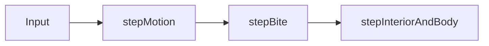
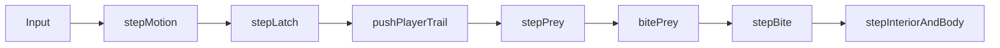

# Sandworm Prey Worm Implementation Plan (v2, Gemini-ready)

> **Executor rules (read first, obey always):**
> 1. Implement tasks in order. Do not start Task N+1 before Task N gates pass.
> 2. Never skip an "Expected: FAIL" step. Run it and confirm it fails for the stated reason.
> 3. **Never change an expected value in a test to make it pass.** If a test disagrees with code, fix code. If you believe the test is wrong, STOP and report.
> 4. If a "find this exact text" anchor is not found, **STOP and report**. Do not guess a location.
> 5. Tick a box only when you observed the result. Otherwise write `PENDING: <reason>` next to it.
> 6. Safety: no `git push`, `reset`, `checkout`, `clean`, `rebase`; no file deletes; no package installs; no process, port, firewall or service changes. On any surprise, STOP and report.
> 7. Work only inside `prototypes/sandworm-driver-demo/` plus ticking boxes in this file.

**Goal:** Add fleeing prey worms. Head bite eats one whole. Body bite eats 1 section. A sloppy side-on approach lets prey latch onto our body and wiggle our heading and momentum.

**Architecture:** Sim-side path-history bodies (`src/sim/trail.ts`) for player and prey. Prey AI, bite and latch in `src/sim/prey.ts`. `tick.ts` calls them. Render, sonar, HUD and tuning read the new state.

**Tech Stack:** TypeScript 5.6, Vite 5.4, Three.js 0.186, vitest 2.1, lil-gui 0.19.

**Spec:** `.cursor/plans/design/2026-11-28-sandworm-prey-worm.md` (approved 2026-11-28). Read it before Task 1.

All paths are relative to `prototypes/sandworm-driver-demo/`. Run all commands from that folder.

## Global Constraints

- World is 2D side view. `x` forward, `y` up, `y <= 0` underground, floor `SIM_CONFIG.maxDepth` (-28). `heading` radians, 0 = +x. Scene coords equal sim coords (`mesh.position.set(x, y, 0)`).
- Sim runs at fixed `dt = 1/60` (`src/main.ts:55`).
- New config keys and start values exactly as in Task 2 table.
- Head bite wins over body bite in the same step. At most one prey bitten per step.
- Lunge only when side-on: `angleOff > lungeAngle`, where `angleOff = |wrapAngle(atan2(prey.y - w.y, prey.x - w.x) - w.heading)|`. Nose-on never lunges.
- Only one prey latched at a time (`worm.latchedPreyId`).
- Prey code never writes `worm.health`.
- Prey y stays in `[maxDepth, 0]`.
- Gates after every task: `npm test` all pass, `npm run typecheck` exit 0. After Task 5 also `npm run build` ok.

## Review Focus

1. Trail shorter than requested arc (run start): lookup clamps to oldest sample, never NaN. Test: Task 1 `clamps to oldest sample`.
2. Body bite on a 1-section prey: treated as head bite, prey removed. Test: Task 3 `one-section prey counts as head bite`.
3. Second prey lunging into us while one is latched: does not latch. Test: Task 4 `second prey cannot latch`.
4. Large `dt` (0.25): latch heading push capped by `MAX_NOSE_RATE * dt`. Test: Task 4 `heading push capped`.
5. Outcome not `playing`: prey frozen. Test: Task 5 `prey frozen after outcome`.

## File map

| File | Task | Change |
|---|---|---|
| `src/sim/trail.ts` | 1 | Create |
| `test/trail.test.ts` | 1 | Create |
| `src/sim/types.ts` | 2 | Add prey types, worm fields, interior field |
| `src/sim/config.ts` | 2 | Add prey keys |
| `src/tune/settings.ts` | 2 | Add `Prey` folder rows |
| `src/sim/state.ts` | 2 | Init trail and prey |
| `src/sim/motion.ts` | 4 | Export `MAX_NOSE_RATE` |
| `src/sim/prey.ts` | 3, 4 | Create |
| `src/sim/interior.ts` | 3 | Prey section yield |
| `src/sim/tick.ts` | 3, 4 | Call order |
| `test/prey.test.ts` | 3, 4 | Create |
| `src/render/preyMesh.ts` | 5 | Create |
| `src/render/world.ts`, `src/ui/minimap.ts`, `src/ui/hud.ts` | 5 | Show prey |

Current tick:



Target tick:



---

### Task 0: Inspect checkout and baseline

- [x] **Step 1:** `git branch --show-current`. Expected: `feat/sandworm-prey` (owner creates it before handoff). If `main`, **STOP and report**.
- [x] **Step 2:** `git status --short`. Expected: empty, or only `.cursor/plans/` files. Else STOP.
- [x] **Step 3:** `npm test`. Expected: `Tests  65 passed (65)`. `npm run typecheck`. Expected: exit 0. Write actual counts here: `65 passed (65), typecheck exit 0`.
- [x] **Step 4:** Confirm these anchors exist (grep). If any missing, STOP:
  - `src/sim/tick.ts`: `  stepMotion(state, input, dt);`
  - `src/sim/motion.ts`: `const MAX_NOSE_RATE = 5;`
  - `src/sim/interior.ts`: `intr.acidSlots.push({ yieldHunger: 20, remaining: 2.6, total: 2.6 });`
  - `src/render/world.ts`: `    this.wormVisual.update(state.worm, pose, dt);`
  - `test/tuning.test.ts`: `has one row for every tunable value`

### Task 1: Path trail

**Files:** Create `src/sim/trail.ts`, `test/trail.test.ts`.

**Interfaces (Produces):**
```ts
export interface Point { x: number; y: number; }
/** Samples newest first. arc[i] = path distance from sample 0 to sample i. */
export interface PathTrail { pts: Point[]; arc: number[]; }
export function createStraightTrail(x: number, y: number, heading: number, length: number, spacing: number): PathTrail;
export function pushTrail(t: PathTrail, x: number, y: number, spacing: number, maxLength: number): void;
export function pointAtArc(t: PathTrail, headX: number, headY: number, dist: number): Point;
export function segmentPositions(t: PathTrail, headX: number, headY: number, count: number, spacing: number): Point[];
```
Rules:
- `createStraightTrail`: samples at `d = 0, spacing, 2*spacing, ... <= length` at `(x - cos(heading)*d, y - sin(heading)*d)`.
- `pushTrail`: if distance from `(x,y)` to `pts[0]` `< spacing`, do nothing. Else insert `(x,y)` at front, recompute `arc`, then drop tail samples whose `arc > maxLength + spacing`.
- `pointAtArc`: walk from current head `(headX, headY)` to `pts[0]`, then along `pts`. Lerp inside the leg containing `dist`. If `dist` is beyond the end, return last sample. `dist <= 0` returns head.
- `segmentPositions`: index `i` = `pointAtArc(t, headX, headY, i * spacing)`, `i = 0..count-1`.

- [x] **Step 1: Write failing tests** `test/trail.test.ts`:
```ts
import { describe, expect, it } from 'vitest';
import { createStraightTrail, pointAtArc, pushTrail, segmentPositions } from '../src/sim/trail.ts';

describe('path trail', () => {
  it('segments lie at i*spacing along a straight path', () => {
    const t = createStraightTrail(0, 0, 0, 0, 0.5);
    for (let x = 0.25; x <= 30; x += 0.25) pushTrail(t, x, 0, 0.5, 40);
    const segs = segmentPositions(t, 30, 0, 5, 2.2);
    [30, 27.8, 25.6, 23.4, 21.2].forEach((ex, i) => {
      expect(segs[i]!.x).toBeCloseTo(ex, 5);
      expect(segs[i]!.y).toBeCloseTo(0, 5);
    });
  });

  it('follows a bend', () => {
    // Path: along +x to (10,0), then straight down to (10,-10).
    const t = createStraightTrail(10, 0, 0, 10, 0.5);
    for (let y = -0.5; y >= -10; y -= 0.5) pushTrail(t, 10, y, 0.5, 40);
    const p = pointAtArc(t, 10, -10, 12);
    expect(p.x).toBeCloseTo(8, 5);
    expect(p.y).toBeCloseTo(0, 5);
  });

  it('clamps to oldest sample when trail is too short', () => {
    const t = createStraightTrail(0, 0, 0, 0, 0.5);
    const p = pointAtArc(t, 1, 0, 50);
    expect(p).toEqual({ x: 0, y: 0 });
    expect(Number.isNaN(p.x)).toBe(false);
  });

  it('drops samples beyond maxLength', () => {
    const t = createStraightTrail(0, 0, 0, 0, 0.5);
    for (let x = 0.5; x <= 100; x += 0.5) pushTrail(t, x, 0, 0.5, 20);
    expect(t.arc[t.arc.length - 1]!).toBeLessThanOrEqual(20.5);
  });
});
```
Expected-value reasoning: straight path, head at x=30, segments every 2.2 back → 30 − 2.2·i. Bend test: from head (10,−10) up 10 m to the corner (10,0), then 2 m more along −x → (8,0). Drop test: keep samples with arc ≤ maxLength + spacing = 20.5.
- [x] **Step 2:** `npx vitest run test/trail.test.ts`. Expected: FAIL, `Failed to resolve import "../src/sim/trail.ts"`.
- [x] **Step 3:** Implement `src/sim/trail.ts` per rules above.
- [x] **Step 4:** `npx vitest run test/trail.test.ts` → 4 passed. `npm test` → 69 passed. `npm run typecheck` → 0.
- [x] **Step 5:** `git add src/sim/trail.ts test/trail.test.ts` then `git commit -m "feat(sandworm): sim path trail for worm bodies"`.

### Task 2: Types, config, tuning rows, initial state

**Files:** Modify `src/sim/types.ts`, `src/sim/config.ts`, `src/tune/settings.ts`, `src/sim/state.ts`. Test `test/state.test.ts`.

**Interfaces (Produces):**
```ts
// types.ts
import type { PathTrail } from './trail.ts';
export type PreyMode = 'wander' | 'flee' | 'lunge' | 'latched' | 'recover';
export interface PreyWorm {
  id: number;
  x: number; y: number; vx: number; vy: number; heading: number;
  sections: number;          // 1..preySegments, segment 0 = head
  trail: PathTrail;
  mode: PreyMode;
  modeTimer: number;         // seconds left in lunge, recover or flee burst
  latchSegment: number;      // player segment index while latched, else -1
  latchTimer: number;
  latchMomentumStart: number;
  wigglePhase: number;
  alive: boolean;
}
// WormState: add  trail: PathTrail;  latchedPreyId: number | null;
// InteriorState: add  preySections: number;   // queued items that came from prey
// SimState: add  prey: PreyWorm[];
```

Config: add inside `DEFAULT_SIM_CONFIG`, after `regenPerPoint: 1.1,`, under comment `// prey`:

| Key | Value | Settings row min, max, step |
|---|---|---|
| `trailSampleSpacing` | 0.5 | 0.1, 2, 0.05 |
| `segmentSpacing` | 2.2 | 0.5, 5, 0.1 |
| `playerSegments` | 8 | 2, 16, 1 |
| `playerSegmentRadius` | 1.8 | 0.5, 4, 0.1 |
| `preySegments` | 5 | 1, 12, 1 |
| `preySegmentRadius` | 1.0 | 0.3, 3, 0.1 |
| `preySpeed` | 20 | 0, 50, 0.5 |
| `preyTurnRate` | 3.6 | 0.5, 10, 0.1 |
| `fleeRadius` | 30 | 5, 100, 1 |
| `lungeRadius` | 8 | 1, 30, 0.5 |
| `lungeAngle` | 1.0 | 0, 3.1, 0.05 |
| `lungeDuration` | 1.2 | 0.2, 5, 0.1 |
| `latchDuration` | 4 | 0.5, 15, 0.5 |
| `latchWiggleForce` | 1.0 | 0, 5, 0.05 |
| `latchWiggleFreq` | 2.5 | 0.2, 8, 0.1 |
| `latchTurnGain` | 1.2 | 0, 1000, 0.1 |
| `latchMomentumDrain` | 18 | 0, 100, 1 |
| `shakeOffBrake` | 25 | 1, 100, 1 |
| `recoverTime` | 2.5 | 0, 10, 0.1 |
| `preyBurstTime` | 1.0 | 0, 5, 0.1 |
| `preyCount` | 4 | 0, 4, 1 |
| `preyYieldPerSection` | 15 | 0, 50, 1 |

`latchTurnGain` max is 1000 on purpose (Task 4 cap test sets it to 1000; `applyValues` clamps to max).
Settings: append one `row('Prey', key, label, min, max, step, help)` per key above in `SETTINGS`, after the last existing row. Help text: one plain sentence, more than 10 characters. Note `preyCount` only takes effect on restart (say so in its help).

State (`createInitialState`):
- `worm.trail = createStraightTrail(0, -2, 0, (C.playerSegments + 1) * C.segmentSpacing, C.trailSampleSpacing)`, `worm.latchedPreyId = null`, `interior.preySections = 0`.
- Prey spawn table (take first `C.preyCount` rows):

| id | x | y |
|---|---|---|
| 201 | 120 | -8 |
| 202 | 250 | -12 |
| 203 | 380 | -6 |
| 204 | 500 | -14 |

  Each: `vx 0, vy 0, heading 0, sections C.preySegments, trail createStraightTrail(x, y, 0, (C.preySegments + 1) * C.segmentSpacing, C.trailSampleSpacing), mode 'wander', modeTimer 0, latchSegment -1, latchTimer 0, latchMomentumStart 0, wigglePhase 0, alive true`.

- [x] **Step 1: Failing test** append to `test/state.test.ts`:
```ts
it('spawns preyCount prey with full bodies and a player trail', () => {
  const s = createInitialState();
  expect(s.prey.map((p) => p.id)).toEqual([201, 202, 203, 204]);
  for (const p of s.prey) {
    expect(p.sections).toBe(5);
    expect(p.alive).toBe(true);
    expect(p.y).toBeGreaterThanOrEqual(-28);
    expect(p.y).toBeLessThanOrEqual(0);
    expect(p.trail.arc[p.trail.arc.length - 1]!).toBeGreaterThanOrEqual(4 * 2.2);
  }
  expect(s.worm.latchedPreyId).toBeNull();
  expect(s.worm.trail.pts[0]).toEqual({ x: 0, y: -2 });
  expect(s.interior.preySections).toBe(0);
});
```
Reasoning: last prey segment index 4 sits 4 × 2.2 = 8.8 m back, so the trail must reach at least that.
- [x] **Step 2:** `npx vitest run test/state.test.ts`. Expected: FAIL (`s.prey` undefined).
- [x] **Step 3:** Implement types, config, settings rows, state.
- [x] **Step 4:** `npm test` → 70 passed (tuning test `has one row for every tunable value` must still pass). `npm run typecheck` → 0.
- [x] **Step 5:** Commit `feat(sandworm): prey state, config and tuning rows`.

### Task 3: Prey movement, lunge, bite, digest yield

**Files:** Create `src/sim/prey.ts`, `test/prey.test.ts`. Modify `src/sim/tick.ts`, `src/sim/interior.ts`.

**Interfaces:**
- Consumes: Task 1 trail functions, Task 2 types and config.
- Produces:
```ts
export function playerBodyPoints(state: SimState): Point[];   // segmentPositions(worm.trail, worm.x, worm.y, C.playerSegments, C.segmentSpacing)
export function preyBodyPoints(p: PreyWorm): Point[];         // segmentPositions(p.trail, p.x, p.y, p.sections, C.segmentSpacing)
export function pushPlayerTrail(state: SimState): void;       // pushTrail(worm.trail, worm.x, worm.y, C.trailSampleSpacing, (C.playerSegments + 1) * C.segmentSpacing)
export function stepPrey(state: SimState, dt: number): void;
export function bitePrey(state: SimState): void;
```

`stepPrey` for each `alive` prey not `latched`:
1. `modeTimer = max(0, modeTimer - dt)`.
2. Distance `d` from prey head to worm head, `angleOff` per Global Constraints.
3. Transitions, evaluated in this order, first match wins:
   - `recover` and `modeTimer > 0`: stay.
   - `recover` and `modeTimer == 0`: go `flee`.
   - `lunge` and `modeTimer == 0`: go `flee`.
   - (`wander` or `flee`) and `worm.latchedPreyId === null` and `d <= lungeRadius` and `angleOff > lungeAngle`: go `lunge`, `modeTimer = lungeDuration`.
   - `wander` and `d <= fleeRadius`: go `flee`.
   - `flee` and `d > fleeRadius * 1.5`: go `wander`.
4. Target heading and speed:
   - `wander`: `targetH = 0.6 * sin(state.time * 0.5 + id)`, speed `0.5 * preySpeed`.
   - `flee`: `targetH = atan2(p.y - w.y, p.x - w.x) + 0.4 * sin(state.time * 1.7 + id)`, speed `preySpeed`, times 1.4 while `modeTimer > 0` (burst).
   - `recover`: keep heading, speed `0.5 * preySpeed`.
   - `lunge`: `targetH` toward the nearest point in `playerBodyPoints(state)` with index `>= 1`, speed `1.3 * preySpeed`.
5. Turn: `heading += clamp(wrapAngle(targetH - heading), -preyTurnRate*dt, preyTurnRate*dt)`.
6. Move: `vx = cos(heading)*speed`, `vy = sin(heading)*speed`, `x += vx*dt`, `y += vy*dt`. If `y > 0`: `y = 0`, `heading = -|heading|`. If `y < maxDepth`: `y = maxDepth`, `heading = |heading|`.
7. `pushTrail(p.trail, p.x, p.y, trailSampleSpacing, (preySegments + 1) * segmentSpacing)`.
8. Latch start: if mode is `lunge` and `worm.latchedPreyId === null`, then for player body index `j >= 1`, if `hypot(p - body[j]) <= preySegmentRadius + playerSegmentRadius`: `mode = 'latched'`, `latchSegment = j`, `latchTimer = latchDuration`, `latchMomentumStart = worm.momentum`, `wigglePhase = 0`, `worm.latchedPreyId = p.id`. Use the lowest such `j`.

`bitePrey`: `reach = C.headRadius + C.preySegmentRadius`. For each alive prey, in array order, stop after the first prey bitten:
- `pts = preyBodyPoints(p)`. `headHit = hypot(worm - pts[0]) <= reach`. `bodyHit` = some `k >= 1` within reach.
- If `headHit` or (`bodyHit` and `sections <= 1`): `alive = false`, `interior.mouthQueue += sections`, `interior.preySections += sections`, `recordImpact(worm, 'break', 0.8, p.x, p.y)`. If `worm.latchedPreyId === p.id`, set it to `null`.
- Else if `bodyHit`: `sections -= 1`, `mouthQueue += 1`, `preySections += 1`, `mode = 'flee'`, `modeTimer = preyBurstTime`, `recordImpact(worm, 'gnaw', 0.5, p.x, p.y)`. If latched to us, free: `latchedPreyId = null`, `latchSegment = -1`.

`interior.ts`: replace exact line
`        intr.acidSlots.push({ yieldHunger: 20, remaining: 2.6, total: 2.6 });`
with
```ts
        const fromPrey = intr.preySections > 0;
        if (fromPrey) intr.preySections -= 1;
        intr.acidSlots.push({ yieldHunger: fromPrey ? SIM_CONFIG.preyYieldPerSection : 20, remaining: 2.6, total: 2.6 });
```

`tick.ts`: after the exact line `  stepMotion(state, input, dt);` insert:
```ts
  pushPlayerTrail(state);
  stepPrey(state, dt);
  bitePrey(state);
```

- [x] **Step 1: Failing tests** `test/prey.test.ts`:
```ts
import { afterEach, describe, expect, it } from 'vitest';
import { createInitialState } from '../src/sim/state.ts';
import { SIM_CONFIG, resetSimConfig } from '../src/sim/config.ts';
import { bitePrey, preyBodyPoints, stepPrey } from '../src/sim/prey.ts';
import { stepInteriorAndBody } from '../src/sim/interior.ts';

const idle = { throttle: 0, steer: 0, boost: false, ping: false, preset: null };
afterEach(() => resetSimConfig());

describe('prey bite', () => {
  it('head bite eats prey whole', () => {
    const s = createInitialState();
    const p = s.prey[0]!;
    s.worm.x = p.x; s.worm.y = p.y;
    bitePrey(s);
    expect(p.alive).toBe(false);
    expect(s.interior.mouthQueue).toBe(5);
    expect(s.interior.preySections).toBe(5);
  });

  it('body bite eats one section and prey flees', () => {
    const s = createInitialState();
    const p = s.prey[0]!;
    const seg2 = preyBodyPoints(p)[2]!;
    s.worm.x = seg2.x; s.worm.y = seg2.y;
    bitePrey(s);
    expect(p.alive).toBe(true);
    expect(p.sections).toBe(4);
    expect(s.interior.mouthQueue).toBe(1);
    expect(p.mode).toBe('flee');
    expect(p.modeTimer).toBeCloseTo(1.0, 5);
  });

  it('one-section prey counts as head bite', () => {
    const s = createInitialState();
    const p = s.prey[0]!;
    p.sections = 1;
    s.worm.x = p.x; s.worm.y = p.y;
    bitePrey(s);
    expect(p.alive).toBe(false);
    expect(s.interior.mouthQueue).toBe(1);
  });

  it('prey section digests at preyYieldPerSection', () => {
    const s = createInitialState();
    s.interior.mouthQueue = 1;
    s.interior.preySections = 1;
    stepInteriorAndBody(s, idle, SIM_CONFIG.crewCarryTime);
    expect(s.interior.acidSlots[0]!.yieldHunger).toBe(15);
    expect(s.interior.preySections).toBe(0);
  });
});

describe('prey movement', () => {
  it('nose-on approach never lunges', () => {
    SIM_CONFIG.preySpeed = 0;
    const s = createInitialState();
    const p = s.prey[0]!;
    s.worm.x = p.x - 6; s.worm.y = p.y; s.worm.heading = 0;
    for (let i = 0; i < 30; i++) {
      stepPrey(s, 1 / 60);
      expect(p.mode).not.toBe('lunge');
    }
  });

  it('side-on approach within lungeRadius lunges', () => {
    const s = createInitialState();
    const p = s.prey[0]!;
    s.worm.x = p.x; s.worm.y = p.y + 6; s.worm.heading = 0;
    stepPrey(s, 1 / 60);
    expect(p.mode).toBe('lunge');
  });

  it('flee moves away from the player', () => {
    const s = createInitialState();
    const p = s.prey[0]!;
    s.worm.x = p.x - 20; s.worm.y = p.y; s.worm.heading = 0;
    const d0 = Math.hypot(p.x - s.worm.x, p.y - s.worm.y);
    for (let i = 0; i < 60; i++) stepPrey(s, 1 / 60);
    expect(p.mode).toBe('flee');
    expect(Math.hypot(p.x - s.worm.x, p.y - s.worm.y)).toBeGreaterThan(d0 + 5);
  });

  it('prey stays between floor and surface', () => {
    const s = createInitialState();
    const p = s.prey[0]!;
    p.y = -27.9; p.heading = -Math.PI / 2;
    for (let i = 0; i < 120; i++) stepPrey(s, 1 / 60);
    expect(p.y).toBeGreaterThanOrEqual(-28);
    expect(p.y).toBeLessThanOrEqual(0);
  });
});
```
Expected-value reasoning:
- Head bite: worm on prey head, distance 0 ≤ reach 3 → whole prey, 5 sections queued.
- Body bite: worm on segment 2, 4.4 m from the prey head, which is more than reach 3, so no head hit. `modeTimer = preyBurstTime = 1.0`.
- Digest: one crew step with `dt = crewCarryTime` makes `crewWorkTimer` reach 1, so one item moves to the acid pit with yield 15.
- Nose-on: worm 6 m behind, facing the prey, so `angleOff = 0`, which is not more than 1.0. Never lunges.
- Side-on: the prey is 6 m straight below a worm heading +x. `angleOff = π/2 ≈ 1.57 > 1.0` and `d = 6 ≤ 8`. The lunge rule is evaluated before the flee rule, so it lunges in one step.
- Flee: worm 20 m away, which is more than lungeRadius and within fleeRadius, so the prey flees. Wander speed in step 1 gives about 0.17 m, then flee at 20 m/s for 59 steps gives about 19 m. The jitter is ±0.4 rad, so cos ≥ 0.92 and the forward gain is ≥ 17 m. The margin of 5 is safe.
- [x] **Step 2:** `npx vitest run test/prey.test.ts`. Expected: FAIL, `Failed to resolve import "../src/sim/prey.ts"`.
- [x] **Step 3:** Implement `prey.ts` (`stepPrey`, `bitePrey`, helpers), the `interior.ts` replace, and the `tick.ts` insert. Define `wrapAngle` and `clamp` locally in `prey.ts` (same one-liners as `motion.ts`).
- [x] **Step 4:** `npm test` → 78 passed. `npm run typecheck` → 0.
- [x] **Step 5:** Commit `feat(sandworm): prey chase, lunge, bite and digest yield`.

### Task 4: Latch physics and escape

**Files:** Modify `src/sim/prey.ts`, `src/sim/motion.ts`, `src/sim/tick.ts`. Test `test/prey.test.ts`.

**Interfaces:**
- Consumes: Task 3 `playerBodyPoints`.
- Produces: `export function stepLatch(state: SimState, input: DriverInput, dt: number): void;` in `prey.ts`.
- `motion.ts`: change exact text `const MAX_NOSE_RATE = 5;` to `export const MAX_NOSE_RATE = 5;`.
- `tick.ts`: insert `  stepLatch(state, input, dt);` directly **before** `  pushPlayerTrail(state);`.

`stepLatch` (no-op if `worm.latchedPreyId === null`). Let `p` = that prey, `j = p.latchSegment`:
1. `L = j / C.playerSegments`.
2. `f = C.latchWiggleForce * sin(p.wigglePhase)` computed with the **current** phase. Then `p.wigglePhase += C.latchWiggleFreq * 2π * dt`.
3. `worm.heading += clamp(f * L * C.latchTurnGain * dt, -MAX_NOSE_RATE*dt, MAX_NOSE_RATE*dt)`.
4. `worm.momentum = max(0, worm.momentum - C.latchMomentumDrain * (1 - 0.5 * L) * dt)`.
5. If `|f| >= 0.95 * C.latchWiggleForce` and `C.latchWiggleForce > 0`: `worm.shakeImpulse = max(worm.shakeImpulse, 0.2)`.
6. Pin: `body = playerBodyPoints(state)`. Set `p.x, p.y = body[j]`. `pushTrail(p.trail, ...)`.
7. `p.latchTimer -= dt`.
8. Escape if any: `p.latchTimer <= 0`; `input.throttle < 0` and `p.latchMomentumStart - worm.momentum >= C.shakeOffBrake`; `body[j]` is within `obs.radius + C.preySegmentRadius` of any unbroken obstacle.
9. On escape: `p.mode = 'recover'`, `p.modeTimer = C.recoverTime`, `p.latchSegment = -1`, `worm.latchedPreyId = null`. Push `p` 3 m away from `body[j]` along `(body[j] - body[j-1])` rotated +90° (normalized). If the length is 0, push +y.

Shake 0.2 is below the interior stun threshold 0.35 (`interior.ts:9`), so a latch alone never stuns crew or breaches. Plan call: harm stays on steering and momentum, as the spec requires.

- [x] **Step 1: Failing tests** append to `test/prey.test.ts`:
```ts
import { stepLatch } from '../src/sim/prey.ts';
import { stepSim } from '../src/sim/tick.ts';

function latchAt(j: number) {
  const s = createInitialState();
  const p = s.prey[0]!;
  p.mode = 'latched'; p.latchSegment = j; p.latchTimer = 4;
  p.wigglePhase = Math.PI / 2; p.latchMomentumStart = 80;
  s.worm.latchedPreyId = p.id;
  s.worm.momentum = 80; s.worm.heading = 0;
  return { s, p };
}

describe('latch', () => {
  it('tail latch turns more, head latch drains more', () => {
    const tail = latchAt(7); stepLatch(tail.s, idle, 0.05);
    const head = latchAt(1); stepLatch(head.s, idle, 0.05);
    expect(tail.s.worm.heading).toBeCloseTo(0.0525, 6);
    expect(head.s.worm.heading).toBeCloseTo(0.0075, 6);
    expect(80 - head.s.worm.momentum).toBeCloseTo(0.84375, 6);
    expect(80 - tail.s.worm.momentum).toBeCloseTo(0.50625, 6);
  });

  it('heading push capped on dt spike', () => {
    SIM_CONFIG.latchTurnGain = 1000;
    const { s } = latchAt(7);
    stepLatch(s, idle, 0.25);
    expect(Math.abs(s.worm.heading)).toBeLessThanOrEqual(5 * 0.25 + 1e-9);
  });

  it('latch ends on timer', () => {
    const { s, p } = latchAt(4);
    p.latchTimer = 0.01;
    stepLatch(s, idle, 0.05);
    expect(p.mode).toBe('recover');
    expect(s.worm.latchedPreyId).toBeNull();
  });

  it('hard brake shakes it off', () => {
    const { s, p } = latchAt(4);
    s.worm.momentum = 54;
    stepLatch(s, { ...idle, throttle: -1 }, 1 / 60);
    expect(p.mode).toBe('recover');
  });

  it('rock slam shakes it off', () => {
    const { s, p } = latchAt(3);
    const rock = s.obstacles[0]!;
    s.worm.x = rock.x + 3 * SIM_CONFIG.segmentSpacing; s.worm.y = rock.y;
    s.worm.trail = createStraightTrail(s.worm.x, s.worm.y, 0, 20, SIM_CONFIG.trailSampleSpacing);
    stepLatch(s, idle, 1 / 60);
    expect(p.mode).toBe('recover');
  });

  it('second prey cannot latch while one is latched', () => {
    const { s } = latchAt(4);
    const b = s.prey[1]!;
    const seg2 = playerBodyPoints(s)[2]!;
    b.mode = 'lunge'; b.modeTimer = 1; b.x = seg2.x; b.y = seg2.y;
    stepPrey(s, 1 / 60);
    expect(b.mode).not.toBe('latched');
    expect(s.worm.latchedPreyId).toBe(s.prey[0]!.id);
  });

  it('latch never touches health', () => {
    const { s } = latchAt(7);
    s.worm.health = 50;
    SIM_CONFIG.regenPerPoint = 0;
    for (let i = 0; i < 200; i++) stepLatch(s, idle, 1 / 60);
    expect(s.worm.health).toBe(50);
  });
});
```
Add `createStraightTrail` (from `../src/sim/trail.ts`) and `playerBodyPoints` to the imports.
Expected-value reasoning: phase π/2 gives `f = 1.0`. Tail: L = 7/8 = 0.875, Δh = 1 × 0.875 × 1.2 × 0.05 = 0.0525, drain = 18 × (1 − 0.4375) × 0.05 = 0.50625. Head: L = 0.125, Δh = 0.0075, drain = 18 × 0.9375 × 0.05 = 0.84375. Cap: 1000 gain → raw 43.75 × 0.25, capped at 5 × 0.25 = 1.25. Brake: 80 − 54 = 26 ≥ 25 with throttle −1. Rock: segment 3 sits 3 × 2.2 behind the head, which is the rock centre, so distance 0 ≤ 3.4 + 1.0. Second prey: `latchedPreyId` is not null, so the latch start is skipped.
- [x] **Step 2:** `npx vitest run test/prey.test.ts`. Expected: FAIL, `stepLatch` is not exported.
- [x] **Step 3:** Implement.
- [x] **Step 4:** `npm test` → 85 passed. `npm run typecheck` → 0.
- [x] **Step 5:** Commit `feat(sandworm): prey latch wiggle and escape`.

### Task 5: Render, sonar, HUD

**Files:** Create `src/render/preyMesh.ts`. Modify `src/render/world.ts`, `src/ui/minimap.ts`, `src/ui/hud.ts`. Test `test/tick.test.ts`.

**Interfaces (Produces):**
```ts
export class PreyVisual {
  readonly group: THREE.Group;
  constructor();
  update(state: SimState): void; // create meshes lazily per prey id, position from preyBodyPoints
}
```
- Mesh: per prey, `C.preySegments` spheres (`SphereGeometry(C.preySegmentRadius, 10, 8)`). Head color `0x8a6e45`, body `0xc9b48a`, `MeshStandardMaterial` roughness 0.7. Segment `i` visible only if `alive && i < sections`. Position `set(pt.x, pt.y, 0)`.
- `world.ts`: field `private readonly preyVisual = new PreyVisual();`. Add `this.scene.add(this.preyVisual.group);` in the constructor right after the exact line `    this.scene.add(hemi, dir);`. Call `this.preyVisual.update(state);` right after the exact line `    this.wormVisual.update(state.worm, pose, dt);`.
- `minimap.ts`: after the spawner loop (anchor `    // Uneaten food / spawners` block end), for each alive prey in view: polyline through `preyBodyPoints` mapped by `toX/toY`, stroke `#d9c38f` width 2, head dot radius 3 fill `#f2e6d0`.
- `hud.ts`: in the action-text chain, as the **first** check: if `state.worm.latchedPreyId !== null`, `actionText = 'LATCHED, shake it off (brake hard or hit a rock)'`, `actionDanger = true`. Read the surrounding code (`hud.ts:102-112`) for the exact variable in scope. If the worm state is named differently there, use that name.

- [x] **Step 1: Failing test** append to `test/tick.test.ts`:
```ts
it('prey frozen after outcome', () => {
  const s = createInitialState();
  s.outcome = 'win';
  const x0 = s.prey[0]!.x;
  for (let i = 0; i < 10; i++) stepSim(s, { throttle: 0, steer: 0, boost: false, ping: false, preset: null }, 1 / 60);
  expect(s.prey[0]!.x).toBe(x0);
});
```
- [x] **Step 2:** Run. This one passes already because of the early return in `stepSim`. Record `PASS (guard pre-exists)`. It is a regression pin, not TDD red.
- [x] **Step 3:** Implement render, minimap, HUD.
- [x] **Step 4:** `npm test` → 86 passed. `npm run typecheck` → 0. `npm run build` → ok.
- [x] **Step 5:** Commit `feat(sandworm): prey render, sonar and latch HUD`.

### Task 6: Runtime checklist (owner or Claude observes; tests cannot tick)

`npm run dev -- --port 5173`, open `http://localhost:5173/`, click the Drive monitor. Tick only when observed. Else write `PENDING: <reason>`. Gemini headless cannot see the screen: mark every item PENDING.
- [ ] Prey visible as a pale sphere chain and flees when approached. PENDING: headless, cannot observe screen
- [ ] Nose-on chase lands a head bite: prey vanishes, mouth queue +5. PENDING: headless, cannot observe screen
- [ ] Body bite shortens the prey by 1 and it bolts. PENDING: headless, cannot observe screen
- [ ] Side-on pass gets latched: heading wobbles, momentum bleeds, HUD pill shows. PENDING: headless, cannot observe screen
- [ ] Hard brake or rock slam frees the latch. PENDING: headless, cannot observe screen
- [ ] F3 `Prey` folder values change behavior live. PENDING: headless, cannot observe screen

### Report format (Gemini returns this)

Per task: commit hash, `npm test` count, typecheck exit code, any STOP with reason. List of any boxes marked PENDING.
