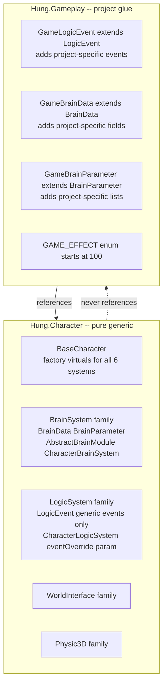

# Memory: Hung.Character Core/Glue Split — Reusable Refactor Guide

**ID:** `mem-character-refactor-guide`  
**Owner agent:** `domain-gameplay-developer`  
**Companion doc:** If you authored a refactor spec for this project, it lives in `.cursor/plans/` (local, not synced).

This guide documents the pattern used to make `Hung.Character` a pure generic 3D character core, extraction-ready for reuse across projects. Follow this sequence in a new project.

---

## Goal

`Hung.Character` must contain **zero game-specific types, fields, events, enum values, or comments**. All project-specific subclasses live in the game assembly (`Hung.Gameplay` or equivalent).

Two governing laws remain inviolable after the refactor:

> **LAW 1 — Logic is a pure rule-executor.** Logic reads only `LogicParameter`. It emits only void fire-and-forget effects via `LogicEvent`. Never makes a movement or where-to-go decision.

> **LAW 2 — All where/whether-to-move decisions live in Brain.** Brain decides intent and writes it into `BrainData`. Mobility only executes that intent.

---

## Architecture after refactor



---

## Step sequence

### Step 1 — Defect fixes

Fix defects that will block device or CI builds:

- Remove any unguarded `using UnityEditor;` in non-Editor runtime files.
- Genericize doc comments that name concrete game types — those become stale after extraction.

### Step 2 — Dead code removal

Before deleting, **grep for zero usages** of each candidate. Delete only confirmed-dead files:

- Unused 2D stub families (MobilityData, Abstract2DMobilityModule, etc.)
- Empty marker interfaces with zero usages
- Commented-out method bodies in files being moved anyway

Gate: `dotnet build <Assembly>.csproj -v q --nologo` — 0 errors before proceeding.

### Step 3 — Leakage extraction (core to game)

Identify every game-specific item in `Hung.Character` core files. For each:

| Item type | Extraction pattern |
|---|---|
| Game-specific events on `LogicEvent` | Move to `GameLogicEvent : LogicEvent` in game assembly |
| Game-specific fields on `BrainData` | Move to `GameBrainData : BrainData` in game assembly |
| Game-specific fields on `BrainParameter` | Move to `GameBrainParameter : BrainParameter` in game assembly |
| Game-specific enum values | Move to `GAME_EFFECT` (or equivalent) starting at 100; core enum reserved 0–99 |
| Game-specific layer constants | Move to game assembly constants file |
| Game-specific MonoBehaviours (HpBar etc.) | Move file + meta (Unity open for GUID preservation) |

**`CharacterStats.Effect` storage:** Change `public EFFECT Effect` to `public int EffectId = (int)EFFECT.NONE` plus a compatibility property:
```csharp
public EFFECT Effect { get => (EFFECT)EffectId; set => EffectId = (int)value; }
```
This lets game code use `Stats.EffectId = (int)GAME_EFFECT.YOUR_VALUE` without requiring a cast back on read.

### Step 4 — Factory virtuals on BaseCharacter

Add six protected virtual factory methods to `BaseCharacter<T>`:

```csharp
protected virtual LogicEvent CreateLogicEvent() => new LogicEvent();
protected virtual BrainData CreateBrainData() => new BrainData();
protected virtual BrainParameter CreateBrainParameter() => new BrainParameter();
protected virtual CharacterBrainSystem<BrainData, BrainParameter> CreateBrainSystem(...) { ... }
protected virtual AbstractPhysicSystem CreatePhysicSystem(...) { ... }
protected virtual AbstractWorldInterfaceSystem CreateWorldInterfaceSystem(...) { ... }
```

`InitializeSystems()` routes through all factory methods — no direct `new` calls for overridable types.

**Critical:** `CreateLogicSystem` must pass `CreateLogicEvent()` as `eventOverride`:
```csharp
protected override CharacterLogicSystem<...> CreateLogicSystem(...) {
    return new CharacterLogicSystem(module, perceptionData, CreateLogicEvent());
}
```
If you forget this, `logicSystem.Event` will always be base `LogicEvent` regardless of what `CreateLogicEvent()` returns — a silent runtime cast failure.

**`CharacterLogicSystem` constructor signature:**
```csharp
public CharacterLogicSystem(AbstractLogicModule<D,P,E> module, PerceptionData perceptionData, E eventOverride = null)
```
`Event = eventOverride ?? new E();`

**`CharacterBrainSystem` constructor signature:**
```csharp
public CharacterBrainSystem(AbstractBrainModule<D,P> module, D dataOverride = null, P parameterOverride = null)
```
`Data = dataOverride ?? new D(); Parameter = parameterOverride ?? new P();`

### Step 5 — Game-side rewiring

In the game assembly, create the subclass types and update all consumers:

**Create `GameLogicEvent`** — add your game-specific events here:
```csharp
public class GameLogicEvent : LogicEvent
{
    public event Action _OnYourEvent;
    public event Action<YourGameType> _OnYourParameterizedEvent;
    public void YourEvent() => _OnYourEvent?.Invoke();
    public void YourParameterizedEvent(YourGameType arg) => _OnYourParameterizedEvent?.Invoke(arg);
}
```

**Create `GameBrainData` / `GameBrainParameter`** — inherit from `BrainData` / `BrainParameter`, add game-specific fields.

**Override factory virtuals** in the game's `Character<T>` base (not per-character):
```csharp
protected override BrainData CreateBrainData() => new GameBrainData();
protected override BrainParameter CreateBrainParameter() => new GameBrainParameter();
```

**Override `CreateLogicEvent` in concrete character classes** where a subclass event is needed:
```csharp
// YourCharacter.cs
protected override LogicEvent CreateLogicEvent() => new GameLogicEvent();
protected GameLogicEvent GameEvent => (GameLogicEvent)logicSystem.Event;
```

**Cast-at-boundary pattern** — access game subclass fields via explicit cast or helper property:
```csharp
((GameLogicEvent)Event).YourEvent();
((GameBrainData)Parameter.NavData).YourGameField = someValue;
// Or via helper property in the module/state:
private GameBrainParameter GameParameter => (GameBrainParameter)Parameter;
```

**GAME_EFFECT usage:**
```csharp
Stats.EffectId = (int)GAME_EFFECT.YOUR_VALUE;   // set
// Check:
if (Stats.EffectId == (int)GAME_EFFECT.YOUR_VALUE) { ... }
// Or via switch on int -- never switch on EFFECT enum for game values
```

### Step 6 — Asmdef cleanup

Remove unused references from `Hung.Character.asmdef`. After this refactor, `Hung.Character` should reference only its true dependencies:
- `Hung.Base`
- `Hung.Utilities.STimer`
- `Hung.DesignPattern`

Remove any project-specific references your game added (game packages, input systems, UI libraries, etc.) — they belong in `Hung.Gameplay.asmdef`, not the core.

After saving the asmdef, **keep Unity open** — it must regenerate `.csproj` files. Run `dotnet build Hung.Character.csproj -v q --nologo` and `dotnet build Hung.Gameplay.csproj -v q --nologo` after Unity regenerates.

Regenerate the asmdef matrix: `.claude/tools/pkg-framework-gen-asmdef-matrix.ps1`.

### Step 7 — Brain rename (if applicable)

If your project's `NavigationSystem` family is named misleadingly, do the mechanical rename LAST:

| Old | New |
|---|---|
| `NavigationData` | `BrainData` |
| `NavigationParameter` | `BrainParameter` |
| `AbstractNavigationModule` | `AbstractBrainModule` |
| `CharacterNavigationSystem` | `CharacterBrainSystem` |
| fields `navigationModule` / `navigationSystem` | `brainModule` / `brainSystem` |
| folder `Core/NavigationSystem/` | `Core/BrainSystem/` |

**Serialization protection:** Any renamed `[SerializeField]` field must get `[FormerlySerializedAs("old_name")]`:
```csharp
[SerializeField, FormerlySerializedAs("navigationModule")]
protected AbstractBrainModule<BrainData, BrainParameter> brainModule;
```

Do the rename with text-replace across the full repo. Compile gate after. Verify zero remaining occurrences of old names via grep.

### Step 8 — Docs + memory

- Update character system architecture memory to mark rename RESOLVED, add game extension pattern.
- Update `Character-Systems.md` and any enemy docs to use new type names.
- After asmdef changes, regenerate the matrix on demand (`.claude/tools/pkg-framework-gen-asmdef-matrix.ps1`); do not commit its output.

---

## Verification checklist

| Gate | Command / Action |
|---|---|
| Core assembly builds | `dotnet build Hung.Character.csproj -v q --nologo` → 0 errors |
| Game assembly builds | `dotnet build Hung.Gameplay.csproj -v q --nologo` → 0 errors |
| L5 integration builds | `dotnet build Researchs.csproj -v q --nologo` → 0 errors |
| No old Navigation names remain | `grep -r "NavigationData\|NavigationParameter\|navigationSystem\|navigationModule" Assets/` → 0 hits (except FormerlySerializedAs attribute) |
| No game types in Hung.Character | `grep -r "GAME_EFFECT\|GameLogicEvent\|GameBrainData\|GameBrainParameter\|<YourGameTypes>" Assets/<path-to-Hung.Character-sources>/` → 0 hits |
| Play-mode regression | Key character actions in your game (movement, primary interactions, full state-machine chains) |

---

## Known traps

| Trap | Symptom | Fix |
|---|---|---|
| `CreateLogicSystem` calls two-arg constructor | `InvalidCastException` on `GameEvent` property at runtime | Pass `CreateLogicEvent()` as `eventOverride` — see Step 4 |
| New `.cs` files not in csproj | `CS0246 type not found` on game subclass types | Unity must refresh/reimport before `dotnet build` sees new files |
| `[SerializeField]` field renamed without `FormerlySerializedAs` | Prefab loses Inspector assignment (shows Missing) | Add `[FormerlySerializedAs("old_name")]` before rename |
| Asmdef edited while Unity closed | csproj not regenerated -- stale build | Always keep Unity open during asmdef changes |
| Game enum value in core `EFFECT` | Core assembly forces game assembly reference -- circular | Reserved-range pattern: core 0--99, game 100+ |
| `using UnityEditor` in runtime file | Crashes device build | Remove unguarded editor imports in Step 1 |
