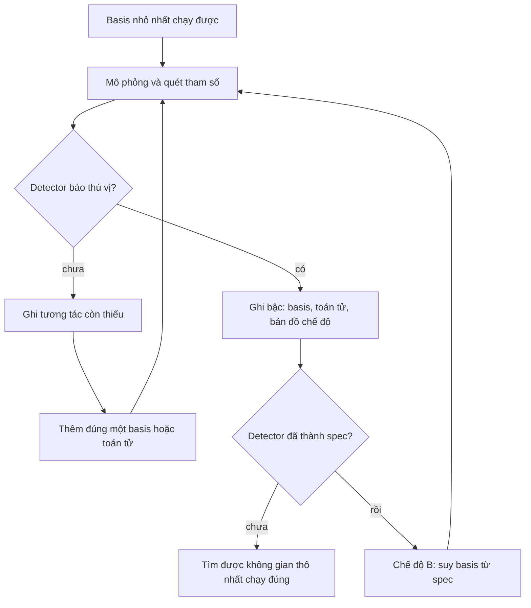
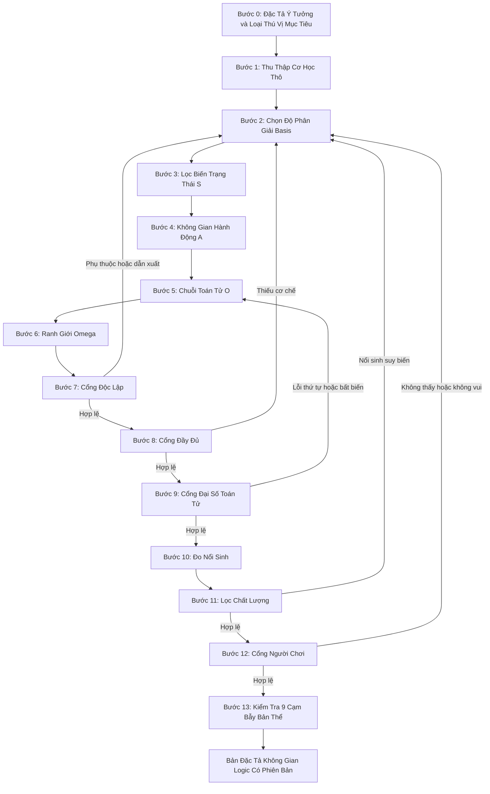

# Playbook: Phân Rã Một Game Bất Kỳ Thành Không Gian Logic Chuẩn Tắc

> **Phiên bản:** v3.0, 2026-11-03. Khớp với lý thuyết lõi `2026-11-03-logical-space-v0.3-draft`.
> **Phạm vi:** Playbook cấp Base Theory (Universal Playbook áp dụng cho mọi game).
> **Lý thuyết lõi:** [Logical-Space-Base-Theory.md](../../docs/theory/Logical-Space-Base-Theory.md) — định nghĩa, nguyên tắc L1–L17, thang basis (mục 4.1), danh mục I1–I6 và M1–M6, cổng P0–P7.
> **Hồ sơ phản biện:** [2026-11-03-logical-space-critique-and-study.md](../plans/design/2026-11-03-logical-space-critique-and-study.md) — H1–H6, lý do của các thay đổi v3.0.
> **Nền tảng toán học:** [Logical-Space-Mathematical-Foundations.md](../../docs/theory/Logical-Space-Mathematical-Foundations.md).
> **Nguyên tắc nền tảng:** [no-case-study-bias-and-basis-orthogonality.md](../../.agents/rules/no-case-study-bias-and-basis-orthogonality.md).
> **Mô hình mục tiêu:** $\mathcal{G} = \left\langle \mathcal{V}, \mathcal{S}, \mathcal{A}, \hat{\mathbb{O}}, \Omega, Y \right\rangle$ — $\mathcal{V}$ là vocabulary (kiểu và thuộc tính, cấu hình), $Y$ là ánh xạ quan sát (thứ người chơi nhìn thấy).

---

## 1. Mục Đích & Khi Nào Sử Dụng

Sử dụng playbook này mỗi khi cần phân tích một trò chơi (game thực tế hoặc ý tưởng game mới) thành một mô hình toán học và logic chuẩn xác, phục vụ cho việc:
1. Hiểu cặn kẽ bản chất cơ học của trò chơi mà không bị lừa bởi lớp vỏ đồ họa / tự sự.
2. Chọn bộ **basis** đủ đơn giản để sinh ra đúng loại nổi sinh mong muốn.
3. Thiết kế luật chơi cân bằng, phát hiện lỗ hổng thiết kế (Design Hazards).
4. Tái cấu trúc thành code engine hoặc simulation sạch sẽ ngay từ đầu.
5. Đảm bảo nổi sinh trong mô phỏng **đến được người chơi**: nhìn thấy được, hiểu được, và vui (L13, P7).

---

## 2. Hai Cách Dùng: Phân Rã Game Có Sẵn và Xây Game Mới

| Tình huống | Cách dùng |
|---|---|
| Game có sẵn hoặc engine đã viết | Chạy thẳng 13 bước bên dưới như một **cuộc kiểm toán** |
| Game mới, hoặc làm lại từ đầu | Chạy **thang basis** (mục 2A); mỗi bậc thang là một không gian ứng viên đi qua 13 bước |

### 2A. Thang Basis (AG-6, L12)

Đi từ basis nhỏ nhất, leo lên từng bậc cho tới khi loại thú vị mục tiêu xuất hiện. Nếu định nghĩa được "thú vị" trước, hãy định nghĩa trước rồi suy ra basis (chủ sở hữu ưu tiên cách này).



| Chế độ | Cần | Dùng khi |
|---|---|---|
| A, leo thang | **Detector**: nhận ra loại thú vị trong log, chưa giải thích được | Chưa hiểu cái thú vị |
| B, đích trước | **Spec**: chỉ ra số hạng tương tác nào, **lặp qua những vòng nào**, sinh ra cái thú vị (L6) | Lịch sử các bậc đã giải thích được detector |

Quy tắc của thang:
* **Ghi dự đoán trước mỗi bậc (L14).** Trước khi chạy, ghi: thay đổi gì, dự đoán detector báo gì, dự đoán chế độ nào. Kết quả lệch khỏi dự đoán là dữ liệu quý nhất của bậc đó.
* **Có detector trước khi leo.** Không có detector thì không có điều kiện dừng; phán đoán bằng mắt không ổn định vì một tham số nhỏ có thể lật chế độ (L10).
* **Mỗi bậc chỉ thay đổi một thứ.** Thay nhiều thứ cùng lúc thì không quy được nguyên nhân khi chế độ bị lật.
* **Mỗi bậc giữ bản đồ chế độ** và ghi lại tương tác nào tạo khác biệt; đủ ghi chép thì detector nâng cấp thành spec.
* **Engine cũ là kho linh kiện.** Chỉ lấy lại một toán tử cũ khi bậc hiện tại cần nó; không cắt tỉa engine cũ rồi gọi đó là thang.

---

## 3. Quy Trình 13 Bước

Bước 0 là P0. Bước 1–6 là phân rã (P1 trong lý thuyết lõi). Bước 7–12 là các cổng kiểm định P2–P7. Bước 13 là kiểm tra cạm bẫy. Mỗi cổng tạo ra **bằng chứng**, không phải tuyên bố.



---

### Bước 0: Đặc Tả Ý Tưởng (P0)
* **Thao tác:** Viết danh sách đánh số các **cơ chế và trải nghiệm bắt buộc** của ý tưởng ("người chơi dập lửa bằng nước", "kinh tế không được lăn cầu tuyết").
* **Khai báo loại thú vị mục tiêu** từ danh mục I1–I6 của lý thuyết lõi, kèm ngưỡng đo. Mỗi game có điểm thú vị riêng; không có định nghĩa "thú vị" phổ quát.
* **Tách điều kiện sống còn khỏi mục tiêu thú vị (L16, AG-8).** Điều kiện sống còn là thứ phải đúng thì cái thú vị mới tồn tại (nhiều loài cùng sống; bàn cờ luôn còn nước đi). Ghi thành danh sách riêng, kèm phép kiểm. Không tối ưu điều kiện sống còn như thể nó là mục tiêu.
* Danh sách này là **đích đầy đủ**: đầy đủ chỉ có nghĩa tương đối với một ý tưởng, không bao giờ là "mọi game".
* **Khai báo detector hoặc spec** cho loại thú vị đã chọn: tín hiệu nào trong log nói "điều đó đã xảy ra". Chưa có → ghi "chưa có detector"; không được leo thang hay tuyên bố đạt P5.
* **Khai báo người chơi làm gì bằng tay** tại khoảnh khắc thú vị. Nếu câu trả lời là "chỉnh tham số", thì tham số đó là meta-action (xem Bước 4).
* **Ghi trước, không giải thích sau (L14).** Ngưỡng đo, detector và kết quả dự đoán phải được ghi **trước** khi chạy mô phỏng. Kết quả chỉ được giải thích sau khi xảy ra thì không phải bằng chứng.
* **Khai báo vòng người chơi** (skill atom của Cook): hành động → mô phỏng → phản hồi qua $Y$ → người chơi cập nhật mental model → hành động tiếp. Ghi rõ người chơi **nhìn thấy gì** khi khoảnh khắc thú vị xảy ra.
* **Phác cấu trúc progression (L15).** Nổi sinh cung cấp khả năng; progression tuyển chọn. Ghi cách game giới hạn vocabulary, trạng thái đầu, hành động hoặc mục tiêu theo thời gian (màn chơi, mở khóa, kịch bản). Sandbox thuần cũng phải ghi: "không có progression", và lý do.

---

### Bước 1: Thu Thập Cơ Học Thực Chứng Thô (Raw Mechanics Inventory)
* **Thao tác:** Khảo sát toàn bộ tài liệu thiết kế (GDD), Wiki chính thức, hoặc **mã nguồn** của game.
* **Quy tắc bắt buộc:** Ghi chép dữ liệu dạng "nhật ký cơ học thô". **Tuyệt đối không mang sẵn bất kỳ mô hình lý thuyết nào vào bước này** (không gắn nhãn tâm lý học, không gắn nhãn 5 trục hay SDE).
* Khi đọc mã nguồn: ghi lại revision, file đã đọc, và đánh dấu "chưa kiểm chứng runtime".

---

### Bước 2: Chọn Độ Phân Giải Basis (Resolution Rule, L4)
* **Định nghĩa basis (L2, v0.3):** basis = vocabulary $\mathcal{V}$ (kiểu và thuộc tính mà toán tử đọc) cộng các tọa độ trạng thái.
  * **Sinh đủ:** mọi mục Bước 0 và loại thú vị mục tiêu đạt được từ $\mathcal{V}$, trạng thái đầu và $\mathcal{A}$ bằng cách lặp $\hat{\mathbb{O}}$ (nhân chứng ở Bước 8).
  * **Tối tiểu:** bỏ bất kỳ phần tử nào của $\mathcal{V}$, tọa độ trạng thái hay toán tử nào cũng làm mất một mục Bước 0 hoặc mất mục tiêu (ablation, Bước 8).
  * Một nội dung (vật thể, loài, chiêu) là **một hàng cấu hình trên $\mathcal{V}$**, không phải basis mới.
* **Quy tắc dừng:** basis là mức **thô nhất** mà vẫn:
  1. sinh ra mọi cơ chế ở Bước 0 cộng với loại nổi sinh mục tiêu;
  2. người chơi **cảm nhận và dự đoán** được;
  3. vừa chi phí tính toán và code.
* Mọi chi tiết mịn hơn thu gọn thành **tham số cấu hình** (giống lý thuyết hiệu dụng trong vật lý: hóa học không cần lý thuyết dây; nhiệt độ sôi tóm gọn toàn bộ vật lý phân tử). Không đào xuống "lý thuyết dây".
* **Phân biệt kiểu và thể hiện:** basis là **kiểu** (Substance, Noun, Property). Giá trị của từng thể hiện (nhiệt độ ô này, vị trí bức tường này) là **hệ số**, nằm trong $\mathcal{S}$. Tương tự Fourier: basis đánh chỉ số theo tần số; biên độ và pha thuộc về hệ số.
* **Giới hạn của phép so sánh Fourier:** basis Fourier **biểu diễn** một tín hiệu; basis game **sinh ra** nhiều nội dung và lịch sử chơi, giống một ngữ pháp hơn là không gian vector. Dùng Fourier làm cảm hứng và công cụ đo, không dùng làm định nghĩa.

---

### Bước 3: Lọc Tách Biến Trạng Thái Động ($\mathcal{S}$)
* **Thao tác:** Đặt câu hỏi: *"Nếu lưu game (Save Game) tại đúng tích tắc này, những biến số nào BẮT BUỘC phải lưu vào file save để khôi phục chính xác thế cờ?"*
* **Phân định rạch ròi ba loại:**
  * **Biến trạng thái động ($\mathcal{S}$):** Máu hiện tại, năng lượng, tài nguyên, tọa độ, vận tốc, số đếm hiệu ứng.
  * **Tham số cấu hình tĩnh:** Máu cơ bản, hệ số kháng, sát thương cơ sở, nhiệt độ sôi, khối lượng. $\implies$ **Loại khỏi $\mathcal{S}$**, đưa vào bảng tham số hằng.
  * **Giá trị dẫn xuất:** Tính được từ trạng thái và cấu hình (pha vật chất, "đang cháy", tập luật đang kích hoạt trong Baba Is You). $\implies$ **Không phải basis, không lưu**, tính khi đọc.
  * **Quan sát $Y$:** thứ hiển thị cho người chơi (màu, hạt, con số, âm thanh) là hàm của trạng thái, **chỉ đọc**, không bao giờ ghi ngược vào $\mathcal{S}$. Ghi riêng thành bảng ở Bước 12.

---

### Bước 4: Định Nghĩa Không Gian Hành Động ($\mathcal{A}$)
* **Thao tác:** Đặt câu hỏi: *"Trong mỗi nhịp quyết định (turn / tick), người chơi và AI được phép thay đổi những bậc tự do nào?"*
* **Phân loại hành động:**
  * Lựa chọn chiêu thức / tài nguyên tiêu hao.
  * Phân bổ mục tiêu (ghép cặp đối kháng).
  * Điều phối vị trí không gian hoặc thứ tự chuỗi lệnh.
  * **Hành động liên tục** (vector bắn, lực kéo): ghi rõ miền giá trị; các bước đo sau phải **lấy mẫu** trên miền này thay vì liệt kê.
  * **Hành động sửa luật** (đẩy chữ trong Baba Is You): ghi rõ, vì nó kéo theo toán tử hai tầng ở Bước 5.
  * **Meta-action — hành động chỉnh cấu hình** (sandbox, chỉnh gene, thanh trượt): người chơi sửa giá trị trong $\mathcal{V}$ hoặc cấu hình, không sửa trạng thái. Ghi rõ tham số nào được mở cho người chơi, chỉnh lúc nào (giữa lượt chạy hay trong lúc chạy). Với sandbox, **bản đồ chế độ chính là sân chơi**: meta-action đẩy hệ qua ranh giới chế độ phải được người chơi nhìn thấy (Bước 12).
* **Kiểm tra rỗng:** nếu $\mathcal{A}$ rỗng hoặc hành động định nghĩa cái thú vị chưa được hiện thực (không có UI), ghi thành lỗi thiết kế, không phải chi tiết hoàn thiện.

---

### Bước 5: Xây Dựng Chuỗi Toán Tử Phân Giải ($\hat{\mathbb{O}}$)
* **Thao tác:** Liệt kê các hàm biến đổi trạng thái theo thứ tự thời gian thực thi:
  $$(\mathcal{S}_t \times \mathcal{A}_t) \xrightarrow{\hat{\mathcal{O}}_1 \to \hat{\mathcal{O}}_2 \to \dots \to \hat{\mathcal{O}}_m} \mathcal{S}_{t+1}$$
* **Nguyên tắc cốt tử:** **Toán tử không phải là một trục không gian.** Đụng độ, tính sát thương, trừ tài nguyên là các hàm ánh xạ, tuyệt đối không được nhét vào $\mathcal{S}$.
* **Bảng toán tử bắt buộc:** mỗi toán tử ghi chữ ký, các tọa độ **đọc**, các tọa độ **ghi**, và vị trí trong thứ tự.
* **Đánh dấu toán tử tương tác:** số hạng tương tác phi tuyến là **điều kiện cần** của nổi sinh. Phép cộng chỉ tạo độ phức tạp (tổng các sóng chỉ chứa tần số đầu vào); phép nhân tạo thành phần mới ($\sin a \sin b = \tfrac12[\cos(a-b) - \cos(a+b)]$). Ví dụ: HOT với MELT, cháy với ướt, va chạm đồng minh kích hoạt kỹ năng.
* **Nhưng một số hạng tương tác chưa phải nổi sinh (L6, AG-7).** HOT với MELT là luật designer viết tay. Nổi sinh là kết quả xuất hiện khi các toán tử **lặp lại nhiều bước** theo thời gian và không gian, không ai liệt kê trước, và thực tế chỉ tìm được bằng cách chạy. Vì vậy ghi thêm: **vòng lặp nào** (toán tử A ghi thứ toán tử B đọc, B ghi thứ A đọc) tạo đường lan truyền; ví dụ: cháy → nóng → hơi nước → chặn đường.
* **Toán tử hai tầng:** nếu luật nằm trong trạng thái, tách **bộ thông dịch cố định** khỏi **dữ liệu luật biến đổi**. Phân tách không gian và toán tử vẫn giữ ở tầng bộ thông dịch.
* **Hai thang thời gian:** lượt rời rạc bọc một mô phỏng vật lý liên tục cần một toán tử lượt chứa toán tử vật lý con.

---

### Bước 6: Xác Lập Không Gian Ranh Giới ($\Omega$)
* **Thao tác:** Liệt kê các điều kiện dừng của vòng lặp:
  * Điều kiện thắng.
  * Điều kiện thua.
  * Giới hạn an toàn (Timeout, Turn limit, Resource exhaustion).

---

### Bước 7: Cổng Độc Lập (P2)

| Kiểm tra | Câu hỏi | Trượt khi |
|---|---|---|
| Dẫn xuất | Tọa độ $x_k$ có tính được từ các tọa độ khác không? | Có công thức $x_k = g(\text{khác})$ luôn đúng → giá trị dẫn xuất |
| Bỏ khỏi file save | Bỏ $x_k$ khỏi save, khôi phục có giống hệt không? | Giống hệt → dư thừa |
| Phụ thuộc trên tập đạt được | Trên các trạng thái mô phỏng được, $x_k$ có bị các tọa độ khác quyết định không? | Entropy có điều kiện xấp xỉ 0 → xem lại: chủ ý thiết kế hay ghép nối ẩn |
| Phân loại bản thể | $x_k$ thực chất là toán tử hay tham số? | Là công thức, resolver, bảng tra |

Với toán tử phi tuyến, tập sinh tối tiểu có thể **không duy nhất** và **khác kích thước**. Báo cáo bộ basis đã chọn, không báo cáo "số chiều".

**Quy tắc chọn basis (L3, AG-10):** không chứng minh tính duy nhất. Khi nhiều basis tối thiểu cùng qua phép thử, chọn theo thứ tự: (1) người chơi nhìn thấy và hiểu được (L13); (2) cần ít toán tử hơn; (3) dùng lại được code sẵn có. **Ghi lý do chọn.** Ví dụ: (kiểu chất, nhiệt độ) thay vì (kiểu chất, năng lượng nhiệt), vì người chơi hiểu nhiệt độ.

---

### Bước 8: Cổng Đầy Đủ (P3)
* Dựng **ma trận phủ**: hàng là các mục Bước 0; cột là basis và toán tử.
* Mỗi hàng cần một **nhân chứng**: chuỗi hành động từ trạng thái đầu tạo ra cơ chế đó (chứng minh bằng cấu trúc hoặc mô phỏng có ghi log).
* Hàng không có nhân chứng → thiếu: thêm basis hoặc toán tử.
* Cột không phục vụ hàng nào → ứng viên xóa (YAGNI).
* **Kiểm tra hữu dụng bằng ablation** (phép thử tối tiểu của L2, v0.3): đóng băng một basis hoặc tắt một toán tử, chạy nhiều seed. Kết quả không đổi → phần tử đó không đóng góp, ứng viên xóa. Nối được trên sơ đồ chưa chứng minh có tác dụng: chuỗi đúng là đường khai báo → điều kiện mở được → toán tử chạy → đầu ra khác 0 → kết quả đổi → quy nguyên nhân có đối chứng.

---

### Bước 9: Cổng Đại Số Toán Tử (P4)
* **Kiểm tra giao hoán:** với mỗi cặp toán tử cùng ghi một tọa độ, hoặc một bên đọc thứ bên kia ghi, thử cả hai thứ tự trên các trạng thái lấy mẫu. Khác kết quả → hoặc là luật chủ ý (sát thương trước kiểm tra chết), hoặc là lỗi ẩn.
* **Xung đột luật:** định nghĩa thứ tự ưu tiên tường minh (Baba Is You: WALL IS STOP và WALL IS DEFEAT là bài toán khó nhất của nhà phát triển).
* **Bất biến:** khai báo đại lượng bảo toàn (tổng nước, tổng vàng trừ nguồn và hố), kiểm bằng property test.
* **Đóng kín:** trạng thái hợp lệ vào → trạng thái hợp lệ ra (biên, không âm, hữu hạn).

---

### Bước 10: Đo Nổi Sinh (P5)
* Cần **mô phỏng headless** có seed. Nếu chưa có, ghi "chưa đo" — không tuyên bố.
* Chọn thước đo theo loại thú vị đã khai báo ở Bước 0:

| Loại mục tiêu | Thước đo |
|---|---|
| I1 Thay đổi khả năng hành động | M5: thực thể phản hồi input, nước đi khả dĩ, tập đạt được, chiến lược tác tử mạnh trước và sau sự kiện |
| I2 Cân bằng động | Bản đồ chế độ theo tham số; M4 |
| I3 Đa dạng lời giải | M2, M3 |
| I4 Câu chuyện nổi sinh | M2 cộng báo cáo người chơi |
| I5 Chiều sâu chiến lược | Kiểm tra chiến lược áp đảo; độ đo kỹ năng và may rủi |
| I6 Phản ứng dây chuyền | M6: độ dài chuỗi mỗi hành động, tỉ số phân nhánh, chênh lệch cú bắn tốt nhất so với ngẫu nhiên |

* **Độ nhạy tham số:** một thay đổi nhỏ có thể lật hệ từ thú vị sang nhàm chán. Vẽ **bản đồ chế độ** (quét tham số, nhiều seed, phân loại chế độ) trước khi chỉnh tay; đặt giá trị mặc định cách xa biên vùng thú vị.
* Mọi thước đo M1–M6 còn là **giả thuyết** cho tới khi được kiểm chứng trên hệ đã biết là nổi sinh và hệ thuần cộng, và đối chiếu với đánh giá người chơi (phương pháp Ludi của Browne).
* **Cảnh báo M1:** tỉ lệ phương sai từ tương tác chỉ cho biết có tương tác, chưa cho biết có nổi sinh; còn phụ thuộc phân phối đầu vào và cách chọn tọa độ. Đo trên kết quả **sau nhiều bước**, không đo trên một toán tử.
* **Khoảng cách dự đoán** (ý tưởng ID-1, đề xuất): so kết quả chạy với dự đoán đã ghi ở Bước 0. Phần xảy ra mà không có trong dự đoán là ứng viên nổi sinh; phân loại tiếp ở Bước 11.
* So kết quả với **ngưỡng đã ghi trước** ở Bước 0. Không chỉnh ngưỡng sau khi thấy kết quả; nếu cần chỉnh, ghi thành bậc mới.

---

### Bước 11: Lọc Chất Lượng (P6)
Nổi sinh là điều kiện cần, không đủ. Loại hoặc thiết kế lại khi có:
* điều kiện sống còn ở Bước 0 bị vi phạm trên một phần đáng kể các seed (L16);
* chiến lược áp đảo vượt khoảng tin cậy;
* softlock hoặc điều kiện thắng không đạt được;
* tăng trưởng mất kiểm soát khi đặc tả cần cân bằng;
* vi phạm bất biến;
* lựa chọn giả (các phương án khác nhau không đáng kể);
* thay đổi tầm thường hóa game (BABA IS WIN ngay cạnh Baba).

Playtest người thật là lớp bằng chứng riêng ở Bước 12.

---

### Bước 12: Cổng Người Chơi (P7)

Nổi sinh trong mô phỏng và niềm vui của người chơi là **hai tuyên bố riêng, cần hai bằng chứng riêng** (L13).

**a. Bảng khả năng cảm nhận** (làm trên giấy, trước playtest):

| Sự kiện mục tiêu | Tọa độ quyết định | Nguyên nhân thấy qua $Y$ ở đâu | Hệ quả thấy qua $Y$ ở đâu | Đạt? |
|---|---|---|---|---|
| Ví dụ: một loài lấn át loài khác | Độ ẩm đất, sức sống | ? | Màu loài đổi trên bản đồ | Chưa: nguyên nhân không hiển thị |

* Tọa độ chi phối mạnh mà không hiển thị → vi phạm L13 và điều kiện 2 của L4.
* Sự kiện chỉ thấy hệ quả mà không thấy nguyên nhân → người chơi không học được (vòng skill atom bị đứt).
* **Nén qua $Y$ (L17, AG-9):** điều kiện sống còn hay mục tiêu mà người chơi cần cảm nhận → nén thành **1–2 tín hiệu có hướng** (tốt lên hay xấu đi) + visual. Ngưỡng chi tiết giữ ở tầng ẩn cho designer. Ví dụ Forest_Bloom: số loài hiệu dụng (Hill number) hiện thành độ rực màu bản đồ + mũi tên xu hướng.

**b. Playtest nhỏ — bộ đo AG-11, theo thứ tự ưu tiên:**
1. **Chơi tiếp không?** Người chơi chơi thật, không hướng dẫn. Hết thời gian thử, nói "xong rồi, chơi tiếp hay dừng tùy ý", ghi **số phút tự chơi thêm**. Đo hứng thú bằng hành vi, khó giả hơn lời khen (free-choice paradigm của nghiên cứu động lực nội tại).
2. **Kể lại:** "Điều đáng nhớ nhất là gì? Vì sao nó xảy ra?" Kể đúng nguyên nhân → nổi sinh **đọc được**. Kể sai hoặc không kể được → quay lại $Y$.
3. **Bảng hỏi IMI Interest/Enjoyment** (khoảng 7 câu): chỉ dùng khi so sánh hai phiên bản.
* Ghi chép trung thực, kể cả khi người chơi chán. Với tài liệu nội bộ, vài người chơi với ghi chép tốt có giá trị hơn số liệu lớn không ghi điều kiện.

**c. Đối chiếu thước đo:** khi có nhiều phiên bản hoặc biến thể, so thước đo P5 với đánh giá người chơi. Thước đo không đi cùng đánh giá → hạ cấp hoặc bỏ.

---

### Bước 13: Kiểm Tra 9 Cạm Bẫy Bản Thể Học (Sanity Check)

1. **Cạm bẫy Toán tử (Operator-as-Space):** Có trục nào của $\mathcal{S}$ thực chất là thuật toán (resolver, công thức sát thương, kiểm tra trúng)? Nếu có, **đưa sang $\hat{\mathbb{O}}$**.
2. **Con số thiêng (Sacred Number):** Số chiều có bị gượng ép về 5, 6, 7? Báo cáo bộ basis, không báo cáo con số.
3. **Sụp đổ liên kết (Coupling Collapse):** Toán tử có bao quát các số hạng chéo giữa trạng thái không? Phân tách quá mức làm mất nổi sinh.
4. **Dẫn xuất giả basis (Derived-as-Basis):** Có phần tử nào trong basis tính được từ phần tử khác (pha vật chất, lửa, hơi nước)? Nếu có, chuyển thành toán tử.
5. **Sai độ phân giải (Wrong Resolution):** Basis quá thô (phải viết tay từng tổ hợp) hay quá mịn (người chơi không cảm nhận được, chi phí cao)? Quay lại Bước 2. Dấu hiệu quá mịn: hàng trăm tham số ghép nối, nhiều đường song song cùng ghi một tọa độ, trạng thái quyết định kết quả không hiển thị.
6. **Mang trục từ case study khác (Case-Study Carryover):** Có trục nào được thừa hưởng từ dự án khác (trục tâm lý, "hai tầng", số khối) thay vì rút ra từ nhu cầu của game này? Nếu có, chứng minh lại từ Bước 0 hoặc bỏ.
7. **Bảng không gian lẫn loại (Mixed Space Table):** Bảng "các không gian" có chứa thứ không phải trạng thái game: quan sát/log, hiển thị, công cụ AI, hoặc giá trị dựng lại mỗi tick (ngân sách, yêu cầu)? Chỉ những gì phải lưu trong save mới là $\mathcal{S}$; phần còn lại là toán tử, giá trị dẫn xuất hoặc tầng ngoài game.
8. **Tương tác viết tay tưởng là nổi sinh (Hand-Written Interaction):** Có "nổi sinh" nào thực chất chỉ là một luật designer đã viết sẵn (HOT với MELT → tan) mà không qua vòng lặp nào? Đó là nội dung, không phải nổi sinh (L6). Tìm vòng lặp, hoặc ngừng tuyên bố.
9. **Nổi sinh vô hình (Invisible Emergence):** Mô phỏng thú vị trong log nhưng người chơi không thấy nguyên nhân hoặc hệ quả? Không tính cho người chơi (L13). Sửa $Y$ trước khi thêm luật mới.

---

## 4. Bài Học Kinh Nghiệm Tích Lũy

| Nguồn | Bài học |
|---|---|
| Ví dụ lửa và nước | Lửa và nước là basis quá thô. Kiểu chất (cấu hình) và nhiệt độ (trạng thái) là đủ; pha, lửa, hơi nước đều là dẫn xuất. Hơi nước, băng, dập lửa, gỗ cháy, kim loại chảy tự nổi sinh |
| Baba Is You | Vật thể **không có thuộc tính mặc định**: mọi hành vi đến từ luật. Luật nằm trong trạng thái → toán tử hai tầng. Thay đổi thú vị là khi **cách chơi thay đổi** (WALL IS YOU). Màn chơi giới hạn từ vựng để uốn không gian nổi sinh thành tiến trình |
| Bump_Hero | Hành vi theo loài (Bat, Bear, Seal) viết cứng ở mức thô, trong khi modifier vật lý và hiệu ứng trạng thái đã ở mức thuộc tính. Giả thuyết: loài là hàng cấu hình của thuộc tính thân × trigger × điều kiện × hiệu ứng. Hành động liên tục cần lấy mẫu |
| Forest_Bloom | Một tham số nhỏ có thể lật nổi sinh từ thú vị sang nhàm chán → bản đồ chế độ trước khi chỉnh tay |
| Forest_Bloom, kiểm toán 2026-10-24 | Kỹ thuật mạnh (thứ tự 22 giai đoạn, snapshot, ledger, checkpoint, ablation) nhưng tầng thiết kế bị ngược: xây từ nguyên tử tâm lý lên, không có P0. Kết quả: hơn 100 tham số ghép nối, $\mathcal{A}$ rỗng (UI chỉnh gen/tham số không tồn tại), trạng thái nội tại quyết định mọi thứ nhưng không hiển thị, I2 chưa đạt (10/10 seed trượt nghiệm thu). Bài học: kỹ thuật tốt không thay được P0; cần detector và thang basis (mục 2A); cạm bẫy 5, 6, 7 |
| Phiên lý thuyết 2026-10-24 | Leo thang mà không có detector thì không có điểm dừng. Detector (nhận ra) khác spec (giải thích); lịch sử các bậc nâng detector thành spec |
| Phản biện 2026-11-03 | Một số hạng tương tác chưa phải nổi sinh; nổi sinh cần vòng lặp (AG-7). Mô phỏng thú vị chưa phải game vui: thiếu $Y$, vòng người chơi và progression. Forest_Bloom "thú vị phía mô phỏng nhưng chưa fun" là ví dụ. Lý thuyết là **phương pháp**, không phải lý thuyết của mọi game; phần mới so với Sellers và MDA là đo và kiểm tra |
| Sửa lỗi 2026-10-04 | "5 trục" thực chất là 5 khối và 10 tọa độ vô hướng → kiểm tra độc lập trước khi tuyên bố số chiều. Đọc láng giềng tại chỗ gây phụ thuộc thứ tự → đọc snapshot, cộng dồn delta, commit cùng lúc |

---

## 5. Mẫu Đầu Ra

```text
<game>-logical-space/
├── README.md        # P0 đặc tả, loại thú vị mục tiêu, dự đoán ghi trước, vòng người chơi, progression, nguồn và revision
├── decomposition    # Bảng vocabulary V; bảng basis: cấu hình / trạng thái / dẫn xuất; A và meta-action; bảng toán tử và vòng lặp; Omega
├── ladder           # Game mới: mỗi bậc thang, thay đổi gì, dự đoán, detector báo gì, bản đồ chế độ
├── gates            # Bằng chứng P2 đến P6, hoặc "chưa đo"
├── player           # P7: bảng khả năng cảm nhận Y, ghi chép playtest
└── lessons          # Bài học mới để đưa ngược về lý thuyết lõi và playbook này
```

Với game nhỏ, gộp tất cả vào một `README.md`, như [bump-hero-logical-space](../../docs/explorations/bump-hero-logical-space/README.md).
