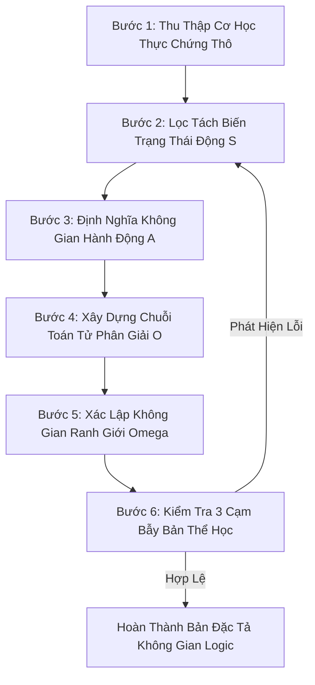

# Playbook: Phân Rã Một Game Bất Kỳ Thành Không Gian Logic Chuẩn Tắc

> **Phạm vi:** Playbook cấp Base Theory (Universal Playbook áp dụng cho mọi game).  
> **Nguyên tắc nền tảng:** [no-case-study-bias-and-basis-orthogonality.md](../../.agents/rules/no-case-study-bias-and-basis-orthogonality.md).  
> **Mô hình mục tiêu:** $\mathcal{G} = \left\langle \mathcal{S}, \mathcal{A}, \hat{\mathbb{O}}, \Omega \right\rangle$.

---

## 1. Mục Đích & Khi Nào Sử Dụng

Sử dụng playbook này mỗi khi cần phân tích một trò chơi (game thực tế hoặc ý tưởng game mới) thành một mô hình toán học và logic chuẩn xác, phục vụ cho việc:
1. Hiểu cặn kẽ bản chất cơ học của trò chơi mà không bị lừa bởi lớp vỏ đồ họa / tự sự.
2. Thiết kế luật chơi cân bằng, phát hiện lỗ hổng thiết kế (Design Hazards).
3. Tái cấu trúc thành code engine hoặc simulation sạch sẽ, không rác rưởi.

---

## 2. Quy Trình 6 Bước Thực Thi

---

### Bước 1: Thu Thập Cơ Học Thực Chứng Thô (Raw Mechanics Inventory)
* **Thao tác:** Khảo sát toàn bộ tài liệu thiết kế (GDD) hoặc Wiki chính thức của game.
* **Quy tắc bắt buộc:** Ghi chép dữ liệu dạng "nhật ký cơ học thô". **Tuyệt đối không mang sẵn bất kỳ mô hình lý thuyết nào vào bước này** (không gắn nhãn tâm lý học, không gắn nhãn 5 trục hay SDE).

---

### Bước 2: Lọc Tách Biến Trạng Thái Động ($\mathcal{S}$)
* **Thao tác:** Đặt câu hỏi: *"Nếu lưu game (Save Game) tại đúng tích tắc này, những biến số nào BẮT BUỘC phải lưu vào file save để khôi phục chính xác thế cờ?"*
* **Phân định rạch ròi:**
  * **Biến trạng thái động ($\mathcal{S}$):** Máu hiện tại, điểm năng lượng, số lượng tài nguyên, vị trí tọa độ, số đếm hiệu ứng bám kèm.
  * **Tham số cấu hình tĩnh (Static Config Parameters):** Máu cơ bản, hệ số kháng cự, sát thương cơ sở của vũ khí, khoảng tốc độ. $\implies$ **Loại bỏ khỏi $\mathcal{S}$**, đưa vào bảng tham số hằng.

---

### Bước 3: Định Nghĩa Không Gian Hành Động ($\mathcal{A}$)
* **Thao tác:** Đặt câu hỏi: *"Trong mỗi nhịp quyết định (turn / tick), người chơi và AI được phép thay đổi những bậc tự do nào?"*
* **Phân loại hành động:**
  * Lựa chọn chiêu thức / tài nguyên tiêu hao.
  * Phân bổ mục tiêu (ghép cặp đối kháng).
  * Điều phối vị trí không gian hoặc thứ tự chuỗi lệnh.

---

### Bước 4: Xây Dựng Chuỗi Toán Tử Phân Giải ($\hat{\mathbb{O}}$)
* **Thao tác:** Liệt kê các hàm biến đổi trạng thái theo thứ tự thời gian thực thi:
  $$(\mathcal{S}_t \times \mathcal{A}_t) \xrightarrow{\hat{\mathcal{O}}_1 \to \hat{\mathcal{O}}_2 \to \dots \to \hat{\mathcal{O}}_m} \mathcal{S}_{t+1}$$
* **Nguyên tắc cốt tử:** **Toán tử không phải là một trục không gian.** Đụng độ, Tính sát thương, Trừ tài nguyên là các hàm ánh xạ, tuyệt đối không được nhét vào $\mathcal{S}$.

---

### Bước 5: Xác Lập Không Gian Ranh Giới ($\Omega$)
* **Thao tác:** Liệt kê các điều kiện dừng của vòng lặp:
  * Điểm hút kết thúc thắng (Win manifold).
  * Điểm hút kết thúc thua (Loss manifold).
  * Giới hạn an toàn (Timeout, Turn limit, Resource exhaustion).

---

### Bước 6: Kiểm Tra 3 Cạm Bẫy Bản Thể Học (Sanity Check)

Chỉ thông qua tài liệu nếu vượt qua cả 3 câu hỏi kiểm tra:

1. **Kiểm tra Cạm bẫy Toán tử (Operator-as-Space Check):**
   * Trong danh sách các trục của $\mathcal{S}$, có trục nào thực chất là một thuật toán tính toán (như resolver, damage formula, accuracy check) không? Nếu có, **đưa ngay sang $\hat{\mathbb{O}}$**.
2. **Kiểm tra Con số thiêng (Sacred Number Check):**
   * Số chiều của $\mathcal{S}$ có bị gượng ép về một con số phong thủy hay định kiến nào (5, 6, 7) không? Số chiều phải bằng đúng số biến tự do độc lập.
3. **Kiểm tra Sụp đổ Liên kết (Coupling Check):**
   * Các toán tử có bao quát hết các số hạng chéo (cross-terms) giữa các trạng thái không? Tránh việc phân tách quá mức làm mất tính nổi sinh của game.
