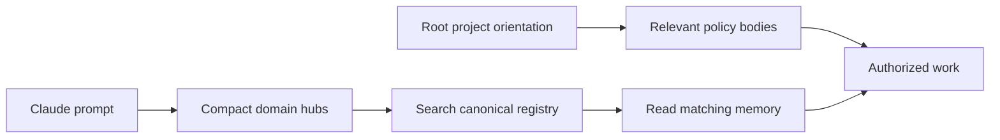

# Playbook: Reduce Cold-Start Context

**Use when:** startup context is large, knowledge routing is unclear, or a rule body contains reference material that is better read on demand.
**Outcome:** concise entry points and policy coverage preserved across the clients actually used. Measure before/after; do not promise a fixed token-saving percentage.

## Current architecture



Work inline unless the user explicitly requests delegation. This procedure does not require an agent-folder companion playbook or a second agent memory registry.

## Steps

1. **Snapshot actual loading.** Measure root/rule sizes and the memory hook output for the active client. Claude hooks, Codex root injection and Cursor adapters are different surfaces. Record client/model/plugin versions for comparative audits; do not extrapolate one client's startup to another.
2. **Keep policy concise.** Keep rules that constrain decisions in `.claude/rules/`. Move detailed explanations to project docs, durable facts to indexed memories, and repeatable recipes to a playbook. Preserve the policy and a reachable pointer before removing duplicate prose. A `paths:` rule can be conditional; not every rule body is always loaded in every client.
3. **Use one memory registry.** Keep a two-column `## Memory index` in `.cursor/memory/mem-arch-assemblies-canonical.md`, with Project registrations inside `LOCAL-MEMORY-INDEX`. Use a few `HUB:` entry rows. The current hook emits hubs and a lookup instruction, not the full index. Verify every important hub fits its 3,000-character budget; do not place essential routing after the first non-fitting row.
4. **Keep root registries generated.** Preserve project orientation outside `GENERATED:REGISTRY` boundaries. Update the owning rule's `description:` when its summary misses essential policy, then regenerate. Do not replace the registry with a hand-maintained conditional-rule table.
5. **Respect ownership.** Universal changes belong in shared source; package rules/hooks/tools/skills belong in package `AI~/` source and require versioned adoption; Project rules/values/memories belong in the project. Do not slim generated outputs by hand. Settings are generated from shared base plus installed package fragments.
6. **Review before pulling.** Resolve required packages first. Preview sync, review every retirement/generated change and warning, then apply only approved scope. Preserve customized retired content before deliberate migration. Shared pull is not transactional: retirements precede package discovery.
7. **Verify reachability, not only size.** Compare load snapshots/policy anchors, run the index checker, check relevant literal skill/playbook paths and rerun WhatIf. Smaller context is acceptable only if important knowledge and policy remain reachable. Record evidence and scoped commits.

## Read-only checks from target project root

```powershell
node .claude/tools/ai-audit/check-ai-index.js --project .
powershell -NoProfile -ExecutionPolicy Bypass -File <shared-root>/sync.ps1 pull -WhatIf
```

To inspect hook output, pass `{}` to `.claude/hooks/memory-index-injector.js` with `CLAUDE_PROJECT_DIR` set to the intended project. Parse the emitted `additionalContext` and compare its text length with the hook budget. A missing index yields no routing; a clean return code alone is insufficient.

## Boundaries and traps

| Trap | Correct response |
|---|---|
| Zero index findings treated as every AI path valid | Checker covers defined surfaces; inspect relevant skills, Cursor rules and playbooks too |
| Project-specific paths baked into shared guidance | Discover target ownership or use explicit Project values |
| Old directory/role template links survive retirement | Update active instructions at source, preserve historical evidence separately |
| A local Universal edit looks correct until next pull | Integrate source-owner fix before adoption |
| Regeneration used without resolved package folders | Stop on unresolved-package warning and preserve required policy |
| A root without registry boundaries stays stale | Prepare reviewed Project adapter boundaries before pull |

Secrets and per-machine permissions remain in local, ignored configuration. Do not copy one project's permission allow-list into shared settings.
