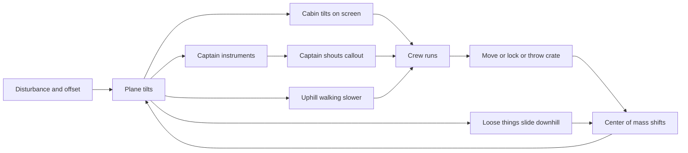
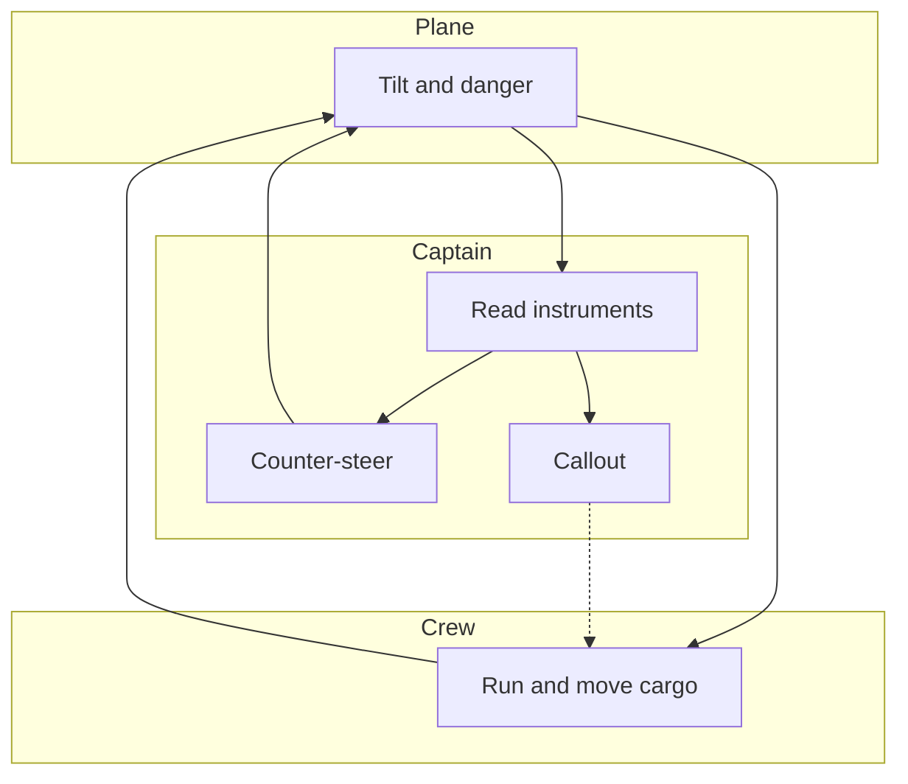

# Airplane Co-op: Stabilization Core (Logical Space v0.3.1)

> **Status:** Draft theory for a new game idea, 2026-11-20. Scope is **only** the aircraft stabilization mechanism and its core loop. Events, repairs, passengers, landing, scoring and art are out of scope.
> **Method:** [Base Theory v0.3.1](../../theory/Logical-Space-Base-Theory.md) (L18 core loop first, L19 two-loop rule, L20 feeling layer, L21 decoupling detector, I7 loop coupling).
> **Marking:** **OD-n** = owner decision in conversation. **Proposal** = assistant call, open to correction. **Deferred** = owner said "later".
> **Reference only:** the MAYDAY demo (third-person, self-levelling plane) was read as prior art. This game does not copy it; it differs in view (FPS), stability (unstable plane) and cargo rules.

---

## 1. Owner Decisions

| ID | Decision |
|---|---|
| OD-1 | Co-op game on an airplane. Start with stabilization and its core loop only |
| OD-2 | First-person view |
| OD-3 | Target feeling: everyone shouting and running together |
| OD-4 | Players read the tilt by seeing it: the cabin visibly tilts |
| OD-5 | Players respond by moving their bodies, following the captain's callouts, and moving packages into lock shelves to rebalance the center of mass |
| OD-6 | The plane is unstable by itself, from several causes. Owner will list causes later |
| OD-7 | One flight: no packages added, only removed |
| OD-8 | Removing = throwing out the cargo door. Packages can also move between shelves |
| OD-9 | Over-tilt: danger zone first, then crash if it lasts too long |
| OD-10 | Tilt speed = off-balance amount × amplifier (tuning value) |
| OD-11 | No tilt cap (option A rejected). Big tilts may happen; what players do then (climb, tools, captain recovery) is designed later |
| OD-12 | Free throwing rejected (option D): it makes moving pointless. Throwing stays but must be limited |
| OD-13 | Handrails/ropes (B) and captain counter-steer (C) approved |
| OD-15 | Tilt model: **rate model kept** (tilt speed = k × offset). Fixing the offset only stops the tilt; the captain's counter-steer brings the plane back to level once the offset is near zero. Crew fixes the cause, captain fixes the angle |
| OD-16 | Crates are much heavier than players (proposal: 3 to 5 × player mass), so standing on the high side is not a dominant fix |
| OD-17 | Thin choices (which crate, which shelf is obvious): tune in the demo, not on paper |
| OD-18 | Crew-only information (so the crew is not just order-takers): later |
| OD-14 | Deferred: carried crate moves the center of mass with the carrier; door cycle limit (T1); heavy crates need two people (T3, approved for later) |

---

## 2. P0: Idea Spec

**One line:** an unstable plane that only stays level when the whole crew reads, shouts, runs and moves cargo together.

**Required mechanics (v1):**

| # | Mechanic | Source |
|---|---|---|
| M1 | Center of mass from crates and players sets the torque on the plane | OD-5, OD-10 |
| M2 | Tilt rate = offset × amplifier, plus disturbances | OD-6, OD-10 |
| M3 | Cabin tilt is visible in first person | OD-2, OD-4 |
| M4 | Loose crates and players slide downhill; walking uphill is slower | Proposal, follows from M3 physics |
| M5 | Lock shelves: a crate placed in a shelf is fixed ballast | OD-5 |
| M6 | Move crate between shelves | OD-8 |
| M7 | Throw crate out of cargo door, limited | OD-8, OD-12 |
| M8 | Handrails and ropes let a player pull uphill at fixed speed | OD-13 |
| M9 | Captain counter-steer slows the tilt | OD-13 |
| M10 | Captain sees exact instruments; others see only the cabin | Proposal |
| M11 | Danger zone timer, crash when it fills | OD-9 |

**Target interestingness:**

| Type | Why | Pre-registered threshold (proposal) |
|---|---|---|
| I2 Dynamic balance, as **target** | Keeping balance is the experience itself | Median flight spends 60 to 85 percent of time outside the calm band and under 15 percent in danger; neither all-calm nor all-danger |
| I7 Loop coupling | Captain loop and crew loop must interlock | L21 passes: crew moves change with captain callouts at least 2× above chance; shouting and running beats co-occur in at least half of danger episodes |

**Viability conditions (L16):** listed in section 8.

**Player loop (Cook skill atom):** feel tilt → hear callout → run and move weight → see cabin level out → update "which side is heavy" model.

---

## 3. Basis (P1)

### 3.1 State $\mathcal{S}$

| Coordinate | Type | Note |
|---|---|---|
| $\theta$ pitch, $\phi$ roll | Continuous, unbounded except by crash | OD-11: no cap |
| Per crate: slot id **or** loose position and velocity; exists flag | Discrete plus continuous | Exists flag only goes true to false (OD-7) |
| Per player: position, velocity, holding rail flag, carrying crate id | Continuous plus discrete | Players are mass |
| Danger timer $D$ | Continuous, 0 to $D_{max}$ | OD-9 |
| Disturbance state | Unknown | Waits for owner's list of causes (OD-6) |

### 3.2 Config (fixed per flight)

Crate masses (3 to 5 × player mass, OD-16); shelf slot positions; door position; amplifier $k$ (OD-10); danger angle $\theta_d$; crash time $D_{max}$; captain counter-steer strength $c$; floor friction; uphill walk penalty; rail pull speed; player mass.

### 3.3 Derived (never stored)

Center of mass offset $\Delta = (\Delta_x, \Delta_z)$ from crates and players; danger flag $|\theta| > \theta_d$ or $|\phi| > \phi_d$; all $Y$ signals.

### 3.4 Actions $\mathcal{A}$

| Action | Who |
|---|---|
| Walk | All |
| Grab rail and pull | All |
| Pick up, carry, place crate in shelf (lock) | Crew |
| Throw crate out door | Crew, limited (limiter open, section 10) |
| Counter-steer input $u \in [-1, 1]$ per axis | Captain in seat |
| Call out | Captain (voice, outside the system) |

L1 check: the tilt formula, slide rule and danger timer are **operators**, not axes.

---

## 4. Operators $\hat{\mathbb{O}}$

| Operator | Reads | Writes | Rule |
|---|---|---|---|
| O_com | crate slots, loose crates, players | $\Delta$ (derived) | Mass-weighted mean minus balanced reference |
| O_tilt | $\Delta$, $u$, disturbance | $\theta, \phi$ | $\dot\theta = k\,\Delta_z - c\,u_\theta + d_\theta(t)$, same for roll (OD-10, OD-13, OD-15). Rate model: $\Delta = 0$ holds the angle, it does not level. Levelling comes from captain input $u$ |
| O_slide | $\theta, \phi$, loose bodies, rail flag | loose velocities | Acceleration $g \sin\theta$ minus friction; rail holders exempt |
| O_walk | $\theta, \phi$, input | player velocity | Speed scaled down uphill, up downhill |
| O_rail | rail flag, input | player velocity | Fixed pull speed, ignores slope (OD-13) |
| O_lock | crate, slot | crate slot | Locked crates ignore O_slide |
| O_throw | crate at door, limiter | crate exists false | Permanent mass removal |
| O_danger | danger flag | $D$ | Rises in danger, decays outside; crash at $D_{max}$ |
| O_disturb | flight time | $d(t)$ | **Open**: owner's list of causes |

**Order per tick (P4, proposal):** inputs, then O_rail and O_walk, then O_slide, then O_lock and O_throw, then O_com, then O_tilt, then O_danger. Read one snapshot, write together.

**Product terms (L6, L21):** O_slide multiplies tilt by mass; O_walk multiplies tilt by player speed. These are the terms that couple the loops. Nothing here is a flat added cost.

---

## 5. Core Loop (L18)

**Core elements** (cutting any one breaks the loop): center of mass, O_tilt with amplifier, visible cabin tilt, crate move and lock, crew running.
**Support:** handrails, captain counter-steer, captain instruments, throw.
**Progression and polish:** deferred (door cycle, heavy crates, events).

**Two feedback signs inside one loop:**
- **Negative (the fix):** crew moves weight to the high side, so offset shrinks.
- **Positive (the threat):** tilt makes loose things slide to the low side, so offset grows, and uphill walking slows the fix.

The game lives in the race between these two. Tuning $k$, friction and walk penalty sets who usually wins.

---

## 6. Loops (L19)

| Loop | Own state | Own clock | Output |
|---|---|---|---|
| L-plane | $\theta, \phi$, $D$ | Physics tick | Tilt to everyone |
| L-captain | Instruments read, $u$ | Captain's attention | Counter-steer (system edge) and callouts (through players) |
| L-crew | Player and crate positions | Running and carrying time | Center of mass (system edge) |

Solid arrows are system edges. The dashed arrow (callout) goes through the players' ears, so L19 says it is **not** a system edge; measure it with decision dependence (L21).

**Design claim:** L-captain and L-crew are one coupled system, because both write into the same tilt through a product term and each needs the other: the captain alone only slows the tilt ($c$ must stay below what $k\Delta$ can produce); the crew alone cannot read the exact numbers.

**Viability rule from this:** captain strength $c$ must not cancel a large offset by itself. Proposal: $c$ cancels at most the offset of one crate in the worst slot.

---

## 7. Feeling Layer (L20)

| Beat | What happens | Feelings | Relation |
|---|---|---|---|
| Drift | Cabin slowly leans | Unease, alert | Start |
| Callout | Captain shouts | Urgency, trust | Reinforces drift |
| Uphill haul | Crew pulls a crate up the slope on the rail | Struggle, togetherness | Reinforces |
| Slide surprise | A loose crate slides past and makes it worse | Panic, laughter | Contrast |
| Lock click | Crate locks, cabin eases | Relief | Contrast |
| Throw | A crate goes out the door | Sacrifice, release | Contrast |
| Big tilt | Steep chaos (deferred design) | Chaos, adrenaline | Peak |

**Divided-attention check (L20):** the captain must both counter-steer and shout. The crew must watch the slope and listen. The $Y$ requirement: at the moment of a big tilt, the captain's instruments and the cabin view must both show the danger, so nobody depends on one screen.

---

## 8. Viability and P6 Checks

| ID | Condition | Failure it prevents |
|---|---|---|
| V1 | **Recoverable:** from any state not yet crashed, crew plus rails (B) plus captain (C) can produce a correction before $D$ fills. Big-tilt states are exempt until their tools exist (OD-11) | Runaway soft-lock: players alive but unable to act |
| V2 | **No dominant throw:** throwing never beats moving as the default fix | Corner-and-throw strategy (OD-12) |
| V3 | **Never solved:** a balanced plane does not stay balanced (disturbances, OD-6) | Dead calm after first fix |
| V4 | **Running matters:** a single standing player cannot hold balance | Loop without co-op |
| V5 | **Captain not enough:** $c$ cannot cancel large offsets alone | Captain replaces crew |
| V7 | **Players are not ballast:** all players on the high side cannot cancel the offset of one heavy crate (OD-16) | Stand-on-the-high-side strategy |
| V8 | **Levelling needs the captain, offset needs the crew:** with $\Delta \approx 0$ the captain levels within the danger window; with large $\Delta$ the captain alone cannot (V5) | One role makes the other pointless |
| V6 | **Slide not overwhelming:** locking crates is possible at the angles the crew usually faces | All cargo piles on one side |

**Test plan (proposal):** headless 2D sim of section 4 with bot crew; sweep $k$, friction, walk penalty, $c$; record time in each tilt band, recovery success from seeded tilts, and throw share. V1 to V6 must hold across seeds before any 3D build.

---

## 9. Perceivability ($Y$, L17)

| Signal | Who sees | What it means |
|---|---|---|
| Cabin floor and walls tilt; player head stays level with gravity | Everyone | Direction and size of tilt |
| Loose things sliding | Everyone | Which side is low |
| Pitch and roll instruments, offset arrow | Captain only | Exact numbers and needed fix |
| Danger cue: alarm, creaking, red light, rising sound | Everyone | $D$ rising; compress to one signal getting worse or better |

Proposal: the head stays level with gravity while the cabin tilts, so the tilt reads clearly and motion sickness stays low.

---

## 10. Open Items

| Item | Owner of decision |
|---|---|
| List of instability causes (O_disturb) | Owner, next |
| Throw limiter: door cycle T1, durability T2, or other | Owner, later |
| Heavy crates need two people (T3) | Approved for later |
| Carried crate moves the center of mass | Deferred. **v1 proposal:** a carried crate counts at the carrier's position anyway? Or at its old slot until placed? Needs owner call before prototype |
| Big-tilt survival actions (climb, tools, captain recovery) | Owner, later |
| Crew size (2 to 4?) and captain role: fixed or anyone in the seat | Owner |
| Pitch only first, roll later? | Proposal: rung 1 pitch only (L12 one change per rung) |

---

## 11. Basis Ladder (proposal)

| Rung | Adds | Detector to pass |
|---|---|---|
| 1 | Pitch only; crates, shelves, O_tilt, O_slide, O_walk, danger timer | V1, V3, V6 in headless sim |
| 2 | Captain counter-steer and instruments | V5; L21 decision dependence |
| 3 | Handrails | V1 at steeper angles |
| 4 | Roll axis | I2 band threshold |
| 5 | Throw with limiter | V2 |
| 6 | First-person playtest | P7 kit (AG-11) |
