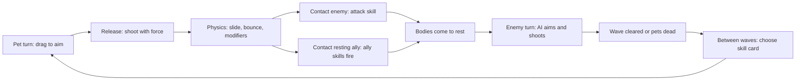

# Exploration: Bump_Hero Logical Space, First Pass

> **Status:** First-pass decomposition from source reading. Not runtime-verified. No edits made to the game.
> **Source:** `G:\Unity\Project\BumpHero`, revision `f127c8a8` (2026-10-22). Read: `GameplayManager` notes in `.cursor/memory/mem-arch-layer5-composition.md`, `PetLogicStates.cs`, `Bat.cs`, `Bear.cs`, `Seal.cs`, `SealHealSkill.cs` (partial), `mem-enemy-turn-ai-drag-delay.md`, and file listings of `_PhysicBasis`, `_Gameplay/_Skill`, `_Gameplay/_Roguelike`, `_StatusEffect`.
> **Process:** playbook steps 1 to 5 from the [discussion record](../../../.cursor/plans/design/2026-10-24-logical-space-base-theory.md), section 4. Derived from this game's code only, per the [anti-bias rule](../../../.claude/rules/no-case-study-bias-and-basis-orthogonality.md).
> **Project state:** Bump_Hero is mid-way through `com.hung.*` package adoption (W0 to W3 done 2026-10-22). Treat this as theory input, not a change proposal for that repo.

---

## 1. Game in One Paragraph

Turn-based physics flick roguelike. On a pet's turn, the player drags to aim and releases to shoot the pet with a force. The pet slides and bounces. Contact with an enemy runs the pet's attack. Contact with a **resting ally pet** runs that ally's skills. Enemies take turns through an AI that aims, fakes a drag, and shoots. Waves spawn; between waves the player picks a skill card.

---

## 2. Draft Decomposition

| Component | Contents, from code | Notes |
|---|---|---|
| State $\mathcal{S}$ | Per character: position, velocity, HP, weight with modifiers, active status effects, `IsHurt`, transform flag, `IsTurn`. Global: current turn character, wave index and state, owned skill cards and levels | Velocity matters only while bodies move |
| Action $\mathcal{A}$ | Pet turn: shot direction and force, a continuous 2D vector. Between waves: one skill card, discrete | Effectively one continuous choice per turn |
| Operators $\hat{\mathbb{O}}$ | Physics integration with modifiers: Bouncing, Attraction, Damping, LimitDistance, FireEvent. Contact resolver: pet with enemy runs attack; pet with resting ally runs ally skills. Damage, status effects: DoT, knockback, shock, stun, stat modifier. Turn-start rules per species. Wave spawn. Card application | Contact resolver is the main interaction operator |
| Boundary $\Omega$ | Waves cleared: win. All pets dead: loss | From turn-flow notes; not traced in code this pass |

---

## 3. Where Basis and Emergence Sit Today

### 3.1 Two emergence sources

1. **Geometry.** Continuous shot vector, bounces and positions give a large outcome space from one input. This is real emergence: nobody enumerates ricochet paths.
2. **Contact combos.** Shooter hits a resting ally → the ally's skill fires. This is a pairwise interaction operator, the same shape as HOT with MELT in Baba Is You.

### 3.2 Basis level is mixed

| Element | Current form | Level |
|---|---|---|
| Bat | Class: attraction modifier active only on own turn; rotate skill on attract begin and end | Coarse, species-coded |
| Bear | Class: transforms at turn start if hurt since last turn | Coarse, species-coded |
| Seal | Class: on another pet's turn, +90 flat weight and a heal bubble | Coarse, species-coded |
| Physics modifiers | Bouncing, Attraction, Damping, LimitDistance, FireEvent as definitions plus stats | **Already property-vocabulary level** |
| Status effects | DoT, knockback, shock, stun, stat modifier, remove-on-apply | **Already property-vocabulary level** |

Reading through the [resolution rule AG-5](../../../.cursor/plans/design/2026-10-24-logical-space-base-theory.md): species behavior is written at the "fire, water" level, with bespoke turn rules per class. Underneath, the physics modifiers and status effects are close to a finer basis. Example re-expression, assistant's hypothesis:

| Species today | Possible property-level form |
|---|---|
| Seal | Mass modifier plus heal-on-contact, both gated by condition "not my turn" |
| Bat | Attraction field gated by condition "my turn" |
| Bear | Transform gated by condition "hurt since last turn" |

Candidate basis: **body properties** (mass, bounce, damping, field) × **triggers** (on contact with enemy, on contact with ally, on turn start) × **conditions** (my turn, not my turn, hurt) × **effects** (damage, heal, status, transform). Species become rows of config. This is a hypothesis for discussion, not a refactor request.

### 3.3 Interestingness candidates

**Owner-confirmed target (2026-10-24): I6 chain reaction.** One shot ricochets through several allies and chains their skills. Test: M6 cascade profile in the discussion record, section 3.7.

| Type | Where it could appear |
|---|---|
| I6 Chain reaction | **Primary target.** Shooter knocks a resting ally into another ally; each contacted ally fires its skills |
| I1 Affordance shift | Bat attraction bends trajectories, so the player gains curved shots. Seal's weight changes how bounces off it behave |
| I3 Solution diversity | Many distinct shots that clear a wave |
| I5 Strategic depth | Card choices and pet ordering without a dominant line |

---

## 4. Theory Stress Points Exposed

- **Continuous action.** The shot is a continuous vector resolved by real-time physics. Boolean Fourier fits the property-by-trigger contact table. The shot itself needs sampling: sweep angle and force, record outcomes, and check whether good shots are many and varied or one dominant line. This touches open problem 6 in the [explainer](../../theory/Logical-Space-Mathematical-Foundations.md).
- **Two time scales.** Discrete turns outside, continuous physics inside a turn. The model needs a turn operator that wraps a physics sub-simulation.
- **Hidden order rules.** Species turn rules switch on `TurnType` 0 and 1. Their order relative to each other and to card effects is implicit: gate P4 territory.

---

## 5. Open Questions for the Owner

1. ~~What is the intended interesting moment?~~ Answered: I6 chain reaction.
2. Is the property-level basis in section 3.2 the direction you want, or should species stay hand-coded?
3. Should deeper Bump_Hero work also wait for its package adoption to finish, like Forest_Bloom?
