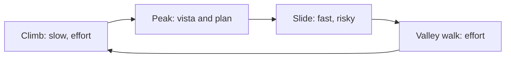
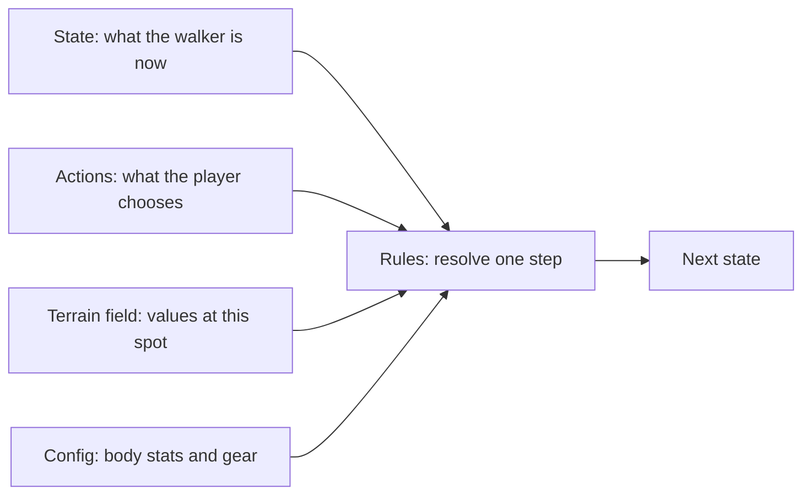
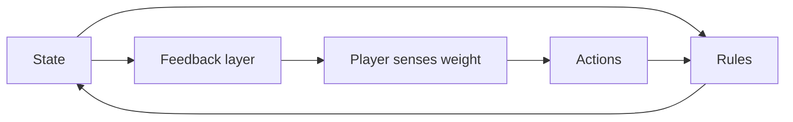

# Endless Walker: Game Design Draft

Working title. Draft v0.1, 2026-11-12. Status: brainstorming, not approved for build.
Decision record: [`.cursor/plans/design/2026-11-12-endless-walker.md`](../../../.cursor/plans/design/2026-11-12-endless-walker.md)

Each item is marked **[Agreed]** (owner confirmed, EW-n) or **[Proposal]** (from Claude, not yet confirmed).

---

## 1. Pitch

**[Agreed EW-2]** Indie-scope game about human physical movement across an endless procedural world. The inspiration is Death Stranding, where walking is the game. The world is generated like Minecraft. The body is the core. This sets it apart from vehicle-upgrade games like SnowRunner and Pacific Drive.

**[Agreed EW-14]** Vehicles are cut for now. Slide is the speed burst.

**[Agreed EW-16]** Current aim is a **prototype**. The cost of slowness, charting and the growth currency are decided later.

**[Agreed EW-11] Signature moment:** moving through vast space, climbing a mountain, then sliding down from the peak.

## 2. Player fantasy and goal

**[Agreed EW-3]** The player is a **pathfinder and surveyor**. They push an endless frontier, reach far landmarks and high points, and chart unknown land.

**[Agreed EW-4]** The goal is **forward only**. Trails and structures left behind give no help at the frontier.

**[Agreed EW-6]** What the player wants is **more speed and more stability**, so they can cross vast distance as fast as possible.

"World changes" means the map fills in, the frontier moves and the land gets stranger.

## 3. Core loop

## 4. Rhythm: height as currency [Proposal]

- Height is **earned** slowly with stamina and grip, then **spent** fast on the slide.
- Route planning is height planning: one big climb buys a long slide toward the next target.
- Peaks do double duty as vista point and launch point.

## 5. Body system

**[Agreed EW-5]** Health works like Death Stranding: **stamina plus balance**. No hunger, no food, no deep survival layer.

**[Proposal] Core tension: speed vs stability.**
- Push fast and you risk stumbling, falling, tumbling, and losing time or gear.
- Go too safe and you waste time, or waste the height you earned.
- Terrain sets how hard the trade-off is.
- Player skill is reading terrain and choosing how hard to push.

## 6. Movement verbs

**[Agreed EW-10]**
| Verb | Main use |
|---|---|
| Walk | Default travel, careful footing |
| Run | Speed on good ground, costs stamina and balance |
| Climb | Cliffs and walls. Grip and stamina |
| Jump | Gaps, small drops |
| Slide | Fastest descent. **Star verb**. Relaxed slide is safe; risk grows only when the player pushes speed (EW-23). Works on any slope (EW-15); grip and softness set the feel |
| Rappel | Safe, fast descent. Costs rope |
| Wade | Water. The current pushes balance |
| Brace | Wind. Crouch to hold balance |

Balance walking on a ridge counts as slow walking on a narrow surface, not a separate verb.

## 7. Obstacles

**[Agreed EW-9]**
| Obstacle | Tests | Answer |
|---|---|---|
| Steep slope up | Stamina | Walk slow, zig-zag, climb |
| Steep slope down | Balance, speed control | Slide, brake, rappel |
| Cliff or wall | Grip, stamina | Climb, rope, anchor |
| Gap or crevasse | Timing, commitment | Jump, ladder or plank, rope bridge |
| River | Balance, current | Wade, find ford |
| Narrow ridge | Balance precision | Slow walk |
| Soft ground: snow, sand, mud | Stamina drain, sinking | Wide boots, snowshoes, firmer line |
| Slippery: ice, wet rock | Grip | Crampons, slow steps |
| Boulder field | Footing, stumbles | Careful steps, hop |
| Dense vegetation | Speed | Push through, cut path |
| Wind | Balance, worse on ridges | Brace, wait for a gap in the gusts |
| Fog or storm | Route reading | Wait, compass, landmarks |
| Night | Reading terrain | Lamp, slow down |

**[Agreed EW-13]** Fog, storm and night are planned for the future, not now.

**[Proposal]** Obstacles are not new mechanics. Each one is a combination of terrain properties: slope, grip, softness, width, current, wind. Visibility joins later with fog, storm and night.

## 8. Progression

**[Agreed EW-7]**
| Source | Role | Ceiling |
|---|---|---|
| Skill | Read terrain, choose lines, manage balance | The player's own |
| Body growth | Stamina, balance, carry weight | Slow, steady |
| Gear growth | Boots, grip, rope kit, terrain-specific tools | Unlocks with new land |

Vehicle row removed (EW-14, cut for now). The EW-7 rule "walker stays slower than a vehicle" is parked with it.

**[Proposal]** Packing matters: the weight limit forces you to guess which tools you'll need on land you haven't seen.

## 9. World generation

### 9.1 Biome consistency [Proposal]

The rules stay fixed. A biome only changes terrain property values:

| Property | Snow | Desert | Jungle | Cliff |
|---|---|---|---|---|
| Slope | low to mid | dunes | mid | very high |
| Grip | low | low | mid | depends on rock |
| Softness | high | high | high | none |
| Wind | gusts | steady | low | strong on faces |

**[Agreed EW-12]** Temperature has no effect on health for now. Visibility is deferred with EW-13.

A new biome is a new mix of familiar values. The player reads it with skills they already have, but has to adapt.

Logical-space view: see section 9.3.

### 9.3 Logical space map [Agreed EW-17 as core]

Approved as the core. Still open: whether the action list is 4, 5 or 6 (crouch does three jobs, use tool may fold into grab), and what happens on balance loss. Both wait until the feel of each main action is settled.

Only two of these are spaces: state and actions. Terrain field and config are parameters. Rules are functions. They must not be mixed. No count here is fixed: each list holds what the game needs and grows or shrinks by test, not to hit a number.

**State (changes every moment)**

| Group | Variables | Note |
|---|---|---|
| Motion | Position, velocity | Height is part of position. Height as currency needs no extra variable |
| Condition | Stamina, balance | EW-5 |
| Contact mode | On foot, on wall, sliding, in water, on rope, in air, fallen | One at a time |
| Carry | Load weight, rope and other consumables | |
| Knowledge | Charted map | Deferred with charting |

**Actions (player choices)**

| Action | Parameter |
|---|---|
| Move | Direction, pace from careful to sprint |
| Grab or release | Wall or ledge |
| Jump | Timing, direction |
| Crouch | Hold |
| Use tool | Which tool: rope, anchor |

The eight EW-10 verbs stay as the player-facing names. Each one is an action seen in a contact mode:

| Verb | Action | Contact mode |
|---|---|---|
| Walk, run | Move at low or high pace | On foot |
| Wade | Move | In water |
| Climb | Grab, then move | On wall |
| Jump | Jump | On foot to in air |
| Slide | Crouch on a slope, steer with move | Sliding |
| Brace | Crouch on flat ground | On foot |
| Rappel | Use rope | On rope |

**Terrain field (read at the walker's position, set by biome)**

Slope, grip, softness, width, current, wind. Later: visibility.

**Config (changes slowly through progression)**

Body stats: max stamina, balance strength, carry limit. Gear modifiers: boots change grip, snowshoes change softness effect.

**Rules (functions, not spaces)**

| Rule | Reads | Changes |
|---|---|---|
| Locomotion | Pace, slope, softness | Velocity, position |
| Stamina | Pace, slope, load, contact mode | Stamina |
| Balance | Speed, slope, grip, wind, current, crouch | Balance |

**[Agreed EW-20]** Load affects stamina only, like Peak. It does not affect balance. This does not break the logical space: load is still a carried value, and which rule reads it is a design choice. Only the stamina rule reads it. Claude's call: locomotion does not read load either, so a heavy walker slows down only because stamina runs out sooner.
| Slide and gravity | Slope, grip, height | Velocity. Turns height into speed |
| Mode change | Balance, grip, actions | Contact mode: slip, fall, grab, land |
| Tool | Tool use | Consumables, contact mode |

**Prototype subset (Claude's guess):** state = position, velocity, stamina, balance, contact mode without water and rope. Actions = move, grab, jump, crouch. Field = slope, grip, softness. Rules = all except tool.

### 9.2 Scenery [Agreed EW-8 as non-blocker, method is a Proposal]

Outstanding scenes are needed only sometimes.
- Noise terrain between landmarks provides the walking challenge.
- Hand-made set pieces are placed by spacing rules.
- Landmark-first shaping keeps each landmark visible from far away.
- A vista scorer guarantees a payoff viewpoint.
- Quality-diversity search is optional later (`docs/research/quality-diversity-level-generation/`).

## 9A. Movement feel [Proposal, under discussion]

**[Agreed EW-18]** Design order: settle the feel of each main action first. Movement must have weight and good feedback, like Death Stranding.

Feel is a presentation layer. It reads state and shows it to the player. It never changes state.

| Source of weight | What the player feels | Lives in | Cost |
|---|---|---|---|
| Inertia | Slow start, cannot stop at once | Locomotion rule | Low |
| Turn radius | Wide turns at speed or under load | Locomotion rule | Low |
| Slope momentum | Downhill pulls you faster than you asked | Slide and gravity rule | Low |
| Load | Heavier pack makes all three above worse | Config | Low |
| Body lean | Leans into turns, slopes and stops | Feedback | Mid |
| Foot placement | Feet land on real ground, no sliding | Feedback | Mid |
| Stumble ladder | Small slip, stagger, fall. Warning before failure | Mode change rule plus feedback | Mid |
| Camera | Lags a little, sways, shakes on hard landing | Feedback | Low |
| Sound | Footsteps by surface, breath by stamina, gear rattle by load | Feedback | Low |
| Controller rumble | Each footstep, stronger on the leaning side | Feedback | Low |

**[Agreed EW-19] Reference feel moment:** carrying too much weight on the back and trying to climb a slope. This is the first thing the prototype must get right.

**[Proposal] What that moment is made of:**

| Part | Rule or feedback | Reads |
|---|---|---|
| Full stick gives less speed | Locomotion rule | Slope along heading |
| Stamina drains fast, less of it is usable | Stamina rule | Load, slope along heading |
| Feet slip back on poor ground | Mode change rule | Grip, slope |
| Going diagonal is easier but tips you sideways | Locomotion and balance rules | Slope along heading, slope across heading |
| Shorter steps, slower rhythm | Feedback | Speed |
| Torso leans forward, more under load | Feedback | Slope, load |
| Breath gets louder, steps sound heavier | Feedback | Stamina, load |

Consequences:
- Slope is a direction plus a steepness, not one number. The rules read it two ways: along the heading and across the heading. Zig-zag then appears by itself, with no special mechanic.
- Load must be in the prototype. A simple weight slider is enough; packing and gear source stay deferred.
- Load changes no balance number (EW-20), so the body must still show it: lean, step rhythm, breath and sound all read load. Otherwise weight is only a bar.
- Proposal, Peak style: load takes up part of the stamina bar. One bar shows both how tired you are and how much you carry.

**[Agreed EW-21]** The slide from a snow peak, as in Death Stranding, is in the prototype.

**[Proposal] Prototype shape: one snow mountain.** Climb up under load, reach the peak, slide down. This is the height-as-currency rhythm of section 4 in its smallest form, and it holds both reference moments (EW-19, EW-21).

**[Proposal] Slide first sketch:**

| Part | Rule or feedback | Reads |
|---|---|---|
| Start | Crouch on a slope, or a slip forces it | Slope, grip |
| Speed builds | Slide and gravity rule | Slope along heading, grip |
| Steer | Move action, wide turns at speed | Speed |
| Brake | Costs speed, steadies balance | Grip, softness |
| Balance drops with speed and bumps | Balance rule | Speed, slope across heading |
| Fall | Mode change rule | Balance |
| Wind noise, camera pulls back, snow spray | Feedback | Speed |

Under EW-20, load plays no part in the slide, since sliding costs no stamina.

**[Agreed EW-22] Slide target:** it feels very good, the scenery during it is good, and it feels like the player is the one sliding. Claude reads the last part as embodiment, not as an automatic slide.

**[Proposal] What each part asks for:**

| Target | Needs |
|---|---|
| Feels very good | Steering answers at once and carves smoothly. Long unbroken run. Easy to enjoy, hard to go fastest: risk grows only when the player pushes speed |
| Good scenery | The slope opens onto a wide view. The launch point faces the next landmark. Camera keeps the horizon in frame |
| Feels like I am sliding | Camera low and close behind, widens with speed. Wind, snow spray, scrape sound, rumble. Almost no interface on screen |

**[Agreed EW-23]** Slide risk grows only when the player pushes speed. A relaxed slide is safe and beautiful; a fast slide is a skill test. This replaces the old "high fall risk" wording in section 6.

Build approach (Claude's recommendation): simple capsule controller with tuned speed curves, plus procedural lean and foot placement. Not motion matching (needs motion-capture data). Not full physics ragdoll (hard to control, reads as comedy).

## 10. References

| Game | What we take |
|---|---|
| Death Stranding | Walking as the game, balance, load, terrain reading |
| Cairn, Jusant | Climbing as skill, stamina, ropes |
| Peak | Stamina, generated mountain, small team scope |
| A Short Hike | Climb and glide, body growth with stamina feathers |
| SnowRunner | Terrain that fights back, route scouting |
| The Long Dark | Weight limits, route choice |
| Valheim, Minecraft | Endless procedural world |
| Outer Wilds | Exploration and knowledge as reward |
| Journey, Sable | Vast calm space, a far landmark that pulls you on |

## 11. Open questions

| Question | Notes |
|---|---|
| Logical space map | Section 9.3, discuss each space in turn |
| Cost of slowness | Why speed matters: no clock or pressure yet. Deferred (EW-16) |
| Growth currency | What pays for body and gear growth. Deferred (EW-16) |
| Gear source | Where the player packs from when the goal is forward only |
| People | Settlements, NPCs, or nobody? |
| Shared traces | Other players' marks, Death Stranding style? |
| Trace decay | Do your trails fade? |
| Endgame | Pure endless, or a far goal? |
| Production | Prototype is HTML first (EW-25), one snow mountain (EW-24), see the [prototype design](../../../.cursor/plans/design/2026-11-12-endless-walker-prototype.md). Engine for the real game is undecided |
| Vehicle | Cut for now (EW-14). Revisit after prototype |
| Charting | What surveying actually is as a player action. Deferred (EW-16) |
| Weather and night | Fog, storm, night, visibility. Future (EW-13) |
| Temperature | No health effect for now (EW-12) |
