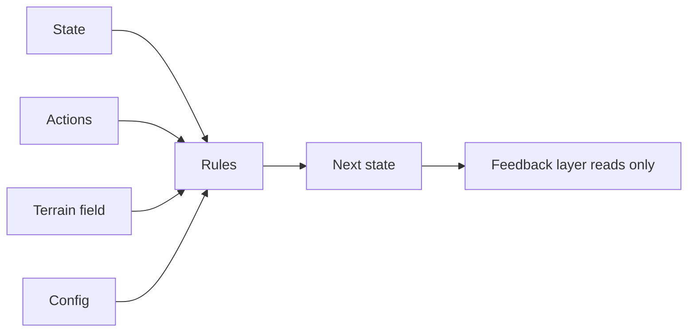

# Endless Walker (working title): Exploration Hub

Status: GDD in brainstorming. Prototype design approved (EW-28). Prototype built by Gemini 2026-11-12, reviewed by Claude (38/38 tests). Awaiting owner playtest. Nothing committed. Started 2026-11-12.
Isolated case study. Do not import Anima, Forest_Bloom or psychology assumptions here (see `.claude/rules/no-case-study-bias-and-basis-orthogonality.md`).

## Files

| File | Holds |
|---|---|
| [`GDD.md`](GDD.md) | Full game design draft. Main source for the game |
| [`../../../.cursor/plans/design/2026-11-12-endless-walker.md`](../../../.cursor/plans/design/2026-11-12-endless-walker.md) | Decision record EW-1 to EW-28, open proposals |
| [`../../../.cursor/plans/design/2026-11-12-endless-walker-prototype.md`](../../../.cursor/plans/design/2026-11-12-endless-walker-prototype.md) | Approved prototype design, with builder handoff (section 12) |
| `../../../.cursor/plans/implement/2026-11-12-endless-walker-prototype.md` | Implementation plan for Gemini, awaiting approval. Brief: `2026-11-12-endless-walker-prototype-gemini-brief.md` |
| `prototype/` | Prototype code. Run `python -m http.server 8765 --bind 127.0.0.1` inside it |

## Pitch

Indie game about human movement across an endless procedural world. Death Stranding inspiration: walking is the game. Player is a pathfinder and surveyor pushing a forward-only frontier. Vehicles cut for now (EW-14).

## Logical space core (EW-17, GDD section 9.3)

Only state and actions are spaces. No dimension count is fixed.

| Kind | Content |
|---|---|
| State | Position (height inside it), velocity, stamina, balance, contact mode, load, consumables, later charted map |
| Actions | Move with pace, grab or release, jump, crouch, use tool. Count 4, 5 or 6 still open |
| Terrain field | Slope along and across heading, grip, softness, width, current, wind. Visibility later |
| Config | Body stats, gear modifiers, load limit |
| Rules | Locomotion, stamina, balance, slide and gravity, mode change, tool |
| Feedback | Camera, body pose, sound, rumble, bar. Never changes state |

The eight verbs (walk, run, climb, jump, slide, rappel, wade, brace) are player-facing names for an action in a contact mode.

## Key feel decisions

| ID | Decision |
|---|---|
| EW-19 | Reference feel: overloaded back climbing a slope |
| EW-20 | Load affects stamina only, like Peak. Not balance, not speed |
| EW-21, EW-22 | Death Stranding snow-peak slide: feels very good, good scenery, feels like you slide yourself |
| EW-23 | Slide risk grows only when the player pushes speed |
| EW-26 | Climbing feels like Peak |

## Prototype (EW-24 to EW-28)

One snow mountain, HTML with Three.js. Climb up under load, cliff band climb, peak view, long slide down toward a far landmark. Pass test: owner says walking, climbing and sliding feel good.

## Deferred

Cost of slowness, charting action, growth currency, gear source, balance-loss detail, action count, weather and night, temperature effect, vehicle, people, shared traces, endgame, real engine.
