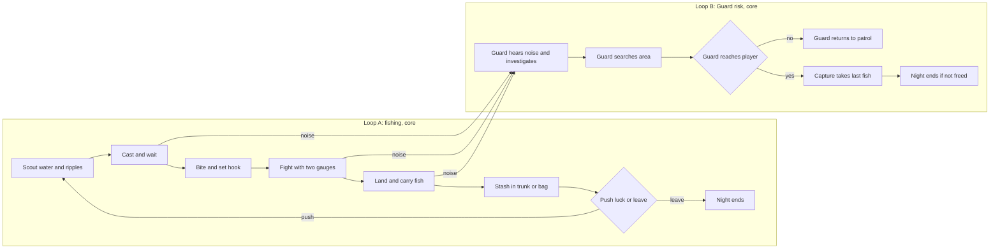

# A Fishing Night — Logical Space Exploration

> **Game:** A Fishing Night (working title), first-person stealth fishing horror, 1–4 players, HTML/three.js demo.
> **Game repo:** `D:\Projects\SleepWithTheFish\HtmlDemo\TheFishingNight` (submodule of SleepWithTheFish).
> **Game spec (P0 snapshot):** [2026-11-19-fishing-night-logical-space.md](../../../../SleepWithTheFish/HtmlDemo/TheFishingNight/docs/2026-11-19-fishing-night-logical-space.md)
> **Game design:** [GAME_DESIGN.md](../../../../SleepWithTheFish/HtmlDemo/TheFishingNight/docs/GAME_DESIGN.md), [ARCHITECTURE.md](../../../../SleepWithTheFish/HtmlDemo/TheFishingNight/docs/ARCHITECTURE.md)
> **Method:** [Base Theory v0.3](../../theory/Logical-Space-Base-Theory.md), [playbook](../../../.cursor/playbooks/playbook-decompose-game-to-logical-space.md)
> **Revision:** 2026-11-19, draft. Game code at `7fefd7b`.

**Status:** P0 draft, decomposition partial. No detector run, no ladder rung measured, no playtest. Every target and viability condition below is **proposed** until the owner approves it.

---

## P0: Idea spec

### Mechanics (numbered, no theory labels)

1. Cast, wait for bite, set hook in a window.
2. Fight with two gauges (fish stamina, line tension); land within reach of the bank.
3. Every fishing action emits noise.
4. Guard hears noise and investigates; sees in a cone; chases; captures.
5. Captured player is carried and tied; teammates can free them.
6. Fish go to trunk or backpack; quota counts team fish value.
7. Throw items to draw the Guard away.
8. Traps, fence, chained gate and key chain control access to the lake.
9. Co-op: teammates hug-pull and share one world, host runs the Guard.

### Target interestingness (proposed, owner picks)

| Type | Candidate target | Test | Status |
|---|---|---|---|
| I3 Solution diversity | Several routes into the lake: cut chain, key from toolbox to electric box and back gate, bushes, decoy throws | M2, M3 | Candidate |
| I6 Chain reaction | One noise cascades: throw draws Guard, Guard finds player, teammate frees or is caught in turn | M6 | Candidate |
| I1 Affordance shift | An item changes what the player can do: rod as tool, stone as decoy, knife as rescue | M5 | Candidate |
| I4 Story emergence | Unscripted captures and rescues that players remember | M2 plus player reports | Candidate, needs P7 |

No type has a defined detector yet (L12). I6 has the most direct mapping to the noise bus, so it is the first to test if the owner agrees.

### Viability conditions (proposed, L16, separate from targets)

| ID | Condition |
|---|---|
| V1 | A solo player catches at least one common fish in a normal run |
| V2 | The Guard does not catch every run at once |
| V3 | Noise events reach the Guard within the configured radius |
| V4 | Quota is reachable with the fish that exist |
| V5 | A teammate can free a captured player in co-op |

### Player loop (L13, L17)

Action (cast, throw, sneak) → noise and Guard state → Y (fight gauges, prompts, outlines, Guard behaviour) → player reads Guard position → next action.

**Gap:** Guard suspicion (`detect`) is hidden. Y shows only behaviour. L17 suggests one directional signal. Not yet decided.

---

## Core loops (two-loop split)

Working rule (from the game spec, section 0.1): a second loop gets its own graph when it has its own state and clock, and its outputs do not return to the first loop as system state. Proposed, not yet adopted in Base Theory.

Both loops in one frame. Loop A (fishing) and loop B (Guard risk) are separate subgraphs. The one arrow between them is the only system link.

**Link A to B (one way, system state).** Cast, Fight and Carry emit noise events. Loop B reads them. Loop B changes nothing in loop A except capture.

**Link B to A (player-mediated, not a graph edge).** The player reads Guard state through Y and changes the next cast or stash decision. Real coupling, measured in playtest (decision dependence), not assumed.

## Decomposition

### Vocabulary V

| Type | Config or basis | Source |
|---|---|---|
| Fish class common, valuable, premium | Basis with config rows | `src/config.js` 300–302 |
| Guard | Basis | `src/guard.js` |
| Noise event | Operator output, radius from config | `CONFIG.noise` |
| Throwables (stone, bottle, rod, flashlight, cutters, knife) | Basis with config rows | `CONFIG.throwing` |
| Bear trap | Basis | `src/trap.js` |
| Fence, gate, chain, key ring | Basis | `src/fence.js`, `src/level.js` |
| Hiding bush, tall grass | Basis | `CONFIG.bushes` |
| Backpack grid 3×3 | Basis | `src/backpack.js` |
| Fish value in $ | **Derived** from class and weight | GDD 2.1 |
| Quota | **Derived** from fish value sum | `CONFIG.mission` |
| Heat | Not built | GDD section 1 |

### State S, actions A, operators O, boundary Ω

- **S:** each fish, each Guard (state, `detect`, hearing target), bag, trunk, ground items, gate and chain state, lamps, traps, night clock, player pose.
- **A:** cast, wind, hook, pull, walk, run, crouch, jump, drop, throw, pick up, cut, step, QTE input, pack, hug-pull.
- **O:** noise bus (strongest candidate), Guard perception, fight resolver, throw resolver, chain pull, trap, capture.
- **Ω:** quota met with one player out; dawn; everyone caught.

Full tables are in the game spec. Keep this file in sync when the spec changes.

---

## Ladder

Not started. Proposed rung 0 is the current build: noise bus, Guard perception, fight. Each later rung adds one element or operator, one change per rung (Theory 4.1). Start only after a target has a detector.

| Rung | Change | Predicted emergence | Detector | Result |
|---|---|---|---|---|
| 0 | Current build | — | — | Not measured |

---

## Gates

| Gate | Status |
|---|---|
| P2 Independence | Not run. Check fish value derived (game spec G5). |
| P3 Completeness | Not run. Each mechanic reachable from V, S, A, O. |
| P4 Operator algebra | Not run. Check noise bus order in co-op. |
| P5 Emergence | Not run. Needs detector. |
| P6 Quality | Not run. Viability V1 to V5. |
| P7 Player | Not run. Playtest required. |

---

## Gaps found (also in game spec)

- **G1** Heat not built; Guard uses `detect`. Basis decision needed (L3, AG-10).
- **G2** Viability list new, owner approval needed (L16).
- **G3** No detector, no ladder.
- **G4** Guard suspicion hidden from Y (L13, L17).
- **G5** Fish value derived or stored? Keep derived.

---

## Lessons

None yet. Add here when a rung or gate teaches something that goes back to the theory or playbook.

---

## Owner questions

1. Pick the target type or types (I3, I6, I1, I4) and approve detectors.
2. Approve viability V1 to V5.
3. Heat or `detect` for Guard escalation.
4. Thresholds before the first run.
5. Keep GDD Heat-never-falls rule, or drop it after the OoT fishing change?
