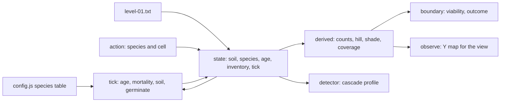

# Forest_Bloom Slice — Reference Case

Smallest Forest_Bloom slice used as the first full reference case for the Logical Space method (theory frozen at `2026-11-03-logical-space-v0.3-draft`). Plan: [2026-11-12-forest-bloom-slice-reference-case.md](../../../.cursor/plans/implement/2026-11-12-forest-bloom-slice-reference-case.md). Code: [prototypes/forest-bloom-slice/](../../../prototypes/forest-bloom-slice/).

## P0 (approved 2026-11-03, critique record section 2.3)

| P0 item | Content |
|---|---|
| Target interestingness | **I6 chain reaction**: a seed in the right place starts a spreading wave of recovery and succession |
| Skill expression | "Right place" must matter: the cascade from the best cell is much longer than from a random cell (M6: best versus random) |
| Viability condition (L16) | Several species coexist; no species takes the whole map |
| Player loop | Look at the map, pick seed and cell, watch the wave, understand why it spread or stopped, plant again |
| Perceivability (L13) | Causes of spread (soil, shade) and effects (new species) are visible |
| Progression (L15) | Out of scope for this slice: one level only |

## Basis table, rung 0

| Entry | Class | Notes |
|---|---|---|
| Species type: pioneer 1, shrub 2, canopy 3 | Vocabulary, config | Parameters in the species table |
| Rock mask, initial soil, seed inventory, ticks per turn | Level config | Progression structure, L15 |
| `soil` per cell, integer 0 to 5 | State | |
| `species` per cell, 0 for empty | State | |
| `age` per cell | State | |
| `inventory` per species, `tick` | State | |
| Shade, counts, coverage, Hill number, trend | Derived | Never stored |

## Species table, rung 0

| Field | pioneer | shrub | canopy | Meaning |
|---|---|---|---|---|
| `minSoil` | 1 | 3 | 4, **3 from rung 2** | Soil needed to germinate and to stay alive |
| `soilSelf` | 0 | 0 | -1 | Soil change on own cell per tick |
| `soilNear` | 1 | 1 | 0 | Soil change on each 4-neighbour per tick |
| `enrichCap` | 3, **0 from rung 1** | 5 | 5 | A positive `soilNear` never lifts a cell above this |
| `matureAge` | 1 | 2 | 3 | Age from which the plant seeds neighbours |
| `lifespan` | 6 | 10 | 16 | Dies when age exceeds this |
| `shadeLimit` | 1 | 3 | 5 | Dies when canopy 4-neighbours reach this count |
| `rank` | 1 | 2 | 3 | Higher rank wins a contested empty cell |

## Operator table, one tick

Each phase reads the result of the phase before it and writes synchronously.

| Order | Operator | Reads | Writes |
|---|---|---|---|
| 1 | `agePhase` | species | age plus 1 for every plant |
| 2 | `mortalityPhase` | age, soil, species, config | removes a plant when age exceeds `lifespan`, or soil is below `minSoil`, or canopy neighbours reach `shadeLimit` |
| 3 | `soilPhase` | surviving plants, config | soil, clamped 0 to 5; positive `soilNear` respects `enrichCap` |
| 4 | `germinatePhase` | snapshot after phase 3 | each empty non-rock cell takes the highest-rank species among mature 4-neighbours whose `minSoil` the cell meets; new plant age 0 |

## Data flow

