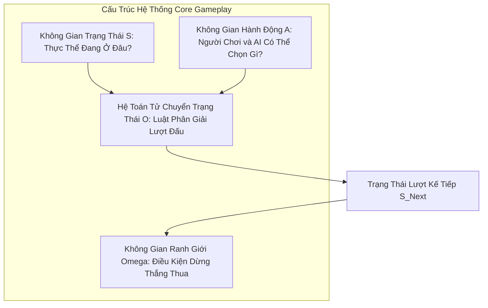
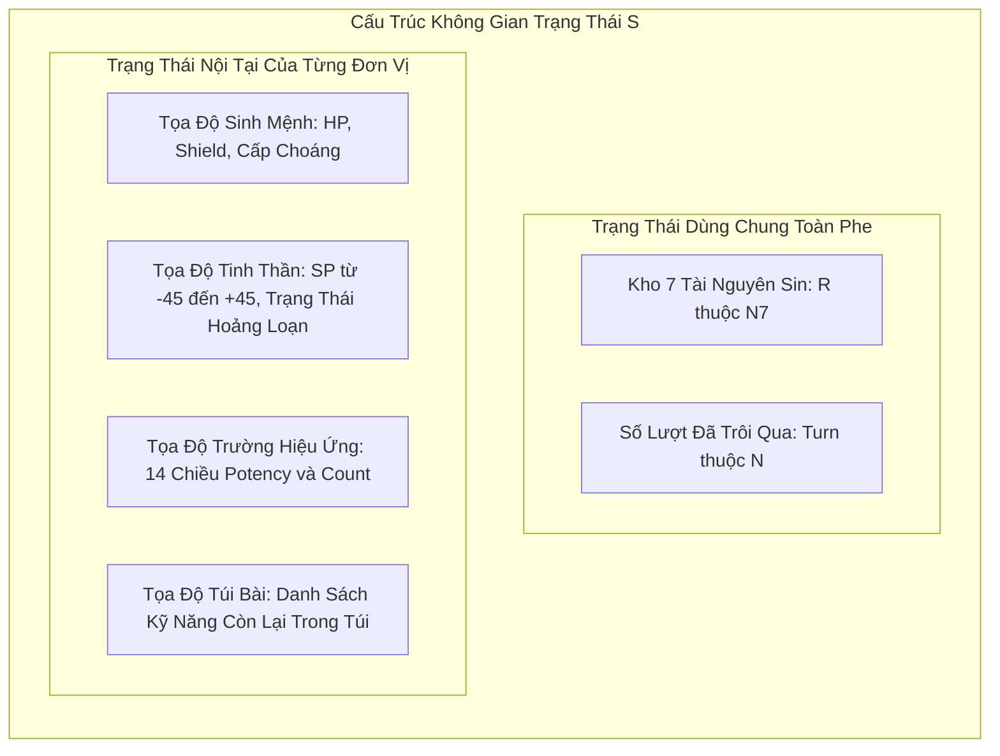
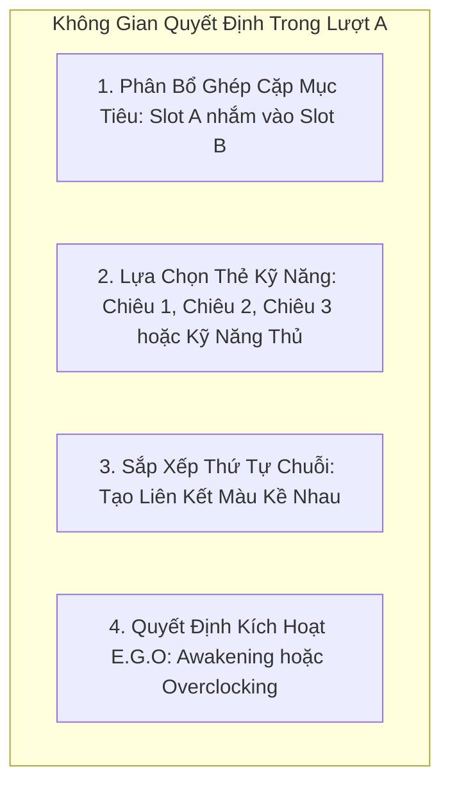
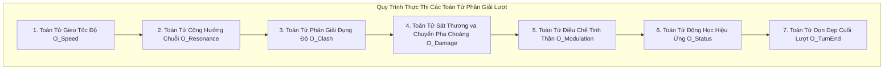

# Khảo Sát & Phân Rã Không Gian Logic: Core Gameplay Limbus Company

> ### KHẾ ƯỚC BIÊN GIỚI NGHIÊN CỨU & NGUYÊN TẮC BẢN THỂ
> * **Không gian nghiên cứu:** `docs/explorations/limbus-company-logical-space/`
> * **Quy tắc tuân thủ nghiêm ngặt:** [no-case-study-bias-and-basis-orthogonality.md](../../../.agents/rules/no-case-study-bias-and-basis-orthogonality.md).
> * **Cam kết phi thiên kiến:** Bác bỏ hoàn toàn việc áp đặt con số "5 trục" hay các khái niệm của Project Anima / Big Five. Limbus Company được phân rã thuần túy theo cấu trúc toán học của một Hệ Động Lực Trò Chơi (Game Dynamical System).
> * **Nguyên tắc phân định bản thể:** Tách bạch tuyệt đối giữa **Không Gian Trạng Thái (State Space)**, **Không Gian Hành Động (Action Space)**, và **Hệ Toán Tử Chuyển Trạng Thái (Transition Operators)**. Không đánh đồng Toán tử thành Trục không gian.

---

## 1. Cấu Trúc Bản Thể Của Core Gameplay Limbus Company

Trong lý thuyết thiết kế game chuẩn tắc, Core Gameplay của một trận chiến $\mathcal{G}_{\text{combat}}$ được định nghĩa bởi bộ 4 thành phần toán học:

$$\mathcal{G}_{\text{combat}} = \left\langle \mathcal{S}, \mathcal{A}, \hat{\mathbb{O}}, \Omega \right\rangle$$

1. **$\mathcal{S}$ (Không Gian Trạng Thái):** Tập hợp toàn bộ biến số biến thiên mô tả snapshot của bàn cờ và nhân vật tại thời điểm $t$.
2. **$\mathcal{A}$ (Không Gian Hành Động & Quyết Định):** Tập hợp các bậc tự do mà người chơi và AI được phép lựa chọn trong lượt.
3. **$\hat{\mathbb{O}}$ (Hệ Toán Tử Chuyển Trạng Thái):** Các hàm phân giải cơ học biến đổi $(\mathcal{S}_t, \mathcal{A}_t) \xrightarrow{\hat{\mathbb{O}}} \mathcal{S}_{t+1}$.
4. **$\Omega$ (Không Gian Ranh Giới & Điều Kiện Dừng):** Các điều kiện kết thúc trận đấu (Thắng, Thua, Giới hạn 100 lượt).

---

## 2. Phân Tích Không Gian Trạng Thái ($\mathcal{S}$)

Không gian trạng thái $\mathcal{S}$ không phải là 1 hay 5 trục trừu tượng, mà là tích Descartes của các không gian trạng thái thành phần có thực trong mã nguồn game:

$$\mathcal{S} = \mathcal{S}_{\text{Shared}} \times \prod_{i=1}^{N_{\text{units}}} \mathcal{S}_{\text{Unit}}^{(i)}$$

---

### 2.1. Trạng Thái Toàn Cục Dùng Chung ($\mathcal{S}_{\text{Shared}}$)
* **Kho Tài Nguyên Tội Đội Ngũ ($\vec{R}_{\text{Sin}} \in \mathbb{N}^7$):**
  $$\vec{R}_{\text{Sin}} = (R_{\text{Wrath}}, R_{\text{Lust}}, R_{\text{Sloth}}, R_{\text{Gluttony}}, R_{\text{Gloom}}, R_{\text{Pride}}, R_{\text{Envy}})$$
  Đây là biến trạng thái bảo toàn và tích lũy xuyên suốt các lượt, được nạp khi dùng kỹ năng thường và tiêu hao khi kích hoạt kỹ năng E.G.O.
* **Biến Đếm Lượt ($T_{\text{turn}} \in [1, 100]$):** Đếm thời gian tiếp cận ngưỡng quá tải (Overclocked Failure).

---

### 2.2. Trạng Thái Của Từng Đơn Vị ($\mathcal{S}_{\text{Unit}}$)

1. **Trục Sinh Mệnh & Choáng ($\mathbf{x}_{\text{Life}} \in \mathbb{R}_{\ge 0} \times \mathbb{R}_{\ge 0} \times \mathcal{M}_{\text{stagger}}$):**
   * Máu hiện tại: $HP \in [0, HP_{\max}]$.
   * Máu khiên: $S \in \mathbb{R}_{\ge 0}$.
   * Cấp độ choáng hiện thời: $\text{StaggerState} \in \{\text{Normal}, \text{Stagger}, \text{Stagger+}, \text{Stagger++}\}$.
2. **Trục Tinh Thần ($\mathbf{x}_{\text{Sanity}} \in [-45, +45] \times \mathcal{M}_{\text{panic}}$):**
   * Điểm tinh thần: $SP \in [-45, +45]$.
   * Trạng thái tâm lý: $\text{PsychState} \in \{\text{Sane}, \text{LowMorale}, \text{Panic}, \text{Corrosion}\}$.
3. **Không Gian Trường Hiệu Ứng 14 Chiều ($\vec{\sigma}_{\text{Status}} \in \mathbb{N}^{14}$):**
   Bao gồm 7 cặp biến số nguyên độc lập:
   $$\vec{\sigma}_{\text{Status}} = (P_{\text{Burn}}, C_{\text{Burn}}, P_{\text{Bleed}}, C_{\text{Bleed}}, \dots, P_{\text{Charge}}, C_{\text{Charge}})$$
4. **Trạng Thái Túi Thẻ Kỹ Năng ($\mathbf{x}_{\text{Deck}}$):**
   Tập hợp các thẻ kỹ năng còn lại trong bộ bài cá nhân (Skill Deck), quyết định thẻ nào sẽ được rút lên ở lượt tiếp theo.

---

## 3. Phân Tích Không Gian Hành Động & Quyết Định ($\mathcal{A}$)

Trong mỗi lượt đấu, người chơi và AI không can thiệp trực tiếp vào biến trạng thái $\mathcal{S}$, mà đưa ra một vector quyết định trong không gian hành động $\mathcal{A}$:

* **Quyết định Ghép Cặp (Targeting Assignment):** Một tập các cạnh định hướng $E \subseteq \text{Slots}_{\text{Sinners}} \times \text{Slots}_{\text{Enemies}}$.
* **Quyết định Chọn Kỹ Năng (Action Allocation):** Với mỗi slot khả dụng, người chơi chọn thẻ tấn công sẵn có từ tay, hoặc thay thế bằng kỹ năng phòng thủ (Guard, Evade, Counter), hoặc kích hoạt E.G.O tiêu tốn tài nguyên.
* **Quyết định Tô-pô Chuỗi Màu (Color Topology):** Sắp xếp chuỗi liên kết để tối đa hóa độ dài $L$ của các mắt xích cùng màu Sin (nhằm kích hoạt Sin Resonance / Absolute Resonance).

---

## 4. Hệ Toán Tử Chuyển Trạng Thái ($\hat{\mathbb{O}}$)

Toán tử KHÔNG PHẢI là một trục không gian. Toán tử là các **bộ máy chuyển đổi cơ học (Resolvers / State Transformers)** lấy đầu vào là trạng thái hiện tại $\mathcal{S}_t$ và hành động đã chọn $\mathcal{A}_t$ để sinh ra trạng thái mới $\mathcal{S}_{t+1}$.

---

### 4.1. Chi Tiết Từng Toán Tử

#### 1. Toán Tử Gieo Tốc Độ ($\hat{\mathcal{O}}_{\text{Speed}}$)
* **Chức năng:** Lấy khoảng tốc độ tĩnh $[v_{\min}, v_{\max}]$ của mỗi đơn vị, gieo xúc xắc ngẫu nhiên để sinh ra vector tốc độ cụ thể cho lượt: $\vec{v}_t \in \mathbb{N}^{N_{\text{units}}}$.
* **Hệ quả logic:** Thiết lập thứ tự ưu tiên can thiệp và quyền cưỡng bức đụng độ (Clash Redirection).

#### 2. Toán Tử Cộng Hưởng Chuỗi ($\hat{\mathcal{O}}_{\text{Resonance}}$)
* **Chức năng:** Quét mảng chuỗi màu trên bảng điều khiển.
  * Nếu có $L$ kỹ năng cùng màu đứng kề nhau $\implies$ Cấp công tăng thêm: $\Delta \text{Off} = L$ (Sin Resonance).
  * Nếu có $\ge 3$ kỹ năng cùng màu bất kỳ $\implies$ Mở khóa kích hoạt các nội tại đặc biệt (Absolute Resonance).

#### 3. Toán Tử Phân Giải Đụng Độ ($\hat{\mathcal{O}}_{\text{Clash}}$)
* **Bản chất toán học:** Một xích Markov hấp thụ (Absorbing Markov Chain) giải quyết xung đột giữa hai kỹ năng đối đầu.
* **Quy trình:**
  1. Với mỗi đồng xu, lật mặt với xác suất $p = 0.5 + \frac{SP}{100}$.
  2. Tính tổng $\text{Final Power} = P_{\text{base}} + \sum \text{Coin Power} + \left\lfloor \frac{\Delta \text{Level}}{3} \right\rfloor$.
  3. Bên có điểm thấp hơn bị trừ $1$ đồng xu khả dụng. Quá trình lặp lại cho đến khi một bên mất sạch đồng xu.
  4. Bên thắng nhận quyền tung toàn bộ các đòn đánh chưa vỡ vào bên thua.

#### 4. Toán Tử Sát Thương & Chuyển Pha Choáng ($\hat{\mathcal{O}}_{\text{Damage}}$)
* **Chức năng:** Ánh xạ từ các đòn đánh trúng đích sang sự suy giảm của $HP$ và bước nhảy Choáng.
  $$\Delta HP = \text{FinalPower} \times R_{\text{Phys}} \times R_{\text{Sin}} \times \left(1 + \frac{\text{Off} - \text{Def}}{|\text{Off} - \text{Def}| + 25}\right) \times K_{\text{Stagger}}$$
* **Chuyển pha:** Nếu $HP$ sau đòn đánh vượt qua vạch $T_k$, đơn vị bị cưỡng bức chuyển trạng thái sang `Stagger` (khóa toàn bộ hành động, chuyển hệ số sang $2.0 \times$).

#### 5. Toán Tử Điều Chế Tinh Thần ($\hat{\mathcal{O}}_{\text{Modulation}}$)
* **Chức năng:** Cập nhật biến $SP$ sau các sự kiện trong trận:
  * Thắng đụng độ / Tiêu diệt kẻ địch: $\Delta SP > 0$.
  * Thua đụng độ / Đồng đội chết / Dính sát thương tinh thần: $\Delta SP < 0$.
* **Hấp thụ hoảng loạn:** Nếu $SP \le -45$, khóa $SP = -45$ và chuyển trạng thái tâm lý sang `Panic` hoặc `Corrosion` ở lượt kế tiếp.

#### 6. Toán Tử Động Học Hiệu Ứng ($\hat{\mathcal{O}}_{\text{Status}}$)
* **Chức năng:** Xử lý tương tác của vector 14 chiều $\vec{\sigma}_{\text{Status}}$:
  * Khi tung coin: Trừ máu theo Bleed, giảm 1 Count Bleed.
  * Khi bị đánh trúng: Trừ máu cố định theo Rupture, trừ SP theo Sinking, giảm 1 Count tương ứng.
  * Khi kích nổ Tremor Burst: Dâng vạch $T_{\text{stagger}}$ theo Potency của Tremor.

#### 7. Toán Tử Dọn Dẹp Cuối Lượt ($\hat{\mathcal{O}}_{\text{TurnEnd}}$)
* **Chức năng:** Xử lý sự suy tàn tự nhiên:
  * Gây sát thương Burn theo Potency của Burn, giảm 1 Count Burn.
  * Giảm 1 Count của các hiệu ứng suy biến theo lượt (như Tremor).
  * Xóa sạch toàn bộ Khiên tồn đọng: $S \leftarrow 0$.
  * Rút kỹ năng mới từ Skill Deck lên tay.

---

## 5. Phản Biện Sâu: 2 Cạm Bẫy Bản Thể Học (Category Traps) Cần Tránh

1. **Cạm bẫy "Biến Toán Tử Thành Trục Không Gian" (The Operator-As-Space Fallacy):**
   * *Sai lầm trước đó:* Gọi "Bộ giải đụng độ" hay "Đại số tội" là các trục cơ sở.
   * *Bản chất đúng:* Một trục cơ sở (Basis Axis) phải là một **biến trạng thái có thể đo lường được ở một thời điểm bất kỳ** (ví dụ: lượng máu, điểm SP, số tài nguyên tích lũy). Đụng độ hay Tính sát thương là **hành vi tính toán biến đổi** giữa các trạng thái, tuyệt đối không được coi là trục không gian.

2. **Cạm bẫy "Đồng nhất Tham số Cấu hình Tĩnh với Biến Trạng Thái Động":**
   * *Sai lầm:* Nhét Base Power, ma trận kháng cự hay khoảng tốc độ $[v_{\min}, v_{\max}]$ vào làm một phần của trạng thái thay đổi theo thời gian.
   * *Bản chất đúng:* Đây là các **tham số cấu hình hằng số (Static Parameters)** của Identity/Skill, do nhà thiết kế gán cố định trước trận đánh. Trạng thái động chỉ chứa các đại lượng biến thiên qua từng tích tắc của lượt đấu.

---

## 6. Kết Luận & Khung Làm Việc Tiếp Theo

Với cấu trúc chuẩn tắc $\langle \mathcal{S}, \mathcal{A}, \hat{\mathbb{O}}, \Omega \rangle$:
* **Không Gian Trạng Thái $\mathcal{S}$** đã được xác định rõ: Kho 7 Tội, Sinh mệnh (HP/Shield/Stagger), Tinh thần (SP/Panic), và Trường 7 từ khóa (14 chiều).
* **Không Gian Quyết Định $\mathcal{A}$** đã được định hình: Chọn chiêu, Gán mục tiêu ghép cặp, Sắp xếp chuỗi màu.
* **Hệ Toán Tử $\hat{\mathbb{O}}$** đã được tách bạch: 7 toán tử phân giải tuần tự từ Gieo tốc độ đến Dọn dẹp cuối lượt.

Tài liệu này từ nay là **Kim Chỉ Nam Bản Thể** cho toàn bộ các phân tích bóc tách tiếp theo về Core Gameplay của Limbus Company.
