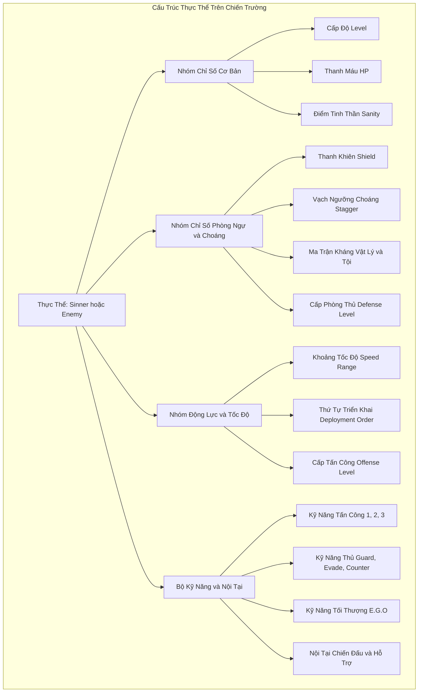
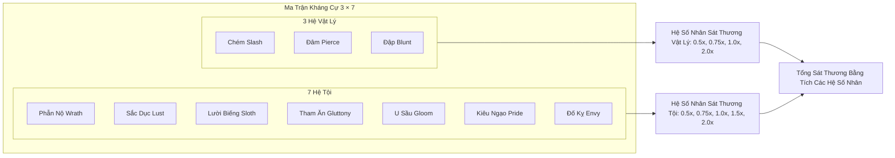
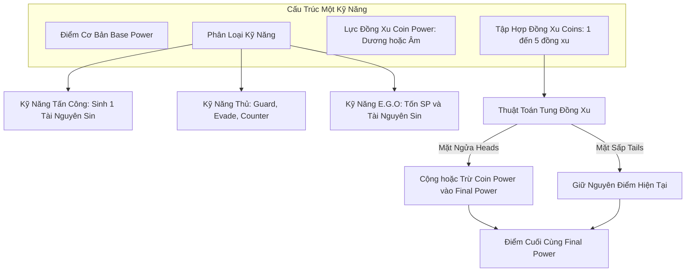
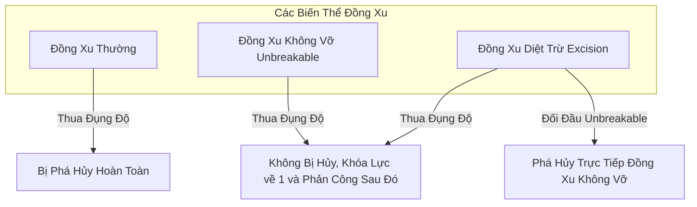
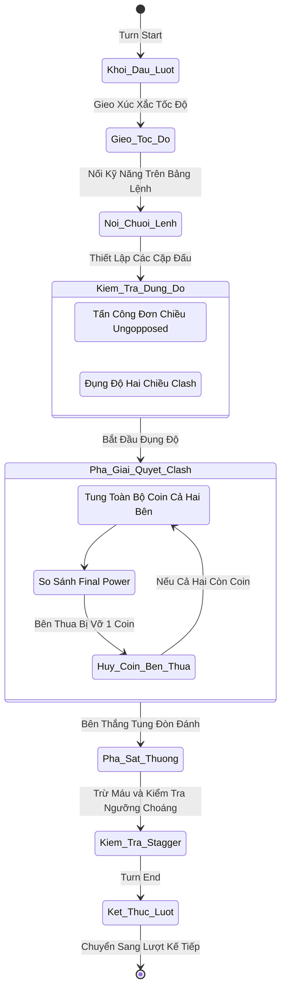
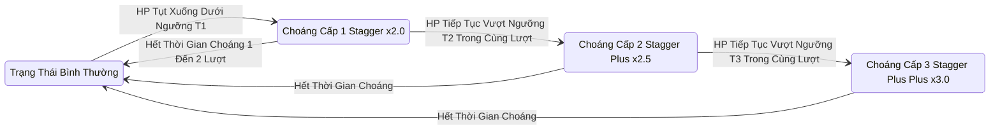
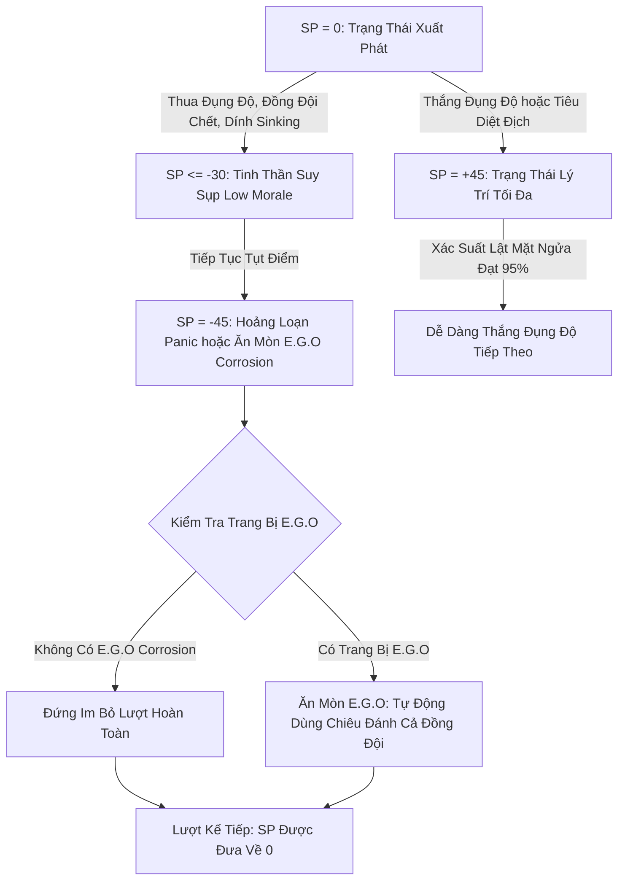
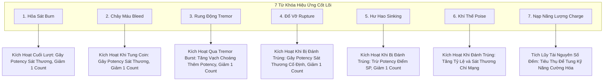
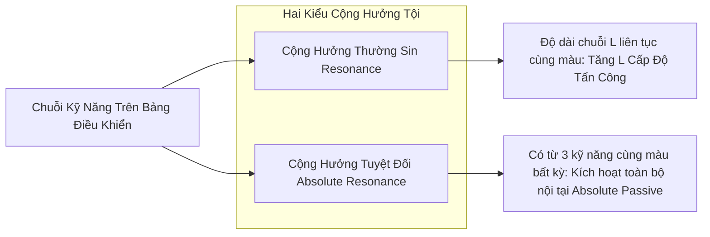
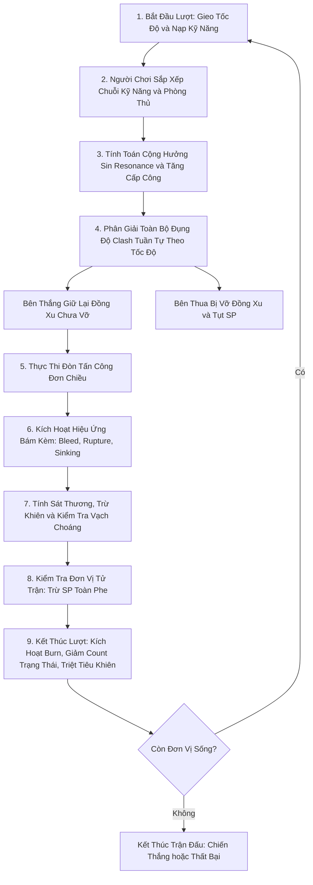

# Toàn Bộ Các Yếu Tố Gameplay Trong Limbus Company

> ### BẢN ĐỒ BÁCH KHOA CƠ HỌC GAMEPLAY (GAMEPLAY ELEMENTS ATLAS)
> * **Nguồn tham chiếu dữ liệu:** [Limbus Company Official Wiki (wiki.gg)](https://limbuscompany.wiki.gg/).
> * **Không gian nghiên cứu:** `docs/explorations/limbus-company-logical-space/`
> * **Mục đích:** Liệt kê đầy đủ, toàn diện mọi thực thể, chỉ số, cơ chế, trạng thái, công thức tính toán và vòng lặp vận hành trong Gameplay của Limbus Company.
> * **Phương thức trình bày:** Tối đa hóa sơ đồ trực quan (Mermaid Diagrams) và bảng cấu trúc logic, không lược bỏ bất kỳ yếu tố cơ học nào.

---

## 1. Cấu Trúc Thực Thể & Hệ Thống Chỉ Số (Unit & Stats Taxonomy)

Mọi nhân vật (Sinners), Kẻ địch (Enemies) và Dị Thể (Abnormalities) trên chiến trường đều được cấu tạo từ các nhóm thuộc tính sau:

---

### 1.1. Chi Tiết Các Chỉ Số Cốt Lõi

| Chỉ Số | Ký Hiệu | Khoảng Giá Trị | Cơ Chế Vận Hành Chi Tiết |
|---|---|---|---|
| **Cấp Độ (Level)** | $\text{Lvl}$ | $1 \to 65$ (Story) / $111$ (Dungeon) | Quyết định giá trị gốc của Máu tối đa, Cấp Tấn công và Cấp Phòng thủ cơ sở. |
| **Máu (Health)** | $HP$ | $[0, HP_{\max}]$ | Khi $HP = 0$, nhân vật tử trận hoặc rút lui. Công thức: $HP = \text{Base} + (\text{Mult} \times \text{Level})$. |
| **Khiên (Shield)** | $S$ | $\ge 0$ | Nhận sát thương trước $HP$, thừa hưởng kháng cự của chủ thể; tự hủy hoàn toàn ở cuối mỗi lượt. |
| **Tinh Thần (Sanity)** | $SP$ | $[-45, +45]$ | Tác động trực tiếp lên tỷ lệ mặt Ngửa của đồng xu: $P(\text{Heads}) = 50\% + SP\%$. |
| **Tốc Độ (Speed)** | $v$ | $[v_{\min}, v_{\max}]$ | Gieo xúc xắc ngẫu nhiên đầu mỗi lượt. Quyết định thứ tự hành động và quyền cưỡng bức đụng độ. |
| **Thứ Tự Triển Khai** | $\text{Order}$ | $1 \to 12$ | Cố định trong trận; ưu tiên nhận thêm slot hành động từ lượt 2 và phân xử điều kiện nội tại. |
| **Cấp Công (Offense)** | $\text{Off}$ | $\text{Level} + \text{Mod}$ | Mỗi 3 cấp chênh lệch so với đối thủ được $+1$ Clash Power; đồng thời khuếch đại sát thương ra. |
| **Cấp Thủ (Defense)** | $\text{Def}$ | $\text{Level} + \text{Mod}$ | Giảm sát thương nhận vào; dùng tính toán đụng độ cho kỹ năng phòng thủ. |
| **Vạch Choáng (Stagger)** | $T_{\text{stagger}}$ | $\%$ của $HP_{\max}$ | Các mốc phần trăm trên thanh máu; tụt qua vạch sẽ bị choáng, mất lượt và nhân đôi sát thương. |

---

## 2. Hệ Thống Kháng Cự Hai Lớp (Dual Resistance System)

Mọi sát thương gây ra trong game đều là phép tích hợp giữa **Hệ Vật Lý** và **Hệ Tội (Sin Affinity)**:

---

## 3. Hệ Thống Kỹ Năng & Cơ Học Đồng Xu (Skills & Coin Engine)

Kỹ năng là đơn vị hành động cơ bản, được vận hành qua thuật toán tung đồng xu:

---

### 3.1. Các Loại Đồng Xu Đặc Biệt

---

### 3.2. Phân Loại Kỹ Năng Phòng Thủ (Defense Skills)

1. **Khiên Thủ (Guard / Power Guard):**
   * Tung đồng xu tạo ra lượng khiên bảo vệ hấp thụ sát thương.
   * Biến thể *Clashable Guard*: có khả năng tham gia đụng độ trực tiếp.
2. **Né Tránh (Evade):**
   * Tung đồng xu đọ điểm với đòn tấn công của đối thủ.
   * Nếu điểm Né $>$ Điểm Đòn Đánh: Né hoàn toàn sát thương và **giữ lại đồng xu Né** cho các đòn tiếp theo trong lượt.
   * Nếu điểm Né $\le$ Điểm Đòn Đánh: Nhận đủ sát thương và mất đồng xu Né.
3. **Phản Đòn (Counter / Power Counter):**
   * Nhận sát thương từ đòn đánh đối thủ, sau đó tự động tung đòn phản công trả lại.

---

## 4. Vòng Lặp Lượt Đấu & Động Lực Đụng Độ (Turn Loop & Clash Dynamics)

Toàn bộ nhịp vận hành của một lượt đấu tuân theo cỗ máy trạng thái tuần tự:

---

### 4.1. Quy Luật Chuyển Hướng Đụng Độ (Clash Redirection)

* **Điều kiện Tốc độ:** Để chuyển hướng đòn tấn công của kẻ địch nhắm vào đồng đội, Sinner phải có $v_{\text{Sinner}} > v_{\text{Enemy}}$.
* **Ngoại lệ kỹ năng không thể đụng độ (Unclashable):** Một số kỹ năng đặc biệt không thể bị ép vào vòng đụng độ, luôn đi thẳng vào giai đoạn gây sát thương đơn phương.
* **Bù trừ kỹ năng thủ (Offset):** Khi kỹ năng phòng thủ chạm kỹ năng phòng thủ của đối phương, cả hai bị triệt tiêu không gây hiệu ứng.

---

## 5. Cơ Chế Choáng Phân Đoạn (Stagger State Transitions)

Trạng thái Choáng là điểm gãy sinh tồn then chốt trong cấu trúc trận đánh:

---

## 6. Hệ Thống Tinh Thần, Hoảng Loạn & Ăn Mòn E.G.O (Sanity & Corrosion Dynamics)

Sanity ($SP$) vận hành như một con lắc động lực quyết định sự kiểm soát lý trí:

---

## 7. Toàn Bộ 7 Hiệu Ứng Từ Khóa Trụ Cột (The 7 Archetype Keywords)

Mỗi từ khóa trạng thái hoạt động dựa trên cặp tọa độ hai tham số: $\mathbf{S} = (\text{Potency}, \text{Count})$.

---

### 7.1. Bảng Chi Tiết Thuật Toán Của 7 Hiệu Ứng

| Từ Khóa | Icon | Cơ Chế Kích Hoạt | Tác Động Lên Trục Chỉ Số | Quy Tắc Tiêu Hao |
|---|---|---|---|---|
| **Burn** | Hỏa Sát | Turn End | Trừ trực tiếp vào $HP$. | Count giảm 1 mỗi cuối lượt; nếu Count $= 0$, xóa Potency. |
| **Bleed** | Chảy Máu | Mỗi lần thực thể lật đồng xu tấn công | Trừ trực tiếp vào $HP$ trước khi đòn đánh diễn ra. | Count giảm 1 mỗi lần tung coin; nếu Count $= 0$, xóa Potency. |
| **Tremor** | Rung Động | Cần kỹ năng có hiệu ứng *Tremor Burst* | Dịch chuyển vạch ngưỡng Choáng $T_{\text{stagger}}$ lại gần mức máu hiện tại. | Potency dâng vạch; Count giảm 1 ở cuối lượt. |
| **Rupture** | Đổ Vỡ | Mỗi lần nhận đòn đánh trúng đích | Trừ trực tiếp vào $HP$ một lượng sát thương chuẩn cố định. | Count giảm 1 mỗi đòn trúng; nếu Count $= 0$, xóa Potency. |
| **Sinking** | Hư Hao | Mỗi lần nhận đòn đánh trúng đích | Trừ trực tiếp vào $SP$. Đối với quái không có $SP$, trừ vào $HP$ hệ Gloom. | Count giảm 1 mỗi đòn trúng; nếu Count $= 0$, xóa Potency. |
| **Poise** | Khí Thế | Khi thực thể tung đòn tấn công | Tỷ lệ chí mạng $= 5\% \times \text{Potency}$. Sát thương chí mạng $= +20\% + (2.5\% \times \text{Count})$. | Count giảm 1 khi chí mạng hoặc cuối lượt. |
| **Charge** | Tích Điện | Bị động tích lũy qua kỹ năng | Lưu trữ dung lượng năng lượng nội bộ (tối đa 20 Count). | Bị kỹ năng tiêu hao một lượng Count nhất định (ví dụ Rip Space tốn 10 Charge). |

---

## 8. Hệ Thống Đại Số Tội & Cơ Chế Cộng Hưởng (Sin Resonance Algebra)

Khi người chơi liên kết các kỹ năng trên bảng điều khiển, vị trí tô-pô của các màu sắc sinh ra hiệu ứng cộng hưởng:

---

## 9. Toàn Bộ Công Thức Toán Học Trong Gameplay (Mathematical Formulation)

### 9.1. Công thức Máu tối đa (Max HP)
$$\text{MaxHP} = \text{BaseHP} + (\text{Multiplier} \times \text{Level})$$

### 9.2. Công thức Xác suất lật mặt Ngửa (Heads Probability)
$$P(\text{Heads}) = \min\left(0.95, \max\left(0.05, 0.50 + \frac{SP}{100}\right)\right)$$

### 9.3. Công thức Cấp Công / Cấp Thủ và Điểm Đụng Độ
$$\Delta \text{Level} = \text{Offense Level} - \text{Defense Level}$$
* Trong đụng độ: Cứ mỗi $3$ điểm chênh lệch cấp công thủ, kỹ năng có cấp cao hơn được nhận thêm **$+1$ Clash Power**.

### 9.4. Công thức Hệ số Sát thương do Chênh lệch Cấp Độ
$$M_{\text{level}} = \frac{\text{Off} - \text{Def}}{|\text{Off} - \text{Def}| + 25} \times 100\%$$

### 9.5. Công thức Sát thương Tổng hợp của Một Đòn Đánh
$$\text{Damage} = \left\lfloor \text{FinalPower} \times R_{\text{Phys}} \times R_{\text{Sin}} \times \left(1 + \frac{M_{\text{level}}}{100}\right) \times K_{\text{Stagger}} \times K_{\text{Crit}} \right\rfloor$$
Trong đó:
* $\text{FinalPower}$: Điểm sức mạnh kỹ năng sau khi lật toàn bộ đồng xu.
* $R_{\text{Phys}}$: Hệ số kháng cự vật lý (Slash / Pierce / Blunt), nhận giá trị $\{0.5, 0.75, 1.0, 2.0\}$.
* $R_{\text{Sin}}$: Hệ số kháng cự Tội (Wrath ... Envy), nhận giá trị $\{0.5, 0.75, 1.0, 1.5, 2.0\}$.
* $K_{\text{Stagger}}$: Hệ số nhân trạng thái choáng, nhận giá trị:
  * Không choáng: $1.0$
  * `Stagger`: $2.0$
  * `Stagger+`: $2.5$
  * `Stagger++`: $3.0$
* $K_{\text{Crit}}$: Hệ số sát thương chí mạng (nếu kích hoạt Poise): $1.2 + (0.025 \times \text{Count}_{\text{Poise}})$.

---

## 10. Bản Đồ Tổng Lực Vận Hành Core Gameplay (Master Loop Diagram)

