# Branch Memory: Không Gian Logic Limbus Company

> **Phạm vi lưu trữ:** Bộ nhớ riêng của Nhánh Nghiên Cứu `docs/explorations/limbus-company-logical-space/`.  
> **Ngày khởi tạo:** 2026-10-16.  
> **Nguyên tắc:** Kế thừa Lý thuyết Không Gian Logic Gốc ($\mathcal{G} = \langle \mathcal{S}, \mathcal{A}, \hat{\mathbb{O}}, \Omega \rangle$), không làm biến dạng Base Theory.

---

## 1. Bản Đồ Trực Quan Hóa Hệ Thống

```mermaid
flowchart TD
    subgraph Limbus_Combat_Architecture ["Kiến Trúc Core Combat Limbus Company"]
        subgraph State_Space ["1. Không Gian Trạng Thái S"]
            SinPool["Kho 7 Tội: R_Sin thuộc N7"]
            LifeState["Sinh Mệnh: HP, Shield, Cấp Choáng Normal, Stagger 1-3"]
            SanityState["Tinh Thần: SP từ -45 đến +45, Panic, Corrosion"]
            StatusField["Trường 7 Từ Khóa: 14 Chiều Potency và Count"]
            DeckState["Túi Bài Skill Deck: Thẻ Kỹ Năng Còn Lại"]
        end

        subgraph Action_Space ["2. Không Gian Hành Động A"]
            PickSkill["Chọn Thẻ Chiêu: Chiêu 1, 2, 3 hoặc Thủ"]
            AssignTarget["Ghép Cặp Mục Tiêu: Cung Nối Giữa Các Slot"]
            OrderColor["Sắp Xếp Chuỗi Màu Sin"]
            UseEGO["Kích Hoạt E.G.O: Tốn SP và Nạp Tài Nguyên"]
        end

        subgraph Operator_Pipeline ["3. Chuỗi 7 Toán Tử Chuyển Trạng Thái O"]
            O1["O_Speed: Gieo Tốc Độ Xúc Xắc"]
            O2["O_Resonance: Tính Toán Chuỗi Màu Cộng Hưởng"]
            O3["O_Clash: Giải Quyết Đụng Độ Bằng Xích Markov Đồng Xu"]
            O4["O_Damage: Tính Sát Thương Thực Tế và Bẻ Vạch Choáng"]
            O5["O_Modulation: Phản Hồi Điều Chế Tinh Thần SP"]
            O6["O_Status: Kích Nổ Bleed, Rupture, Tremor, Sinking"]
            O7["O_TurnEnd: Sát Thương Burn, Triệt Tiêu Khiên, Rút Thẻ Mới"]
        end

        subgraph Termination ["4. Không Gian Ranh Giới Omega"]
            WinCondition["Chiến Thắng: Toàn Bộ Kẻ Địch Tử Trận"]
            DefeatCondition["Thất Bại: Toàn Bộ Sinners Tử Trận hoặc Vượt 100 Lượt"]
        end
    end

    State_Space --> Operator_Pipeline
    Action_Space --> Operator_Pipeline
    Operator_Pipeline --> State_Space
    State_Space --> Termination
```

---

## 2. Toàn Bộ Các Thành Phần Đã Bóc Tách

### 2.1. Không Gian Trạng Thái ($\mathcal{S}$)
1. **Kho Tài Nguyên Sin Toàn Phe ($\vec{R}_{\text{Sin}} \in \mathbb{N}^7$):** Wrath, Lust, Sloth, Gluttony, Gloom, Pride, Envy. Bảo toàn qua các lượt.
2. **Tọa Độ Sinh Mệnh & Choáng:** $HP \in [0, HP_{\max}]$, $S \ge 0$, $\text{StaggerState} \in \{\text{Normal}, \text{Stagger}, \text{Stagger+}, \text{Stagger++}\}$.
3. **Tọa Độ Tinh Thần:** $SP \in [-45, +45]$. Tại $-45$ kích hoạt biên hấp thụ hoảng loạn (Panic) hoặc ăn mòn E.G.O (Corrosion).
4. **Trường Từ Khóa 14 Chiều:** Cặp $(\text{Potency}, \text{Count}) \in \mathbb{N}^2$ của 7 từ khóa: Burn, Bleed, Tremor, Rupture, Sinking, Poise, Charge.
5. **Trạng Thái Túi Thẻ (Deck State):** Số lượng thẻ còn lại trong chu kỳ nạp bài.

### 2.2. Không Gian Hành Động ($\mathcal{A}$)
1. Lựa chọn thẻ kỹ năng trên tay (Attack 1/2/3, Defense Guard/Evade/Counter, E.G.O Awakening/Corrosion).
2. Phân bổ cung ghép cặp (Targeting Arcs) và thứ tự ưu tiên tốc độ để chuyển hướng đụng độ (Clash Redirection).
3. Sắp xếp chuỗi liên tục cùng màu để tối ưu hóa Sin Resonance ($L$ cấp công) và Absolute Resonance ($\ge 3$ cùng màu).

### 2.3. Hệ 7 Toán Tử Phân Giải Lượt ($\hat{\mathbb{O}}$)
1. $\hat{\mathcal{O}}_{\text{Speed}}$: Gieo xúc xắc $[v_{\min}, v_{\max}]$, xác lập thứ tự bán phần.
2. $\hat{\mathcal{O}}_{\text{Resonance}}$: Quét mảng chuỗi màu $\implies$ Tăng cấp công $\Delta \text{Off} = L$, mở khóa nội tại.
3. $\hat{\mathcal{O}}_{\text{Clash}}$: Đọ điểm $P = P_{\text{base}} + \sum P_{\text{coin}} + \lfloor \Delta \text{Level} / 3 \rfloor$, phá hủy coin bên thua, bên thắng nhận quyền tấn công.
4. $\hat{\mathcal{O}}_{\text{Damage}}$: Nhân hệ số kháng kép (Vật lý $\times$ Tội) và chênh lệch cấp công thủ $\implies$ Trừ khiên/máu, nhảy bậc Stagger nếu tụt qua ngưỡng.
5. $\hat{\mathcal{O}}_{\text{Modulation}}$: Thắng $+SP$, Thua $-SP$, dính Sinking $-SP$.
6. $\hat{\mathcal{O}}_{\text{Status}}$: Kích nổ sát thương Bleed/Rupture, nâng vạch Stagger bằng Tremor, trừ SP bằng Sinking, trừ 1 Count mỗi lần kích hoạt.
7. $\hat{\mathcal{O}}_{\text{TurnEnd}}$: Sát thương Burn cuối lượt, trừ 1 Count các hiệu ứng theo lượt, xóa toàn bộ khiên, rút bài mới.

---

## 3. Kiến Trúc Đa Tầng Của Game Hoàn Chỉnh

* **Tầng 1 (Core Combat Loop):** Mô hình hóa ở trên, chạy ở tần số cao (~từng lượt).
* **Tầng 2 (Dungeon / Roguelike Space):** Mirror Dungeons, Refraction Railway, E.G.O Gifts (đóng vai trò Meta-Operators biến đổi luật của Tầng 1).
* **Tầng 3 (Roster / Meta-Progression Space):** Hệ thống Identity, Cấp độ, Uptie I–IV, Threadspin I–IV, Support Passives từ ghế dự bị.
* **Tầng 4 (Macro Economy Space):** Enkephalin $\to$ Modules, Lunacy, Gacha Extraction, Egoshards & Dispenser, Battle Pass.

---

## 4. Các Tài Liệu Cốt Lõi Của Nhánh

1. [`Khong-Gian-Logic-Core-Gameplay-Limbus-Company.md`](../Khong-Gian-Logic-Core-Gameplay-Limbus-Company.md) — Phân rã cấu trúc chuẩn tắc $\langle \mathcal{S}, \mathcal{A}, \hat{\mathbb{O}}, \Omega \rangle$.
2. [`Toan-Bo-Cac-Yeu-To-Gameplay-Limbus-Company.md`](../Toan-Bo-Cac-Yeu-To-Gameplay-Limbus-Company.md) — Bách khoa 9 sơ đồ cơ học chi tiết và công thức tính toán.
3. [`playbook-limbus-combat-analysis.md`](playbook-limbus-combat-analysis.md) — Quy trình 5 module mô hình hóa toán học cơ học chiến đấu Limbus Company.

