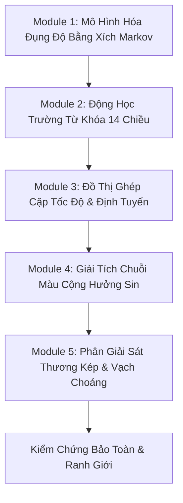

# Playbook: Quy Trình Phân Tích & Mô Hình Hóa Toán Học Cơ Học Limbus Company

> **Phạm vi:** Playbook cấp Branch Nghiên Cứu (`docs/explorations/limbus-company-logical-space/`).  
> **Kế thừa từ:** Universal Playbook [playbook-decompose-game-to-logical-space.md](../../../../.cursor/playbooks/playbook-decompose-game-to-logical-space.md).  
> **Đối tượng:** Hệ thống giao tranh theo lượt (Core Combat Loop - Tầng 1) của Limbus Company.

---

## 1. Mục Đích & Điều Kiện Kích Hoạt

Sử dụng playbook này khi:
1. Cần lập trình mô phỏng (combat simulator) hoặc giải mã xác suất thắng thua trong giao tranh Limbus Company.
2. Cần phân tích độ cân bằng toán học (balance math) giữa các Identity, E.G.O, hoặc thiết kế kẻ địch mới.
3. Cần chuyển đổi cơ chế wiki sang mã máy giả lập không rác rưởi.

---

## 2. Quy Trình 5 Module Mô Hình Hóa

---

### Module 1: Mô Hình Hóa Đụng Độ (Clash) Bằng Xích Markov Hấp Thụ

* **Mục tiêu:** Tính toán chính xác kỳ vọng và phân phối xác suất bên thắng trong một pha đụng độ giữa Kỹ năng $A$ và Kỹ năng $B$.
* **Các bước chuẩn hóa:**
  1. **Xác định xác suất ngửa đồng xu:**
     $$P(\text{Heads}) = 0.5 + \frac{SP}{100}, \quad SP \in [-45, +45]$$
  2. **Không gian trạng thái Markov:** Cặp $(c_A, c_B)$ biểu thị số đồng xu hiện còn của Skill $A$ và Skill $B$.
  3. **Trạng thái hấp thụ:**
     * Thắng: $(c_A, 0)$ (Skill $B$ hết đồng xu).
     * Thua: $(0, c_B)$ (Skill $A$ hết đồng xu).
  4. **Tính điểm đụng độ tại mỗi vòng gieo:**
     $$P = P_{\text{base}} + \sum_{i=1}^{c} (\text{CoinValue} \times \mathbb{I}_{\text{Heads}}) + \left\lfloor \frac{\text{OffenseLevel}_A - \text{OffenseLevel}_B}{3} \right\rfloor$$
  5. **Quy tắc chuyển tiếp:**
     * Nếu $P_A > P_B$: Chuyển sang trạng thái $(c_A, c_B - 1)$.
     * Nếu $P_A < P_B$: Chuyển sang trạng thái $(c_A - 1, c_B)$.
     * Nếu $P_A = P_B$ (Hòa): Giữ nguyên $(c_A, c_B)$, tăng biến đếm số vòng hòa (sau 99 vòng hòa tự động hủy).
  6. **Đầu ra:** Xác suất hấp thụ $\mathbb{P}(A \text{ thắng})$ và số đồng xu kỳ vọng còn lại của $A$ để thực hiện chuỗi tấn công sau đụng độ.

---

### Module 2: Động Học Trường Từ Khóa 14 Chiều (14D Status Kinetics)

* **Mục tiêu:** Mô hình hóa chính xác sự suy hao và kích nổ của 7 cặp hiệu ứng $(\text{Potency}, \text{Count})$.
* **Các bước phân loại cơ chế:**
  1. **Nhóm Kích Nổ Theo Đòn Đánh (On-Hit Trigger):**
     * **Bleed (Chảy máu):** Khi mục tiêu gieo đồng xu trong tấn công hoặc đụng độ $\implies$ Nhận sát thương cố định bằng $\text{Potency}$, $\text{Count} \leftarrow \text{Count} - 1$.
     * **Rupture (Nứt toác):** Khi mục tiêu nhận đòn đánh $\implies$ Nhận sát thương chuẩn bằng $\text{Potency}$, $\text{Count} \leftarrow \text{Count} - 1$.
  2. **Nhóm Tác Động Lên Vạch Tinh Thần & Trạng Thái Choáng:**
     * **Tremor (Rung chấn):** Khi bị kích nổ bởi kỹ năng có hiệu ứng *Tremor Burst* $\implies$ Dời vạch ngưỡng Stagger về phía trước một đoạn đúng bằng $\text{Potency}$. Nếu vượt qua HP hiện tại $\implies$ Lập tức rơi vào trạng thái Stagger.
     * **Sinking (Chìm đắm):** Khi nhận đòn đánh $\implies$ Trừ $SP$ một lượng bằng $\text{Potency}$, $\text{Count} \leftarrow \text{Count} - 1$. (Đối với dị thể không có $SP$, chuyển thành sát thương Tinh thần vào HP).
  3. **Nhóm Tích Lũy Bản Thân (Self-Buff Kinetics):**
     * **Poise (Thế công):** Xác suất bạo kích $= 5\% \times \text{Potency}$. Sát thương bạo kích $+20\%$. Khi bạo kích thành công $\implies \text{Count} \leftarrow \text{Count} - 1$.
     * **Charge (Tích điện):** Đóng vai trò nhiên liệu $\text{Count} \in [0, 20]$. Kỹ năng tiêu hao $k$ Count để kích hoạt hiệu ứng tối thượng. Cuối lượt tự nhiên suy hao 1 Count.
  4. **Nhóm Phân Rã Cuối Lượt (End-of-Turn Decay):**
     * **Burn (Bỏng):** Gây sát thương bằng $\text{Potency}$ ở cuối lượt, sau đó $\text{Count} \leftarrow \text{Count} - 1$.

---

### Module 3: Đồ Thị Ghép Cặp Tốc Độ & Định Tuyến (Speed Bipartite Matching)

* **Mục tiêu:** Xác định cấu trúc đồ thị tương tác có hướng giữa các Slot hành động của Sinner và Kẻ địch.
* **Các bước giải thuật:**
  1. **Gieo tốc độ:** Mỗi slot gieo số nguyên ngẫu nhiên $v \in [v_{\min}, v_{\max}]$.
  2. **Thiết lập mục tiêu mặc định:** Kẻ địch tự động nối cung mục tiêu sang các Slot của Sinner.
  3. **Điều kiện chuyển hướng đụng độ (Clash Redirection):**
     * Sinner slot $i$ có tốc độ $v_i$.
     * Kẻ địch slot $j$ có tốc độ $v_j$ đang nhắm vào Sinner slot $k$.
     * Sinner $i$ chỉ được phép cướp đụng độ (ép slot $j$ giao tranh với $i$) nếu và chỉ nếu:
       $$v_i > v_j$$
     * Nếu $v_i \le v_j$, đòn đánh của Sinner $i$ biến thành đòn đánh một chiều (One-sided Attack) diễn ra sau khi slot $j$ hành động.

---

### Module 4: Giải Tích Chuỗi Màu Cộng Hưởng Sin (1D Color Sequence)

* **Mục tiêu:** Tính toán phần thưởng từ việc xâu chuỗi kỹ năng trên thanh lệnh điều khiển.
* **Các bước xử lý chuỗi:**
  1. Biểu diễn chuỗi kỹ năng đã chọn dưới dạng vector màu:
     $$\vec{C} = [s_1, s_2, \dots, s_n], \quad s_i \in \{1, 2, \dots, 7\}$$
  2. **Sin Resonance (Cộng hưởng thường):**
     * Đếm tổng số thẻ có màu $k$ xuất hiện trong chuỗi: $N_k$.
     * Cấp công cộng thêm cho các thẻ mang màu $k$: $\Delta \text{Off} = N_k$.
  3. **Absolute Resonance (Cộng hưởng tuyệt đối):**
     * Tìm đoạn con liên tiếp dài nhất có cùng màu: $L_{\max} = \max \text{length}(s_i = s_{i+1} = \dots)$.
     * Nếu $L_{\max} \ge 3$: Kích hoạt toàn bộ nội tại nhánh Absolute Sin của các bản thể liên quan. Cấp công cộng thêm: $\Delta \text{Off} = L_{\max} \times 1.5$.

---

### Module 5: Phân Giải Sát Thương Kép & Vạch Choáng (Damage & Stagger Engine)

* **Mục tiêu:** Ánh xạ từ điểm sát thương cơ sở sang biến động thực tế của $HP$ và trạng thái $\text{StaggerState}$.
* **Công thức phân giải:**
  $$\text{Damage} = \text{BaseDamage} \times M_{\text{Physical}} \times M_{\text{Sin}} \times \left(1 + \frac{\text{OffenseLevel} - \text{DefenseLevel}}{25 + |\text{OffenseLevel} - \text{DefenseLevel}|}\right)$$
* **Thuật toán bẻ vạch Choáng:**
  1. Trừ máu theo thứ tự: $\text{Shield} \to HP$.
  2. Kiểm tra giao cắt vạch:
     * Nếu $HP$ tụt qua vạch Stagger 1 $\implies \text{StaggerState} \leftarrow \text{Stagger}$ (Sát thương nhận vào $\times 2.0$, mất lượt hiện tại và lượt tiếp theo).
     * Nếu tụt tiếp qua vạch Stagger 2 $\implies \text{StaggerState} \leftarrow \text{Stagger+}$ (Kháng toàn bộ đổi thành Fatal $\times 2.0$).
     * Nếu tụt qua vạch Stagger 3 $\implies \text{StaggerState} \leftarrow \text{Stagger++}$.
  3. Khi ở trạng thái Stagger, phòng thủ đưa về 0, tốc độ gieo bằng 0.

---

## 3. Tiêu Chí Nghiệm Thu Mô Hình (Verification Gate)

Một bản mô phỏng hoặc phân tích cơ học Limbus Company chỉ đạt chuẩn khi:
1. **Kiểm tra Bảo Toàn Tội:** Tổng tài nguyên Sin $\vec{R}_{\text{Sin}}$ sau lượt $t$ phải bằng $\vec{R}_{\text{Sin}}(t-1) + \text{Generated} - \text{Consumed}$. Không được tự sinh biến mất.
2. **Kiểm tra Biên Tinh Thần:** $SP$ luôn bị kẹp chặt trong khoảng $[-45, +45]$. Tại $-45$, bắt buộc chuyển pha sang Panic hoặc E.G.O Corrosion.
3. **Kiểm tra Tính Độc Lập:** Không bao giờ định nghĩa các bộ tính toán (như Clash Resolver hay Damage Formula) là các trục của $\mathcal{S}$.
