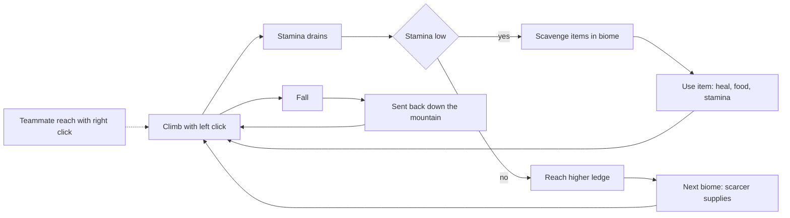

# PEAK — Logical Space Analysis (reference game)

> **Game:** PEAK, co-op climbing game by Aggro Crab and Landfall, released 2025. Reference case for core-first analysis (Base Theory L18, proposed).
> **Revision:** 2026-11-19, draft from public reviews. Not a full decomposition; the game's internals are not public.
> **Comparison:** [A Fishing Night vs PEAK](../peak-vs-fishing-night/README.md)

**Status:** P0 reconstructed from reviews, core loop identified. No detector run, no playtest by us. Sales figures are press-reported and do not validate the design (L9, L11).

**Source limits:** Steam store page fetch failed; GDC 2026 talk PDF was not readable (binary); one review fetch was truncated. Ropes, spikes, weight, helicopter and respawn rules are either absent from the sources or only in search snippets, and are marked unconfirmed below.

---

## 1. Core loop (what a run repeats)

The loop is one meter (merged stamina and health), one resource decision (which item, when), and one social verb (pull a teammate up). Everything else is terrain.

---

## 2. Vocabulary V (from sources)

| Type | Role | Source |
|---|---|---|
| Player climber | Basis; own stamina max, which varies with status | GamingOnLinux review |
| Merged stamina and health bar | Basis for resource; drained by hunger, cold, poison, weight, falls | Final Weapon review, GamingOnLinux review |
| Items (3 hand slots, 4 backpack slots) | Basis with config: heal, food, stamina refill | Final Weapon review |
| Biome: Shore, Tropics, Alpine, Caldera, Kiln | Basis for hazard and supply tables | Final Weapon review |
| Hazard: vines, rain, cold, poison, fire | Operator outputs on the stamina bar | Final Weapon review |
| Route | Derived: generated per island, regenerates every 24 hours | Final Weapon review, GamingOnLinux review |
| Badges and cosmetics | Progression across sessions | GamingOnLinux review |
| Proximity voice | Y (social) | Final Weapon review |

Unconfirmed: ropes and spikes (search snippet only).

---

## 3. State, actions, operators, boundary

- **S:** each climber's stamina, hunger, health, status, inventory, position; the island's routes and biome state; fall state.
- **A:** climb, reach, pull a teammate, use item, interact, drop or catch a teammate.
- **O:** stamina resolver (drains from hunger, cold, weight, hazards; refills from items); climb resolver (stamina gates climbing); fall resolver (send back down); rescue resolver (teammate pull and catch, limited by the helper's own stamina max).
- **Ω:** summit reached (win, per reviews); fall or death; end of session (unconfirmed).

---

## 4. Observation Y

- One merged bar shows the whole survival state. The reviewer's point is that it compresses everything into one number (L17 pattern).
- Proximity voice gives social signal.
- Route variety is seen only by climbing.

---

## 5. Core, supporting, progression, polish (first pass, core-first)

| Class | Elements | Why |
|---|---|---|
| **Core** | Merged stamina bar; items as stamina decisions; teammate pull and catch; falls | These form the loop in section 1. Remove stamina and the climb has no cost. Remove rescue and co-op is only parallel solo climbing. |
| **Supporting** | Biome hazards (vines, rain, cold, poison, fire); supply scarcity by height; dead-end routes | Each shapes which items the player needs and when. Loop runs without any single one. |
| **Progression** | Daily island regeneration; badges and cosmetics | Keeps repeat sessions fresh (L15 pattern: emergence supplies, progression curates). |
| **Polish** | Proximity voice muffling; chaos from accidental knock-offs; cosmetics | Adds comedy. Reviewers cite it, but the loop does not depend on it. |

### Ablation predictions (reading-based, not tested)

| Remove | Predicted loop result | Class |
|---|---|---|
| Merged stamina bar | No cost to climbing; no decision | Core |
| Items | Stamina cannot be refilled; climb becomes binary | Core |
| Teammate pull | Co-op loses rescue; solo is harder but still a loop (reviewer: solo is less engaging) | Core for co-op |
| Biome hazards | Fewer pressures; loop runs | Supporting |
| Daily regeneration | Routes repeat; loop runs | Progression |
| Badges | Less long-term pull; loop runs | Progression |
| Proximity voice | Less comedy; loop runs | Polish |

---

## 6. Why it works (from reviews, not our measurement)

- Simple mechanics pushed far (GamingOnLinux review).
- One merged meter creates constant resource tradeoffs.
- Uneven stamina between players creates both cooperation and comedy.
- Procedural islands keep attempts fresh.
- Reviewer drawbacks: random routes frustrate some players; crashes; controller support awkward.

These are reviewer claims. Commercial success is not evidence of the design working (L11); it could come from marketing, price, timing or co-op comedy.

---

## 7. Gates (for the Peak analysis)

| Gate | Status |
|---|---|
| P0 reconstructed | Done from reviews; targets not declared by developers |
| P1 decomposition | Partial (sections 2 and 3) |
| P2 to P6 | Not run; no source access to game internals |
| P7 | Not run |

---

## 8. Sources

- [Final Weapon review, 9 July 2025](https://finalweapon.net/2025/07/09/peak-review-pc-steam/): core loop, stamina, items, biomes, co-op, falls.
- [GamingOnLinux, July 2025](https://www.gamingonlinux.com/2025/07/co-op-climbing-game-peak-is-a-truly-great-time-with-friends): merged stamina, co-op roles, badges, daily islands, why it works.
- Co-optimus review (search snippet only, not fetched): [link](https://www.co-optimus.com/blog/article-poster/3381/five-dollars-one-mountain-and-a-masterclass-in-co-op.html). Not used for any claim here.
- [PC Gamer, 29 Dec 2025](https://www.pcgamer.com/games/adventure/peak-shows-you-dont-need-horror-or-quirky-party-games-to-be-one-of-the-best-co-ops-in-years/): headline only, body truncated.
- [ExitLag wiki](https://www.exitlag.com/blog/peak-game-wiki-guide/): marketing content, not used for design claims.
- Not read: [GDC 2026 talk, Zac Millman](https://media.gdcvault.com/gdc2026/GNR/Papers/Zac+Millman+-+GDCReview_2026_Peak_Millman.pdf) (binary, unreadable through this tool). Steam store page: connection reset.

---

## 9. Questions for the owner

1. Read the GDC talk yourself (or paste text), to confirm the design goals and any rope and spike mechanics.
2. Is Peak's core the stamina decision or the rescue? The reviews point to both.
3. Confirm the Peak sources are enough for a reference case, or do we need the developer's own statements?
