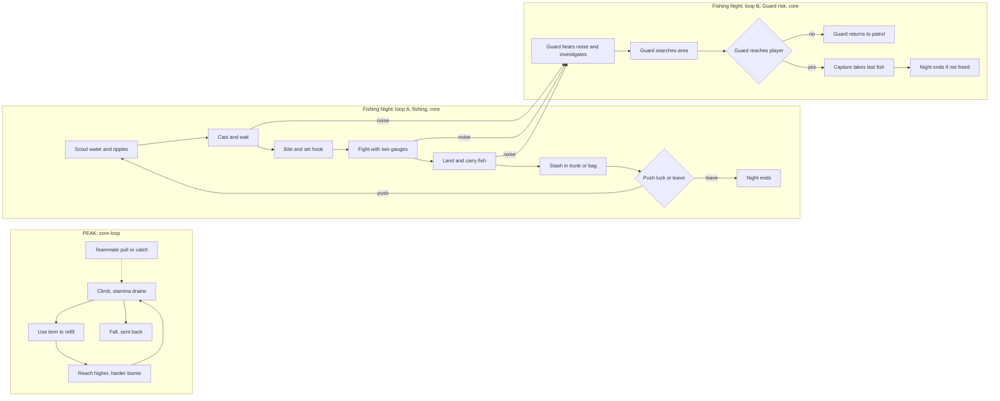

# PEAK vs A Fishing Night — Core-First Comparison

> **Compares:** [PEAK analysis](../peak-logical-space/README.md) (reviews only) and [A Fishing Night spec](../../../../SleepWithTheFish/HtmlDemo/TheFishingNight/docs/2026-11-19-fishing-night-logical-space.md) (our own game, section 0 core loop).
> **Revision:** 2026-11-19, draft. Discussion aid, not a conclusion. Both games' core splits are predictions by reading, not tested.

---

## 1. Loops side by side

Both Fishing Night loops are in this one frame, next to PEAK for comparison. The noise arrows are the only system link from loop A to loop B.

PEAK's loop is about a body against a mountain. Fishing Night's loop is about a body against a watcher. PEAK has no second core loop: its only hazard is the mountain, and the teammate rescue acts on the same climb, not on a separate state.

---

## 2. Comparison table

| Dimension | PEAK | A Fishing Night | Note |
|---|---|---|---|
| Core verb | Climb | Cast and fight | Different skill axis |
| Tension source | Stamina bar draining | Guard hearing noise | PEAK pressure is physical; ours is social-stealth |
| Resource | One merged meter (stamina and health) | Two fight gauges plus quota | PEAK compresses; we split |
| Decision | Which item, when | Stash or push luck; where to cast | Both are one-line choices |
| Co-op role | Pull up, catch falls, share supplies | Chain-pull heave, free captured teammate | Both are rescue, different mechanism |
| Failure | Fall, sent back down | Captured, tied, night ends unless freed | Ours is harsher and has a timer |
| World | Procedural, regenerates every 24 h | Hand-made map, fixed layout | PEAK varies routes; we teach routes |
| Progression | Badges and cosmetics across sessions | Quota per night, key chain order, 02:00 backup | Ours curates inside the night (L15) |
| Hidden state | Little reported | Guard `detect` hidden | PEAK has no hidden-danger problem |
| Y clarity | One bar shows everything | Gauges show fish and line; Guard state needs reading | Gap in ours (G4) |

---

## 3. Core split side by side (predictions)

| Class | PEAK | A Fishing Night |
|---|---|---|
| Core | Merged stamina; items; teammate pull; falls | Noise bus; Guard hearing; fight resolver; carry and stash; quota; Y for gauges and Guard behaviour |
| Supporting | Biome hazards; supply scarcity; dead-end routes | Fence and gate; lamps and electric box; key chain; bushes; throws (decoy); traps |
| Progression | Daily regeneration; badges | Quota card; key order; 02:00 backup; ambush |
| Polish | Proximity voice; accidental knock-offs | Carry and slap animation; rag-doll fish; heave feel |

Both games put the core in a few operators and treat variety and pacing as progression. Fine.

---

## 4. What each game can learn from the other

**For Fishing Night (from PEAK):**

1. **Compress to one signal (L17).** PEAK's merged bar means the player always reads survival at a glance. Our Guard `detect` is hidden. Test a single directional Guard signal (sound, light or pulse) before we add numbers. This is the strongest lesson.
2. **Each player's capability differs.** PEAK gives each climber a different stamina max, which creates both cooperation and comedy. We already have per-character stats (heavy +15% pull, slim the reverse, `CONFIG.characters`), but they are small and not shown to teammates. Test whether a visible capability gap, like PEAK's stamina bar per player, changes co-op behaviour.
3. **Regeneration vs teaching.** PEAK's daily islands keep runs fresh. We have a hand-made map so routes are learnable (L15). If replay matters later, a seeded variant of the lake layout is a candidate. Not now.

**For PEAK (from Fishing Night):**

1. **Fear through a hidden actor.** Our design relies on a hidden agent that reacts to sound. PEAK's danger is visible physics. Different tension source; not a direct copy, but worth knowing that PEAK gets tension without any hidden state.
2. **Run goal is explicit.** PEAK's goal is the summit, which the reviews state plainly. Our goal is a quota per night. Both are simple; check that ours is as readable in Y (the intro card and HUD show it).

---

## 5. Caution on success

PEAK's sales are large (press-reported), but commercial success does not validate its design (L9, L11). We should not borrow PEAK's loop because it sold well. We should borrow the mechanism (one merged signal) only after testing it in our own game.

---

## 6. Open questions

1. Is one merged Guard signal enough for the player to read stealth risk, or do we lose the horror? Test in playtest.
2. Should our co-op players have asymmetric stats, like PEAK? It adds comedy but changes the fight balance.
3. Do we want routes to vary per night? That is a progression choice (L15), not a core change.
4. After reading the GDC 2026 talk (not yet readable here), check whether PEAK's developers name a core loop or core pillars. Their claim would beat our inference.

---

## 7. Sources

- PEAK review sources: see [PEAK analysis, section 8](../peak-logical-space/README.md#8-sources).
- Fishing Night: [A Fishing Night spec, section 0](../../../../SleepWithTheFish/HtmlDemo/TheFishingNight/docs/2026-11-19-fishing-night-logical-space.md).
