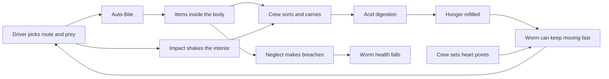
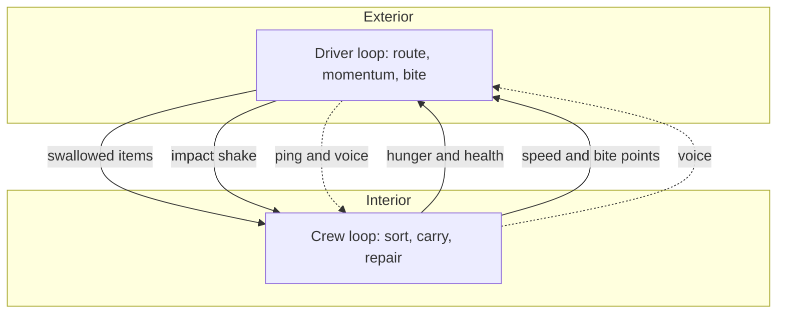
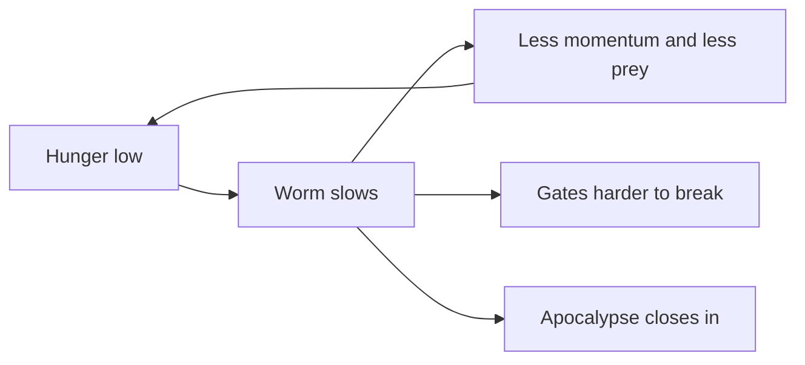

# Co-op Sandworm Survival: Research Document (Logical Space v0.3.1)

> **Status:** Research draft, 2026-11-26. Awaiting owner review. No code, no simulation, no playtest.
> **Source design:** `C:\Users\Hung\Downloads\system_design_portable.html` ("System Design Document: Co-op Sandworm Survival", Vietnamese, with two interactive demos). The file is outside this repository.
> **Method:** [Base Theory v0.3.1](../../theory/Logical-Space-Base-Theory.md) and the [playbook](../../../.cursor/playbooks/playbook-decompose-game-to-logical-space.md). L18 to L21 and I7 are provisional.
> **Isolation:** The basis below is derived from this design only. Method lessons from the playbook are reused; no state axis comes from another case.
> **Marking:** **S** = stated in the source design. **P** = proposal by the assistant. **F-n** = finding. **Q-n** = open question for the owner.

---

## 0. Summary

**Idea.** Four to five players run a giant sandworm from point A to point B ahead of an apocalypse. One Driver steers it and sees the outside. Three or four Crew work inside its body: sort what it swallows, feed the acid stomach, patch holes, fight intruders, allocate heart energy and craft tools.

**Assessment.** The strongest part is a closed two-way loop: what the Driver bites becomes the Crew's work, and what the Crew does becomes the Driver's speed, bite strength and survival. That is a real candidate for loop coupling (I7). The design is detailed on *what exists* and thin on *rates*: hunger drain, food value, breach damage, spawn rate and acid capacity have no numbers, so balance cannot be judged yet.

**Fix or decide before prototyping:**

| Priority | Finding | Section |
|---|---|---|
| 1 | Acid pit capacity is undefined. It decides whether hammering is worth doing at all | F-1 |
| 2 | Low hunger can feed on itself: slower worm, less food, lower hunger | F-2 |
| 3 | Ejecting surplus inorganic through the rear may dominate processing it | F-3 |
| 4 | Periscope and mini-anatomy for the Driver weaken the information-asymmetry pillar | F-4 |
| 5 | Two-person carry gives less total throughput than two solo carriers | F-5 |

---

## 1. The Design As Stated (S)

### 1.1 Concept and pillars

| Item | Content |
|---|---|
| Genre | Chaotic co-op, 4 to 5 players |
| References named | Barotrauma, Lovers in a Dangerous Spacetime, Death Worm |
| View | Interior 3D isometric with physics; exterior 2D side-scroller |
| Goal | Reach point B before the apocalypse |
| Pillar 1 | Information asymmetry: Driver is blind inside, Crew is blind outside, so they must talk |
| Pillar 2 | Inertia and hunger economy: dive to build momentum, surface to spend it; evolution raises hunger drain |
| Pillar 3 | Living dungeon: the body can be holed, invaded, and shaken by the Driver's impacts |

### 1.2 Exterior

| Element | Rule |
|---|---|
| Steering | WASD or arrows, limited turn radius; a longer worm turns wider |
| Momentum | Deep dive builds it; leap follows a parabola; nose-first re-entry keeps it; belly flop loses it and throws the Crew around |
| Auto-Bite | Bites on contact; too weak against an obstacle means bounce |
| Gate tier 1 | Rock, concrete. Needs Bite 2 or higher |
| Gate tier 2 | Steel bunker. Needs Bite 4; low momentum gnaws about 1 to 1.5 s, high momentum breaks instantly |
| Gate tier 3 | Military wall, magma. Needs jaw evolution; read radar and go around |
| Zones | 0 to 25 percent soft ground; 25 to 65 percent structures, tiers 1 and 2, allergens, hostiles; 65 to 100 percent dense hostiles, tier 3, apocalypse close |
| Safe pocket | 5 to 10 s underground rest after a dense cluster |
| Pings | Space and keys 1 to 3: call for bite, speed, or warn of a big intake |

### 1.3 Interior

| Room | Function |
|---|---|
| Brain | Driver's seat; automatic door with lock, which can trap teammates |
| Mouth | Intake; light and horn warn before a large batch |
| Heart | Splits limited energy among Speed, Regen, Bite. One heart 4 points, two hearts 7, at most 4 per stat |
| Intestine chambers | Items rest here; traps, prey chases, breaches |
| Stomach (acid pit) | Digests; falling in hurts Crew; craft table is here |
| Rear exit | Ejects allergens, time bombs, surplus inorganic |

### 1.4 What goes through the body

| Class | Handling | Result |
|---|---|---|
| Small or common meat | One carrier or cart | Low to medium hunger |
| Large meat | Two carriers or hammer | High hunger |
| Rare prey | Net gun, then acid | Very high hunger plus short buff |
| Hostile | Shotgun or trap; body is food | High hunger |
| Small inorganic | No hammering; about 2 to 3 s | Little hunger plus currency |
| Medium inorganic | 5 to 6 s whole, or 2 pieces at 2 s each; tyres roll | Little hunger plus currency |
| Large inorganic | 10 to 12 s whole, or 3 pieces at 3 s each | Little hunger plus more currency |
| Explosive | Hammering detonates it; does not digest; carry to rear exit | Hazard |
| Allergen (chosen per match) | Scan, then eject. In acid it causes one of: whole-worm shock, acid overflow, or tumor with special monsters | Hazard |

Rules around items: biting a vehicle or building drops 1 to 2 representative parts at tunable rates. Anything left too long shows a yellow or orange warning, then red floor corrosion, then becomes a **breach** that damages the worm continuously until sprayed with medicine. A hidden **Workload Director** applies a soft cap, spawn cooldown, and lower load for four players.

### 1.5 Crew character

| Stat or input | Value |
|---|---|
| Walk, sprint | 100 percent, 145 percent. No hop or dash |
| Heavy carry | Solo about 45 percent, pair about 85 percent |
| Trip | Sprinting into parts or big blocks: stun 0.8 to 1.2 s, drop held item |
| Health | 100; lost to bites and acid |
| Slots | 2, swapped with Q |
| Throw | Hold G for an arc throw into the acid or to a teammate |
| Shake | Worm impacts slide Crew and objects to one side; cart can tip |

### 1.6 Tools and crafting

Digested inorganic returns currency; bigger items return more. The table at the stomach unlocks tools, replaces or adds copies, and upgrades.

| Tool | Start | Job | Upgrade |
|---|---|---|---|
| Wooden hammer | One | Break big inorganic (2 to 3 pieces) and big meat | Iron: one hit, small knockback |
| Medicine sprayer | One | Seal breaches | Twice as fast |
| Cart | One | Carry many pieces; can tip | Steel frame: more load, no tipping |
| Allergy scanner | One | Highlight this match's allergen | Room-wide, longer mark |
| Net gun | Craft | Catch prey, briefly root hostiles | Electric net |
| Bear trap | Craft | Hold hostiles in corridors or at doors | Serrated |
| Shotgun | Craft | Kill and knock back hostiles | Double barrel |

> The source header says six demo tools; its tool section lists **seven**. The scanner looks like the late addition (Q-12).

---

## 2. Prior Art

Based on web search summaries retrieved 2026-11-26. The pages were not read in full and none of these games was played. The summaries do not always say which page holds which claim, so treat each link as **where to verify**, not as a confirmed citation.

| Work | What the sources report | Lesson to test here (P) |
|---|---|---|
| [Barotrauma](https://store.steampowered.com/app/602960/Barotrauma/) | Submarine crew roles (captain, engineer, medic, security); hull damage floods the vessel; players repair, man guns and craft. Lead developer cited Space Station 13 as the biggest inspiration, for emergence and human interaction ([article](https://Www.wikipedia.org/wiki/Barotrauma_(video_game))) | Closest match for "damaged vessel as dungeon". One review notes some roles stay at a station while others roam ([a related article](https://www.pcgamer.com/barotrauma-is-part-subnautica-part-ftl-and-all-gong-show)); check the Driver does not feel pinned |
| [Lovers in a Dangerous Spacetime](https://www.pcgamer.com/lovers-in-a-dangerous-spacetime-is-like-playing-mario-inside-ftl/) | A shared ship where each player mans one station at a time. The designer avoided upgrade menus because one player would browse while others wait ([deep dive](https://gamedeveloper.com/design/game-design-deep-dive-power-ups-in-i-lovers-in-a-dangerous-spacetime-i-)) | Check the craft table and heart station for waiting teammates |
| [Death Worm](https://www.mobygames.com/game/28908/death-worm/) | Move underground, build momentum, leap to eat people and vehicles; upgrades on goals. Reviews report limited variety ([Pocket Gamer](https://www.pocketgamer.com/death-worm/review-2669/)) | The exterior fantasy is proven readable. It may not stay interesting alone, so Driver depth must come from the coupling |
| [Void Crew](https://store.steampowered.com/app/1063420/Void_Crew/) | Four ship roles are generally praised; common complaints are repetition and thin content; hard for casual or partial crews ([PC Gamer](https://www.pcgamer.com/games/action/void-crew-review)) | Test replay variety and the 4-player case early |
| [Dear Passengers](https://store.steampowered.com/app/4534960/Dear_Passengers/) | Physics co-op, one pilot and a cabin crew; announced July 2026, reported 700,000 wishlists in 36 hours ([Sirus Gaming](https://sirusgaming.com/dear-passengers-hits-700k-wishlists-36-hours-after-announcement/)); no firm release date found | Shows demand for "pilot plus chaotic interior". Wishlists do not show the loop works. This space may get crowded |
| [Last Train Outta' Wormtown](https://store.steampowered.com/app/2318480/Last_Train_Outta_Wormtown/) | One player is a worm hunting other players as cowboys | A worm game, but adversarial, not a shared body |
| Harris and Hancock, [CHI 2019](https://uwaterloo.ca/touchlab/references/asymmetry-and-beyond-improving-social-connectedness) (DOI 10.1145/3290605.3300239) | Asymmetric cooperative play may improve connectedness; action timing and direction of dependence are design levers | Design dependence in both directions with different timing. Check the paper before citing it further |

**Position.** My searches found no co-op game where a crew works inside a creature that a teammate drives. That is a limit of a few searches, not proof of novelty. The likely distinct point is that the **cargo and the dungeon are the same thing**: the Driver creates the Crew's content by eating.

---

## 3. P0: Idea Spec

**One line (P):** one body, two blind halves: what the mouth takes in is the crew's problem, and what the crew does with it is the driver's power.

### 3.1 Required mechanics

| ID | Mechanic |
|---|---|
| M1 | Steer, dive, leap; momentum and re-entry quality |
| M2 | Auto-Bite turns exterior targets into interior items |
| M3 | Interior physics: carry, throw, cart, trip, shake |
| M4 | Acid digestion turns items into hunger and currency |
| M5 | Hunger drains; empty hunger slows the worm toward death |
| M6 | Neglected items become breaches that drain worm health |
| M7 | Heart allocation sets speed, regen and bite |
| M8 | Bite level and momentum against tiered gates |
| M9 | Allergen identification and ejection; explosives |
| M10 | Hostiles damage the body and Crew; tools counter them |
| M11 | Currency buys, replaces and upgrades tools |
| M12 | Apocalypse advances toward B |
| M13 | Asymmetric view plus pings and voice |

### 3.2 Targets and viability (L16)

| Type | Role (P) | Pre-registered threshold (P, needs owner approval before any run) |
|---|---|---|
| **I7 loop coupling** | Primary target | (1) Driver choices change with belly state: when interior load is high, the share of leaps that bite a large target is at least 30 percent lower than when load is low. (2) Crew heart choices change with exterior callouts at least 2 times above chance. (3) Beats carry feelings from both loops in at least half of crisis episodes |
| **I4 story emergence** | Secondary target | In at least 3 of 5 sessions a player retells an unscripted event with the correct cause. No automatic detector exists |

| Viability ID | Condition |
|---|---|
| V1 | Low hunger is recoverable by correct play |
| V2 | No handling choice dominates: process, eject and ignore each have a real cost |
| V3 | Losing any single tool does not make the run unwinnable |
| V4 | Neither role has long stretches with no decision |
| V5 | A four-player crew can cover all urgent jobs |

### 3.3 Player loops

| Role | Action, simulation, feedback, updated model |
|---|---|
| Driver | Pick route and prey, leap; worm moves; radar, gauges, pings; "what can we afford to swallow now" |
| Crew | Run, sort, carry; items move and digest; acid foam, lights, horns, pain; "what is urgent, what should heart do" |

---

## 4. Core Loop (L18, L19)

| Class | Elements | Cut test |
|---|---|---|
| **Core** | Steering and bite, item creation, carry, acid, hunger, return of hunger to movement | Removing any one breaks the cycle |
| **Core pressure** (P) | Neglect to breach, shake | The cycle survives without them but loses its threat and most of the coupling |
| **Support** | Heart, gates, hammer, cart, scanner, pings | Change efficiency or choice |
| **Threat variety** | Allergens, explosives, hostiles, tumor | Add cases to the same loop |
| **Progression and polish** | Currency, tool upgrades, evolution, zones, apocalypse pacing, diegetic HUD | |

**Two-loop test (L19).** Driver and Crew have different clocks and different work, but their outputs return to each other **as system state**: items go to the Crew; hunger, heart allocation and shake cross the other way or back. So this is **one coupled system with two player loops**. Voice and pings pass through players and are not system edges.

**Interaction terms (L6, L21).** Merging needs a product inside an operator, not a flat added cost.

| Term | Product | Strength |
|---|---|---|
| Bite level with momentum against gate tier | Crew setting × Driver skill | Strong, but only fires at gates |
| Shake with loose items and Crew positions | Driver impact × interior layout at that instant | Strong and frequent. The best coupling in the design (P) |
| Speed points with hunger drain | Heart choice raises drain | Cost link. By the demo formula it is linear in speed alone |
| What is bitten with interior workload | Driver choice × current backlog | Strong **only if** the Driver can sense backlog and may skip prey |
| Sprint with floor clutter | Crew urgency × item count | Interior only |

---

## 5. Basis (P1, P)

> **Refined and replaced by [logical-space.md](logical-space.md)**, which holds the current vocabulary, state, operators and space. This section is the first pass.

Resolution (L4): an item is an object with a type and a few values. No tissue chemistry, no soft-body gut simulation.

### 5.1 Vocabulary

Every swallowed thing is one config row over: `organic`, `size`, `mass`, `max pieces`, `explodes when hit`, `digest time`, `hunger value`, `currency value`, `can be allergen`, `rolls`, `moves by itself`, `attacks`.

Tyre, gas tank, rare prey and hostile become rows, not new mechanics. A meat to inorganic split stays as the `organic` property.

### 5.2 State

| Group | Coordinates |
|---|---|
| Worm | Position, velocity, heading, health, hunger, critical timer |
| Heart | Heart count, three allocations, evolution unlocks, length |
| Each item | Type, location or velocity, pieces left, neglect age, digest progress, scan mark |
| Interior damage | Breaches (location, size), overflow area and time, tumors (location, timer) |
| Crew | Position, velocity, health, two slots, stun timer |
| Objects | Tools (location, level), cart (position, load, tipped), traps, door lock |
| Creatures | Prey and hostiles: position, health, trapped timer |
| World | Terrain and gate instances, apocalypse position, safe pocket timer |
| Hidden | This match's allergen type, Director cooldowns, random seed |
| Economy | Currency |

Generated layout and terrain are fixed per match but must be saved or rebuilt from the seed.

Q-1: is **momentum** computed from velocity (derived) or a charge stored while diving (state)? This changes Driver skill considerably.

### 5.3 Derived (not stored)

Warning stage from neglect age; radar tier colour; can-break check; turn radius; hunger drain rate; carry speed; critical flag; every HUD and diegetic signal.

### 5.4 Actions

| Who | Actions |
|---|---|
| Driver | Steer, ping, toggle brain door |
| Crew | Move, sprint, pick up, drop, throw, push cart, use tool, aim, swap slot, set heart points, craft, operate rear exit, toggle door |

The Driver has **one continuous action** plus pings. Biting is automatic. Driver depth therefore rests on route, prey choice, timing and re-entry angle (F-6).

### 5.5 Operators

| Operator | Reads | Writes |
|---|---|---|
| Steer and gravity | Input, speed points, length | Worm velocity, position, heading |
| Re-entry | Velocity angle at surface | Momentum, shake impulse |
| Bite and gate | Contact, bite points, momentum, tier | New items, terrain, velocity |
| Interior physics | Shake, mass, rolls, positions | Item, Crew, cart motion |
| Trip | Sprint, collision | Stun, dropped item |
| Neglect | Item age | Age, breach |
| Digest | Items in acid, digest time, pieces | Progress, hunger, currency, item removal |
| Allergy | Allergen in acid | Shock, overflow or tumor |
| Hunger | Speed points, evolution | Hunger, speed penalty |
| Damage and regen | Breaches, traps, hostiles, regen points | Worm health, Crew health |
| Repair | Sprayer use | Breach removal |
| Hammer | Target type, hits | Pieces, or explosion |
| Creature | Positions, traps | Creature motion, attacks |
| Craft and eject | Currency, rear exit use | Tools, item removal |
| Director | Zone, load, player count | Spawn timing, cooldowns |
| Apocalypse | Time | Apocalypse position |

**Order hazards to specify (P4):**

| Pair on the same tick | Why it matters |
|---|---|
| Digest versus hunger reaching zero | Whether a last-second throw saves the run |
| Repair versus breach damage | Whether sealing prevents that tick's damage |
| Shake versus pickup, throw or acid entry | Who ends up holding what; accidental allergen digestion |
| Neglect expiry versus pickup | Whether a held item can still become a breach, and whether picking up resets its age |
| Explosion versus nearby items and breach | Chain reactions |

**Boundary:** win on reaching B. Loss when the apocalypse catches the worm (10 to 15 s critical state, S) or worm health ends. Q-2: does empty hunger kill by itself, and what happens if the whole Crew dies?

---

## 6. Findings

### F-1 Acid capacity decides the value of hammering

Digest times from the source, hammer time and trips excluded:

| Item | Whole | Pieces, one at a time | Pieces, all at once |
|---|---|---|---|
| Medium | 5 to 6 s | 4 s (2 × 2) | 2 s |
| Large | 10 to 12 s | 9 s (3 × 3) | 3 s |

If the pit digests one thing at a time, hammering saves only 1 to 2 s on medium and 1 to 3 s on large, then costs swing time and possibly extra trips. It would rarely be worth it. If digestion is parallel, hammering is very strong. Also: if digestion is parallel and unlimited, the pit is never a bottleneck.

**P:** give the pit a small number of digestion slots. Then piece count, queue order and "what goes in first" become real decisions.

### F-2 Possible death spiral

Nothing stated pushes back, so V1 is unproven. Zone 3's goal of "high speed power fantasy while keeping hunger above zero" depends on this.

**P options:** (a) guaranteed easy food underground when hunger is low; (b) one emergency burst that burns worm health for speed; (c) drain falls as the worm slows. Option (c) is the cheapest to test.

### F-3 The rear exit may be a dominant strategy

Surplus inorganic may be ejected. Ejecting costs one trip and removes breach risk, allergen risk and acid queue time. It loses only a little hunger and some currency. Once the Crew has enough tools, currency may have no use, and ejecting everything inorganic becomes correct. The match then reduces to eating meat.

**P:** give ejection a real price (cooldown, mouth or tail stays open, or an eject that costs hunger), keep currency useful through consumables such as ammunition or medicine, or require some inorganic for repair. Test against V2.

### F-4 Pillar 1 conflicts with its anti-boredom fix

Pillar 1 says the Driver is blind inside. The risk section adds a periscope screen inside the belly and a mini-anatomy for the Driver. If these show enough, the Driver stops asking.

Both needs are real: the Driver must sense backlog for I7, and must not know so much that talking is pointless.

**P:** give the Driver **coarse, late, damage-only** signals (a region hurts, a heavy load shifts) and keep **cause, type and urgency** with the Crew. Give the Crew exterior hints only through feel and radar sound. Do not give the Crew a periscope that shows route and gates, unless playtests show they have nothing to plan around. Q-3: what exactly does each screen show?

### F-5 Pair carry does not pay in throughput

If both percentages are shares of walk speed and each player could otherwise carry a separate heavy item: two solo carriers move 2 × 45 = **90** item-speed units; one pair moves 1 × 85 = **85**. The pair only wins when **one specific item is urgent** (nearly double speed).

That may be good: pairing becomes an emergency choice. But the source says the numbers should *encourage* pairing. If that is the intent, lower solo speed to about 35 percent, or add a solo trip risk. Q-4: can you sprint while carrying?

### F-6 Driver decision depth

Auto-Bite leaves steering as the main input. Depth is possible from momentum timing, re-entry angle, choosing what not to eat, and routing around tier 3. All four need readable exterior consequences. "Choose what not to eat" needs targets that are visibly different **and** a reason to refuse. Without that, the best Driver play is "eat everything", and criterion (1) of the I7 detector fails.

**P:** show likely contents on targets (truck carries tank and tyres, herd carries meat), so the Driver shops for the Crew.

### F-7 Allergen play may be a chore

The scanner highlights the allergen directly. If scanning is cheap, the optimal play is "scan every inorganic item", with no judgement. **P:** create a trade-off: scanning takes a slot and a few seconds, or gives a family rather than a yes or no, so a rushed Crew sometimes gambles. Q-5: is the allergen found only by scanner? Which of the three outcomes happens, and how is it chosen? Players should be able to learn it (L13).

### F-8 Single-tool soft locks

One hammer, one sprayer, one cart, one scanner. A lost sprayer means unpatchable breaches; replacement needs currency, which needs digestion while the worm bleeds. **P:** decide whether tools can be destroyed at all. If yes, guarantee a free slow replacement for the sprayer and scanner (V3). Q-6.

### F-9 Heart numbers

From the demo code:

| Case | Fact |
|---|---|
| One heart, 4 points | Bite 4 is possible only as speed 0, regen 0, bite 4 (1 of 15 full splits) |
| Two hearts, 7 points | Bite 4 leaves 3 points for speed and regen (4 of 18 full splits) |
| Hunger drain, one heart | 0.8 plus 0.1 × speed: 0.8 to 1.2 |
| Hunger drain, two hearts | 1.3 plus 0.15 × speed: 1.3 to 1.9 |
| Bite and regen | No drain effect in the demo |

- With one heart, tier 2 needs speed at its lowest. If momentum depends on speed points (Q-1), the **instant break** at high momentum may be nearly unreachable before the second heart. A short momentum carry-over after re-allocating could be a deliberate crew trick: build speed, then switch to bite just before impact. That would be a strong timed coupling moment (P).
- "Balanced" presets are free in drain except for speed, so parking spare points in regen or bite has no cost. Decide if that is intended.
- Q-7: how fast can points be moved? Instant, free switching removes most heart tension. Q-8: what does regen do against active breaches?

### F-10 The interior generator is less varied than its label

I ran the file's own `generateDungeon` logic 20,000 times with a stub page.

| Property | Result |
|---|---|
| Distinct connection layouts | **3**; other variation is room position jitter |
| Rooms, corridors | Always 9 rooms and 9 corridors, plus 2 shortcuts when enabled |
| Graph type | Always exactly **1 cycle**, so not a spanning tree. Source: the hard-added edge from chamber 1 to heart |
| Mouth | Always one corridor, to chamber 1; always 2 steps to stomach |
| Brain | Always a dead end behind the heart |
| Rear exit | **Missing**: listed as a room in the design, not generated |
| Straight-line corridor crossings | None found |

The fixed spine is a reasonable design choice: mouth, chamber 1 and stomach form a readable main road, and a natural jam point. But if replay variety should come from the interior (see the Void Crew repetition complaint), this generator will not supply it. The rear exit position matters a lot for F-3 and the explosive carry, because its distance **is** the ejection price.

### F-11 Missing numbers and rules

| Q | Missing |
|---|---|
| Q-9 | Hunger drain per second, hunger per item, speed penalty curve, breach damage per second, neglect time limit, repair time, worm health pool |
| Q-10 | What triggers evolution, what it costs, and whether it shares currency with tools |
| Q-11 | How the 5-player job split (driver, heart and door, two haulers, fighter and repairer) merges at 4 players |
| Q-12 | Six or seven demo tools |
| Q-13 | Match length |
| Q-14 | Crew death and revival |
| Q-15 | Networking model. Physics objects shared by 5 players is the largest technical risk (P) |

The 2D exterior and 3D interior are also two simulations that must share shake and intake events. Define that interface early (P).

---

## 7. Gate Status

| Gate | Status | Note |
|---|---|---|
| P0 | Draft | Targets and thresholds are proposals |
| P1 | Draft | Section 5 |
| P2 independence | Paper check only | Open: momentum (Q-1) |
| P3 completeness | Paper check only | Table below; no witness has been simulated |
| P4 operator algebra | Hazards listed | No tests |
| P5 emergence | **Not measured** | No simulation |
| P6 quality | Risks F-2, F-3, F-7, F-8 | No seeds run |
| P7 player | **Not run** | |

### 7.1 Paper coverage

| Mechanics | Operators | Gap |
|---|---|---|
| M1, M2 | Steer, re-entry, bite | Momentum formula |
| M3 | Interior physics, trip | Shake strength mapping |
| M4, M5 | Digest, hunger | Capacity and rates |
| M6 | Neglect, damage, repair | Timers |
| M7, M8 | Heart action, bite and gate | Switch cost |
| M9 | Allergy, hammer, eject | Outcome selection |
| M10 | Creature, damage | Spawn and entry rules |
| M11 | Craft | Costs |
| M12 | Apocalypse | Speed curve |
| M13 | Observation map | Screen contents |

### 7.2 Candidate emergence (hypotheses, none observed)

| Candidate chain | Loop that makes it |
|---|---|
| Hard landing, tyre rolls, sprinter trips, drops allergen near the pit | Shake, physics, trip, allergy |
| Backlog grows, Crew asks to stop eating, Driver must pick a poorer route, hunger falls, heart is re-split | Items, route, hunger, heart |
| Tipped cart blocks the mouth road during a big intake, neglect ages pile up | Shake, cart, chamber chokepoint, neglect |

Each is a story only if it can happen without a script and players can tell why (L6, L13).

---

## 8. Feeling Layer (L20, P)

| Beat | Driver | Crew | Relation |
|---|---|---|---|
| Intake warning | Greed | Dread, readiness | **Conflict**, the key I7 beat |
| Deep dive | Anticipation | Brief calm, bracing | Contrast |
| Hard landing | Guilt, alarm | Panic, laughter | Reinforce |
| Gate ahead | Tension, calls for bite | Urgency at the heart | Reinforce |
| Allergen near acid | Unaware until told | Alarm | Asymmetry |
| Breach sealed | Relief felt through the body | Relief | Reinforce |
| Apocalypse close | Desperation | Desperation | Peak |

**Divided attention:** the heart operator must watch gauges while the room shakes and a Driver calls. The Driver must read terrain while listening. At every gate and every big intake, make sure each side gets its signal without looking away from its main view.

---

## 9. What Players Can See (Y, L13, L17)

Source plan: little floating HUD. Brain has screens and needle gauges; the interior uses lights, horns, foam colour, heartbeat and wall radar.

| Hidden criteria | Compressed signal (P) |
|---|---|
| Hunger, drain, backlog value | **Stomach signal:** foam colour and sound, getting better or worse |
| Breaches, ages, damage rate | **Pain signal:** body pulse and groan, getting better or worse |

| Target event | Cause visible? | Effect visible? | Risk |
|---|---|---|---|
| Shake spills items | Crew cannot see the landing | Yes | Needs a pre-impact cue, or it feels random |
| Allergy outcome | Only if the item entry is noticed | Yes | Show which item caused it |
| Gate bounce | Driver sees the gate, not the heart split | Yes | Show current bite level in the brain |
| Slowdown from hunger | Needs stomach signal in both places | Yes | |
| Director spawn changes | Hidden by design | Partly | Must not read as unfair |

---

## 10. Basis Ladder and Test Plan (P)

One change per rung (L12). Log predictions before each run (L14). Rungs 1 to 4 can be a headless or flat top-down sim with bots; no 3D is needed.

| Rung | Adds | Question | Pass |
|---|---|---|---|
| 0 | Numbers sheet for Q-9; spreadsheet of hunger in and out | Can any crew pace sustain hunger? | A positive and a negative case both exist |
| 1 | Scripted intake, organic only, carry, acid slots, hunger, neglect to breach | Is sorting and hauling a real queue? | V1; load stays neither empty nor runaway across seeds |
| 2 | Inorganic with pieces, hammer, currency, rear exit | Is any handling choice dominant? | V2: no single policy wins on all seeds |
| 3 | Shake and trip | Does impact change outcomes beyond flat delay? | Compare with a control that adds the same average delay without positions |
| 4 | Human or bot Driver choosing intake, with coarse interior signals | Does the Driver respond to backlog? | I7 criterion (1) |
| 5 | Heart and gates | Do heart choices follow callouts? | I7 criterion (2) |
| 6 | One hazard at a time: allergen, then explosive, then hostile | Does each add a new decision? | Ablation: removing it changes strategy |
| 7 | Two or more real players, rough interior | Do both sides talk, and want more? | P7 kit (AG-11) |

**Cheapest early test (P):** a tabletop or two-screen paper run. One person sees only a route map and hands "swallow cards" to the others, who see only a room map with tokens and a timer. It can test talk, backlog and refusal before any physics exists. It cannot test shake feel.

**Suggested v1 cut (P):** keep driving, bite, one gate tier, organic plus two inorganic rows, acid slots, hunger, breach, sprayer, cart, hammer, shake, heart. Defer allergens, tumors, hostiles, weapons, crafting upgrades, evolution and procedural rooms.

---

## 11. Risks

| Risk | Kind | Source |
|---|---|---|
| Driver role is shallow or lonely | Design | F-6; source risk list |
| Asymmetry removed by Driver screens | Design | F-4 |
| Dominant eject or eat-everything play | Balance | F-3, F-6 |
| Hunger death spiral | Balance | F-2 |
| Many systems at once before the loop is proven | Scope | Source lists 7 tools, 3 gate tiers, 3 allergy outcomes, hostiles, crafting |
| Synced physics for 5 players | Technical | Q-15 |
| 4-player crew overload | Design | V5, Q-11 |
| Crowded "chaotic co-op" market | Market | Section 2 |
| Motion comfort and readability when the interior shakes | UX | P |

---

## 12. Decisions Needed From The Owner

In order of how much they change the design:

1. **Targets:** accept I7 primary and I4 secondary, with the thresholds in section 3.2?
2. **Acid pit:** limited slots, one at a time, or unlimited? (F-1)
3. **Driver information:** what do periscope and mini-anatomy show? (F-4, Q-3)
4. **Momentum:** derived from speed or stored charge? (Q-1)
5. **Rear exit:** what does ejecting cost? (F-3)
6. **Death spiral:** which recovery path? (F-2)

Then Q-2 and Q-4 to Q-15.

---

## 13. Limits Of This Document

- The source design was read in full (page text and script). Visual layout and diagrams were not viewed in a browser.
- Only the room generator and heart allocation logic were executed. All other findings are paper reasoning from the stated numbers.
- Prior art rests on search summaries; verify before external use.
- No emergence or fun claim is established.
