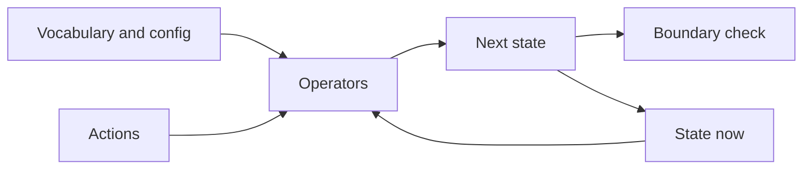
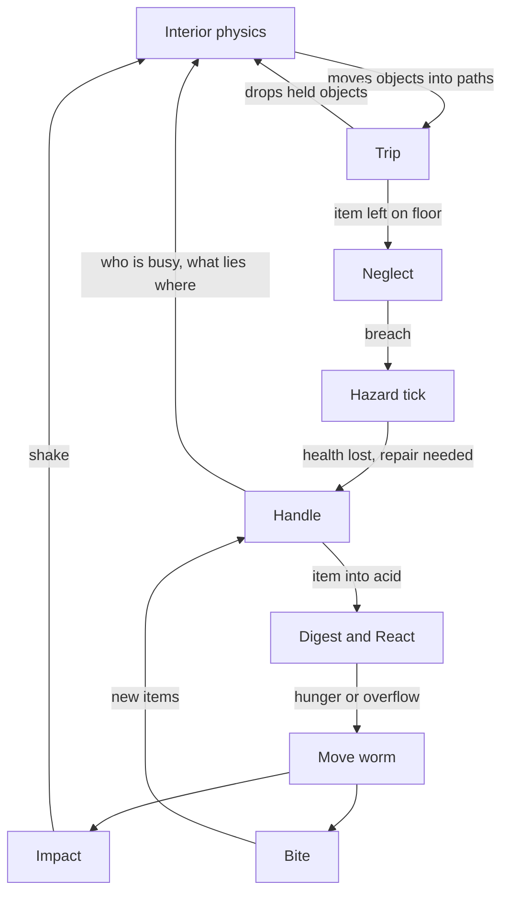
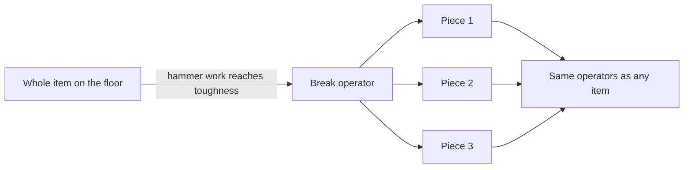
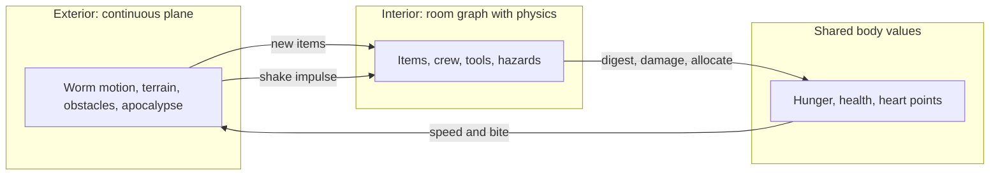

# Co-op Sandworm Survival: Basis, Operators, Logical Space

> **Status:** Paper draft, 2026-11-26. Nothing simulated. All basis choices are **proposals** until the owner agrees.
> **Scope:** only vocabulary, state, actions, operators, boundary and the space they span. Research, findings and risks are in the [research document](README.md).
> **Relation:** this document **refines and replaces section 5** of the research document.
> **Method:** [Base Theory v0.3.1](../../theory/Logical-Space-Base-Theory.md), principles L1 to L6.
> **Marking:** **SW-n** = owner decision. **S** = stated in the source design. **P** = assistant proposal. **Q-n** = open question, numbered as in the research document; Q-16 onward are new here.

| Decision | Date | Content | Details |
|---|---|---|---|
| **SW-1** | 2026-11-26 | A split item becomes **several separate pieces**, each its own instance (answers Q-20) | Section 6.7 |
| **SW-2** | 2026-11-26 | There is **one** acid slot. It has a **maximum capacity** digested at one time. The unit of capacity is still open (Q-24) | Section 6.2 |
| **SW-3** | 2026-11-26 | Allergy hunger loss follows each piece's **proportion**; the pieces' losses add up to the original item's loss (answers Q-30 for hunger) | Section 6.7 |

---

## 1. Model

$$\mathcal{G} = \langle \mathcal{V}, \mathcal{S}, \mathcal{A}, \hat{\mathbb{O}}, \Omega, Y \rangle$$

| Symbol | Meaning here | Covered |
|---|---|---|
| $\mathcal{V}$ | Properties and kinds that operators read | Section 3 |
| $\mathcal{S}$ | Values a save file must hold | Section 4 |
| $\mathcal{A}$ | What Driver and Crew decide | Section 5 |
| $\hat{\mathbb{O}}$ | Rules that change state | Section 6 |
| $\Omega$ | End conditions | Section 8 |
| $Y$ | What players perceive; reads state, never writes it | Out of scope, see research document section 9 |

**Resolution (L4, P).** The world is discrete objects with a few properties, moving in two spaces: an exterior side view and an interior room map. No gut tissue, no digestion chemistry, no soft-body worm. Anything finer becomes a config number.

---

## 2. Sorting The Design: What Is Basis And What Is Not

The source names rooms, tools, item classes and systems. Most are not basis. This table is the key step.

| Name in design | What it really is | Reason |
|---|---|---|
| Brain, Mouth, Heart, Intestine, Stomach, Rear exit | **Config:** nodes of the room map, each enabling some operators | A room is a place, not a degree of freedom |
| Acid pit | A **zone** plus the Digest operator | The zone is config; digestion is a rule |
| Heart energy station | **State** (allocation) plus an action that edits it | The station is only where the action is allowed |
| Organic, inorganic | **Derived label** from yields (P) | See 3.3 |
| Meat sizes, tyre, battery, engine, gas tank | **Config rows** over $\mathcal{V}$ | New content needs no new rule |
| Prey, hostile | Same object as an item, with a **behaviour** property (P) | A dead creature becomes ordinary food |
| Allergen | Hidden **state** (this match's tag) plus a reaction rule | The same item is safe or dangerous by match |
| Breach, acid overflow, tumor | **State:** hazard instances | They have location, age and must be saved |
| Hammer, sprayer, scanner, net, trap, shotgun, cart | **Config rows** with a capability (P) | See 3.2 |
| Bite power, speed, regen | **State** (allocated points) | Players change them in play |
| Momentum | **Open**, Q-1 | Derived if computable from velocity, state if stored charge |
| Gate tiers 1 to 3 | **Config rows** on terrain obstacles | Three rows of one rule |
| Zones 1 to 3, safe pocket | **Progression structure** (L15) | Restricts what appears and when |
| Workload Director | **Operator** with its own state (cooldowns) | It changes state, so it is not scenery |
| Radar, gauges, foam, horns, heartbeat | $Y$ | Read only |
| Digestion, crafting, tripping, shaking | **Operators** | Rules, never axes (L1) |

> **Category warning.** The source's system list mixes places, objects, stats and rules at one level. Building code that way gives one class per room and per item, and every new combination must be written by hand.

---

## 3. Vocabulary $\mathcal{V}$

### 3.1 Item and creature properties (P)

Operators read only these. They never read an item's name.

| Property | Type | Read by | Source examples |
|---|---|---|---|
| `mass` | Number | Carry, Interior physics | Solo and pair carry speeds |
| `rolls` | Number, 0 means it does not roll | Interior physics | Tyre rolls easily |
| `obstructs` | Yes or no | Trip | Sprinting into big blocks |
| `max_pieces` $N$ | 1 to 3 | Break | Small 1, medium 2, large 3 |
| `break_toughness` | Number | Break | P: wooden hammer needs more work than iron |
| `piece_digest_time` | Time | Digest | S: 2 s medium, 3 s large |
| `piece_rolls`, `piece_obstructs` | As `rolls`, `obstructs` | Interior physics, Trip | P, see 6.7 |
| `on_break` | One of: split, explode | Break | Gas tank and time bomb must not be hammered |
| `digest_time` | Time per piece, plus whole time | Digest | 5 to 6 s whole, 2 s per piece |
| `yield_hunger` | Number | Digest | Meat high, inorganic low |
| `yield_currency` | Number, may be 0 | Digest | Only inorganic pays |
| `digestible` | Yes or no | Digest | Explosive does not digest |
| `tag` | Family label | React | Which family is this match's allergen |
| `size` | Number | Digest | P: room an item takes in the acid |
| `allergy_hunger` $A$ | Number | React | Hunger lost if this item triggers a hunger reaction; may be one global value instead |
| `behaviour` | One of: none, flee, attack | Creature | Prey and hostiles |
| `health` | Number, creatures only | Damage, Creature | |

`neglect_limit` (time before a breach) is one config value, or per row if items should differ (Q-16).

### 3.2 Tool capabilities (P)

A tool is a row that grants a capability. Upgrades change numbers on the same row.

| Capability | Verb it enables | Source tools |
|---|---|---|
| `break_power` | Break | Hammer |
| `seal_rate` | Seal a hazard | Medicine sprayer |
| `reveal` | Mark an item's tag | Scanner |
| `restrain_time` | Stop a creature | Net gun (thrown), bear trap (placed) |
| `harm` and `knockback` | Damage a creature | Shotgun, iron hammer knockback |
| `capacity` and `stability` | Hold and move several items | Cart |
| `delivery` | One of: melee, projectile, placed, vehicle | All |

This lets tools combine without new rules: a trap restrains, then a cart moves the catch.

### 3.3 Why `organic` is derived (P)

| Test | Result |
|---|---|
| What differs between organic and inorganic in the source? | Hunger amount and whether currency is returned |
| Can that be read from yields? | Yes: currency zero versus above zero |
| Does any rule need the label itself? | None found in the source |

So `organic` is a name players see, computed as `yield_currency == 0`. Keep it as real property only if a future rule must tell the two apart with identical yields (Q-17).

### 3.4 Sample content rows (illustrative, not balance values)

| Row | rolls | max_pieces | on_break | digestible | currency | behaviour |
|---|---|---|---|---|---|---|
| Small meat | 0 | 1 | split | yes | 0 | none |
| Large meat | 0 | up to 3, count is Q-18 | split | yes | 0 | none |
| Tyre | high | 2 | split | yes | some | none |
| Engine | 0 | 3 | split | yes | more | none |
| Gas tank | some, P | 1 | explode | no | 0 | none |
| Rare prey | 0 | Q-18 | split | yes | 0 | flee |
| Hostile | 0 | Q-18 | split | yes | 0 | attack |

When a creature's health reaches zero, `behaviour` becomes none. That is a change of **instance state**, not of config, so `alive` is part of state.

### 3.5 World vocabulary

| Kind | Properties |
|---|---|
| Room node | Which operators are allowed there: intake, heart control, digest, eject, drive, craft |
| Corridor edge | Length, door or none |
| Terrain | Resistance to movement |
| Obstacle | `required_bite`, `gnaw_time` by momentum, `needs_evolution` |
| Prey and prop spawner | Which item rows come out, with what rates |
| Hazard kind | Breach, overflow, tumor: damage target, rate, spread, spawn content |

Gate rows (S):

| Tier | required_bite | Momentum effect | needs_evolution |
|---|---|---|---|
| 1 | 2 | Not stated | no |
| 2 | 4 | Low: about 1 to 1.5 s gnaw. High: instant | no |
| 3 | Not applicable | None | jaw evolution |

---

## 4. State $\mathcal{S}$

State is a product of fixed parts and **sets of instances whose size changes in play**:

$$\mathcal{S} = \mathcal{S}_{worm} \times \mathcal{S}_{econ} \times \mathcal{S}_{world} \times \mathrm{Set}(Item) \times \mathrm{Set}(Hazard) \times \mathrm{Set}(Crew) \times \mathrm{Set}(ToolObj) \times \mathcal{S}_{hidden}$$

So this space has **no fixed dimension count** (L3).

### 4.1 Fixed parts

| Part | Coordinate | Range |
|---|---|---|
| Worm | Position, velocity, heading | Exterior plane |
| | `health` $H$ | 0 to max |
| | `hunger` $h$ | 0 to 100 percent |
| | `critical_timer` | Empty or counting down |
| | `shock_timer` (P, see 7.2) | Slow effect left after an allergy shock |
| | `heart_count` $n$ | 1 or 2 |
| | Allocation $(s, r, b)$: speed, regen, bite | Each 0 to 4 |
| | Evolution unlocks | Set; includes jaw |
| | Momentum $m$ | **Only if Q-1 answers stored** |
| Economy | `currency` | 0 or more |
| World | `apocalypse_pos` | A to B |
| | Obstacle and spawner instances: present or consumed | |
| | Safe pocket timer | |
| | Door open and locked flags | |

### 4.2 Instances

| Set | Per instance |
|---|---|
| Item, includes creatures and pieces | Instance id, row id, `share` $\sigma$, **place**, motion, `age`, `break_progress`, `progress`, `acid_order`, `revealed`, `alive`, health, restrain timer |
| Hazard | Kind, place, size, age |
| Crew | Place, velocity, health, two slots, stun timer, aim and prime state |
| ToolObj | Row id, level, place, ammunition if any (Q-19), tipped flag for cart |

**Place** is one tagged value: `floor(room, x, y)`, `held(player, slot)`, `cart(id)`, `air`, `acid`, or `gone`. One value, so an item cannot be in two places.

**Splitting (SW-1):** a broken item is removed and replaced by $N$ new item instances. Each is carried, rolls, ages and digests on its own, using the same operators. There is no piece counter. Rules in section 6.7.

### 4.3 Hidden state

Allergen tag for this match, allergy outcome choice if random (Q-5), Director cooldowns, random seed and cursor, next instance id.

### 4.4 Derived, never saved

| Value | Computed from |
|---|---|
| `organic` label | `yield_currency` |
| Warning stage: none, yellow or orange, red | `age`, `neglect_limit` |
| Can break this gate | $b$, evolution, obstacle row |
| Hunger drain rate | $s$, evolution |
| Top speed, turn radius | $s$, $h$, length |
| Worm length | Evolution (confirm, Q-10) |
| Point budget | $n$: 4 or 7 |
| Starving flag, critical flag | $h$, `critical_timer` |
| Crew carry speed | `mass`, number of carriers |
| Item is food | `alive` false and `digestible` |
| Effective `mass`, `size`, yields, allergy hunger | Row value multiplied by `share` (SW-3 for allergy hunger) |
| Whole or piece label | Whole if `share` is 1, otherwise piece |
| Effective `digest_time`, `rolls`, `obstructs` | Row value if `share` is 1; `piece_` row value otherwise |
| Can be broken | `share` is 1, `alive` false, and either $N > 1$ or `on_break` explode |
| Dungeon layout and terrain | Seed, **only if** generation is deterministic |

### 4.5 Invariants (property tests)

| ID | Invariant |
|---|---|
| IV1 | $s + r + b \le$ budget of $n$; each in 0 to 4 |
| IV2 | $0 \le h \le 100$, $0 \le H \le H_{max}$, currency never negative |
| IV3 | Every item has exactly one place |
| IV4 | A crew member holds at most two things; each slot at most one |
| IV5 | One break creates exactly $N$ pieces, and a piece is never broken again (P) |
| IV9 | Breaking creates no value: summed piece mass, hunger and currency equal the whole's (P, Q-21). Content check: `yield_currency` divides evenly by $N$ |
| IV10 | Instance ids are never reused |
| IV11 | The shares of all pieces from one break add up to 1, so their allergy hunger losses add up to the whole's (SW-3) |
| IV12 | Total effective `size` digesting at one time never exceeds capacity $C$ (SW-2) |
| IV6 | Each item pays hunger and currency at most once |
| IV7 | `apocalypse_pos` never moves backward |
| IV8 | A `gone` item is never read again |

> Source mismatch: the stats table gives Bite Power as level **1 to 4**, but the heart demo allows **0**. IV1 follows the demo. Q-22: is 0 legal?

---

## 5. Actions $\mathcal{A}$

Actions are requests. Operators decide what happens.

| Actor | Action | Domain | Consumed by |
|---|---|---|---|
| Driver | `steer` | Continuous direction | Move |
| | `ping` | 3 or more signals | None; talk only, no system state |
| | `door` | Open, close, lock | Door |
| Crew | `move`, `sprint` | Continuous plus flag | Crew motion |
| | `pick`, `drop` | Target object | Handle |
| | `throw` | Direction and strength | Handle, then Interior physics |
| | `swap_slot` | Toggle | Handle |
| | `push_cart`, `load_cart` | Cart | Handle |
| | `use_tool`, `prime` | Held tool and aim | Break, Seal, Reveal, Restrain, Harm |
| | `allocate` | Stat, plus or minus; at heart node | Allocate |
| | `craft` | Recipe; at craft node | Craft |
| | `eject` | Items at rear node | Eject |
| | `door` | At door | Door |

Auto-Bite is **not** an action. It is an operator fired by contact (L1).

---

## 6. Operators $\hat{\mathbb{O}}$

### 6.1 Operator table

**R** reads, **W** writes. $\Delta t$ is the tick. Functions written $f_x$ are **not defined in the source**.

| ID | Operator | Reads | Writes |
|---|---|---|---|
| O1 | Allocate | Action, $n$, $(s,r,b)$, actor place | $(s,r,b)$ |
| O2 | Move worm | `steer`, $s$, $h$, `shock_timer`, length, terrain | Worm position, velocity, heading, $m$ if stored |
| O3 | Impact | Velocity and angle at ground contact | Velocity, $m$, **shake impulse** $J$ |
| O4 | Bite | Contact, $b$, $m$, obstacle, spawner | Obstacle state, velocity, **new items** at mouth |
| O5 | Crew motion | Move input, `mass` held, floor | Crew place, velocity |
| O6 | Handle | Pick, drop, throw, cart actions | Item and tool places, slots |
| O7 | Interior physics | $J$, `mass`, `rolls`, places | Item, crew and cart motion, cart tipped, entry into acid |
| O8 | Trip | Sprint flag, `obstructs`, collision | Stun, held items dropped |
| O9 | Creature | `behaviour`, `alive`, restrain, positions | Creature motion, crew health, hazards |
| O10 | Break | `break_power`, `break_toughness`, `on_break`, `max_pieces`, `share`, `alive`, place | `break_progress`; removes the whole and creates $N$ pieces, **or** explosion: damage and impulse |
| O11 | Restrain | `restrain_time`, hit | Restrain timer |
| O12 | Harm | `harm`, hit | Health, `alive`, `behaviour` |
| O13 | Reveal | `reveal`, target `tag`, hidden tag | `revealed` |
| O14 | Digest | Items in acid, `digest_time`, `digestible` | `progress`; on completion $h$, currency, item gone |
| O15 | React | Item `tag` in acid, `share`, `allergy_hunger`, hidden tag | $h$, `shock_timer`, **or** overflow hazard, **or** tumor hazard |
| O16 | Neglect | Item place, `age`, `neglect_limit` | `age`; on expiry new breach |
| O17 | Hazard tick | Hazards, crew places | $H$, crew health, hazard size, new creatures from tumor |
| O18 | Seal | `seal_rate`, breach | Breach size or removal |
| O19 | Metabolism | $s$, evolution, $r$, $h$, $H$, `shock_timer` | $h$, $H$, `shock_timer` countdown |
| O20 | Eject | Items at rear node | Item gone |
| O21 | Craft | Currency, recipe, craft node | Currency, tools |
| O22 | Evolve | Trigger is Q-10 | $n$, evolution unlocks |
| O23 | Door | Door actions, contact | Door flags |
| O24 | Director | Zone, load, player count, cooldowns, seed | Spawners, cooldowns |
| O25 | Apocalypse | Time | `apocalypse_pos`, `critical_timer` |

O16 has no row for explosive timers: the source mentions time bombs. If a bomb explodes on a timer, it needs a `fuse` property and a timer coordinate (Q-23).

### 6.2 Rules with a defined form

**Allocate (S):** allowed only if the new values keep IV1.

**Bite gate (S):** for obstacle $g$ at contact:

$$\text{pass}(g) = \begin{cases} \text{evolution has jaw} & g \text{ is tier 3} \\ b \ge b_{req}(g) & \text{otherwise} \end{cases}$$

If not passed: bounce. If passed at tier 2: instant when momentum is high, otherwise gnaw about 1 to 1.5 s. The high or low threshold is undefined.

**Digest (SW-2, with P details):** the one acid pit has capacity $C$. All admitted items digest **at the same time**, and the effective sizes of admitted items add up to at most $C$. For each admitted digestible item:

$$p \leftarrow p + \frac{\Delta t}{\tau_{item}}, \qquad p \ge 1 \Rightarrow \begin{cases} h \leftarrow \min(100,\ h + y_h) \\ currency \leftarrow currency + y_c \\ place \leftarrow gone \end{cases}$$

**Neglect (S rule, P form):** $a \leftarrow a + \Delta t$ while the item is neglected; $a \ge a_{max}$ creates a breach. Q-16: which places count as neglected, does picking up reset or pause $a$, and does the item survive the breach?

**Metabolism:**

$$h \leftarrow h - \delta(s, evo)\,\Delta t, \qquad H \leftarrow \min(H_{max},\ H + f_{regen}(r)\,\Delta t)$$

The heart demo (S) shows drain as a multiplier: $0.8 + 0.1s$ with one heart, $1.3 + 0.15s$ with two. The base rate is undefined.

**Hazard tick:** $H \leftarrow H - \sum_{breach} f_{dps}(size)\,\Delta t$

**Acid queue (P):** items that do not fit wait. They are admitted first in, first out by `acid_order`; a waiting item is not skipped by a smaller one behind it. Entry order cannot be recomputed after loading, so it is **state**. Items that enter on the same tick are ordered by instance id.

**Content rule (P):** $C$ must be at least the largest whole `size`. Otherwise that item can never be admitted, hammering becomes compulsory, and its stated whole digest time can never happen.

**Capacity unit (Q-24):** this document assumes **size**. The other reading is a count of objects, where a whole engine and one piece each take 1. Not yet confirmed.

### 6.3 Interaction operators

Interaction means the result depends on **two things together**, not their sum (L6).

| Operator | Product | Who supplies each side |
|---|---|---|
| O4 Bite gate | $b$ and $m$ against obstacle | Crew and Driver |
| O7 Interior physics | $J$ with each object's place, `mass`, `rolls` | Driver and Crew's housekeeping |
| O8 Trip | Sprint and an obstructing object in the path | Crew urgency and clutter |
| O10 Break | `break_power` and `on_break` | Crew and item row |
| O10 explosion | Blast with everything nearby | Crew mistake and layout |
| O15 React | Item `tag` and hidden tag | Item choice and match secret |
| O17 Hazard tick | Hazard place and crew place | Neglect and routing |
| O2 with O19 | $s$ raises speed and drain together | Crew |

**Not interactions:** O14 hunger gain, O18, O20 and O21 are plain transfers or removals.

### 6.4 Loops that can carry emergence

One interaction is a hand-written rule. Emergence needs operators that **write what another reads, in a cycle**.

| Loop | Path | Timescale (P) | Kind |
|---|---|---|---|
| L-A Clutter | O7, O8, O7 | Under a second | Interior only |
| L-B Intake | O2, O4, O6, O14, O2 | Seconds to tens of seconds | **Core**, crosses both roles |
| L-C Shake | O2, O3, O7, O6, O14, O2 | Seconds | **Crosses both roles** |
| L-D Decay | O6, O16, O17, O6 | Tens of seconds | Pressure |
| L-E Power | O1, O2 and O19, hunger, O1 | Tens of seconds | Crosses both roles |
| L-F Economy | O14, O21, O6 | Minutes | Progression |

Part of L-B and L-E closes through a player's decision (reading signals, then choosing). That part is not a system edge; L21 measures it.

### 6.5 Tick order (P)

| Phase | Operators | Rule |
|---|---|---|
| 1 Decide | Read all actions | One snapshot |
| 2 Control | O1, O23, O22 | |
| 3 Exterior | O2, O3, O4, O25 | Produces $J$ and new items |
| 4 Interior intent | O5, O6 | Conflicts over one item: fixed priority, Q-25 |
| 5 Interior motion | O7, O9, O8 | Uses this tick's $J$ |
| 6 Tool effects | O13, O11, O12, O10, O18 | |
| 7 Sinks | O20, O14, O15, O21 | |
| 8 Time | O16, O19, O17 | |
| 9 World | O24 | |
| 10 Check | $\Omega$ | |

Consequences, each a **design choice** to confirm:

| Order | Effect on play |
|---|---|
| O5 and O6 before O7 | A throw made on the landing tick is still shaken |
| O18 before O17 | A seal completed this tick prevents this tick's damage |
| O14 before O19 | A last-moment meal counts before starvation |
| O6 before O16 | Pickup on the expiry tick can save the floor, if pickup stops ageing |
| O15 before O14 | An allergen reacts on entry and never pays yield (Q-26) |

### 6.6 Write conflicts (P4)

| Coordinate | Writers | Combine by |
|---|---|---|
| $h$ | O14, O15, O19 | Phase order, clamp after each |
| $H$ | O17, O19, explosion, bite hazards | Sum damage, then apply regen, then clamp (confirm) |
| Crew health | O9, O10, O17 | Sum |
| Item place | O4, O6, O7, O8, O14, O20 | Strict phase order; last writer in order wins |
| Worm velocity | O2, O3, O4 | Phase order |
| `shock_timer` | O15, O19 | Set, then count down |
| Currency | O14, O21 | Digest first, then craft |
| Cart tipped | O7, O6 | Phase order |

Several items hit by one shake must all be solved from the same snapshot, so results do not depend on list order.

### 6.7 Split Into Separate Pieces (SW-1)

**Decided (SW-1):** pieces are separate instances. **Everything else in this section is a proposal** that this decision makes necessary.

#### Closure: the main idea

$$\hat{\mathcal{O}}_{break}: \mathrm{Set}(Item) \to \mathrm{Set}(Item), \qquad \{w\} \mapsto \{q_1, \dots, q_N\}$$

The output lives in the **same set** and uses the **same vocabulary** as the input. So no new basis element appears, and carry, throw, cart, shake, trip, scan, eject, digest, react and neglect all work on pieces **with no new rule**. "Tyre piece" is not new content to write: it is a tyre row with `share` below 1.

#### Rule

**Allowed when** the target is on the floor (not held, in a cart, in the air or in acid), `share` is 1, `alive` is false, and $N > 1$.

1. Each hit or swing adds `break_power` to `break_progress`. `break_progress` stays if the Crew member stops or is interrupted.
2. When it reaches `break_toughness`, remove the whole and create all $N$ pieces at once.
3. Pieces appear beside the old position, at rest, in a fixed order. They can be touched from the next tick.

`on_break` explode ignores $N$: the first hit detonates (S: hammering it makes it explode).

An iron hammer with `break_power` at or above `break_toughness` gives the stated one-hit break (S) with no special rule.

#### What a piece inherits

| Value | Piece gets | Reason |
|---|---|---|
| Row id, tag | Same | Same material |
| `share` | Its proportion of the whole; equal split gives $1/N$ (P) | Drives allergy loss (SW-3); below 1 blocks a second break (P) |
| `revealed` | Same | Scan knowledge is not lost |
| `age` | Same as the whole | **Otherwise hammering resets the rot timer**, a free exploit |
| `break_progress`, `progress` | 0 | Items cannot leave acid in this proposal, so no digestion is lost (Q-27) |
| `acid_order` | Empty | Not in acid |
| Mass, size, yields, allergy hunger | Derived: row multiplied by `share` | Not stored (L5), conserves value (IV9, IV11) |
| Digest time | Derived: `piece_digest_time` | See below |

**Why `share` is state.** SW-3 defines loss by proportion, so every piece must know its proportion. Storing it replaces the earlier whole or piece flag, which is now derived. Splits stay equal for now (P, Q-28), but unequal pieces would need no new rule: only the shares assigned at break time would differ.

**Why digest time is config, not derived.** In the source, a piece digests **faster than its share**: a medium whole takes 5 to 6 s (half would be 2.5 to 3 s) but a piece takes 2 s; a large whole takes 10 to 12 s (a third would be about 3.3 to 4 s) but a piece takes 3 s. Dividing by $N$ would give wrong numbers.

#### Breaches from pieces

Each piece ages and can create its own breach. Without a rule, one neglected whole makes one breach but three neglected pieces make three full ones.

**P:** breach size equals the source item's effective mass, and damage rate grows **linearly** with size. Then total damage per second is the same for one whole or all its pieces, but the pieces need **$N$ separate repair spots**. This assumes mass is a fair measure of breach danger (Q-29).

#### What splitting now trades

| Gain | Cost |
|---|---|
| Each piece is lighter to carry | Up to $N$ trips without a cart |
| Shorter digest time per piece | Hammer time before any digestion starts |
| Pieces fit into leftover acid capacity | Pieces still occupy capacity and can make other food wait |
| Pieces can be shared among Crew | $N$ objects to slide, roll and be tripped over |
| Smaller bites waste less hunger near the 100 percent cap | $N$ neglect timers and possible repair spots |

The last gain appears without a special rule: hunger is clamped at 100, and several small payments can be timed, one large one cannot.

**Clutter choice:** `piece_obstructs` and `piece_rolls` decide the strength of the trade. If pieces never obstruct, hammering reduces trip danger. If they do, it multiplies it. **P:** set per row; engine pieces obstruct, tyre pieces roll.

**Digest time only** under SW-2, assuming capacity counts size and the pit starts empty (hammer and hauling excluded):

| Large item, size 3, with $C = 3$ | Time |
|---|---|
| Fed whole | 10 to 12 s |
| All 3 pieces together | 3 s |
| Pieces fed one after another, none overlapping | 9 s |

Because pieces digest faster than their share, the same amount of material passes through the pit about **3 to 4 times faster** when split and fed together. Capacity does not limit splitting a single item, so hammer time, hauling and clutter must carry the cost.

#### Effect on the logical space

| Aspect | Effect |
|---|---|
| Basis | No new item type or operator. Adds state `share`, `break_progress`, `acid_order`, next id |
| State space | Number of item instances can now grow during play without new intake |
| Bound | At most 3 pieces per swallowed item, because pieces never break again. Total still depends on intake |
| Reachable set | Larger: parts of one object can be in different rooms, hands and queues at once |
| Emergence | Break alone is a written rule, **not** emergence (L6). Candidate: pieces feed loops L-A and L-C, for example one piece rolls into a path and a carrier of another trips. Unproven |
| Technical cost | Up to 3 times as many physics objects to simulate and sync |

#### Property tests

| Test | Expect |
|---|---|
| T1 | Breaking a row with $N = 3$ removes 1 instance and adds 3 |
| T2 | Summed piece mass, hunger and currency equal the whole's |
| T3 | A piece cannot be broken |
| T4 | Pieces keep the whole's `age` and `revealed` |
| T5 | A held, carted, airborne, digesting or living target cannot be broken |
| T6 | An explode row creates no pieces |
| T7 | Stop hammering, resume later: progress is kept |
| T8 | Save and load with a full acid queue: same digestion order |
| T9 | Total breach damage rate of all neglected pieces equals that of the neglected whole |
| T10 | One piece of an allergen item with share 1/3 removes one third of the allergy hunger value |
| T11 | All pieces of an allergen item, fed together or apart, request the same total loss as the whole (SW-3) |

#### Allergy by proportion (SW-3)

$$\Delta h_i = -A_{row} \cdot \sigma_i, \qquad \sum_i \sigma_i = 1 \Rightarrow \sum_i \Delta h_i = -A_{row}$$

Example with an illustrative $A = 30$ (not a source value) and starting hunger 70:

| What enters the acid | Loss | Hunger after |
|---|---|---|
| Whole item | 30 | 40 |
| One of 3 equal pieces | 10 | 60 |
| All 3 pieces | 30 | 40 |

Rules (P):
- A piece that is ejected causes no loss.
- Use fractional hunger so rounding cannot break the sum.
- The sum is the **requested** loss. Hunger still stops at 0, and eating between pieces can change the final value.

**Consequence to test: taste-testing.** The Crew can feed one piece, pay a third of the loss, learn that the item is the allergen and eject the rest. This is a possible alternative to scanning. It is a problem only if it is almost always cheaper than scanning (V2).

**Deferred by owner, 2026-11-26 (Q-30):** SW-3 covers hunger. Shock slow duration, acid overflow and tumor need their own rules. **P:** scale slow duration and overflow by share too. A tumor needs a size or merge rule, otherwise three pieces could grow three tumors.

---

## 7. The Logical Space

### 7.1 Four nested things

| Space | Contains | Grows by |
|---|---|---|
| Content space | All legal config rows over $\mathcal{V}$ | Adding rows |
| State space | All values of $\mathcal{S}$ obeying IV1 to IV8 | Instances present |
| Reachable set $\mathcal{R}$ | States obtained from start states by iterating operators under some actions | Rules and loops |
| History space | All trajectories through $\mathcal{R}$ | Time and choices |

$$\mathcal{R} = \{\, x : x = \hat{\mathcal{O}}_{tick}(\dots \hat{\mathcal{O}}_{tick}(x_0, a_1) \dots, a_k),\; x_0 \in Start,\; a_i \in \mathcal{A} \,\}$$

Valid is larger than reachable. What players can experience is the history space. Interesting play, if any, is a region of it that nobody listed in advance.

### 7.2 Two coupled sub-spaces

The whole interface is **four edges**. **P:** build the two sides as separate modules that talk only through these: `ItemsSwallowed`, `ShakeImpulse`, writes to body values, reads of body values.

Allergy shock also slows the worm. To keep the interface clean, O15 does not write velocity: it sets the body value `shock_timer`, which O2 reads.

### 7.3 Spec coverage (P3, paper witnesses)

| Mechanic | Witness operator chain | Gap |
|---|---|---|
| Steer, dive, leap | O2, O3 | Motion formula |
| Swallow | O2, O4 | Drop rates |
| Carry, throw, cart | O5, O6, O7 | Cart rules |
| Trip | O5, O8, O6 | |
| Shake spills cargo | O3, O7 | Impulse mapping |
| Hammer then digest faster | O10, O6, O14 | Slots |
| Hammer a gas tank | O10 explode | Blast radius |
| Feed and earn | O6, O14 | Yields |
| Breach and patch | O16, O17, O18 | Timers |
| Scan and eject allergen | O13, O6, O20 | Scan cost |
| Allergy consequence | O6, O15, O17 | Outcome choice |
| Catch prey | O9, O11, O6, O14 | Catch and carry of a live creature |
| Kill hostile, eat it | O9, O12, O6, O14 | |
| Heart changes bite | O1, O4 | Switch cost |
| Break gates | O4 | Momentum threshold |
| Craft and upgrade | O14, O21 | Costs |
| Lock brain door | O23, O9 | What a creature does to the Driver |
| Doom pressure | O25 | Speed curve |

A paper chain is not proof. Each row needs a logged run.

### 7.4 Independence (P2, paper)

| Candidate coordinate | Test | Verdict |
|---|---|---|
| Warning colour | Computable from age | Derived |
| Can-break flag | Computable from $b$, evolution, obstacle row | Derived |
| Starving | From $h$ | Derived |
| `organic` | From currency yield | Derived (P) |
| `revealed` | Cannot be recovered after load | State |
| `age` | History, not computable | State |
| `progress` | History | State |
| `share` | Two instances of one row can differ only by it; effective values and allergy loss depend on it | State |
| Whole or piece label | From `share` | Derived |
| `break_progress` | History | State |
| `acid_order` | History | State |
| Piece mass, size, yields, allergy hunger | Row and `share` | Derived |
| Momentum | Q-1 | Open |
| Worm length | Possibly from evolution | Derived if confirmed |
| Nemesis-like "backlog" value | Count of items and ages | Derived; never store a backlog meter |
| Layout | From seed | Derived if deterministic |

### 7.5 Ablation predictions (L2)

Written before any run. Each is a prediction to test, not a result.

| Remove | Predicted loss | Basis member for |
|---|---|---|
| O3 shake | Driver and Crew linked only by item flow and numbers | I7 |
| `rolls` | All clutter behaves alike | Variety; may be cuttable at first |
| `on_break` | No explosive danger; hammering has no trap | Explosive mechanic |
| `max_pieces` and O10 | No hammer decision | Item handling |
| Separate instances, replaced by a counter | Parts could not be in different places; no piece clutter or split hauling | SW-1 |
| `tag` and O15 | No allergen play; core loop survives | Hazard variety |
| `behaviour` | No prey or hostiles; core loop survives | Threat variety |
| O16 | No cost to ignoring items; likely no urgency | Core pressure |
| `yield_currency` | Organic and inorganic differ only in amount | Economy |
| $s$, $r$, $b$ allocation | No heart role; Crew cannot change Driver's ability | L-E, part of I7 |
| Acid capacity $C$ | Pit never makes food wait | Handling choice |

---

## 8. Boundary $\Omega$

| Predicate | Result | Source |
|---|---|---|
| Worm reaches B | Win | S |
| `critical_timer` expires, 10 to 15 s | Loss | S |
| $H = 0$ | Loss (P; source implies it) | Q-2 |
| $h = 0$ | Slows, then dying state | S; end condition Q-2 |
| All Crew down | Undefined | Q-14 |

---

## 9. Smallest Space That Runs (rung 1, P)

One change per later rung (L12). Rung 1 keeps only the intake side of the core loop, with scripted swallowing in place of a Driver.

| Part | Content |
|---|---|
| $\mathcal{V}$ | `mass`, `digest_time`, `yield_hunger`; one food row |
| $\mathcal{S}$ | $h$, $H$; items with place, `age`, `progress`; breaches; crew place, slot, repair progress |
| $\mathcal{A}$ | Move, pick, drop, seal |
| $\hat{\mathbb{O}}$ | Scripted intake, O5, O6, O14 with capacity $C$, O16, O17, O18, O19 |
| $\Omega$ | $H = 0$, $h = 0$, or time limit |

| Parameter to sweep | Why |
|---|---|
| Intake rate, $C$, drain rate, neglect limit, walk distance, crew count | They set whether the queue stays empty, balanced or runs away |

**Predictions before running:** (1) a region exists where load stays bounded and crew idle time is moderate; (2) outside it the system is either idle or in runaway breaches; (3) the border is sharp (L10). Rung 1 shows only whether the queue works. It cannot show loop coupling, because there is no second role.

**Next rungs:** pieces and break (section 6.7); then shake and trip; then a Driver who chooses intake. Full ladder in the research document section 10.

**Rung 2 predictions, before running** (rewritten after SW-2; the earlier slot-count predictions were never run): (1) with a cart and short walks, "always hammer" wins; (2) with long walks and no cart, hammering lowers throughput; (3) between them there is a range of intake rate and walk distance where the better choice depends on current backlog and hunger. If (3) fails across the sweep, hammering is a fake choice (V2) and needs a rule change. Rung 2 has no trip, so it **cannot** measure the clutter cost; repeat the comparison at the shake and trip rung.

---

## 10. Code Mapping

| Theory | Code | Gain |
|---|---|---|
| $\mathcal{V}$ and rows | Read-only data: items, tools, obstacles, hazards, rooms | New content is a data row |
| $\mathcal{S}$ | Plain data; the save and sync payload | One thing to serialise |
| Derived | Computed on read | No sync bugs |
| $\mathcal{A}$ | Command objects | Players, bots and replay share one path |
| $\hat{\mathbb{O}}$ | One system each, run in the order of 6.5 | Testable without graphics |
| Invariants | Property tests | |
| Interface of 7.2 | Two modules, four messages | 2D exterior and 3D interior develop apart |

**Rule of thumb:** if code asks `if item is tyre`, a property is missing from $\mathcal{V}$.

---

## 11. Open Questions That Change The Basis

Others affect only numbers.

| Q | Question | Proposal |
|---|---|---|
| Q-1 | Momentum derived or stored? | Derived first; add stored charge only if rung tests show a need |
| Q-17 | Does any rule need `organic` apart from yields? | No |
| ~~Q-20~~ | Pieces as new instances or a counter? | **Decided, SW-1:** new instances |
| Q-28 | Equal pieces, broken once only? | Yes |
| Q-29 | Do pieces' breaches scale with mass? | Yes, linear damage |
| Q-30 | Allergy per piece | **Hunger decided, SW-3.** Slow, overflow and tumor deferred by owner |
| Q-24 | Does capacity $C$ count size or objects? One slot with a maximum is decided, SW-2. Unit deferred by owner | Size, as a working assumption |
| Q-16 | What counts as neglect? | Any place except held or acid; pickup pauses age |
| Q-23 | Do bombs have a fuse? | If yes, add `fuse` and a timer |
| Q-19 | Do tools use ammunition or break? | None in v1 |
| Q-10 | What triggers evolution? | Leave out of v1 |

Smaller new questions: Q-18 piece counts for meat and creatures; Q-21 whether pieces keep the same total yield; Q-22 bite level 0; Q-25 two players grabbing one item; Q-26 whether an allergen also pays yield; Q-27 whether items can be pulled back out of the acid (proposal: no).
