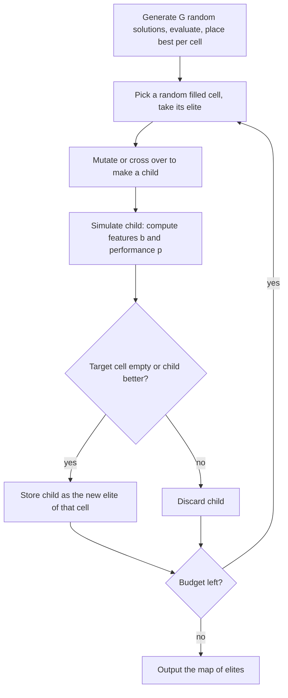
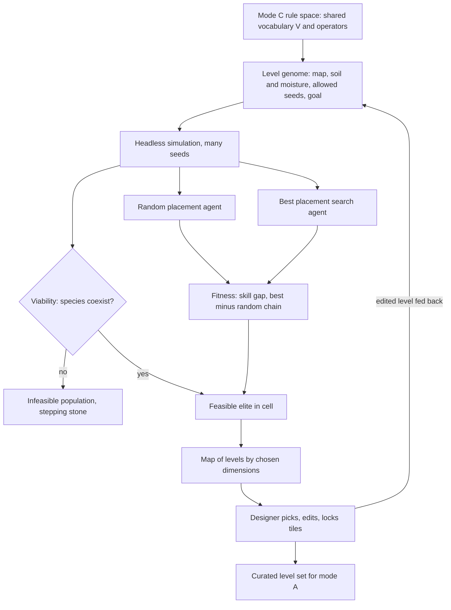

# Quality-Diversity Level Generation — Synthesis for Forest_Bloom

> **Author:** the assistant, 2026-11-03, written for the owner's study. **Status:** research notes, not a design decision.
> **Sources:** the six papers in [papers/](papers/), indexed in [README.md](README.md). Text marked **[Paper]** reports what a paper says. Text marked **[Proposal]** is the assistant's own idea for Forest_Bloom and the Logical Space method; it is untested.
> **Context:** idea ID-7 and decision FB-1 in the [critique and study record](../../../.cursor/plans/design/2026-11-03-logical-space-critique-and-study.md).

---

## 1. The Problem This Solves

Forest_Bloom's mode C is a rule space where species spread through iterated local rules. Mode A levels are curated slices of that space. Because the outcome is emergent (AG-7), a hand-drawn level may turn out unwinnable, trivial, or dominated by one species. Finding good levels requires many simulations.

Quality-diversity (QD) search turns that cost into a tool. Instead of searching for **one best** level, it searches for **a map of good levels that differ from each other** in ways the designer chooses.

---

## 2. Core Idea of Quality-Diversity

**[Paper, Gravina et al. 2019]** QD algorithms search for a set of good solutions that cover a space defined by behavior metrics. Two things are pursued together:

| Concept | Meaning | Forest_Bloom reading [Proposal] |
|---|---|---|
| **Quality** | How good one solution is: a fitness score, plus hard constraints such as "the level is completable" | Skill gap between best and random seed placement; level is winnable |
| **Diversity** | Measured in **behavior space**, not in the genome: how solutions *behave*, not how they are encoded | Biome dryness, typical chain length, number of species required |
| **Behavior space** | Either distance-based (novelty) or **partitioned** into a grid of cells; partitioning lets designers control granularity | A 2D grid the designer can read at a glance |

This differs from ordinary optimization, which collapses to one answer, and from multi-objective search, which trades objectives against each other instead of covering a space.

---

## 3. MAP-Elites, the Base Algorithm

**[Paper, Mouret and Clune 2015]** MAP-Elites, *Multi-dimensional Archive of Phenotypic Elites*, is an "illumination" algorithm: it finds the best solution in each cell of a user-defined feature space.

**Inputs:**
1. Performance function $f(x)$: how good solution $x$ is.
2. Feature descriptor $b(x)$: maps $x$ to a low-dimensional vector of chosen features. Some features are read directly; others require simulation.
3. A discretization of each feature dimension into cells.

**Algorithm:**

**Evaluation metrics [Paper]:**

| Metric | Meaning |
|---|---|
| Global performance | Best single solution found |
| Global reliability | Mean best performance over all fillable cells; empty cells count as zero |
| Precision | Mean performance over filled cells only |
| Coverage | Fraction of fillable cells filled |

Later work also uses **QD-score**, the sum of elite fitness over filled cells (used by Fontaine et al.).

**Practical advice [Paper]:**
- Keep the feature space **low-dimensional by design**, even when the search space is huge.
- Start with a **coarse grid** and refine as compute allows.
- Expect empty cells: some combinations are impossible, others are just hard to reach.
- **Stepping stones:** a good solution for one cell often descends from elites in distant cells. Searching all cells together helps find a better global optimum too.
- Caveat: the 2015 paper is marked an early draft; its authors ask readers not to treat its empirical numbers as final.

---

## 4. Variants That Matter for Games

### 4.1 Constrained MAP-Elites: playability as a hard constraint

**[Paper, Khalifa et al. 2018; Gravina et al. 2019]** Each cell keeps **two populations**: a feasible one that maximizes fitness, and an infeasible one that minimizes distance to feasibility. This borrows the FI-2Pop idea. Infeasible individuals are not thrown away; they are stepping stones back toward feasibility.

In Talakat, a bullet-hell level generator, playability is checked by **simulation with a best-first-search agent** whose strategy and dexterity can be tuned. Behavior dimensions include agent entropy, agent risk and bullet distribution, so the search targets levels that demand a specific mix of strategy and dexterity.

**[Proposal]** For Forest_Bloom, the hard constraint is the **viability condition** (ID-6): several species coexist and no species takes the whole map. A level that collapses to one species is infeasible but kept as a stepping stone.

### 4.2 Interactive Constrained MAP-Elites: the hybrid workflow

**[Paper, Alvarez et al. 2019]** In the Evolutionary Dungeon Designer, the designer and the algorithm work on the same room at the same time:

- The designer's current room is **fed into the search in the background**. Edits change later suggestions.
- The designer can **apply a suggestion**, which replaces the room and steers later suggestions.
- The designer can **change which two dimensions** are shown, or their granularity, at any time; the cells are rebuilt and individuals reassigned.
- Tiles can be **locked** so they persist across suggestions.
- Each cell holds feasible and infeasible populations of up to 25 individuals. Grids filled within seconds because fitness was cheap.

Reported limitations: no user study, so workflow claims are not validated; showing more than two dimensions is unsolved; some dimension pairs conflict and leave cells empty; fitness did not yet include agent-based play.

**[Proposal]** This is the closest existing model for the owner's **hybrid** choice: the machine fills a map of candidate levels, the designer picks, edits and locks parts, and the machine continues from the edit.

### 4.3 CMA-ME: faster search over continuous parameters

**[Paper, Fontaine et al. 2020]** CMA-ME combines CMA-ES's self-adapting search distribution with MAP-Elites' archive. On continuous benchmarks it more than doubled MAP-Elites' performance on standard QD metrics, and on Hearthstone it found decks of higher quality and broader diversity than CMA-ES or MAP-Elites.

**[Proposal]** Relevant when the level genome is mostly continuous: moisture field parameters, soil gradients, gene values.

### 4.4 Latent-space search and its warning about agent-based dimensions

**[Paper, Fontaine et al. 2021]** QD searched the latent space of a GAN trained on Mario levels. Playability was the share of the scene an A* agent got through.

- QD methods beat CMA-ES and random search on representation dimensions (sky tiles, enemies) and on style divergence; CMA-ME did best.
- **On agent-based dimensions** — eight flags such as "agent stomped an enemy" — **all methods performed about as poorly as random search, filling under 10% of 256 cells.** The A* agent rushes to the exit and rarely triggers those mechanics.
- User studies: more sky tiles and enemies predicted higher perceived difficulty; sky tiles mattered much more. Style divergence matched human judgments of similarity.

**[Proposal] Lesson for Forest_Bloom:** a dimension measured through an agent is only as good as the agent. If the placement agent never tries a strategy, levels that reward that strategy look identical to the search. Use **at least two agents**: random placement and a best-placement search. Their gap is the skill measure (M6).

---

## 5. Open Challenges Listed by the Survey

**[Paper, Gravina et al. 2019]**, condensed:

| Challenge | Relevance to Forest_Bloom [Proposal] |
|---|---|
| Choosing a good behavior characterization is the core difficulty | High: the dimensions decide what "different levels" means |
| Curse of dimensionality; grid granularity trade-off | Keep two or three dimensions |
| Surrogate models to cut costly simulations | Later, if simulation cost becomes the bottleneck |
| Testing content with diverse play-style agents | Matches the two-agent proposal above |
| Explainability for designers: no surveyed project targeted it | Matches L13: the designer must see why a cell is good |
| Extending QD to rules, not only levels | Long term: search over C's rule parameters, not only A's maps |

---

## 6. Proposed Pipeline for Forest_Bloom [Proposal]

Owner's choice: **hybrid**, with the machine searching and the designer curating and editing.

| Element | Proposed content | Logical Space link |
|---|---|---|
| Genome | Map layout, soil and moisture fields, allowed seed types and counts, goal | Progression structure (L15) |
| Hard constraint | Viability: several species coexist; no takeover | Viability condition (ID-6), checked as in P6 |
| Fitness | Skill gap: chain length from best placement minus random placement | M6 best versus random; "the right spot" must matter |
| Dimensions, pick two | Biome harshness; typical chain length; species needed to win; perceivability score | Diversity of levels; L13 if perceivability is a dimension |
| Designer loop | Interactive constrained MAP-Elites as in Alvarez et al. | Hybrid, owner decision |
| Rule change trigger | A region of the map stays empty or every elite is trivial | Level acts as a **detector** for C (FB-1 guard 2); add one rule per rung (AG-6) |

**Why it fits the method [Proposal]:**
- Each filled cell is a **witness** (P3) that C can produce that kind of level.
- Persistently empty cells are evidence that C lacks an interaction, which gives the basis ladder a stopping and growing signal.
- Simulation cost stays manageable only if C stays small; the ladder keeps it small.
- Forest_Bloom already has headless simulation, ablation tools and `SimClosure`, per the 2026-10-24 audit.

---

## 7. Risks and Open Questions [Proposal]

1. **Agent quality caps search quality.** Section 4.4. Build and test the best-placement agent first.
2. **Fitness is a proxy for fun.** A large skill gap does not prove players enjoy the level; P7 playtests are still needed.
3. **Simulation cost.** Unknown until one level evaluation is timed. Measure before choosing grid size.
4. **Dimension choice.** No dimension is agreed yet; this is the main design decision of the pipeline.
5. **Explainability.** The designer needs to see *why* a cell's elite is good, not only that it scores well.

---

## 8. Glossary

| Term | Meaning |
|---|---|
| Quality-diversity (QD) | Search for many good and mutually different solutions |
| Behavior characterization, feature descriptor | The few numbers that describe how a solution behaves; the axes of the map |
| Elite | The best solution found so far in one cell |
| Illumination | Revealing how performance varies across the whole feature space |
| Coverage | Share of cells filled |
| QD-score | Sum of elite fitness over filled cells |
| FI-2Pop | Feasible and infeasible two-population scheme for constraints |
| Mixed-initiative | Human and algorithm both propose and edit the same artifact |
| Stepping stone | An intermediate solution, possibly poor or infeasible, that leads to a good one |
