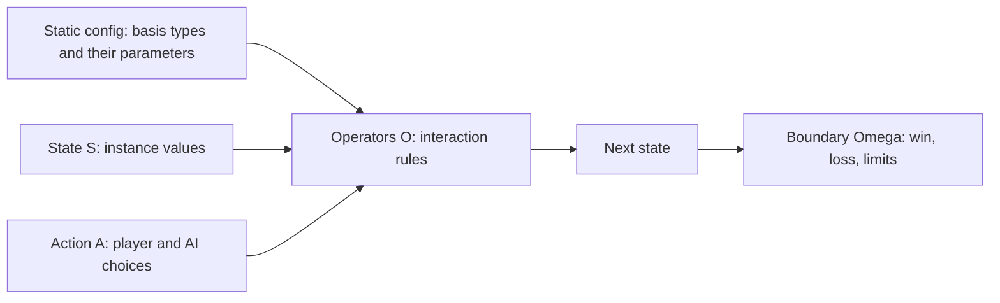
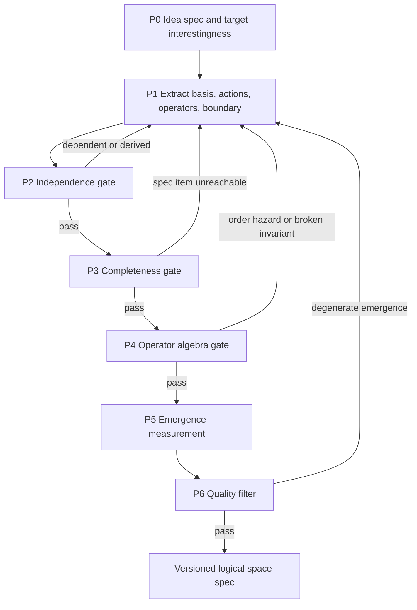
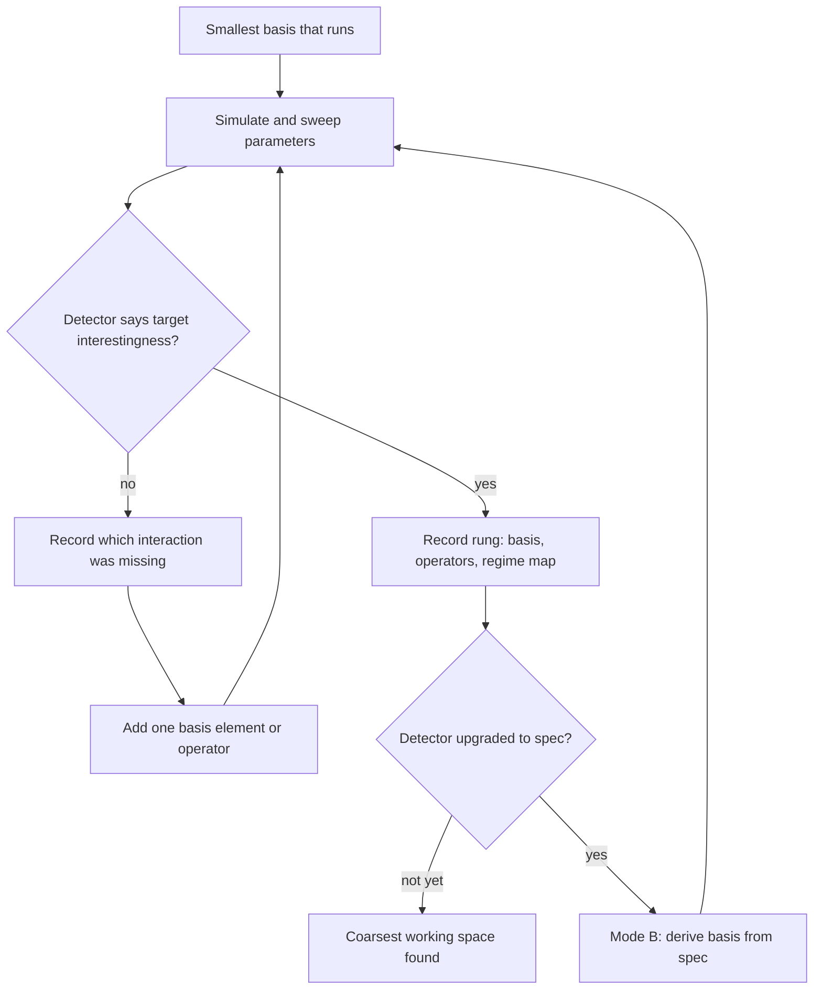

# Logical Space Base Theory — Core

> **Entry point.** When starting a new game, point to this file. It is the compact, canonical statement of the base theory.
> **Version:** `2026-10-24-logical-space-v0.2.1` (adds AG-6 basis ladder, section 4.1). Supersedes the `v0.1` pin that pointed to `AGENTS.md`.
> **Status:** Draft theory. Definitions and principles are agreed with the owner where marked. **No emergence measure is validated yet.** Treat every measure as a hypothesis until tested.
> **Detail lives elsewhere:** math explainer [Logical-Space-Mathematical-Foundations.md](Logical-Space-Mathematical-Foundations.md); step-by-step procedure [playbook](../../.cursor/playbooks/playbook-decompose-game-to-logical-space.md); full reasoning and decision history [discussion record](../../.cursor/plans/design/2026-10-24-logical-space-base-theory.md).

---

## 1. Thesis

Build a game from a small **basis** of elements that cannot be divided further within the game's scope. The basis spans a **logical space** of everything that can exist. **Operators**, the rules for how elements interact, produce emergent gameplay that nobody enumerated by hand. Because the code mirrors basis and operators, it is clean from the first day.

Fourier is the inspiration: few basis waves, a combining operator, any signal. The theory keeps Fourier's basis, span and measurement ideas and drops its linearity, because linear combination cannot create emergence.

---

## 2. Core Model

$$\mathcal{G} = \langle \mathcal{S}, \mathcal{A}, \hat{\mathbb{O}}, \Omega \rangle$$

| Term | Definition | Example |
|---|---|---|
| **Basis element** | A type that cannot be built from other elements by the game's operators | Substance type; Baba noun or property |
| **Coefficient** | Instance values of a basis element. Fourier analog: amplitude and phase belong to the coefficient, not the basis | Temperature of this tile; position of this wall |
| **Static config** | Parameters attached to basis types; lower-level detail collapsed into numbers | Boiling point, ignition point, mass |
| **State $\mathcal{S}$** | Everything a save file must hold to restore play exactly | HP, position, temperature |
| **Derived value** | Computable from state and config; **not** basis, not saved | Phase of matter; "is on fire"; Baba's active rule set |
| **Action $\mathcal{A}$** | Degrees of freedom the player or AI controls per decision | Shot vector; pushing a word block |
| **Operator $\hat{\mathcal{O}}$** | Function $\mathcal{S} \times \mathcal{A} \to \mathcal{S}$. **Never a basis element or a state axis** | Heat transfer; contact resolver; damage |
| **Two-level operator** | Fixed interpreter plus variable rule data held in state | Baba: parser is fixed, rule words are state |
| **Boundary $\Omega$** | Termination predicates | Waves cleared; all pets dead; turn limit |

---

## 3. Principles

| ID | Principle | Status |
|---|---|---|
| L1 | **Operators are not basis.** Resolvers, formulas and interaction tables are operators or config, never axes of $\mathcal{S}$. | Standing rule |
| L2 | **Basis = minimal generating set under the operators.** Generating: every game element is a composition of basis elements. Minimal: no basis element is a composition of the others. Atomicity is relative to the operator set. | Owner definition plus assistant formalization |
| L3 | **No sacred numbers.** With nonlinear operators, minimal generating sets may not be unique and may differ in size. Report the chosen basis, not a "dimension." | Standing rule |
| L4 | **Resolution rule.** The basis is the coarsest level that (1) generates every required mechanic plus the target emergence, (2) the player can perceive and predict, (3) fits compute and code cost. Finer detail collapses into config parameters. Physics analog: effective theory. Fourier analog: bandlimit. Do not dig toward "string theory." | **Agreed** AG-5 |
| L5 | **Derived values are not basis.** If a formula computes it from other coordinates, it is an operator output. | Agreed via examples |
| L6 | **Emergence lives in interaction terms.** Addition gives complexity without emergence: a sum of waves holds only its input frequencies. Products create new components: $\sin a \sin b = \tfrac12[\cos(a-b) - \cos(a+b)]$. Emergence: an operator whose output contains components outside its inputs. | **Agreed** AG-1 |
| L7 | **Completeness is relative to one idea's spec**, never "all games." | **Agreed** AG-2 |
| L8 | **Interesting is game-specific.** Each game declares target types from the catalog, section 5. | Owner |
| L9 | **Emergence is necessary, not sufficient.** Dominant combos, softlocks and trivializing shifts are emergent too. Filter them. | Agreed need |
| L10 | **Small parameter changes can flip the regime**, interesting to boring. Map the regime before tuning by hand. | Owner observation |
| L11 | **Evidence, not claims.** Every gate yields evidence. A measure is a hypothesis until it separates known emergent systems from known additive ones. | Standing practice |
| L12 | **Grow the basis by a ladder, stop by a detector.** Start at the smallest basis; add one element or operator per rung; each rung must earn new emergence. Climbing needs at least a **detector** for the target interestingness, or there is no stopping rule. See section 4.1. | **Agreed** AG-6 |

### 3.1 Worked Example of L2 to L5

| Candidate | Verdict | Reason |
|---|---|---|
| Fire, water | Too coarse | Steam, ice, extinguishing must each be hand-written |
| Substance type | Basis, config | Carries boiling point, ignition point, conductivity |
| Temperature | Basis coefficient, state | Not computable from other coordinates |
| State of matter | Derived | `phase(substance, T)` |
| Fire | Derived | Flammable substance above ignition point |
| Steam | Derived | Water above boiling point |

Operators: heat transfer, phase derivation, combustion. Steam, ice, extinguishing, burning wood and melting metal emerge without enumeration.

---

## 4. Process: Define and Confirm a Logical Space

Full steps in the [playbook](../../.cursor/playbooks/playbook-decompose-game-to-logical-space.md).

| Gate | Question | Evidence |
|---|---|---|
| P0 | What must the game do, and which kind of interesting does it target? | Numbered mechanics list; chosen types I1 to I6 with thresholds |
| P1 | What are $\mathcal{S}$, $\mathcal{A}$, $\hat{\mathbb{O}}$, $\Omega$, and at what resolution? | Decomposition table; L4 justification |
| P2 | Is every basis element independent? | Derivation test; save-game drop test; reachable-set dependence; category check |
| P3 | Does the space span the spec? | Coverage matrix with a witness action sequence per spec item |
| P4 | Are order, invariants and validity explicit? | Read/write table; commutator tests; property tests |
| P5 | How much emerges, and of the targeted kind? | Measures M1 to M6 |
| P6 | Is the emergence good? | Dominance, softlock, runaway, invariant and fake-choice checks; then human playtest |

### 4.1 Basis Ladder: How a Space Is Grown

P0 to P6 confirm a space. The ladder builds one. Each rung is a candidate space that runs through the gates.

| Mode | Needs | Use when | Speed |
|---|---|---|---|
| A, climb | **Detector**: recognizes the target interestingness in logs, cannot explain it | Interestingness not yet understood | Slow; trial and error |
| B, target-first | **Spec**: names which interaction terms produce the target, per L6 | Detector has been explained by rung history | Fast; basis follows from spec |

- **Detector before climbing.** Judging rungs by eye is unstable under L10. Each catalog type I1 to I6 needs a detector before a game climbs toward it.
- **Self-upgrading.** Each rung, success or failure, records which interaction made the difference. Enough records turn the detector into a spec; then switch to Mode B. The owner prefers Mode B whenever interestingness can be defined first.
- **One change per rung.** Otherwise the cause of a regime flip cannot be attributed.
- **Each rung keeps a regime map.** It shows where interesting flips to boring, per L10.
- **Existing engines are parts bins.** Reuse an existing operator only when a rung needs it.

Origin: Forest_Bloom review, 2026-10-24. Its engine grew to 100+ coupled parameters without a stopping rule, and its I2 target was not reached.

---

## 5. Interestingness Catalog

Add a type only with an example game and a test.

| Type | Meaning | Example | Test |
|---|---|---|---|
| I1 Affordance shift | A combination changes what the player can do, not only numbers | Baba Is You: WALL IS YOU | M5 |
| I2 Dynamic balance | Parameters produce a sustained, diverse, non-collapsing system; lives in parameter space | Forest_Bloom ecological balance | Regime map; M4 |
| I3 Solution diversity | Many distinct ways to reach a goal | BotW chemistry puzzles | M2, M3 |
| I4 Story emergence | Rule interactions produce memorable unscripted events | Dwarf Fortress, RimWorld | M2 plus player reports |
| I5 Strategic depth | No dominant strategy; skill keeps paying off | Chess, card games | P6 dominance; skill-luck measure |
| I6 Chain reaction | One action triggers a cascade of interactions | Bump_Hero: one shot chains allies' skills | M6 |

I1, I2 and I6 come from the owner; I3 to I5 are assistant candidates. **No type has a defined detector yet** (L12); I2 is first in line.

---

## 6. Measures and Tools

| Measure | Definition | Tool, explainer section |
|---|---|---|
| M1 Interaction share | Fraction of outcome variance from interaction terms | Boolean Fourier §3; Sobol §4 |
| M2 Novel outcomes | Outcome classes reached in simulation but absent from P0 | Simulation logs |
| M3 Strategy diversity | Entropy of strong agents' strategy distribution | Statistics §9 |
| M4 Dynamic modes | Decay, cycle and runaway modes of key observables | Koopman and DMD §5 |
| M5 Affordance shift | Change in responsive entities, possible moves, reachable set and strong-agent strategy after an event | Section 5, I1 |
| M6 Cascade profile | Cascade length per action; branching ratio $m$: below 1 dies out, near 1 heavy tail, above 1 explodes; best-shot versus random-shot gap for skill | Branching process; regime map §8A |

| Tool | Use | Explainer |
|---|---|---|
| Operator algebra | Order hazards, invariants, closure | §8 |
| Graph spectral | Dead subsystems, bottlenecks, resource sinks | §6 |
| Regime map | Where small parameter changes flip behavior | §8A |
| Telemetry spectra | Measured versus designed pacing | §7 |
| Statistics layer | Real versus fake choice, luck versus skill, dominance | §9 |

Cheap exact checks first: algebra, graph. Simulation-based checks next. Human playtest last.

---

## 7. Theory to Clean Code

| Theory | Code | Property gained |
|---|---|---|
| Basis types and parameters | Read-only config: ScriptableObjects, JSON tables | Balance edits never touch logic; new content is a config row |
| State coefficients | Plain data components; the save payload | Trivial save and load; no derived data stored |
| Derived values | Computed on read | No sync bugs |
| Actions | Command objects | Input, AI and replay share one path |
| Operators | Pure functions or ECS systems in an explicit ordered pipeline | Deterministic, headless-testable; order visible |
| Boundary | Predicates after each tick | Win and loss logic in one place |
| Invariants | Property tests | Balance claims become assertions |

The view reads state and never writes it. Headless simulation is required for P2, P3, P5 and P6.

---

## 8. New Game Quickstart

1. Write P0: required mechanics and target interestingness types with thresholds.
2. Inventory mechanics with no theory labels; playbook step 1.
3. Pick the resolution by L4. Write the basis table; mark config, state and derived for every entry.
4. Write the operator table: signature, reads, writes, order. Identify interaction operators.
5. Run P2 and P3 on paper; fix gaps and redundancy.
6. Build a headless simulation of the operators as early as possible.
7. Run P4 to P6; record seeds, source revision and results.
8. Version the spec. Feed lessons back into this file and the playbook.

---

## 9. Known Stress Points

- **Continuous actions.** A shot vector or analog input needs sampling over the action space, not Boolean enumeration.
- **Two time scales.** Discrete turns wrapping a continuous physics sub-simulation need a turn operator containing a physics operator.
- **Rules as state.** Rule-editing games need two-level operators. The separation still holds at the interpreter level.
- **Implicit order.** Per-entity turn hooks and conflicting rules (Baba: WALL IS STOP versus WALL IS DEFEAT) must get explicit priority.
- **Measure validity.** M1 to M6 are unvalidated.
- **Agents are not humans.** Simulation shows what rules allow, not what players enjoy.

---

## 10. Case Studies

| Case | Role | Status | Link |
|---|---|---|---|
| Baba Is You | Reference: no default properties; rules as state; pairwise property operators; levels curate emergence | Analyzed from sources | Discussion record §3.4 |
| Bump_Hero | Turn-based physics flick roguelike; target I6 | First-pass decomposition; testing waits for package adoption | [exploration](../explorations/bump-hero-logical-space/README.md) |
| Forest_Bloom | Ecosystem sandbox; target I2 | Deep discussion waits for adoption in that project | Discussion record §6 |
| Limbus Company | Combat decomposition | Earlier exploration | [exploration](../explorations/limbus-company-logical-space/) |
| Big Five | Psychology projection sandbox | Downstream branch; **pre-v0.2, non-conformant** with P0, L1, L3, L4, L6; game-first rework pending | [sandbox](../explorations/big-five-logical-projection/README.md) |

Anti-bias: derive each game's basis independently. Only what recurs across games may enter this core.

---

## 11. Version History

| Version | Date | Change |
|---|---|---|
| v0.1 | 2026-10-04 | Purpose stated in `AGENTS.md`; model $\mathcal{G}$ in playbook |
| v0.2 | 2026-10-24 | First core statement: definitions, principles L1 to L11, P0 to P6, catalogs I1 to I6 and M1 to M6, clean-code mapping, quickstart |
| v0.2.1 | 2026-10-24 | AG-6: principle L12 and basis ladder, section 4.1; detector versus spec; modes A and B |
