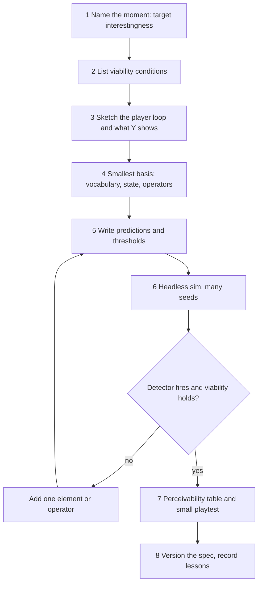

# Logical Space — Designer Guide

> **For:** designers starting a systemic game with the Logical Space method. **Status:** internal guide, matches core `v0.3-draft`.
> **Read with:** [core theory](Logical-Space-Base-Theory.md) for definitions and principles L1 to L17; [playbook v3.0](../../.cursor/playbooks/playbook-decompose-game-to-logical-space.md) (Vietnamese) for the full 13-step audit.
> **This guide gives:** a one-page quickstart, a glossary, fill-in templates, and the mistakes that cost the most so far.

---

## 1. The Method in One Paragraph

Pick the kind of moment you want players to have. Find the **smallest** set of types, properties and state that can produce that moment when simple rules run over and over. Make sure the player can **see** the cause and the effect. Keep the conditions that keep the moment possible separate from the moment itself. Grow the rule set one change at a time, writing your prediction down before each run, and stop when a detector says the moment happens. Then test with real players.

---

## 2. Quickstart



| Step | Do | Output | Principle |
|---|---|---|---|
| 1 | Name the moment. Pick target types from the catalog (core section 5) | One sentence: "the player does X and sees Y happen" | L8 |
| 2 | List what must stay true for the moment to exist | Viability list with a check per item | L16 |
| 3 | Write the player loop: act → simulation → feedback → understanding → act | Loop sketch; what $Y$ shows at the moment | L13, L17 |
| 4 | Choose the smallest vocabulary, state and operators. Mark each entry config, state or derived | Basis table, operator table | L1 to L5 |
| 5 | Before running: write thresholds and what you expect to happen | Prediction sheet | L14 |
| 6 | Run headless, many seeds. Compare with predictions | Run log | L11 |
| 7 | If the detector does not fire, add **one** thing and repeat | Ladder record | L12 |
| 8 | Check the player sees cause and effect; run the playtest kit | Perceivability table; playtest notes | L13, P7 |
| 9 | Version the spec; feed lessons back | Versioned spec | — |

Progression comes after the space works: levels, unlocks or scenarios restrict what the rule space offers so players meet one insight at a time (L15).

---

## 3. Glossary

| Term | Plain meaning | Test or rule |
|---|---|---|
| **Vocabulary $\mathcal{V}$** | The types and properties the rules read: "wood", "flammable", "boiling point" | A content item is a config row over $\mathcal{V}$, not a new basis element |
| **State $\mathcal{S}$** | What a save file must hold to restore play exactly | Save-file test: drop it, reload; if play is identical, it was not state |
| **Config** | Fixed numbers attached to types | Never changes during play, unless a meta-action edits it |
| **Derived value** | Anything computable from state and config: "is burning", "phase of matter" | Computed on read, never saved |
| **Operator** | A rule that turns state plus action into next state | Never a basis element, never a state axis (L1) |
| **Action $\mathcal{A}$** | What the player or AI chooses each decision | If empty, there is no game yet |
| **Meta-action** | A player action that edits config: gene tweaks, sliders | In sandboxes, the regime map is the playground |
| **Observation $Y$** | What the player can see or hear | Read-only; never writes state |
| **Basis** | Vocabulary plus state coordinates, minimal under ablation | Remove any part and some required mechanic or the target disappears (L2) |
| **Emergence** | An outcome produced by rules running over many steps that nobody listed in advance | A single hand-written interaction is content, not emergence (L6) |
| **Target interestingness** | The moment players enjoy | Checked in P5 and P7 |
| **Viability condition** | What must hold for the target to exist at all | Checked in P6 as an invariant (L16) |
| **Detector** | A log signal that says "the target happened" | Needed before climbing the ladder |
| **Spec** | An explanation of which interactions, iterated through which loops, produce the target | Upgraded from detector by ladder history |
| **Regime map** | Map of parameter space showing where behavior flips from interesting to boring | Draw before hand-tuning (L10) |
| **Ladder rung** | One candidate space: one change from the previous rung | Write the prediction first |

---

## 4. Templates

Copy into the game's `<game>-logical-space/README.md`. The examples use the generic fire-and-water system from the core, not any project game.

### 4.1 P0 Idea Spec

```markdown
## P0 — <game>

**The moment (one sentence):** <the player does X and sees Y happen>
**Target types:** <I1 to I6>, threshold: <number, written before any run>
**Detector:** <log signal that says the moment happened> | "no detector yet"

| # | Required mechanic or experience | Witness needed in P3 |
|---|---|---|
| 1 | | |

**Viability conditions (L16):**

| # | Condition | Hidden check | Player-facing signal (L17) |
|---|---|---|---|
| V1 | | | |

**Player loop:** act → <what the sim does> → <what Y shows> → <what the player learns> → act
**Progression (L15):** <levels / unlocks / scenarios> | "none, because <reason>"
**Predictions (L14):** <what you expect the first rung to do>
```

Example, fire and water:

| Field | Value |
|---|---|
| Moment | Player pours water near a fire and watches steam block the path |
| Target | I3 solution diversity, at least 3 distinct ways to clear a burning bridge |
| Viability | V1: fire can always be put out by some means; hidden check: no unreachable win in 1000 seeds |
| Player loop | Pour water → heat transfer → steam particles and hiss → "water plus fire makes cover" → use steam to sneak |

### 4.2 Basis Table

| Entry | Kind: vocabulary / state / config / derived | Why | Test passed |
|---|---|---|---|
| Substance type | Vocabulary | Carries boiling and ignition points | Ablation: removing it loses steam and burning |
| Temperature | State | Not computable from others | Save-file test |
| Boiling point | Config | Fixed per substance | — |
| Phase of matter | Derived | `phase(substance, T)` | Derivation test |

**Basis choice reason (L3, AG-10):** <why this basis over another minimal one: player-visible first, then fewer operators, then code reuse>

### 4.3 Operator Table

| Order | Operator | Reads | Writes | Feeds loop with |
|---|---|---|---|---|
| 1 | Heat transfer | Temperature, conductivity | Temperature | Combustion |
| 2 | Combustion | Temperature, ignition point | Temperature, fuel | Heat transfer |

The last column names the loop: emergence needs operators that feed each other over many steps (L6).

### 4.4 Ladder Record, one row per rung

| Rung | One change | Prediction, written before | Detector result | Viability | Regime note | Lesson |
|---|---|---|---|---|---|---|
| 0 | Smallest basis that runs | | | | | |

### 4.5 Perceivability Table (P7)

| Target event | Deciding state | Cause visible where | Effect visible where | Pass? |
|---|---|---|---|---|
| Steam blocks path | Temperature, phase | Red glow on hot tiles | Steam cloud, hiss | Yes |

### 4.6 Playtest Kit (P7, AG-11)

| # | Measure | How | Record |
|---|---|---|---|
| 1 | Free-choice continuation | After the session: "you may stop or keep playing" | Minutes played voluntarily |
| 2 | Retell | "Most memorable moment? Why did it happen?" | Correct cause yes or no |
| 3 | IMI Interest/Enjoyment | Short questionnaire, only when comparing versions | Score per version |

---

## 5. Costly Mistakes

| Mistake | Symptom | Fix | Source |
|---|---|---|---|
| Building bottom-up with no target | Hundreds of coupled parameters; "interesting in the sim, not fun" | Write P0 first; climb a ladder with a detector | Forest_Bloom audit, 2026-10-24 |
| Optimizing a viability condition as the goal | All effort goes into balance; the real moment is undefined | Separate targets from viability (L16) | Forest_Bloom, 2026-11-03 |
| Calling a hand-written rule "emergence" | "Fire melts ice" listed as emergent | Name the loop that spreads it, or stop claiming emergence (L6) | Critique H1 |
| Invisible emergence | Logs show rich behavior; players see nothing | Fix $Y$ before adding rules (L13) | Forest_Bloom audit |
| Too many numbers on screen | Player must read thresholds | Compress to 1 or 2 directional signals plus a visual (L17) | Forest_Bloom, 2026-11-03 |
| Explaining results after the fact | Every outcome "fits" the theory | Write predictions and thresholds before running (L14) | Critique H4 |
| Several changes per rung | Cannot tell what flipped the regime | One change per rung (L12) | AG-6 |
| Carrying axes from another project | Basis looks like the last game's basis | Derive each game's basis from its own P0 | Case-study isolation rule |

Full list of ontology traps: playbook step 13.

---

## 6. Where This Method Sits

Sellers' Parts, Loops, Wholes and MDA describe systems. This method **measures and tests** them: a testable ontology, a basis ladder with a stopping rule, and gates from simulated emergence to player experience. See core section 11 and the [critique record](../../.cursor/plans/design/2026-11-03-logical-space-critique-and-study.md) section 5.1.
