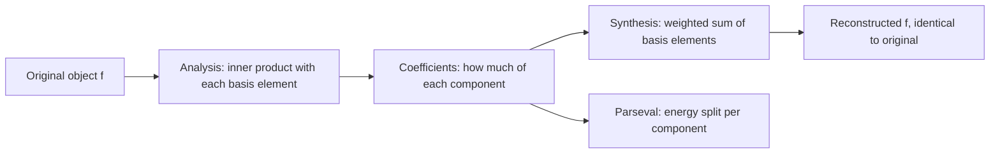
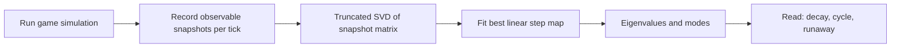
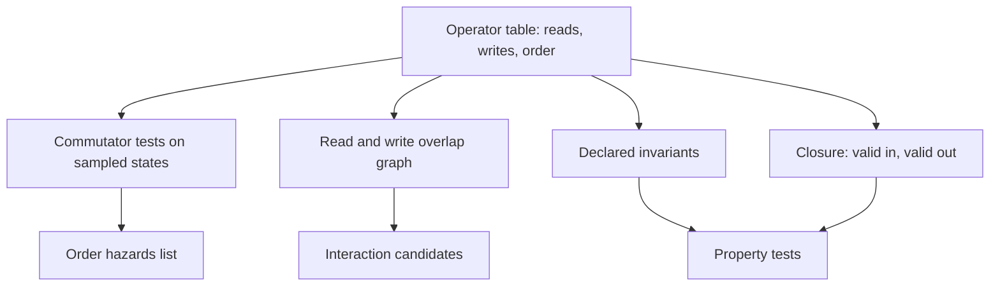
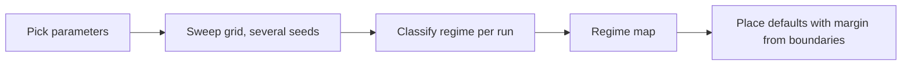
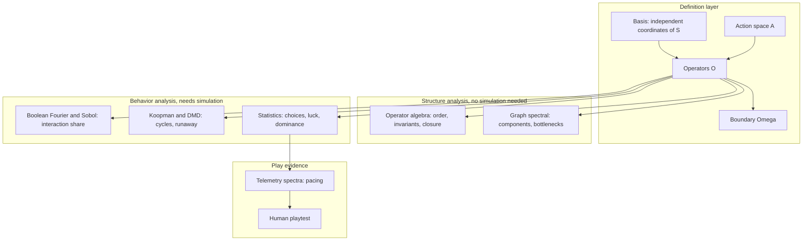
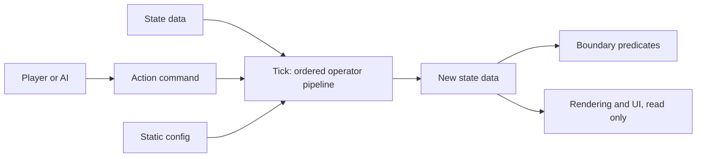

# Logical Space for Game Design — Mathematical Foundations (Explainer)

> **Status:** Exploratory explainer, draft v0.1 (2026-10-24). Nothing here is a proven theory of games. Each idea is a candidate tool, with its rigor and limits stated.
> **Builds on:** the canonical game model $\mathcal{G} = \langle \mathcal{S}, \mathcal{A}, \hat{\mathbb{O}}, \Omega \rangle$ from [playbook-decompose-game-to-logical-space.md](../../.cursor/playbooks/playbook-decompose-game-to-logical-space.md), and the [basis/operator separation rule](../../.claude/rules/no-case-study-bias-and-basis-orthogonality.md).
> **Discussion record:** [2026-10-24-logical-space-base-theory.md](../../.cursor/plans/design/2026-10-24-logical-space-base-theory.md).

---

## 0. Summary

The owner's idea: build a game from a small **basis** of independent primitives. The basis spans a **logical space**. **Operators** acting between basis elements produce emergent gameplay. Fourier is the inspiration.

The central tension: Fourier is clean *because* it is linear, and linear systems cannot produce emergence. This document shows how to keep the useful part of Fourier (basis, coefficients, reconstruction, measuring "how much of what") and drop the part that forbids emergence (linear operators).

| Idea | What it is | What it gives a game designer | Rigor | Cost to apply |
|---|---|---|---|---|
| A. Fourier on the Boolean cube | Exact Fourier transform over on/off features | Measures how much of an outcome comes from **interactions** versus single features | Exact theorem | Low: enumerate or sample feature combos |
| B. Functional ANOVA / Sobol | Same idea for continuous parameters | Interaction share of outcome variance; which parameters matter | Exact decomposition, estimated by sampling | Medium: Monte Carlo runs |
| C. Koopman operator / DMD | Linear "Fourier" view of nonlinear dynamics | Dominant cycles, growth and decay modes of an ecosystem or economy | Exact operator, approximate computation | Medium to high: trajectory data |
| D. Graph spectral analysis | Fourier basis on a graph | Dead subsystems, bottlenecks, slow modes of resource and dependency graphs | Exact linear algebra | Low |
| E. Telemetry spectral analysis | Literal Fourier on play time series | Pacing rhythm, event frequency, tension cycles | Standard signal processing | Low, given a defined signal |
| F. Operator algebra | Composition, order, invariants of rules | Order-dependence bugs, interaction hazards, conservation guarantees | Exact when operators are explicit | Low |
| H. Regime maps | Parameter sweep classified into qualitative behavior regions | Shows where one small parameter change flips interesting to boring | Empirical | Medium: sweep times seeds |
| G. Statistics layer | Measurement over many playouts | Luck versus skill, dominant strategies, real versus fake choices | Standard statistics | Medium: simulation harness |

---

## 1. What Fourier Actually Does

Strip Fourier down to five parts.

1. **A space.** Functions $f$ on an interval, with an inner product $\langle f, g \rangle = \frac{1}{2\pi}\int_{-\pi}^{\pi} f(x)\,\overline{g(x)}\,dx$.
2. **An orthonormal basis.** $e_n(x) = e^{inx}$, with $\langle e_n, e_m \rangle = 1$ if $n = m$, else $0$.
3. **Coefficients.** $\hat f(n) = \langle f, e_n \rangle$: "how much of basis element $n$ is in $f$."
4. **Reconstruction.** $f = \sum_n \hat f(n)\, e_n$. Nothing is lost.
5. **Parseval.** $\|f\|^2 = \sum_n |\hat f(n)|^2$. Total "energy" splits exactly across basis elements.

**The deeper reason Fourier is useful:** the basis **diagonalizes** a class of operators. For a linear time-invariant system $L$ (differentiation, convolution, heat flow), each $e_n$ is an eigenfunction: $L e_n = \lambda_n e_n$. A hard coupled problem becomes many independent one-line problems. Heat equation example: each mode decays on its own, $\hat u(n, t) = \hat u(n, 0)\, e^{-n^2 t}$.

So the transferable lesson for game design is not "decompose into sine waves." It is:

> **Choose a basis in which the rules become as simple as possible, and in which you can measure how much each component contributes.**

---

## 2. Why Literal Fourier Fails for Games

**Superposition.** A linear system satisfies $L(a + b) = L(a) + L(b)$. The response to two things together is the sum of the responses to each alone. There are no cross-terms.

**Emergence lives in cross-terms.** Take a fire rule. Let $B$ = "tile is burning," $W$ = "tile is wet." Fire spreads only if burning *and* not wet:

$$\text{spread} = B \cdot (1 - W)$$

Expanded, this is $B - B W$. The term $-BW$ is an interaction: the effect of wetness depends on whether there is fire. No linear rule can express it. Every "combo," threshold, counter, synergy and conditional in a game is a cross-term.

| Fourier property | Keep for game theory? | Why |
|---|---|---|
| Basis of independent primitives | **Keep** | This is the "clean from the start" part |
| Span: everything is built from the basis | **Keep** | This is "completeness" |
| Coefficients: measure how much of each | **Keep**, reinterpreted | Measure contribution and interaction strength |
| Reconstruction and invertibility | **Keep partially** | Rebuilding a state from coordinates holds; rebuilding *rules* from outcomes does not |
| Linear operators | **Drop** | Linearity forbids emergence |
| Orthogonality of operators | **Drop** | Operators must interact, otherwise nothing emerges |

**Addition versus multiplication of waves.** A sum of sinusoids contains exactly the input frequencies, no more. A square wave built from sines looks complex, but it is pure superposition: complexity, not emergence. A product creates new components:

$$\sin a \cdot \sin b = \tfrac{1}{2}\left[\cos(a - b) - \cos(a + b)\right]$$

The output has frequencies $a - b$ and $a + b$ that neither input had. Signal processing calls this intermodulation. This gives a precise image of emergence: **an operator whose output contains components outside the span of its inputs.** Note also that in Fourier the basis is indexed by frequency alone; amplitude and phase belong to the coefficient $\hat f(n) = A e^{i\varphi}$, not to the basis.

**The resolution used in ideas A and B:** the *transform* can stay linear while the *rules* are nonlinear. You apply a linear transform to the **outcome function** of a nonlinear game rule. The coefficients then tell you how much of the outcome comes from single features and how much from interactions. That is "Fourier without forbidding emergence."

---

## 3. Idea A — Fourier on the Boolean Cube

**This is a real Fourier transform, and it measures interactions directly.** Standard reference: O'Donnell, *Analysis of Boolean Functions* (2014).

### 3.1 Definition

Let a game situation be described by $n$ on/off features, encoded $x_i \in \{-1, +1\}$. Any outcome function $f: \{-1,+1\}^n \to \mathbb{R}$ has a unique expansion

$$f(x) = \sum_{T \subseteq \{1..n\}} \hat f(T)\, \chi_T(x), \qquad \chi_T(x) = \prod_{i \in T} x_i$$

- $\chi_\emptyset = 1$: the constant part.
- $\chi_{\{i\}} = x_i$: the effect of feature $i$ alone.
- $\chi_T$ with $|T| \ge 2$: **interaction** of the features in $T$.

The characters $\chi_T$ are orthonormal under the uniform distribution on inputs, so $\hat f(T) = \mathbb{E}_x[f(x)\,\chi_T(x)]$ and Parseval holds: $\mathbb{E}[f^2] = \sum_T \hat f(T)^2$.

### 3.2 Worked example: fire spread

Features: $B$ (burning, $+1$ = yes), $W$ (wet, $+1$ = yes). Outcome $f = 1$ if burning and dry, else $0$.

$$f = \frac{1 + B}{2}\cdot\frac{1 - W}{2} = \frac{1}{4} + \frac{1}{4}B - \frac{1}{4}W - \frac{1}{4}BW$$

| Term | Coefficient | Meaning |
|---|---|---|
| constant | $1/4$ | base rate: spreads in 1 of 4 situations |
| $B$ | $+1/4$ | burning alone pushes toward spread |
| $W$ | $-1/4$ | wetness alone pushes against spread |
| $BW$ | $-1/4$ | interaction: wetness matters only with fire present |

Check with Parseval: $4 \times (1/4)^2 = 1/4 = \mathbb{E}[f^2]$, since $f = 1$ in one of four cases.

**Interaction share.** Variance is $\sum_{T \ne \emptyset} \hat f(T)^2 = 3/16$. Interaction weight is $\sum_{|T| \ge 2} \hat f(T)^2 = 1/16$. So **1/3 of this rule's variation comes from interaction**. A purely additive rule scores 0.

### 3.3 Use in game design

- Pick the basis features of a system (element properties, unit tags, terrain flags).
- Pick an outcome to study (damage dealt, fire spread, win, resource gained).
- Compute or sample $\hat f(T)$.
- Read the spectrum:
  - All weight on $|T| \le 1$: the system is additive. Expect no emergence.
  - Weight on $|T| = 2$: pairwise combos exist. This is the BotW "chemistry" zone.
  - Weight on high $|T|$: deep combos. Possibly rich, possibly opaque to players.
  - A single huge coefficient: a likely dominant combo.

**Limits.** Orthonormality assumes uniform independent inputs. Real play does not visit all combinations equally. With $p$-biased inputs, use the biased Fourier basis (O'Donnell, ch. 8); with arbitrary distributions, use idea B. There are $2^n$ coefficients, so for large $n$ sample them or restrict to low degree.

---

## 4. Idea B — Functional ANOVA and Sobol Indices

The continuous generalization of idea A, and the bridge to statistics. References: Sobol (1993, 2001); Saltelli et al., *Global Sensitivity Analysis: The Primer* (2008).

### 4.1 Definition

Let outcome $Y = f(X_1, \dots, X_k)$ with **independent** random inputs (tunable parameters, initial conditions, random rolls). Then $f$ has a unique decomposition

$$f = f_0 + \sum_i f_i(X_i) + \sum_{i<j} f_{ij}(X_i, X_j) + \dots + f_{1..k}(X_1,\dots,X_k)$$

where each term has zero mean in each of its own variables. The terms are orthogonal, so variance splits exactly:

$$\operatorname{Var}(Y) = \sum_i V_i + \sum_{i<j} V_{ij} + \dots$$

**Sobol indices:** $S_i = V_i / \operatorname{Var}(Y)$ is the main effect of $X_i$. $S_{ij} = V_{ij}/\operatorname{Var}(Y)$ is the pair interaction. Total index $S_{T_i}$ is everything involving $X_i$.

### 4.2 Use in game design

- **Interaction share** $1 - \sum_i S_i$: the fraction of outcome variance that exists *only* because parameters interact. This is a candidate quantitative measure of emergence for one outcome.
- **Dead parameter:** $S_{T_i} \approx 0$. That knob does nothing. Delete it or connect it.
- **Dominating parameter:** $S_i \approx 1$. The outcome is effectively one-dimensional.
- **Balancing target:** know which knobs to turn before turning them.

**Estimation:** Saltelli or Jansen Monte Carlo estimators, roughly $N(k+2)$ simulation runs. Report confidence intervals by bootstrap.

**Limits.** Requires independent inputs; correlated inputs need other methods (Shapley effects). It measures *variance*, not fun. A high interaction share means "outcomes depend on combinations," which is necessary for emergence but not sufficient for good gameplay.

---

## 5. Idea C — Koopman Operator and DMD

**The closest rigorous "Fourier for nonlinear dynamics."** References: Koopman (1931); Mezić (2005); Schmid (2010); Brunton and Kutz, *Data-Driven Science and Engineering* (2019).

### 5.1 Definition

A game tick is a map $x_{t+1} = F(x_t)$ on state space $\mathcal{S}$, generally nonlinear. Instead of tracking states, track **observables** $g: \mathcal{S} \to \mathbb{C}$ (total population, gold, average health). The Koopman operator acts on observables:

$$(\mathcal{K} g)(x) = g(F(x))$$

$\mathcal{K}$ is **linear** even when $F$ is not, because $\mathcal{K}(a g + b h) = a\,\mathcal{K}g + b\,\mathcal{K}h$. The price is that it acts on an infinite-dimensional function space.

Eigenfunctions $\varphi$ with $\mathcal{K}\varphi = \lambda \varphi$ evolve independently: $\varphi(x_t) = \lambda^t \varphi(x_0)$.

- $|\lambda| < 1$: decaying mode, the system settles.
- $|\lambda| = 1$, $\lambda \ne 1$: sustained cycle, with period from $\arg\lambda$.
- $|\lambda| > 1$: growing mode: runaway, snowball, inflation.

This is exactly Fourier's diagonalization trick, applied to the observables of a nonlinear system.

### 5.2 Computing it: Dynamic Mode Decomposition

From recorded snapshots, stack observable vectors into $X = [y_0, \dots, y_{m-1}]$ and $X' = [y_1, \dots, y_m]$. Find the best linear map $A$ with $X' \approx A X$ through a truncated SVD of $X$. The eigenvalues of $A$ approximate Koopman eigenvalues; its eigenvectors give **modes** (spatial patterns).

### 5.3 Use in game design

- Ecosystem or economy simulation: find predator-prey cycles, boom-bust periods, runaway growth.
- Check a design claim like "this system self-balances": all non-trivial eigenvalues inside the unit circle.
- Spatial modes on a grid: which regions oscillate together.

**Limits.** Finite DMD is an approximation that depends on the chosen observables. Systems with thresholds, discrete events or chaos have continuous spectra that DMD only roughly captures. Results describe the sampled trajectories, not all reachable behavior. **DMD output is evidence, not proof of stability.**

---

## 6. Idea D — Graph Spectral Analysis

Fourier on a graph. References: Chung, *Spectral Graph Theory* (1997); Shuman et al., "The Emerging Field of Signal Processing on Graphs" (2013).

### 6.1 Definition

Model game systems as a graph: nodes are resources, entities or mechanics; weighted edges are flows or dependencies. For an undirected graph with weight matrix $W$ and degree matrix $D$, the **Laplacian** is $L = D - W$. Its eigenvectors form a **graph Fourier basis**; small eigenvalues are "smooth, slow" patterns and large ones are "jagged, fast."

| Spectral fact | Game reading |
|---|---|
| Number of zero eigenvalues = number of connected components | Isolated subsystems: mechanics that never affect the rest |
| Second-smallest eigenvalue small: Fiedler value | Bottleneck: two halves joined by a weak link |
| Fiedler vector sign split | Where the bottleneck is |

For **directed** flows (resource conversion chains), use a Markov chain transition matrix $P$ instead: the stationary distribution shows where resources pile up; the second-largest eigenvalue modulus gives the mixing time; absorbing states are sinks that drain the economy.

### 6.2 Use in game design

Build the resource and dependency graph straight from the operator table: an edge exists where operator $\hat O_k$ reads one quantity and writes another. Then run the spectral checks before any playtest. This connects to Machinations-style economy design (Adams and Dormans, *Game Mechanics: Advanced Game Design*, 2012).

**Limits.** The graph is a linear summary. It shows structure, not thresholds or timing.

---

## 7. Idea E — Spectral Analysis of Play Telemetry

**Literal Fourier, applied to recorded play.**

Define a signal: tension (enemy count, damage taken per second), reward events, resource level. Compute the power spectral density (Welch's method) or autocorrelation. Read:

- Dominant period: the pacing rhythm, for example a wave every 90 seconds.
- Flat spectrum: no rhythm; possibly monotonous or chaotic.
- Energy shifting over time: escalation. Use a short-time Fourier transform or wavelets, because play is rarely stationary.

**Use:** compare the *designed* pacing curve with the *measured* one. **Limits:** the result depends on which signal you define; the theory must specify signals per game.

---

## 8. Idea F — Operator Algebra

Operators are functions $\hat O: \mathcal{S} \times \mathcal{A} \to \mathcal{S}$ (per the [separation rule](../../.claude/rules/no-case-study-bias-and-basis-orthogonality.md)). Treating them algebraically gives cheap, exact checks.

- **Composition.** A tick is a pipeline $\hat O_m \circ \dots \circ \hat O_1$.
- **Commutator test.** If $\hat O_1 \circ \hat O_2 \ne \hat O_2 \circ \hat O_1$ on some states, order matters. Each non-commuting pair is either a deliberate rule (damage before death check) or a hidden bug. The 2026-10-04 root-coupling correction was exactly this class: in-place neighbor reads made results order-dependent.
- **Read/write table.** For each operator, list which coordinates it reads and writes. Two operators that write the same coordinate, or where one reads what the other writes, are interaction candidates.
- **Invariants.** A quantity $Q$ with $Q(\hat O(s, a)) = Q(s)$ for all $s, a$ is conserved. Declaring invariants (total water, total gold excluding sources and sinks) turns balance claims into testable properties. The 2026-10-04 conservative soil flux is an example.
- **Closure.** Every operator must map valid states to valid states: bounds, non-negativity, finite values. This is the formal version of "no impossible state."

---

## 8A. Idea H — Regime Maps and Parameter Sensitivity

**Observation behind it:** one small parameter change can turn rich emergence into boring behavior. In dynamics this is a **bifurcation**: the long-run behavior changes qualitatively at a critical parameter value.

### 8A.1 Method

1. Pick one or two parameters, such as growth rate and spread radius.
2. Sweep a grid of values; run several seeds per point.
3. Classify each run's long-run behavior into a **regime**, using measures fixed in advance.
4. Plot regimes over the parameter grid: a phase diagram for the game.

| Example regime, generic | Possible operational test |
|---|---|
| Extinction or empty | Active entity count reaches zero |
| Frozen fixed point | State stops changing; all non-trivial DMD eigenvalue moduli well below 1 |
| Monoculture | Diversity entropy near zero |
| Sustained cycles | DMD eigenvalue near the unit circle; spectral peak |
| Rich coexistence | Diversity stays high; long transients; no fixed point within the horizon |
| Runaway | Some quantity grows without bound; eigenvalue modulus above 1 |

### 8A.2 Related Work and Caution

- Cellular automata: Wolfram's four behavior classes; Langton's single parameter $\lambda$ tunes rule tables, with complex behavior reported near a transition (Langton, "Computation at the edge of chaos," Physica D, 1990).
- **Caution:** the "edge of chaos" hypothesis is contested; Mitchell, Hraber and Crutchfield (1993) failed to reproduce key claims. A regime map is an empirical tool. It does not assume interesting behavior always sits at a boundary.
- Sobol indices, idea B, measure variance of a numeric outcome. Regimes are categories, so use classification plus sweep, or Sobol on a regime indicator.

**Limits.** The map covers only the swept parameters and horizon. Regime labels depend on measures chosen in advance; "interesting" must be defined per game with the designer.

---

## 9. The Statistics Layer

Statistics is how the theory gets tested. It needs a **simulation harness**: the game's operators run headless, with seeded randomness and scripted or learned agents.

| Question | Measure | Notes |
|---|---|---|
| Is a choice real or fake? | Decision entropy $H = -\sum_a p(a)\log p(a)$ over choices good agents make; outcome difference between choices | Low entropy among strong agents: one option dominates |
| Luck versus skill | Outcome variance across seeds with fixed agent versus across agents with fixed seeds; skill gap between random and strong agents | Several published skill-luck measures exist; pick one and state it |
| Dominant strategy | Win rate per strategy with confidence intervals | A strategy that beats all others beyond its interval is a hazard |
| Which parameters matter | Sobol indices, idea B | Dead and dominating knobs |
| How much emerges | Interaction share, ideas A and B; count of distinct outcomes not listed in the design spec | Candidate measures, to validate |
| Is the design claim true | Hypothesis test or interval estimate over many seeds | Report seeds, runs and source revision |

**Limits.** Agents are not humans. Statistics on bots shows what the rules *allow*, not what players *enjoy*. Human playtest stays a separate, necessary evidence layer.

---

## 10. How the Ideas Fit Together

Cheap, exact checks come first; expensive statistical checks later; human evidence last.

---

## 11. Mapping to Clean Code

The owner's goal includes clean code from the first day. The model maps directly to architecture.

| Theory element | Code element | Property it buys |
|---|---|---|
| Basis coordinates of $\mathcal{S}$ | Plain data components, the save-game payload | Save and load are trivial; no derived data stored |
| Static config | Read-only tables, ScriptableObjects or JSON | Balance changes never touch logic |
| Action space $\mathcal{A}$ | Command objects | Replays, AI and input share one path |
| Operators $\hat{\mathbb{O}}$ | Pure functions or ECS systems taking state and action, returning state or deltas | Deterministic tests, order made explicit |
| Boundary $\Omega$ | Predicates checked after each tick | Win, loss and timeout in one place |
| Invariants | Property tests | Balance claims become assertions |

The view reads state and never writes it. This keeps simulation testable headless, which the statistics layer requires.

---

## 12. Open Problems

1. **Which basis?** "Basis" can mean coordinates of $\mathcal{S}$, a property vocabulary for content (BotW-style tags), or primitive actions. The theory must say which, or how they relate. See the discussion record.
2. **Independence for non-linear, discrete spaces.** Linear independence does not apply. Candidate: *functional* independence, meaning no coordinate is a function of the others on the reachable set. A test procedure is drafted in the discussion record.
3. **Completeness.** Only meaningful relative to a stated idea spec. Needs a coverage method.
4. **Emergence measure validity.** Interaction share and novel-outcome counts are candidates. They must be validated on games where designers agree emergence exists, and on games where it does not.
5. **Good versus degenerate emergence.** Interaction is necessary, not sufficient. Dominant combos and exploits are also emergent.
6. **Real-time and continuous games.** Boolean features and discrete ticks fit turn-based and grid games best. Action games such as a platformer or brawler may need continuous state and hybrid dynamics.

---

## 13. References

References are from prior knowledge and were not re-verified this session. Verify before formal citation.

- R. O'Donnell, *Analysis of Boolean Functions*, Cambridge University Press, 2014.
- I. M. Sobol, "Sensitivity estimates for nonlinear mathematical models," 1993; "Global sensitivity indices for nonlinear mathematical models and their Monte Carlo estimates," 2001.
- A. Saltelli et al., *Global Sensitivity Analysis: The Primer*, Wiley, 2008.
- B. O. Koopman, "Hamiltonian systems and transformation in Hilbert space," PNAS, 1931.
- I. Mezić, "Spectral properties of dynamical systems, model reduction and decompositions," Nonlinear Dynamics, 2005.
- P. J. Schmid, "Dynamic mode decomposition of numerical and experimental data," J. Fluid Mech., 2010.
- S. L. Brunton and J. N. Kutz, *Data-Driven Science and Engineering*, Cambridge University Press, 2019.
- F. Chung, *Spectral Graph Theory*, AMS, 1997.
- D. Shuman et al., "The emerging field of signal processing on graphs," IEEE Signal Processing Magazine, 2013.
- E. Adams and J. Dormans, *Game Mechanics: Advanced Game Design*, New Riders, 2012.
- J. Dormans, *Engineering Emergence: Applied Theory for Game Design*, PhD thesis, University of Amsterdam, 2012.
- H. Fujibayashi, S. Dohta, T. Takizawa, "Breaking Conventions with The Legend of Zelda: Breath of the Wild," GDC 2017.
